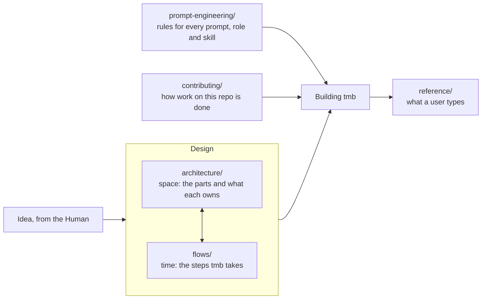
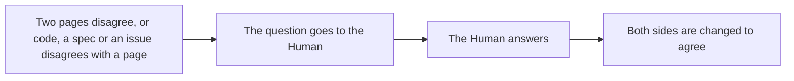

# tmb docs

These pages are tmb's design and the ground truth it is built from. They hold the latest design only: when a decision changes, the page is rewritten in place.

| Folder | Holds | Read it to |
|---|---|---|
| [architecture/](architecture/README.md) | The design in space: the parts, what each owns and how they connect | Learn what tmb is and why |
| [flows/](flows/README.md) | The design in time: every flow, step by step | Learn what happens when the Human asks for something |
| [prompt-engineering/](prompt-engineering/README.md) | The rules every prompt, role and skill follows | Write or change a prompt |
| [contributing/](contributing/README.md) | How work on this repo is done: labels, enums, releases | Contribute to tmb |
| [reference/](reference/README.md) | Install, setup, every command | Use tmb |

## Who reads these docs

| Reader | Reads | Why |
|---|---|---|
| People and agents developing tmb, in this repo | Every folder | To build tmb to its design |
| A user of tmb | [reference/](reference/README.md) only | To install and use tmb |
| A tmb agent at work in a user's project | Nothing here | These pages are not its guide and not its prompt |

- **The docs never ship.** No role prompt, skill, tool or message that tmb puts in a user's project reads, embeds or cites a page here. A rule an agent must follow is written into its prompt directly. Planned: a check that fails the build when a shipped prompt names these docs (trustmybot/tmb#307).
- **In this repo the docs are read as any project's design docs are.** An agent developing tmb reads them because tmb is the project it works on, not because tmb's prompts point to them.

## Where to start

1. [architecture/README.md](architecture/README.md), then [PHILOSOPHY.md](architecture/PHILOSOPHY.md): what tmb is.
2. [flows/FLOWS.md](flows/FLOWS.md): one chart per flow.
3. [RESPONSIBILITIES.md](architecture/RESPONSIBILITIES.md): who does what.

These four are the high-level pages the Human reviews. Every other page is the detail under them.

## When two things disagree

These docs are the ground truth: code, specs and issues follow them.

- **No side wins by rank.** A high-level page does not overrule a detail page, and code does not overrule a page. A disagreement means one of them is wrong, and the Human says which.
- **Nothing is fixed silently.** Whoever finds the disagreement raises it before changing either side.
- **It ends aligned.** After the answer, every page, spec and piece of code that carried the old version is changed.
