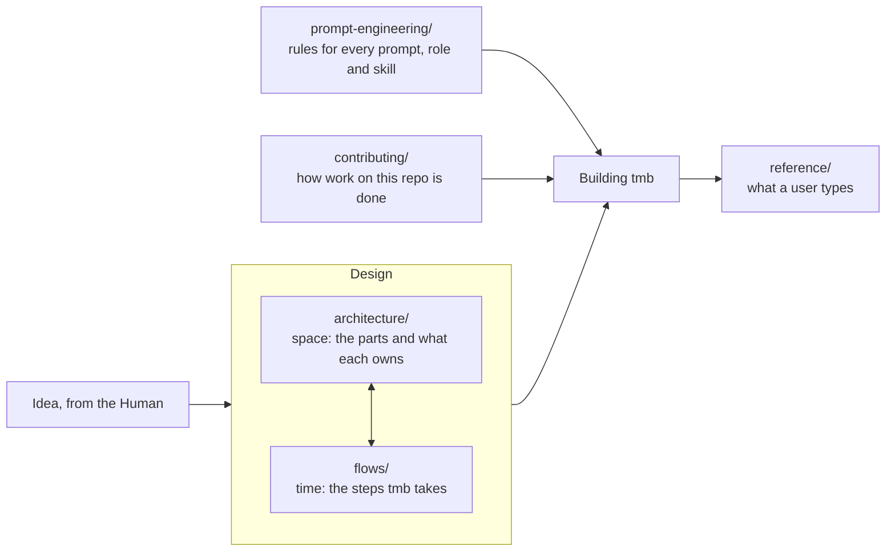

# tmb docs

These pages are tmb's design and the ground truth it is built from. They hold the latest design only: when a decision changes, the page is rewritten in place.

| Folder | Holds | Read it to |
|---|---|---|
| [architecture/](architecture/README.md) | The design in space: the parts, what each owns and how they connect | Learn what tmb is and why |
| [flows/](flows/README.md) | The design in time: every flow, step by step | Learn what happens when the Human asks for something |
| [prompt-engineering/](prompt-engineering/README.md) | The rules every prompt, role and skill follows | Write or change a prompt |
| [contributing/](contributing/README.md) | How work on this repo is done: labels, enums, releases | Contribute to tmb |
| [reference/](reference/README.md) | Install, setup, every command | Use tmb |

## Where to start

1. [architecture/README.md](architecture/README.md), then [PHILOSOPHY.md](architecture/PHILOSOPHY.md): what tmb is.
2. [flows/FLOWS.md](flows/FLOWS.md): one chart per flow.
3. [RESPONSIBILITIES.md](architecture/RESPONSIBILITIES.md): who does what.

These four are the high-level pages the Human reviews. Every other page is the detail under them.
