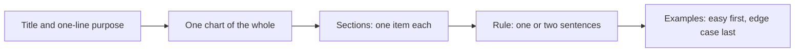

# Doc template

What every page in these docs looks like. A good page lets the Human understand a design in minutes: it goes from high to low, states each rule in one or two plain sentences, and shows it with examples.

The model page is [PHILOSOPHY.md](architecture/PHILOSOPHY.md). When in doubt, copy its shape.



## The skeleton

````markdown
# Page title

One or two sentences: what this page covers and who needs it.

(One chart of the whole page, when the page has a flow or a shape.)

## 1. Item name, as a short rule

The rule in one or two sentences.

- **Example 1.** The easy, common case.
- **Example 2.** A less obvious case.
- **Edge case.** What happens at the boundary.

## 2. Next item

...
````

## The rules

| Rule | Good | Bad |
|---|---|---|
| **High to low.** Start with the whole, then the parts, then the edge cases. | Purpose, chart, items, edge cases | Opening with a corner case or the history |
| **One item, one rule.** Each section states one rule in one or two sentences. | "What code can check, code checks." | A paragraph that holds four rules |
| **Show it.** Every rule has at least one concrete example. | "Human: 'Make it faster.' Planner: 'Which page, and how fast is fast enough?'" | "The planner clarifies ambiguous requests." |
| **Easy first.** Order examples from the common case to the edge case. Two to four are enough; do not cover every edge case. | Example 1, Example 2, Edge case | Ten edge cases, or the edge case first |
| **Plain English.** Short sentences, common words, active voice. | "The worker stops and reports." | "Escalation is initiated by the worker." |
| **Precise.** One meaning per sentence. Name who does what. | "The close refuses the commit." | "It may be handled appropriately." |
| **One word per thing.** Use the glossary's word every time. | "the record" everywhere | "the record", "the DB", "the store" for one thing |
| **Latest design only.** Rewrite in place. No history, versions or schedule. | "The default is Auto." | "The default was Dark until we changed it." |
| **Mark what is unbuilt or unsettled.** | "Planned (trustmybot/tmb#305)", "Open, for the Human" | Unbuilt design written as if it exists |
| **One fact, one place.** State a fact once and link to it. | "Details are in MEMORY.md." | The same rule copied into three pages |

## Which block to use

| The content | Use | Example |
|---|---|---|
| Steps in time, or parts and how they connect | A chart | The checkpoints: close, review, push |
| The same questions asked of several things | A table | Each role: what it owns, with an example |
| One rule and how it plays out | A sentence and examples | "Gates fail closed." plus an edge case |
| Every member of a fixed list | A reference table, with no examples | Schema columns, settings keys, enum values |

- **Example 1.** A flow with a branch is a chart, not a paragraph of "if … then … otherwise".
- **Example 2.** Four roles compared on the same three points are a table, not four paragraphs.
- **Edge case.** A chart with more than about ten boxes is two charts, or a chart and a table.

## Length

A page is as short as its design allows. Cut words before cutting rules.

- **Example 1.** "In order to make sure that" becomes "so".
- **Example 2.** A sentence that only introduces the next sentence is deleted.
- **Edge case.** A page still too long after cutting is two pages: the high-level one keeps the rules and one example each, and a low-level page takes the remaining cases.

## Exceptions

| Page | What differs |
|---|---|
| Reference tables: schema, settings keys, enums | Complete lists. A short rule on top, then the table; no examples per row |
| [prompt-engineering/](prompt-engineering/README.md) | Kept whole. These pages are the rules for prompts and are not thinned |
| [reference/](reference/README.md) | Written for a user: what to type and what comes back |

## Before opening a pull request

| Check | Pass when |
|---|---|
| First screen | The purpose and the chart fit without scrolling |
| Each section | It has one rule of one or two sentences and at least one example |
| Wording | No sentence needs a second reading |
| Terms | Each one matches the glossary |
| State | Unbuilt design is marked Planned with its issue |
| Links | The link check passes |
