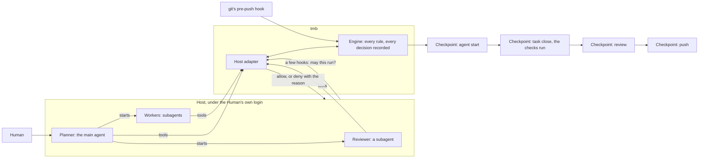
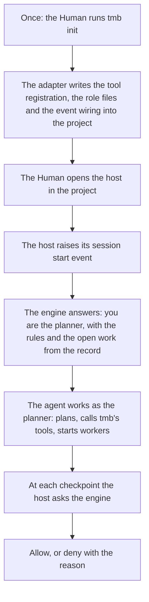

# Hosts and adapters

How tmb works with an agent program without being built for one, and how it holds its rules there. Serving any host is the reason tmb exists: it is a program of its own that a host is wired to. The engine itself, with its checkpoints and what it writes, is in [ENGINE.md](ENGINE.md).

## Terms

- **Host.** The agent program the Human talks to, such as Claude Code. The host's main agent is the planner.
- **Engine.** tmb itself: the record, the code graph, the workflow and the gate.
- **Host adapter.** The one part of tmb that knows a host: its file formats, its events and its limits.
- **Checkpoint.** A point where the engine judges an outcome: an agent's start, a task's close, the review, a push.

## The engine never names a host

The top-level rule of the design: the engine knows nothing about any host, and everything a host needs is in its adapter.

Three rules follow from it:

| Rule | What it means |
|---|---|
| **Every rule is in the engine** | Each rule is written once, against tmb's own events. A host hook and git's hook only raise an event. An adapter that grows a rule is a defect. |
| **Hooks are for checkpoints** | tmb gates the outcome and does not watch each step an agent takes. A host hook is wired only where a checkpoint needs one, and git's own hook is used wherever git has one. |
| **tmb leaves the rest to the host** | tmb starts no agent, runs no model and manages no parallel sessions. Hosts do that better. tmb ships what they lack: one record, one code graph, and one workflow with the gate that enforces it. |

## What an adapter provides

| Part | What it does |
|---|---|
| Detect | Finds the host's program on the machine. |
| Set up | Registers tmb's tool server with the host, writes the role definitions in the host's format, and wires the host's events to the engine. Per project, when the Human runs init. |
| Name what is left | Lists the steps only the Human can take, such as trusting the project, and any wiring that is missing. |
| Translate events | Turns a host event into the engine's neutral question, and the engine's allow or deny into the host's answer. |
| Report limits | Says what the host cannot do, such as deny a tool call or set a model per role. Each adapter states its limits; the engine does not read them. |
| Reconnect | Says how a session picks up tmb's tools again after the tool server moved to a new build. |
| Remove | Undoes exactly what setup added. |

| Host | Support | Tools | Roles |
|---|---|---|---|
| Claude Code, command line and desktop app | Supported | Tool server from the project's settings | Agent files in the project |
| Others | Planned | | |

One adapter shape is enough because every host has the same three building blocks: a tool server, role files and events.

## The planner starts every subagent

The planner (the host's main agent) starts and manages every subagent: tmb's worker and reviewer, and any agent the project adds. tmb does not start the host's models and never reads, stores or passes on a login.

| Step | Who |
|---|---|
| Decide that a task needs a worker | Planner |
| Prepare the task's branch, a worktree and the brief | Engine |
| Start the worker as a subagent, in a folder of its own | Planner (the host) |
| Check that the start is allowed: the task is open, its worktree is ready | Engine, asked by the adapter |
| Make the worker's folder the task's worktree, when the worker first reads its brief. Claude Code only. | Engine |
| Do the work, reading the brief and the code graph through tmb's tools | Worker |
| Run the checks, record the result, close or refuse, and report what changed outside the task | Engine |

Why this way:

- **It runs on the Human's subscription.** The work is ordinary use of the host by its own user. Anthropic's terms do not allow a third-party program to route requests through a user's subscription login, so a design where tmb starts Claude itself would need an API key.
- **It uses what the host already does well:** parallel subagents, a model and effort per role, isolation, and permission prompts shown to the Human.
- **It works wherever the host runs.** Claude Code fires the same events in its command line and in its desktop app. Planned: tmb's own desktop program (trustmybot/tmb#79).

**Several workers at once** is the host's parallel subagents plus git. Each worker has its own task, branch and worktree.

- **Example.** Two open tasks change the same file. Both may. The engine tells the planner which open tasks share a file, as information.
- **Edge case.** Their changes clash when the work is merged. git settles it: the clash refuses the later task's close until it is resolved.

## Cold start

A plain host agent does not work out that it is the planner. tmb tells it at the start of every session, through what `tmb init` wired once.

| Part | What it does | Can an agent skip it? |
|---|---|---|
| The role prompts guide | They tell the planner to plan, write a spec and ask the engine to start a task. | Yes. An agent can ignore a prompt. |
| The gate holds | The host itself asks the engine at a checkpoint, and the engine answers from the record. | No. |

- **The answer carries more than the role:** the open work, what onboarding left empty ([2_ONBOARD.md](../flows/2_ONBOARD.md)), and a map of the project from the code graph.
- **A session resumes from the record.** A new session needs nothing from the conversation before it.

## Different models on one task

| Case | How |
|---|---|
| **One vendor, several models** | The host already runs a different model per subagent. The adapter writes a role's model into the host's role definitions when the role names one. No role tmb ships names a model, so each runs on the host's default. |
| **Several vendors** | Each host connects to the same record in the same project and takes a role: one host plans and writes, and another, opened in the same project, reviews. Both read the same brief and pass the same checks and gate. |
| **Local models** | They arrive through a host that supports them. The adapter writes a role's model as given, and the model's provider is the host's own setup. |

With several vendors:

- **Agents of different vendors talk through the record.** They never message each other. Each writes its work to the trajectory database and reads what the others wrote there ([TRAJECTORY.md](TRAJECTORY.md)), so a mixed team needs no channel of its own. Who starts the second host is the Human's or the first host's business, not tmb's.
- **A role per host.** Setup records the role each host takes in the project, the planner by default. Session start briefs a host in its role.
  - **Example.** A host set up as the reviewer is told which feature branches wait for a review. That includes a branch whose pull request is open and whose new tip is not reviewed.
  - **Edge case.** Two hosts may both be planners, as two sessions of one host may. Open, for the Human: whether two planner hosts stay allowed.
- **A reviewer that is a host's main agent.** Its run opens at that host's session start and ends with the verdict it records.

**Every record names the role and the host that made it.** The role is the one the caller gives, checked against an open run of that role on that host: tmb cannot prove which agent called. With two hosts, the host's name shows that the review came from another vendor's agent.

## What each host can deny

|  | Claude Code |
|---|---|
| Can deny | Yes, from the project's settings, inside subagents too |
| Asks tmb | Only for the tools named in [tmb's own events](ENGINE.md#tmbs-own-events) |
| Names the agent that makes a call | Yes |

**What a host cannot raise or deny, a later checkpoint catches.** The adapter reports the limit and nothing switches over: the close and the push check every change whatever the host raised.
