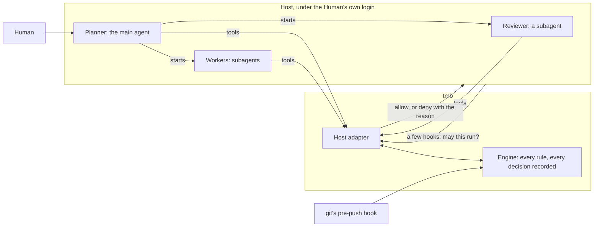

# The host adapter

How tmb fits Claude Code: what the adapter does, how subagents start, how a session learns its role, and what the host can deny. tmb is a program of its own, and the host is wired to it. The engine, with its checkpoints and what it writes, is in [ENGINE.md](ENGINE.md).

The words host, engine, host adapter and checkpoint are in [the glossary](README.md#glossary).

## The engine never names a host

**The engine knows nothing about the host. Everything the host needs is in its adapter.**

- **Example 1: every rule is in the engine.** Each rule is written once, against tmb's own events. A host hook and git's hook only raise an event.
- **Example 2: hooks are for checkpoints.** tmb gates the outcome and does not watch each step an agent takes. A host hook is wired only where a checkpoint needs one, and git's own hook is used wherever git has one.
- **Example 3: tmb leaves the rest to the host.** tmb starts no agent, runs no model and manages no parallel sessions. The host does that better. tmb ships what the host lacks: one record, one code graph, and one workflow with the gate that enforces it.
- **Edge case.** An adapter grows a rule of its own. That is a defect.

## What an adapter provides

**The adapter works with the host's three building blocks: a tool server, role files and events.** Its parts, in full:

| Part | What it does |
|---|---|
| Detect | Finds the host's program on the machine. |
| Set up | Registers tmb's tool server with the host, writes the role definitions in the host's format, and wires the host's events to the engine. Per project, when the Human runs init. |
| Share folders | Hands the host the project's shared folders, so every worktree the host makes links them from the main folder ([CONFIG.md](CONFIG.md#shared-folders-are-linked-not-installed)). Claude Code takes them as its own worktree-link setting, beside the Human's own entries. The engine gives only the list and names no host key. |
| Name what is left | Lists the steps only the Human can take, such as trusting the project, and any wiring that is missing. |
| Translate events | Turns a host event into the engine's neutral question, and the engine's allow or deny into the host's answer. |
| Report limits | Says what the host cannot do, such as deny a tool call or set a model per role. The adapter states its limits. The engine reads one: how much text a session start may carry, and it cuts the project's state to fit. |
| Reconnect | Says how a session picks up tmb's tools again after the tool server moved to a new build. |
| Remove | Undoes exactly what setup added. |

| Host | Support | Tools | Roles |
|---|---|---|---|
| Claude Code, command line and desktop app | Supported | Tool server from the project's settings | Agent files in the project |

## The planner starts every subagent

**The planner, the host's main agent, starts and manages every subagent: tmb's worker and reviewer, and any agent the project adds.** tmb does not start the host's models and never reads, stores or passes on a login.

| Step | Who |
|---|---|
| Decide that a task needs a worker | Planner |
| Prepare the task's branch, a worktree and the brief | Engine |
| Start the worker as a subagent, in a folder of its own | Planner (the host) |
| Check that the start is allowed: the task is open, its worktree is ready | Engine, asked by the adapter |
| Make the worker's folder the task's worktree, when the worker first reads its brief | Engine |
| Do the work, reading the brief and the code graph through tmb's tools | Worker |
| Run the checks, record the result, close or refuse, and report what changed outside the task | Engine |

- **Example 1.** One task needs a worker. The planner asks the engine to start the task, then starts the worker as a subagent. The worker reads its brief through tmb's tools.
- **Example 2.** Several workers at once. That is the host's parallel subagents plus git: each worker has its own task, branch and worktree ([ROLES.md](ROLES.md#parallel-lanes)).
- **Edge case.** The planner starts a worker whose task is not open or whose worktree is not ready. The engine denies the start.

Why this way:

- **It runs on the Human's subscription.** The work is ordinary use of the host by its own user. Anthropic's terms do not allow a third-party program to route requests through a user's subscription login, so a design where tmb starts Claude itself would need an API key.
- **It uses what the host already does well:** parallel subagents, a model and effort per role, isolation in worktrees that link the project's shared folders, and permission prompts shown to the Human.
- **It works wherever the host runs.** Claude Code fires the same events in its command line and in its desktop app. Planned: tmb's own desktop program (trustmybot/tmb#79).

## Cold start

**A plain host agent does not work out that it is the planner, so tmb tells it at the start of every session.** `tmb init` wires this once ([1_INSTALL.md](../flows/1_INSTALL.md#session-start)).

- **Example 1.** A session opens. The host raises its session start event, and the engine answers with the role, the rules and the open work.
- **Example 2.** The role prompts tell the planner to plan, write a spec and ask the engine to start a task.
- **Edge case.** The agent ignores a prompt. The gate still holds: the host itself asks the engine at a checkpoint, and the engine answers from the record.

| Part | What it does | Can an agent skip it? |
|---|---|---|
| The role prompts guide | They tell the planner what to do. | Yes. An agent can ignore a prompt. |
| The gate holds | The host asks the engine at a checkpoint. | No. |

## Different models on one task

**The host runs the models. The adapter writes a role's model and effort into the host's role definitions when the role names one.**

- **Example 1.** No role tmb ships names a model, so each runs on the host's default.
- **Example 2.** A role names a model and an effort. The adapter writes both into that role's definition, and the host, which already runs a different model per subagent, runs that subagent on them.
- **Edge case.** A local model. The adapter writes the role's model as given, and the model's provider is the host's own setup.

Every record names the role that made it. How the role is checked is in [ROLES.md](ROLES.md#how-roles-are-enforced).

## What the host can deny

**What the host cannot raise or deny, a later checkpoint catches.** The adapter reports the limit and nothing switches over.

| Question | Claude Code |
|---|---|
| Can it deny an action? | Yes, from the project's settings, inside subagents too |
| When does it ask tmb? | Only for the tools named in [tmb's own events](ENGINE.md#tmbs-own-events) |
| Does it name the agent that makes a call? | Yes |

- **Example.** The engine refuses a worker's start. The adapter turns the refusal into the host's own deny, with the reason.
- **Edge case.** The host raises no event for an action. The close and the push check every change, whatever the host raised.
