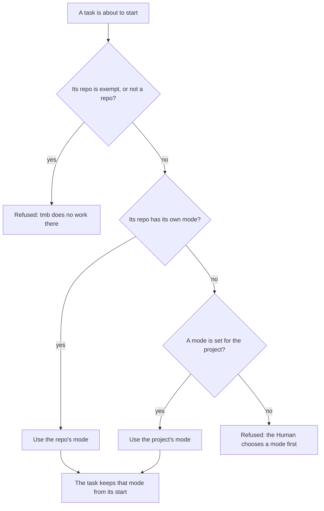
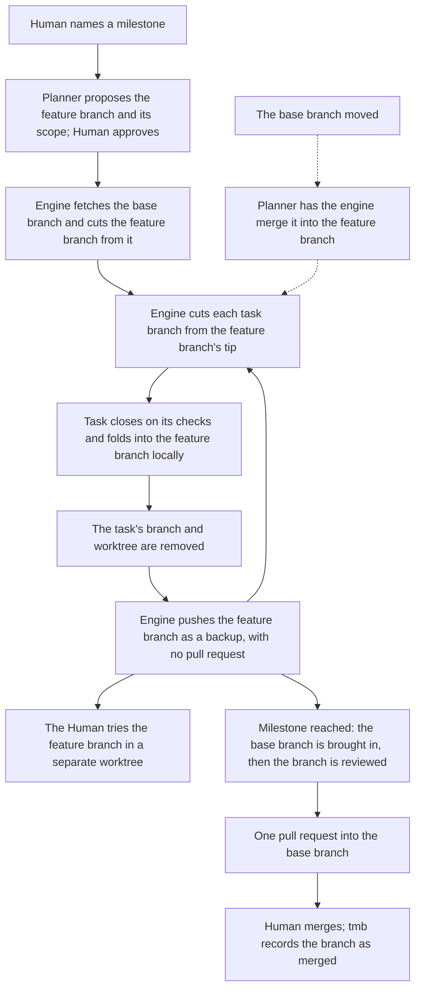
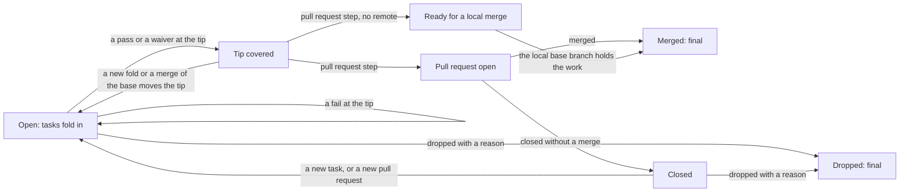
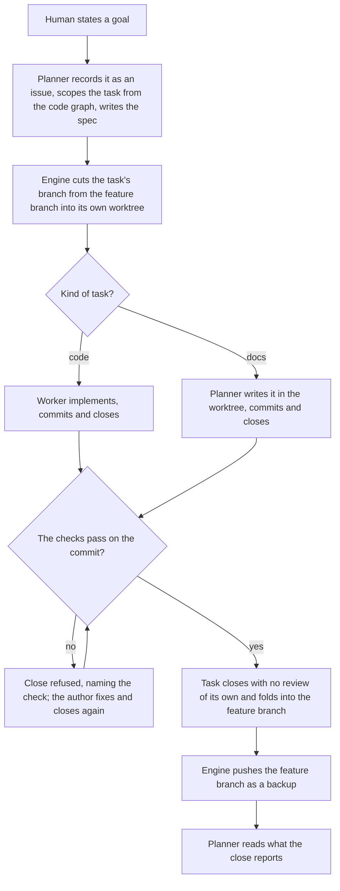
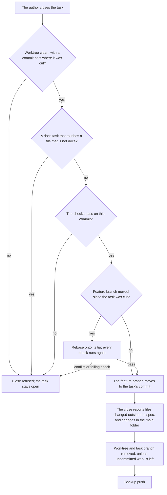
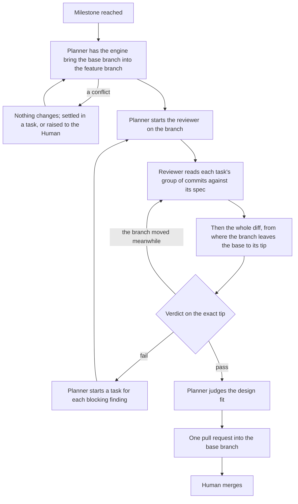
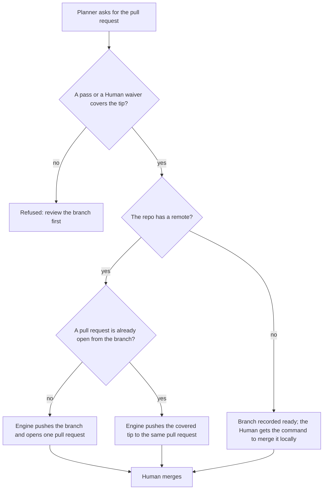
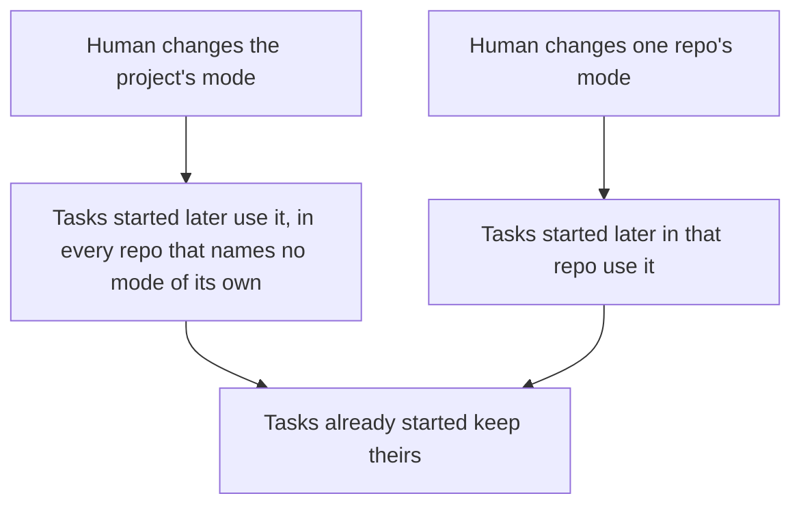

# Agile review mode

Every case of flow 3.9 in [FLOWS.md](FLOWS.md): how agile work builds up on a long-lived feature branch, how its tasks close without a review of their own, how the branch is reviewed once before its pull request opens, and how the review mode is set and changed.

The review mode decides who reviews a change and when. Who merges is a separate question: the Human does.

## Why a feature branch

Agility is agile mode's one goal: the feature reaches a state the Human can try, change or drop sooner, with fewer reviews and CI runs on the way.

| Mode | Review | Reaches the base branch as | For |
|---|---|---|---|
| **Agile** (recommended; the Human chooses) | Once, on the whole feature branch | One pull request per milestone | A feature built in many small tasks and judged as a whole |
| **Truest** | On every task, before its push | One pull request per task | A repo where nothing may reach the base branch unreviewed |

- **One feature branch per milestone.** Each task closes on its checks alone and folds into the branch locally, with no pull request and no CI run of its own. The Human can try the branch at any time.
- **Only the Human chooses the mode,** because it decides how many tokens the project uses. tmb marks agile as recommended and shows what each mode costs. It never picks: until a mode is chosen, no task starts.
- **Truest has no feature branch.** Each task is cut from the base branch and gets its own review and pull request ([GIT.md](GIT.md#rebasing-a-reviewed-task)).

## Where the review mode is set

- **Project.** The planner asks the Human for the mode among its onboarding questions at the first session, and stores the answer. The Human can also set it with `tmb onboard`. Setup itself asks nothing.
- **Repo.** In a workspace of several repos, a repo can name its own mode. One that names none follows the workspace's, and follows it when it changes. Onboarding asks for the workspace's mode once, then asks once whether any repo takes its own ([GIT.md](GIT.md#multi-repo-workspaces)).
- **The task keeps it.** A task records the mode it was started in. A later change of mode applies to tasks started after it.
- **Two fences keep the choice the Human's.** On the command line the mode is set only on a terminal, after a typed yes. The host's guard also denies an agent's shell command that sets it. One exception: a run with no one to ask, such as CI, may set a mode where none is set, and never changes one.
- **tmb keeps it.** The mode lives in tmb's record, and every change is in the audit trail.

## The feature branch

- **One feature branch per milestone.** It collects every task of the milestone. A request that adds to the work of an open branch is its next task there; a new branch is only for separate work. In a workspace, a feature branch belongs to one repo, and its tasks work in that repo. Feature names are unique in the record.
- **It starts from the remote's base branch,** fetched first. The engine uses the local base branch instead when that holds a commit the remote lacks, when there is no remote, or when the remote is out of reach.
- **Tasks fold into it.** Each task branch is cut from the feature branch's tip and folds back into it once the task closes, so the next task builds on the last.
- **Pushed only as a backup.** No pull request opens before the review, so no CI runs on the branch.
- **Tried in its own worktree.** The engine cuts and moves the branch without checking it out, so the main folder never switches under a session.
- **The base branch is brought in before the review.** On the planner's request the engine merges the base branch in, with a merge commit and never a rebase, since the branch is already pushed. The planner asks at the milestone, and earlier whenever the base moved. A conflict changes nothing and names the files: the planner settles it in a task on the branch, or raises it to the Human.
- **How it ends.** Merged, closed or dropped; see [Merge gate](#merge-gate). tmb never deletes the branch.

## Review state

tmb keeps no review state per task. An agile task is open, closed or dropped, and review is a fact about one commit: the feature branch's tip.

- **Covered** means the newest verdict on that exact commit is a pass, or the Human waived the review on it. A waiver is the Human's call, so a later fail does not undo it.
- **A moved tip is uncovered.** Any new commit on the branch needs a new pass or waiver before it reaches the pull request.
- **A fail sends the work back.** The planner starts a task for each blocking finding, and the new tip is reviewed again.

## Task flow

- **The checks replace the per-task review and CI run.** The engine runs the project's checks and the task's own on the committed work. A task with no checks never closes.
- **The planner judges the kind.** A code task goes to a worker. A docs task changes only docs or prompts and no behaviour, and the planner writes it. The engine refuses the close of a docs task whose commit touches a file type that is not prose, data or an image.
- **The planner judges the design fit once,** on the whole branch after the reviewer, not at each close.
- **A task that will not close is dropped,** with a reason, by the planner or the Human. Nothing of it reaches the feature branch, and a new task can name the one it replaces.

## Safe close

Dropping the per-task review removes one gate and nothing else.

- **A close refuses only on its checks, its commit and a clash.** A refused close leaves the task open, the feature branch where it was and the worktree as it was.
- **Files outside the spec are reported, not refused.** The spec stays as written. The planner or the reviewer checks those names with git.
- **Changes in the main folder are reported too,** each with the command that puts it back. The planner raises the list to the Human. tmb puts nothing back by itself, because the change may be the Human's own.
- **Two tasks may change the same file.** There is no lock. A concurrent fold is never lost: the later task is rebased, and a clash holds back its close until it is settled.
- **The backup push is never forced,** and a failed push does not reopen the task. It is skipped when there is no remote, and while the branch's pull request is open.

## Feature branch review

- **One review of the whole branch.** The reviewer did not write the change and has no tool that edits a file. It judges whether the diff breaks behaviour beyond what it meant to change.
- **A group per task.** The branch's brief lists each closed task's commits in the order they landed, so the reviewer reads each against its spec before it reads what the tasks break together.
- **Whole diff.** The review reads what the feature branch adds to the base branch. A change a later task undid is never reviewed, and a conflict settled on the branch is reviewed in its settled form.
- **Docs tasks are in the same review.** A docs task that changed behaviour is a blocking finding, and that part is redone as a code task.
- **The brief says whether the branch holds the base.** Nothing refuses a review of a branch that does not; the brief is how the planner and the reviewer know.
- **The verdict is on one commit.** tmb takes it only on the branch's current tip.
- **A second host can be the reviewer.** A host set up as the project's reviewer is told at session start which branches wait for a review ([HOSTS.md](HOSTS.md)).

## Merge gate

The feature branch reaches the base branch only through one gated pull request.

- **The push gate backs it.** A push that brings onto the base branch a commit no covered tip holds is refused, whoever typed it ([GIT.md](GIT.md#the-push-gate-at-gits-own-hook)).
- **Waivers.** Only the Human waives a review: on a terminal, after a typed yes, with a reason. The waiver names one feature branch at its tip, so it covers one repo and nothing folded in later. The audit trail keeps it, and the commit's mark on GitHub says the review was waived.
- **Merged is final.** tmb reads the pull request's state through the Human's own GitHub command line: at the planner's session start, when the branches are listed, and for the dashboard. A read that fails changes nothing. The session start names each pull request that ended since the last session.
- **Dropped work.** The planner or the Human drops a branch nobody will merge, with a reason. Dropped is final, and the branch is kept in git. A drop is refused while a task on the branch is open or in review, and while its pull request is open: the Human closes the pull request first.

### New work on a branch whose pull request is open

- **The branch takes more tasks:** fixes for a failing check or a review comment, and new work that builds on what the branch holds. The base branch does not hold that work yet, so a new branch could not build on it. The planner says in its reply that the pull request grows, and does not stop to ask.
- **No unreviewed commit reaches an open pull request.** While it is open, a fold or a merge of the base is not pushed, and the answer says so. The new commits stay in the local branch until the new tip is passed or waived. The pull request step then pushes the tip to the same pull request and opens no second one.

### A project with no remote

Nothing is pushed and no pull request opens. A close skips the backup push and says so. Once the tip is covered, the pull request step records the branch ready and gives the Human the command to merge it locally.

- **tmb sees the local merge.** Once the local base branch holds the tip, the branch is merged. A squash or a rebase by hand also counts, when merging the branch into the base would change nothing. A branch with no commit of its own never counts.
- **One limit.** When the base changed the same lines again after the merge, tmb cannot tell. The branch stays ready until it is dropped with a reason that says where the work went.
- **A ready branch takes fix tasks.** The first one opens it again, and its new tip needs a new pass or waiver.

### A closed feature branch taken up again

A branch whose pull request closed without a merge is recorded as closed, and the planner's session start says so.

- **A new pull request** opens from it under the same rule: a pass or a waiver at its tip. A tip the earlier review covers needs no new review.
- **A task that names the branch** opens it again for rework.
- **A pull request the Human reopened on GitHub** is recorded, and tmb opens none. The record keeps the earlier pull request's link.

## Switching review modes

- **Only the Human switches,** by the same fences as the first choice. The planner stores the Human's answer and never picks one.
- **The start decides.** A task opened under one mode finishes under it.
- **A truest repo starts no feature branch.** A task there is cut from the base branch and goes into review at its close.

## Planned

- **The review queue.** The tasks waiting for review, proposed in groups by the files they changed, one reviewer per group in parallel.
- **Comments on an open pull request** brought into the record and sorted into tasks (trustmybot/tmb#70).
