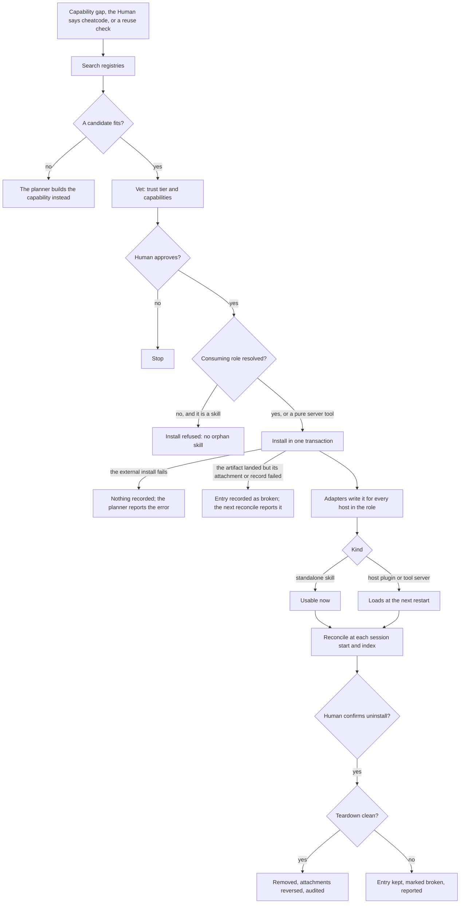
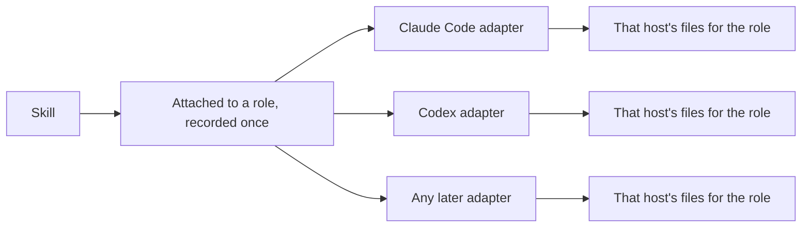

# Cheatcode integration

How the planner acquires cheatcodes (published skills, tool servers and host plugins) on demand, and the trust and approval gates on the way. [FLOWS.md](./FLOWS.md) shows where acquiring a capability fits among tmb's other workflows; this page holds the design decisions behind it.

**Planned (trustmybot/tmb#112): nothing on this page is built.** The design is the plugin's, with one change: in tmb a skill is attached to a role, and the adapters write it for every host in that role ([Attachment](#attachment)).

## Principle

The mechanical pipeline (search, record, vet, install, activate) is deterministic: tools and checkpoints, not a checklist in a prompt. Only three decisions stay with the planner's judgment:

- **Do I lack a capability this task needs?** A classification.
- **Is this candidate trustworthy enough to install?** Weigh the signals and ask the Human.
- **Which role consumes it?** The one the Human named, or one inferred from the domain.

Everything else is deterministic code; [DETERMINISTIC_LAYER.md](../prompt-engineering/DETERMINISTIC_LAYER.md) explains how tmb decides what a prompt judges and what code enforces.

## Lifecycle

Every case of flow 4.1 in [FLOWS.md](FLOWS.md).

| Stage | What it guarantees |
|---|---|
| Search | ranked candidates; when none fits, the planner builds the capability instead |
| Vet | a trust tier and the candidate's capabilities; vetting never decides |
| Approve | the Human approves before anything installs |
| Target | the consuming role: the one the Human named, one inferred from the domain, or the Human's answer when it is ambiguous; a pure server tool needs none |
| Install | the external install runs first, and its failure records nothing; then one transaction holds the registry entry, its attachments to the consuming role, and the audit; idempotent on name and source |
| Activate | when the cheatcode becomes usable ([Hot-load](#hot-load)) |
| Reconcile | each session start and index checks the registry against what is on disk and audits drift |
| Uninstall | Human-confirmed; reverses the install and its attachments ([Teardown](#teardown)) |

## Registries

Discovery queries real, reputable registries, never a self-built index. Each source has a tier, which also shows how far to trust it, and official sources always rank above curated ones:

- **Tier 1, official:** the MCP registry and a host's own plugin marketplace.
- **Tier 2, curated:** PulseMCP.

A registry that fails does not stop the search: it adds no candidates and the search goes on. So an environment without web access gets an empty result, never a crash; the engine works with no internet access.

A passive path keeps the registry honest too: each index records capabilities already present in the project (local skills, enabled host plugins, configured tool servers) that tmb does not track yet.

## Safety invariants

- **Human-approved, never silent.** Approval is per candidate, and the install fails closed without it. An approval is for one source at one version and is used up by one install, so a reinstall or a new version asks again, and a decline is audited with the candidate.
- **The host's own install path only.** A host plugin installs through that host's marketplace, never by copying files or loading a plugin directory.
- **Web posture respected.** Discovery obeys any rule that denies web access, and the Human sees the sources before install.
- **The user project only.** Materialization writes the project's host files, through the adapters. It never changes tmb's shipped roles.

## Attachment

Installing loads a cheatcode; attachment decides which role can use it. A skill is attached to a role once, and each adapter writes it in its host's format for every host in that role.

| Kind | Attachment |
|---|---|
| Standalone skill | Attached to the consuming role. The skill's file is fetched from its source as part of the install, and an install that cannot fetch it is refused. |
| Host plugin contributing skills | The install loads its skills in that host; a role with a restricted skill list gets the name added. |
| Host plugin contributing a tool | The tool is added to what the consuming role may use in that host. |
| Tool server | Registering the server is the attachment: any role can call it. |

Every attachment is recorded so an uninstall reverses exactly what was wired, and a skill with no consuming role is refused. A host plugin reaches one host only; a skill or a tool server reaches every host.

## Hot-load

A cheatcode's kind decides whether it works in the current session; nothing is guessed. A standalone skill is usable at once. Host plugins and tool servers load at the next restart, so their install reports that a restart is needed.

## Teardown

Acquisition must be reversible. An uninstall reverses each recorded attachment, removes the artifact through the host's own uninstall path, and audits the removal, in one transaction. It is idempotent, and honest: when teardown fails, the entry stays, marked broken, and the result says so instead of claiming a clean removal.

Removing is safer than adding, so the planner proposes an uninstall and the Human confirms it; no gate holds it. When an open task depends on the cheatcode, the planner says so before removing it. Uninstalling a standalone skill removes its file and its name from every role it was attached to, on every host.
