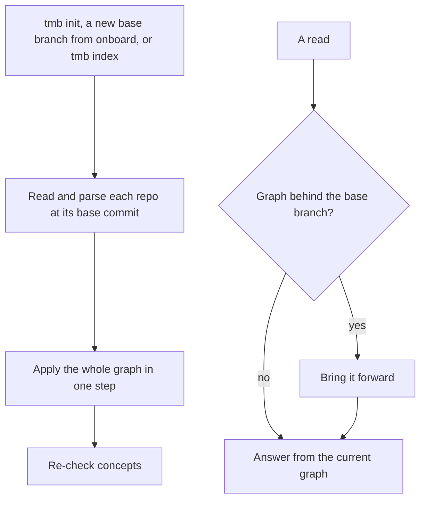

# Code graph

A graph of the project's code: its directories, files and symbols, and the links between them. Agents ask it where something lives and what depends on it, instead of reading whole files.

The plugin called this the world model.

## What it holds

- **Directories and files.** Each with a short summary taken from its README or its header.
- **Symbols.** Each file's definitions and the links between them: calls, imports, database reads and writes, and which tests cover what.
- **Concepts.** Flows and rules written by agents, each anchored to the symbols that carry it out. They link a design page to its code.
- **Areas.** The project's logical parts, such as login or billing, each a named group of files. See [Areas](#areas).

## What it answers

| Question | Asked by |
|---|---|
| What does this project look like? | The planner at the start of a session |
| Where does X live? | Every role |
| What calls or imports X, and which tests cover it? | The planner when it scopes a task; the worker before it changes X; the reviewer when it judges what a change may break |

## Rules

- **Built from git, never from the working folder.** Each repo is indexed at the commit of its base branch, so every session and worktree reads the same graph. A task's own commit is laid on top, so a worker sees its change and its base together.
- **An open feature branch is read too** (trustmybot/tmb#182). While a feature branch is open, the graph keeps a layer built from its tip, brought forward when the tip moves and dropped once the branch is merged or closed. A lookup can name the feature branch. A closed task's lookup reads its feature branch, which now holds the task. A scope reads the repo's only open feature branch by default, and the base branch when several are open. Every answer names what it read.
- **It never guesses.** A reference is linked to a definition only on proof, such as a resolved import. What could not be resolved is reported as unresolved.
- **It can always be rebuilt.** Everything except concepts is derived from git. A rebuild keeps the concepts and re-checks each against the new graph; one whose code is gone is marked broken, never dropped.
- **It keeps itself fresh.** A read brings a graph that is behind its base branch forward before it answers. `tmb index --rebuild` is the fallback, run by the Human: a read that fails does not rebuild by itself. One limit, found on 2026-11-20: the base branch is the local one, so a merge on GitHub is not seen until it is fetched. A graph that is rebuilt because a newer tmb reads code differently says so in its answer.
- **Summaries are untrusted text.** They come from file contents, so they are shown to agents as data, never as instructions.
- **It works offline.** Indexing needs no network. Search is by name and by the words in a name. Search by meaning is left out for now.

## Indexing

## Every function, and a page to see it

Decided by the Human on 2026-11-20: the code graph shows code as a graph, at function level, and no function is left out.

Built:

- **Every function is a node, unnamed ones included** (trustmybot/tmb#140). TypeScript and JavaScript so far. Each symbol links to what contains it: a function, a class or the file. An unnamed function is named by where it is used, such as the callback of the call it is passed to, or else by its line.
- **A coverage test holds it at 100%.** A second, independent parser, the TypeScript compiler, lists every function, and the graph must match it one to one. On tmb's own repo on 2026-11-20: 3,340 of 3,340. Before, it was 1,250 of 3,256.
- **Nothing is skipped in silence.** A file that could not be parsed is in the graph as a file marked so, and indexing prints how many there are.
- **What the graph does not read is named and counted** (trustmybot/tmb#234). Indexing counts the files in programming languages tmb has no module for, by language, and the files it leaves out by rule, by rule. A lookup that finds nothing names the unread languages, so "not there" is never mistaken for "not read". A lookup of a file in an unread language says the file is there and its language is not read.
  - Left out by rule: folders named `dist`, `node_modules` or `vendor`, as on GitHub Linguist's list of vendored paths, and source maps, files named as minified, and lockfiles. A folder named `build` is read: the graph is built from git, so build output that git ignores is never in it.
  - The languages' names and file endings are a copy of Linguist's programming languages, plus Vue and Svelte. Where languages share an ending, Linguist's first one is named.
  - "Not parsed" means only a file in a language tmb reads that failed to parse.
  - Limit: prose, data, settings and images are not counted, and neither is code in a file ending tmb does not know, until trustmybot/tmb#154.
- **A minified file is kept as a file and not parsed** (trustmybot/tmb#232), whatever its name. The test is Linguist's: lines that average more than 110 characters. It holds for TypeScript and JavaScript. Found on a public repo, where one bundle of one line added 2,457 functions and answered a search first.
- **Agents' answers do not change.** A lookup names the nearest named function, and unnamed functions stay out of search.
- **Each caller and each callee is listed once, with its lines** (trustmybot/tmb#235). A test file full of unnamed callbacks is one caller with many lines, not one row per call. A row shows at most 10 lines and counts the rest. The cap of 50 counts distinct rows, and the answer says how many were cut. A call and a construction of the same target are two rows. The same holds in the tools' answers, on the command line and on the dashboard.
- **Each language is a module of its own** (trustmybot/tmb#157). Every module answers the same questions for the engine, and one list names the modules, so adding a language touches nothing else. TypeScript, TSX and JavaScript share one module; bash, Python, SQL and Perl each have their own. A language's parser loads only when a file in that language is read. The plugin's own rules, for its tool registrations and settings reads, are not carried over.
- **Imports through a path alias or a package name resolve to their files** (trustmybot/tmb#147). A TypeScript or JavaScript import that is not a relative path is resolved the way the TypeScript compiler does it: through the nearest project settings file above the importing file, read at the indexed commit. An import of a package that lives in the same repo links to that package's entry file. Two packages of the same name are not linked, because the graph never guesses.
- **A name that reaches a file through a re-export links to where it is declared** (trustmybot/tmb#233). A re-export is proof, so this is inside "never guesses". The import's link to the re-exporting file stays.
  - TypeScript and JavaScript: a re-export by name, with or without a new name; an import followed by an export; a star, which never gives the default export; and a star under a name. A name the file declares or exports by name wins over a star. A name two stars bring from different declarations stays unresolved.
  - Python: a top-level `from .a import f`, with or without a new name, and `from .a import *`, which follows `__all__` when it is a plain list of names and otherwise the public top-level names.
  - A chain is followed step by step. A file seen twice, or a step that cannot be proven, leaves the name unresolved.
  - Not followed: CommonJS, a re-export of a default export, a Python import under `if` or `try`, an `__all__` built by code, and `import pkg` followed by `pkg.f()`, which is not a re-export. On flask, 42 of its 102 `Flask(...)` calls link now; the other 60 are of that last form.
  - Not checked yet: the links against the TypeScript compiler's own answers (trustmybot/tmb#242). A sample was checked by hand.
- **Misses are counted.** Each build counts the imports that name the repo's own code and link to no file, and indexing prints the count. A package installed from outside is not a miss.
- **The dashboard has a Code page** (trustmybot/tmb#142): folders, then files, then functions, one level at a time, and a view of one function with its callers and what it calls. It never draws every function at once. In a workspace of several repos the page opens on the list of repos, and the page's address names the repo, so a link to one repo's graph can be shared.

Planned:

- **Python, bash and the other languages get every function too**, each as its own module with its own coverage test (trustmybot/tmb#141, v1.x). Their rules are written as tree-sitter queries, the form GitHub's code navigation and Neovim use; TypeScript's rules move to that form after. Proposed, for the Human's review.
- **A file's language comes from GitHub Linguist's list** (trustmybot/tmb#154, v1.x). Today each module names its own file extensions, and the unread languages come from a fixed copy of that list.
- **A same-repo package whose entry is build output links to its source** (trustmybot/tmb#236, v1.x), only where the package's TypeScript settings state both the source and the output folder. Proposed, for the Human's review.

Planned, the design for links (trustmybot/tmb#250, agreed by the Human on 2026-11-20). It follows a study of CodeGraph, other code navigation tools and the research on call graphs and coding agents; the issue names what was read and what was not. Built in this order:

- **A link is made only on proof, and that stays the one promise.** There is no second set of less-sure links, marked or not. Studies of agents show wrong links cost more than missing ones, and none shows that marking a link as less sure helps.
- **A name is looked up the way the language looks it up** (trustmybot/tmb#246, v1.0.0): from the call outward through the function's own names and parameters, the functions around it, the file, then what the file imports. The first place that has the name decides. If what is found there is not a function in the repo, there is no link, and the lookup does not go on to another function of the same name. A call on the object itself looks only in its class and the class's parents.
- **The scores are measured before and after each step** against the language's own compiler (trustmybot/tmb#242, trustmybot/tmb#244). Links right has the target, 100%. Links found is tracked and has no target, so that nothing pushes the graph to guess.
- **Every link records the proof it was made on** (trustmybot/tmb#251, v1.x), for a score per proof and for the dashboard. It is not added to an agent's answer.
- **A function says how many of its calls are not linked** (trustmybot/tmb#252, v1.x): linked, to code outside the repo, and not known. An agent that sees calls not known searches by text for the rest.
- **A method call is linked when the object's type is written in the same function or class** (trustmybot/tmb#249, v1.x): the object itself, an object made there by the class's name, a written type, or a module's or class's name. The method must exist on that type or a parent of it, in the repo. Types worked out from callers, return values or chained calls are not used, by decision: where others measured them, they cost much and found little.
- **Answers stay shallow:** search by name first, callers before callees, one step by default.

## Areas

Built (trustmybot/tmb#146). Asked for by the Human on 2026-11-20: the planner can say which logical part a piece of code belongs to, and tests are one area. The choices below are proposed, for the Human's review.

- **An area is a named group of files**, with a one-line purpose. It is defined by path patterns to include and to leave out. A path rule cannot tell login from billing, so the planner names the areas and tmb stores and checks them. A function takes its file's area.
- **Only the planner writes or removes an area.** It proposes the areas to the Human at onboarding. Every role can list them, and so can the Human from the command line.
- **"tests" is there from the start**, and holds every file the built-in test rule matches. The planner changes that rule on the area itself, with patterns to add and to leave out. It cannot be removed.
- **One level of nesting.** An area may have a parent.
- **A file can be in several areas, and has one main area.** The order is always the same: a nested area before its parent, then the area whose pattern is the most exact, then the name that sorts first. "tests" comes last, so a test file inside billing has billing as its main area and is also in tests.
- **Files in no area are listed, with their count**, so the planner sees what is not placed yet.
- **A pattern that matches no file is refused**, with the reason.
- **Areas are kept through a rebuild and re-checked**, as concepts are. One that matches no file is marked broken. One whose size moved by more than a quarter since it was written is marked for the planner to look at.
- **Where an area shows.** Every file's and function's answer names its areas, main one first. Search and scoping can stay inside one area or leave areas out, such as tests; a filter matches any area a file is in, and the anchors a caller names stay in a scope regardless. On the dashboard's Code page the files of an area inside a folder are drawn in one tinted box.
- What was checked: the usual standard for "who owns which paths" is a CODEOWNERS file, where the last matching pattern wins. Areas have no order between them, so the most exact pattern wins, as in URL routing. Not checked: how other code graph tools group code.

## Honest limits

Agents do not always use a graph when one is offered, and a symbol lookup can cost more than a plain text search for a simple question. So the graph is used where it earns its cost: scoping a task, and finding what a change may break. Plain search stays available for everything else, and every miss or wrong answer of the graph is recorded so its value can be measured.

Measured on 2026-11-20 against the TypeScript compiler, on one public repo (hono, 2,033 functions, 11,093 links between files; trustmybot/tmb#245):

- **Functions found:** 2,016 of 2,033. The 17 missing are a bug (trustmybot/tmb#247).
- **Links right:** 98.4% of the links the graph made. "It never guesses" is the rule, and 87 links broke it; three causes are known (trustmybot/tmb#246).
- **Links found:** 50.6% of the compiler's links. The graph leaves a call unlinked when proving it needs the type of the thing it is called on. On two Python repos a sample of 120 links each was 118 and 120 right, but far fewer links are found there than in TypeScript.
- A benchmark that repeats these scores for every release is planned (trustmybot/tmb#244, v1.x).
