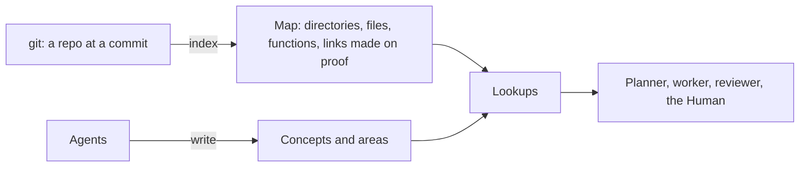
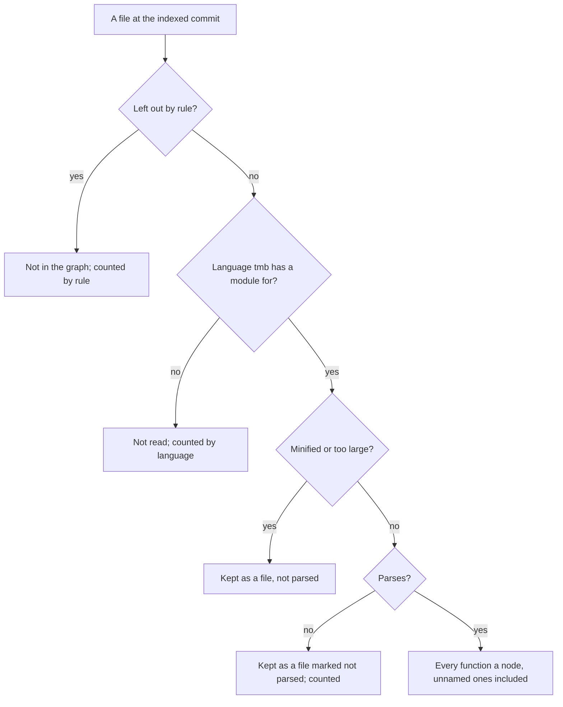
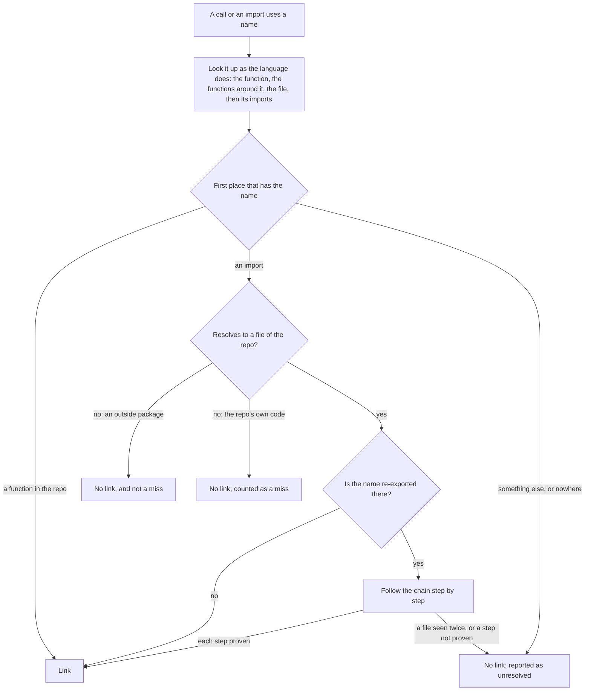
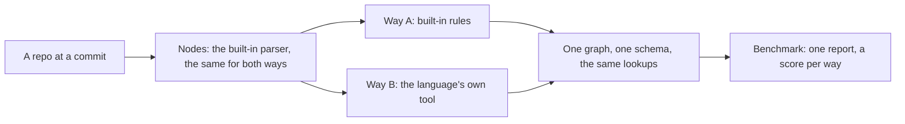
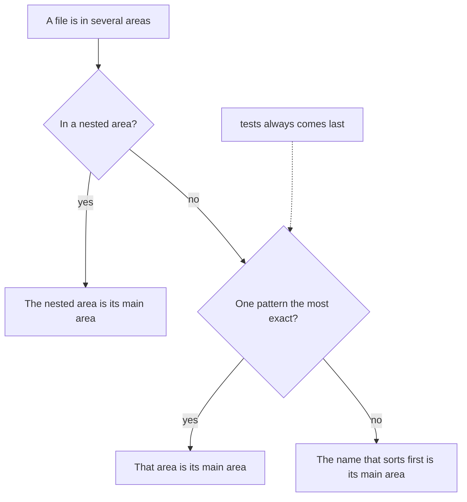
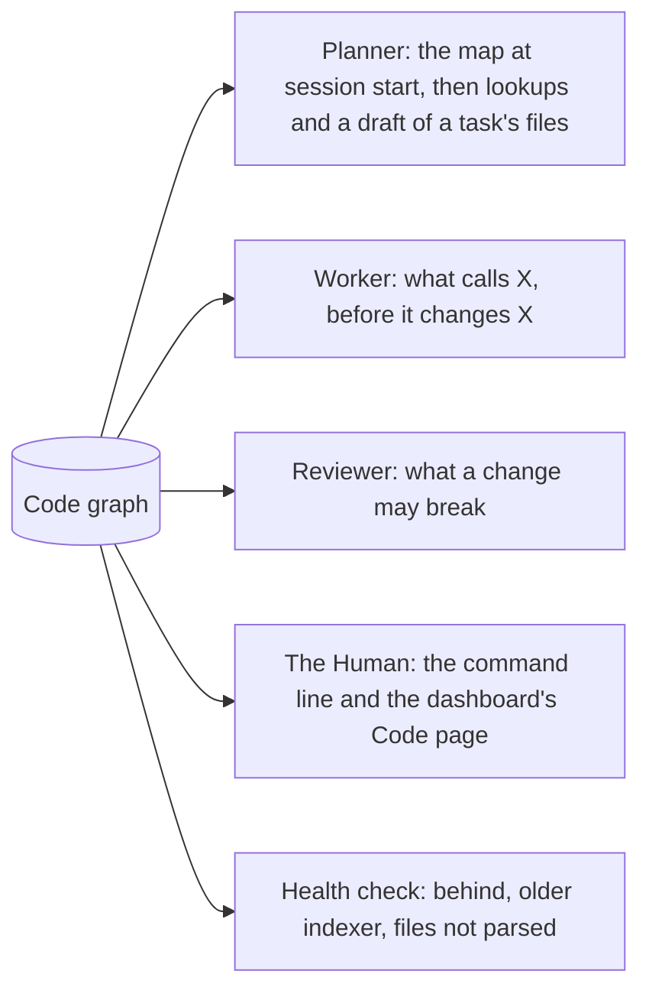

# Code graph

The code graph is the stable, queryable picture of a project: its directories, files and symbols, and the links between them. The planner is the architect of every project it works on and reasons from this picture. Agents ask it where something lives and what depends on it, instead of reading whole files.

It has two purposes, and the second stands on the first.

| Purpose | What it means | State |
|---|---|---|
| 1. Cover the codebase | An agent still reads code, but only the code that matters. The graph narrows the scope, so a task costs fewer tokens and fits a smaller context. A text search returns unrelated hits and misses real ones; the graph returns proven links. So it must hold close to 100% of the code's relationships | Built in part; measured in [Benchmark](#benchmark) |
| 2. Bridge design and code | Design and code drift apart in every real project. The graph ties a design to the code that carries it out, so the project's picture stays fresh and drift is seen | Open, for the Human. [Concepts](#concepts) and [Areas](#areas) are its first parts |

- **Example 1.** A worker is about to change `Cart.total`. A text search for "total" returns every use of the word. The graph returns the callers of that one method, and the worker reads only those.
- **Example 2.** A bridge on a graph that misses half the calls would tie a design to half the code. So coverage comes first.

| Reader | Reads it through |
|---|---|
| Agents: planner, worker, reviewer | tmb's tools, as calls that return an answer |
| The Human | The dashboard's Code page, and the command line |

It is the middle of the three knowledge layers ([README.md](README.md#three-layers-of-knowledge)): it holds the relationships the docs leave out and the code leaves implicit. A change to the code reaches it at the next index, so it never drifts from the code.

This page is the code graph in space: what it holds, how its parts connect and why. How it is built, kept fresh and read through a task's layer is flow 2.2, in [2_CODE_GRAPH.md](../flows/2_CODE_GRAPH.md).

## Terms

| Word | Meaning | Example |
|---|---|---|
| Node | One thing in the graph: a directory, a file, or a symbol | The file `cart.ts`; the function `total` in it |
| Symbol | Something the code declares. [Kinds of symbol](#kinds-of-symbol) lists them | `class Cart`, `function total()` |
| Callable | Code that can be called: a function or a method | `total()`, `Cart.total()` |
| Function | A callable declared outside any type | `function total()` |
| Method | A callable declared inside a type, such as a class. A constructor and an accessor are methods | `Cart.total()` |
| Field | Data stored on a type or on each of its objects | `Cart.items` |
| Name | The word the code uses for a symbol at one place. A name is not the symbol: the same word can mean different symbols in different files, and one symbol can be reached under several names | `total` in `cart.ts` and `total` in `report.ts` are two symbols. `import { total as sum }` makes `sum` a second name for one symbol |
| Qualified name | A symbol's full name inside its file, which tells it apart from others of the same name | `Cart.total` |
| Link | A proven relation between two nodes: a call, an import, a database read or write, or a test covering code | `checkout()` calls `Cart.total` |
| Resolve | To find which symbol a name means at the place it is used | `sum(...)` in `checkout.ts` resolves to `total` in `cart.ts` |
| Layer | One snapshot of a repo at one commit | The base branch's commit; an open task's commit |
| Unnamed function | A function written without a name, as a value | The callback in `items.map(x => x.price)` |

## What it holds

| Kind | Holds | Source |
|---|---|---|
| Directories and files | Each directory with a summary from its README. Each file with a short summary from its header | Git |
| Symbols | Each file's definitions and the links between them: calls, imports, database reads and writes, and which tests cover what. Every function is a node | Git |
| Concepts | Flows and rules, each an ordered list of anchors to symbols or files. See [Concepts](#concepts) | Agents |
| Areas | The project's logical parts, such as login or billing. Each is a named group of files; Planned (trustmybot/tmb#308): of functions. See [Areas](#areas) | The planner |

Two things contain a symbol:

| Container | Kind | Decided by | Example |
|---|---|---|---|
| File | Physical | Git, with no judgment | A file with 10 classes and 100 functions holds all 110 symbols |
| Area | Logical | The planner's judgment | "billing" holds the code that bills, wherever its files are |

- **Example.** The symbols answer "where is X" and "who calls X" without re-reading code.
- **Edge case.** Summaries come from file contents, so every read presents them as untrusted: data, never instructions.

## Substrate

The code graph is not part of the record. It lives in its own file beside it, one per repo in a multi-repo workspace, and every row but the agent-written ones can be rebuilt from git.

| | The code graph holds | The record holds, not the graph |
|---|---|---|
| Content | The project's map: directories, files, symbols, concepts and areas | Issues, notes and decisions, feature branches, tasks, runs, checks, reviews |
| Answers | "What does this project look like?", "Where does X live?", "Who calls X?" | "What did we decide?", "What's open?", "What did the worker commit?" |
| Source | Git, at a commit | The work, as it happens |

- **Built from git, never from the working folder.** Each repo is indexed at the commit of its base branch, so every session and worktree reads the same graph. One limit: the base branch is the local one, so a merge on GitHub is not seen until it is fetched. Planned (trustmybot/tmb#70): the syncer brings what happened on the remote in, so the graph follows it.
- **One snapshot per repo, not history.** The graph holds each repo at one commit. On top sit layers: one per open feature branch and one per open task ([Task overlay](../flows/2_CODE_GRAPH.md#task-overlay)). Git is the history store: what changed between two commits is a diff, and the graph can be rebuilt at any commit.
- **The commit is on the layer, not on each node.** A layer records the one commit it was built at. A node records its file and its lines. The graph links no commit to another and keeps no node's past.
  - **Example 1.** "Who calls `total` now?" is a graph question, answered at the layer's commit.
  - **Example 2.** "When did `total` change, and why?" is a git question: git's history of that file and those lines answers it.
- **The graph file is not committed with the code.** It is a cache built from a commit, and the commit names it. Checking out an older commit and indexing gives that commit's graph again.
- **It can always be rebuilt.** Everything except concepts and areas is derived from git. A rebuild throws the rest away, builds it again, keeps the concepts and areas and re-checks each against the new graph. One whose code is gone is marked broken, never dropped.
- **One step per write.** An index reads and parses first, then applies the whole layer at once. A reader sees the old graph or the new one, never a mix.
- **The commit and the graph are written together.** The commit a repo is indexed at, and the indexer version it was built with, are stored with the graph in one step. So an absent or emptied file always reads as never indexed.
- **Issues and decisions are not in the graph.** The record already ties a commit to its task and its issue. Open, for the Human: whether a code answer also names the issues that changed that code, joined from the record at read time, and whether a concept links to a design page.
- **Indexing is not trajectory.** The record holds no entry for an index run. The graph file keeps, for each repo, the commit it was built at, when, and what it holds.
- **It works offline.** Indexing needs no network. Search is by name and by the words in a name; search by meaning is left out ([MEMORY.md](MEMORY.md#search)).
- **Edge case.** A newer tmb made the graph file. The graph is refused, and the refusal says to update tmb.

## Every function

The graph shows code at function level, and no function is left out.

- **Every function is a node, unnamed ones included** (trustmybot/tmb#140), in TypeScript and JavaScript ([Languages](#languages)). Each symbol links to what contains it: a function, a class or the file.
  - **What an unnamed function is.** A function written as a value with no name: an arrow function or a function expression in TypeScript and JavaScript, a `lambda` in Python (Planned, trustmybot/tmb#141). A nested helper that has a name is a named function, not this.
  - **Example 1.** In `items.map(x => x.price)` the callback is an unnamed function. Its node is named by where it is used, here the callback of `map`, or else by its line.
  - **Example 2.** `function outer() { function helper() {} }`: `helper` is a named function inside `outer`.
  - **Why it is a node.** A call made inside a callback needs an owner, and the count of functions can then be checked one to one against the compiler's list.
- **Unnamed functions never show to a reader.** They stay out of search, and a lookup names the nearest named function instead.
  - **Example.** A test calls `total()` inside `it("adds", () => { ... })`. The answer to "who calls `total`" names the nearest named function around the callback, not the callback.
  - **Its links can leave the file.** Nothing in another file can call a function with no name, but the calls it makes can reach any file, so they need this owner.
- **A coverage test holds it at 100%** (trustmybot/tmb#247). [Benchmark](#benchmark) has the test and its targets.
- **Nothing is skipped in silence.** A file that could not be parsed is in the graph as a file marked so, and indexing prints how many there are. "Not parsed" means only a file in a language tmb reads that failed to parse.
- **What the graph does not read is named and counted** (trustmybot/tmb#234).
  - **Example 1.** A lookup finds nothing. Its answer names the unread languages, so "not there" is never mistaken for "not read".
  - **Example 2.** A lookup of a file in an unread language says the file is there and its language is not read.
- **A minified file is kept as a file and not parsed** (trustmybot/tmb#232), whatever its name. The test is the one used by [GitHub Linguist](https://github.com/github-linguist/linguist), the library GitHub uses to tell a repo's languages and to mark vendored and generated files: lines that average more than 110 characters. It holds for TypeScript and JavaScript.
  - **Why.** One bundle of one line can add thousands of functions and answer a search first.

| What is not read | Rule |
|---|---|
| Left out by rule | Folders named `dist`, `node_modules` or `vendor`, as on Linguist's list of vendored paths; source maps; files named as minified; lockfiles |
| Read all the same | A folder named `build`: the graph is built from git, so build output that git ignores is never in it |
| Unread languages | Named from a copy of Linguist's programming languages, plus Vue and Svelte. Where languages share a file ending, Linguist's first one is named |
| Not counted | Prose, data, settings and images; code in a file ending tmb does not know. Planned (trustmybot/tmb#154): a file's language comes from Linguist's list |

### Kinds of symbol

The graph uses one set of kinds for every language. Each language module maps its own syntax to them. Planned (trustmybot/tmb#314): the stored kinds are this set; until then some are a language's own words, such as class and const. The lowest node is a callable or a field. Nothing inside a function is a node.

| Kind | Meaning, in any language | A node |
|---|---|---|
| File | One source file. The physical container | Yes |
| Type | A named shape that holds members: a class, an interface, a struct, a trait | Yes |
| Function | A callable declared outside any type | Yes |
| Method | A callable declared inside a type. It may need an object or only the type | Yes |
| Constructor | The method that runs when an object is made | Yes, as a method |
| Accessor | A method that is called like a field: a getter or a setter | Yes, as a method |
| Unnamed function | A callable written as a value with no name | Yes, hidden |
| Field | Data stored on a type or on each of its objects | Planned (trustmybot/tmb#312) |
| File-level data | A constant or variable declared outside any type or function; a database table, index or trigger | Yes |
| Local | A variable, a parameter or a statement inside a callable | No |

How two languages write each kind:

| Kind | TypeScript | Python |
|---|---|---|
| Type | `class Cart {}`, `interface Item {}` | `class Cart:` |
| Function | `function total() {}` | `def total():` at the top of a file |
| Method | `total() {}` in a class; `static round() {}` | `def total(self):`; `@staticmethod`, `@classmethod` |
| Constructor | `constructor(owner) {}` | `def __init__(self, owner):` |
| Accessor | `get items() {}`, `set items(v) {}` | `@property`, `@items.setter` |
| Unnamed function | `x => x.price` | `lambda x: x.price` |
| Field | `items = []` in a class | `tax_rate = 0.08` in a class; `self.owner = owner` in a method |
| File-level data | `const MAX = 10` | `MAX = 10` |

- **Everything is a node, and the graph judges nothing.** A member is in the graph whether or not anything uses it. Showing it costs almost nothing; deciding which members matter would cost a judgment on every one.
- **What uses a symbol is read from its links.** A symbol with links from outside its type or file has users there. One with none has none yet.
  - **Example.** `Cart.total` has callers in three files, so a change to it reaches them. `Cart.recount` is called only inside `Cart`, so a change to it stays there. Both are nodes; the links tell them apart.
  - **Edge case.** A static method is no different: `Cart.round(x)` may be called from anywhere, and its links show from where.
- **A member is always inside its type.** A method, a constructor, an accessor and a field are never standalone nodes: each is held by its type and named through it, as `Cart.total`.
- **Example 1.** A class `Cart` with a method `total` gives two nodes in either language: the type `Cart` and the method `Cart.total`.
- **Example 2.** Python's `@property def items(self)` is read as `cart.items`, with no call marks. It is an accessor, so it is a method node. The data behind it, `self._items`, is the field.
- **Example 3.** Planned: `Cart.items` as a field node, so "who reads or writes `Cart.items`" has an answer.
- **Edge case 1.** A field whose value is a function, `onChange = () => {}`. It is called like a method, so it is a callable node.
- **Edge case 2.** A Python field has no declaration: `self.owner = owner` in any method creates it. The field's node is that name on the class, and each assignment is a write link.
- **Why it stops at callables and fields.** A local cannot be reached from another callable, so no question across the code needs it.

### Languages

Each language is a module of its own (trustmybot/tmb#157). Every module answers the same questions for the engine, and one list names the modules, so adding a language touches nothing else. A language's parser loads only when a file in that language is read.

| Module | Every function a node | Lookup the way the language does it |
|---|---|---|
| TypeScript, TSX and JavaScript, one module | Yes | Yes |
| Python | Planned (trustmybot/tmb#141) | Yes |
| bash, SQL, Perl | Planned (trustmybot/tmb#141) | No |

## Links on proof

The graph never guesses. A link is made only on proof, and that is the one promise. What could not be resolved is reported as unresolved. There is no second set of less-sure links, marked or not: a missing link is reported and the agent searches by text for the rest, while a wrong link sends it to the wrong code with no warning.

**How a name is resolved.** Not by searching for the word. tmb parses each file into its syntax tree with a parser (tree-sitter), so it knows which words are calls and imports and which are variables, strings or comments. It then resolves each called or imported name by the language's own scope rules, the way the compiler would. tmb does not run the compiler to build the graph; the TypeScript compiler is the independent check that every link is right ([Benchmark](#benchmark)).

- **Example 1.** `total` appears as a variable in one file and a function in another. Only a call or an import of `total` is resolved, and only to the symbol the scope rules give.
- **Example 2.** Two files each declare `total`. A call in `checkout.ts` links to the one `checkout.ts` imports, never to the other.

- **Example 1.** A function calls a function declared in the same file: link.
- **Example 2.** A function calls a name imported from an outside package: no link, and not a miss. Outside means a package the project installs, such as one from a public registry. A package that lives in the same repo is the repo's own code and is linked.
- **Edge case.** `import pkg` followed by `pkg.f()`. Proving the call needs the type of the thing it is called on, so there is no link.

- **A name is looked up the way the language looks it up** (trustmybot/tmb#246), in TypeScript, JavaScript and Python. The first place that has the name decides. If what is found there is not a function in the repo, there is no link, and the lookup does not go on to another function of the same name. A call on the object itself looks only in its class and the class's parents.
  - A name imported inside a Python function holds only in that function. A name imported under a new name is looked up in the file that import names.
  - Left with no link, and planned as proofs of their own (trustmybot/tmb#249): a call on the parent, the object itself inside a class written as an expression, and a Python class with several parents unless exactly one of them has the method.
  - Planned (trustmybot/tmb#287): the lookup sees four more bindings. Without them each can give a wrong link.
- **Imports through a path alias or a package name resolve to their files** (trustmybot/tmb#147). A TypeScript or JavaScript import that is not a relative path is resolved the way the TypeScript compiler does it: through the nearest project settings file above the importing file, read at the indexed commit. An import of a package that lives in the same repo links to that package's entry file. Two packages of the same name are not linked.
  - **Example.** `import { total } from "@app/cart"` and `import { total } from "../cart"` reach the same file, so both link to the one `total` symbol. An alias adds a name, never a second symbol.
- **A name that reaches a file through a re-export links to where it is declared** (trustmybot/tmb#233). A re-export is proof. The import's link to the re-exporting file stays.

| Re-exports | Followed | Not followed |
|---|---|---|
| TypeScript and JavaScript | By name, with or without a new name; an import followed by an export; a star, which never gives the default export; a star under a name | CommonJS; a re-export of a default export |
| Python | A top-level `from .a import f`, with or without a new name; `from .a import *`, which follows `__all__` when it is a plain list of names and otherwise the public top-level names | An import under `if` or `try`; an `__all__` built by code; `import pkg` followed by `pkg.f()`, which is not a re-export |
| Ties | A name the file declares or exports by name wins over a star | A name two stars bring from different declarations stays unresolved |

- **Every link between files is checked against the TypeScript compiler** (trustmybot/tmb#242). [Benchmark](#benchmark) has the test.
- **Misses are counted.** Each build counts the imports that name the repo's own code and link to no file, and indexing prints the count.

### The three states of a call

Every call is in exactly one state (trustmybot/tmb#252), and a function's answer gives the count of each.

| State | Meaning | Example |
|---|---|---|
| Linked | Proven to reach a symbol in the repo | `total()` declared in the same file |
| Outside | Proven to reach code outside the repo: an installed package or the language's built-ins | `import pkg` then `pkg.f()`; `JSON.parse()` |
| Not known | Neither is proven. The agent searches by text for these | `c.total()` where the type of `c` is not written |

- **What a call is.** A place where the code runs a callable: a call, a construction with `new` or by a class's name, a tagged template, a dynamic import, a call to the parent's constructor, and a decorator written as a call, `@cache()`.
  - **Not a call.** Naming a parent class, a JSX element, and a decorator written as a bare name, `@cache`. They are uses, and belong with what depends on a symbol beyond calls (trustmybot/tmb#148).
- **Who owns a call.** The nearest callable around it. A call in a field's initial value belongs to the type. A decorator's call belongs to what encloses the decorated thing, since it runs when that thing is defined and not when it is called: the type for a method, the file for a top-level function or type. A call in an unnamed function is answered under the nearest named one.
- **A built-in is outside only when nothing nearer declares the name.** The scope and the repo are looked up first, so a repo function named `parse` is never taken for the built-in.
- **The lists of built-ins are generated, never written by hand.** Each language module's list comes from the language's own tool, and a test fails when it is stale.
- **Edge case.** A language with no lookup of its own (bash, Perl, SQL): its calls get no state and are counted apart, so 100% holds for the languages that have one.

The design for links is trustmybot/tmb#250. Its next steps are in [Planned](#planned).

## Two ways to make links

Planned (trustmybot/tmb#311). The goal is links found close to 100%. tmb builds two ways to make links, side by side, and the benchmark compares them.

| | Way A: built-in rules | Way B: the language's own tool |
|---|---|---|
| Makes links with | The syntax tree and tmb's lookup rules ([Links on proof](#links-on-proof)) | The language's compiler or indexer, which knows types |
| Needs | Nothing installed | The tool, and the project set up for it |
| Strong at | Any repo, any commit, offline | A method call on an object, an inherited method, a worked-out type |
| Weak at | Calls that need a type | A repo that is not set up, a language with no tool, a commit the tool did not index |

- **The promise is the same for both.** A link is made only on proof. In way B the proof is the compiler's own answer for that name.
- **The nodes are the same for both.** The built-in parser decides which symbols exist. A way adds links and never adds or removes a node, so the two are compared link by link.
- **A setting picks the way**, per repo. Every link records the way that made it (trustmybot/tmb#251).
- **Way B per language.** TypeScript and JavaScript use the TypeScript compiler. Other languages read a SCIP index, the open format language indexers write (trustmybot/tmb#156).
- **tmb installs nothing for way B.** It never installs a tool or a project's dependencies, and an index is used only for the commit it was made at.
  - **Example 1.** `const c = makeCart(); c.total()`. Way A has no written type for `c`, so no link. Way B asks the compiler, which knows `makeCart` returns a `Cart`, and links to `Cart.total`.
  - **Example 2.** A Python repo with no virtual environment. Way B cannot run. The graph is built by way A, and the answer's freshness says so.
  - **Edge case.** A call decided only at run time, such as a method picked by a string. Neither way links it. It is counted as not known.
- **Way A keeps growing.** Its next proofs are the stated types (trustmybot/tmb#249), the four bindings (trustmybot/tmb#287) and the other languages (trustmybot/tmb#141).
- **No rule is written for one repo.** A rule in either way is the language's rule. Neither way names a benchmark repo, a file or a symbol of one, and a failing benchmark case is fixed by the rule or left unlinked.

Open, for the Human: which way is the default, after the first report. Whether tmb's program carries the TypeScript compiler inside it, so way B needs no install for TypeScript.

## Concepts

A concept is a flow or a rule, written by an agent. It is the bridge from a design page to the code that carries it out: a name, a one-line meaning, and an ordered list of anchors, each a symbol or a file.

| Concept | Kind | Anchors, in order |
|---|---|---|
| "Checkout" | Flow | `Cart.total`, then `chargeCard`, then `saveOrder`, then `sendReceipt` |
| "Only an admin deletes a user" | Rule | `requireAdmin`, then `deleteUser` |
| "Sign-up" | Flow across areas | `validateEmail` in login, `createAccount` in accounts, `sendWelcome` in mail |

- **Example 1.** The design says "an order is charged before it is saved". The planner asks for the concept "Checkout" and gets the four functions in that order, without searching.
- **Example 2.** A worker changes `chargeCard`. The concept shows it is step two of "Checkout", so the reviewer knows which flow to probe.
- **Area or concept.** An area answers "which part of the project is this code in". A concept answers "which code carries out this flow or rule, and in what order". One concept may cross several areas.

- **Agents write concepts**, through one tool, with at least one anchor. Every anchor must be in the base branch's graph. Writing a name that exists replaces that concept. Any role may write one. Open, for the Human: whether only the planner writes concepts, at each close, and a worker only proposes them.
- **Every index of the base branch re-checks them.** A rebuild keeps and re-checks them too ([Substrate](#substrate)).
- **Anchors are stable keys.** An anchor stores the path and the qualified name, not a row id.
  - **Example.** A file is parsed again. No anchor is orphaned.
  - **Edge case.** A function an anchor names is renamed. The anchor breaks by design: the concept is marked broken for review instead of silently following the wrong code.

## Areas

An area is a logical part of the project, such as login or billing, with a one-line purpose. With areas the planner can say which part a piece of code belongs to, and tests are one area (trustmybot/tmb#146).

**Planned: an area holds functions, not only files** (trustmybot/tmb#308). Folders match the design only in a well-kept codebase, so an area is a group of nodes at function level. A path pattern stays as the shortcut for whole files, and one file may hold functions of several areas.

- **Example 1.** `billing/` holds only billing code. One path pattern places every function in it.
- **Example 2.** `utils.ts` holds `formatInvoice` and `hashPassword`. The first is in billing and the second in login.
- **Example 3.** A test file tests both billing and login. Its billing tests are in billing and tests, its login tests in login and tests. The file is in all three.
- **The planner judges, tmb stores.** Which functions belong to an area is the planner's call, as naming the areas is. tmb decides no placement by rule: it stores what the planner places, checks it at each index and lists what is not placed yet.

Until then an area is a named group of files, as below.

- **Defined by path patterns**, to include and to leave out. A path rule cannot tell login from billing, so the planner names the areas and tmb stores and checks them. A function takes its file's area.
- **Only the planner writes or removes an area.** It proposes the areas to the Human at onboarding ([2_ONBOARD.md](../flows/2_ONBOARD.md)). Every role can list them, and so can the Human from the command line.
- **"tests" is there from the start**, and holds every file the built-in test rule matches. The planner changes that rule on the area itself, with patterns to add and to leave out. It cannot be removed.
- **One level of nesting.** An area may have a parent.
- **A file can be in several areas, and has one main area**, by the order in the chart.

- **Example 1.** A test file inside billing has billing as its main area and is also in tests.
- **Example 2.** A test file that both a billing pattern and a login pattern match is in billing, login and tests. Its main area is the one with the most exact pattern.
- **Why the most exact pattern wins.** In a CODEOWNERS file, the usual standard for "who owns which paths", the last matching pattern wins. Areas have no order between them, so the most exact pattern wins, as in URL routing.

| Case | What happens |
|---|---|
| A pattern matches no file | Refused, with the reason |
| A file is in no area | Listed, with the count, so the planner sees what is not placed yet |
| A rebuild | Areas are kept and re-checked, as concepts are |
| An area matches no file at a re-check | Marked broken |
| An area's size moved by more than a quarter since it was written | Marked for the planner to look at |
| A search or a scope names an unknown area | Refused, with the list of areas |

Where an area shows:

- **Answers.** Every file's and function's answer names its areas, main one first.
- **Search and scoping** can stay inside one area and the areas nested in it, or leave areas out, such as tests. A filter matches any area a file is in. The anchors a caller names stay in a scope regardless.
- **The dashboard's Code page** draws the files of an area inside a folder in one tinted box.

## Consumers

| Question | Asked by |
|---|---|
| What does this project look like? | The planner at the start of a session |
| Where does X live? | Every role |
| What calls or imports X, and which tests cover it? | The planner when it scopes a task; the worker before it changes X; the reviewer when it judges what a change may break |

- **The planner** reads the map at cold start and asks "where does X live" directly. A scope gives it a draft of a task's files: the hits for the task's objective, plus the callers, importers and tests of the symbols it names.
- **The reviewer starts from git's diff.** The diff says what changed, and no graph tool repeats it. The reviewer asks the graph only what the diff cannot say: what calls a changed function, and which tests cover it.
- **The dashboard has a Code page** (trustmybot/tmb#142): folders, then files, then functions, one level at a time, and a view of one function with its callers and what it calls. It never draws every function at once. In a multi-repo workspace it opens on the list of repos, and the page's address names the repo, so a link to one repo's graph can be shared.
- **The command line reads the same graph** as the tools ([the reference](../reference/README.md#the-record-from-the-command-line)).

How an answer is shaped:

- **Answers stay shallow.** Search by name first, callers before callees, one step by default.
- **Each caller and each callee is listed once, with its lines** (trustmybot/tmb#235), in the tools' answers, on the command line and on the dashboard. A row shows at most 10 lines and counts the rest. The cap of 50 counts distinct rows, and the answer says how many were cut.
  - **Example.** A test file full of unnamed callbacks is one caller with many lines, not one row per call.
  - **Edge case.** A call and a construction of the same target are two rows.
- **Honest limits.** Agents do not always use a graph when one is offered, and a symbol lookup can cost more than a plain text search for a simple question. So the graph is used where it earns its cost: scoping a task, and finding what a change may break. Plain search stays available for everything else. An agent records every miss or wrong answer of the graph, so its value can be measured.

## Benchmark

The graph is measured against each language's own tool, on tmb's own repo and on public repos at fixed commits.

| Language | Repos | Reference for functions | Reference for links |
|---|---|---|---|
| TypeScript and JavaScript | tmb, hono | The TypeScript compiler | The TypeScript compiler |
| Python | flask, datasette | Python's own parser | Planned (trustmybot/tmb#244): a type checker's answer where it gives one; a link it cannot answer for is counted and not judged |

- **The scores are kept in a file in the repo**, one set per way, per language and per repo. A test fails when a score falls. It runs with the heavy tests, not on every pull request; links right for TypeScript runs on every pull request.
- **Every repo is at a fixed commit, tmb's own included.** New code in tmb would otherwise move the scores with no change to the graph. A pin moves only in a pull request that runs the benchmark again.
- **Links found is scored against the reference**: of the in-repo links the reference gives, the share the graph has. Calls not known are not the measure, because some of them reach outside the repo.
- **A language with no module is not scored.** It joins the benchmark when its module does (trustmybot/tmb#141).
- **The repos are named only in the benchmark.** No code of the graph names one ([Two ways to make links](#two-ways-to-make-links)).

| Measure | Target | How it is held |
|---|---|---|
| Functions found | 100% | A test (trustmybot/tmb#247): the compiler lists every function, and the graph must match that list one to one |
| Links right | 100% | A test (trustmybot/tmb#242), in TypeScript and JavaScript, on every pull request: no link the graph makes between files is wrong |
| Links found | Close to 100% of the calls that can be proven. Planned (trustmybot/tmb#244, trustmybot/tmb#311) | Scored per way and per language for every release. The score may not fall |
| Calls accounted for | 100% | A test (trustmybot/tmb#252): in every function, linked plus outside plus not known equals the calls the compiler finds, and no call marked outside is one the compiler declares in the repo |

- **Links right comes before links found.** A change that raises links found and makes one wrong link fails.
- **Example.** A file has 10 calls: 6 linked, 3 to an outside package, 1 not known. Links found is 6 of 7. Calls accounted for is 10 of 10.
- **Way B needs a second judge.** In TypeScript the reference is the compiler, which is also way B's source. Way B's links right is judged on Python and on samples checked by hand.
- **A link the compiler places outside the repo is wrong.** The graph links only the repo's own code, so a link to a repo symbol for a name the compiler declares only outside the repo fails the test.
- **When a link is right.** It names a declaration the compiler gives for that name. A missing link is no failure. A link the compiler cannot answer for is counted and not judged.
- **Why way A misses links.** It leaves a call unlinked when proving it needs the type of the thing it is called on ([Links on proof](#links-on-proof)).

## Schema

The code graph lives in its own SQLite file, apart from the record, so a build never holds the record's write lock: `.tmb/graph.db`, or in a multi-repo workspace one per repo, `.tmb/graphs/<repo>.db`. Its schema is `src/engine/graph/db.ts`, at `GRAPH_SCHEMA_VERSION = 5`.

**This section lists every table and column of the graph file.** A schema change updates it in the same pull request. Planned: a generator with a freshness test that fails when it drifts.

| Group | Tables | Rebuilt from |
|---|---|---|
| Layers | `layers` | the next read or build |
| Map | `dirs`, `files`, `symbols`, `edges` | a commit in git, one copy per layer |
| Parse cache | `parsed` | file contents, keyed by blob, language and extractor version |
| Concepts and areas | `concepts`, `concept_anchors`, `areas` | nothing: agents write them, and a rebuild keeps and re-checks them |
| Misses | `misses` | nothing: lookups that found nothing, or that an agent reported wrong |
| Search | `symbols_fts`, `files_fts`, `dirs_fts` | the rows they index |

- **Layers.** `base` is the base branch's commit. `task:<id>` is an open task's commit laid on top, and `feature:<id>` is a feature branch's tip, for each feature branch that is neither merged nor closed.
- **Its own schema version.** The graph file has its own version and upgrade steps, apart from the record's. A file a newer tmb made is refused. A layer built by an older extractor is rebuilt at the next read.
- **No link across the two files.** A graph row holds a task id, a feature id or a commit as a plain value.
- **Every graph has the `tests` area** from the start, marked `builtin`.

### Diagram

### Tables

#### `layers`

| Column | Type | Null | Default | Constraints |
|---|---|---|---|---|
| `layer` | TEXT | nullable |  | PK |
| `commit_sha` | TEXT | NOT NULL |  |  |
| `extractor` | INTEGER | NOT NULL |  |  |
| `built_at` | TEXT | NOT NULL |  |  |
| `files` | INTEGER | NOT NULL |  |  |
| `symbols` | INTEGER | NOT NULL |  |  |
| `edges` | INTEGER | NOT NULL |  |  |
| `unresolved` | INTEGER | NOT NULL |  |  |
| `unresolved_imports` | INTEGER | NOT NULL | `0` |  |
| `functions` | INTEGER | NOT NULL | `0` |  |
| `not_parsed` | INTEGER | NOT NULL | `0` |  |
| `not_read` | TEXT | NOT NULL | `'{}'` |  |

#### `dirs`

| Column | Type | Null | Default | Constraints |
|---|---|---|---|---|
| `layer` | TEXT | NOT NULL |  |  |
| `path` | TEXT | NOT NULL |  |  |
| `parent` | TEXT | nullable |  |  |
| `depth` | INTEGER | NOT NULL |  |  |
| `summary` | TEXT | NOT NULL | `''` |  |
| `summary_source` | TEXT | NOT NULL | `'none'` |  |
| `file_count` | INTEGER | NOT NULL | `0` |  |

Table constraints:

- PRIMARY KEY `(layer, path)`

#### `files`

| Column | Type | Null | Default | Constraints |
|---|---|---|---|---|
| `layer` | TEXT | NOT NULL |  |  |
| `path` | TEXT | NOT NULL |  |  |
| `dir` | TEXT | NOT NULL |  |  |
| `lang` | TEXT | nullable |  |  |
| `blob` | TEXT | NOT NULL |  |  |
| `size` | INTEGER | NOT NULL |  |  |
| `lane` | TEXT | NOT NULL |  |  |
| `summary` | TEXT | NOT NULL | `''` |  |
| `summary_source` | TEXT | NOT NULL | `'none'` |  |
| `parse_error` | TEXT | nullable |  |  |

Table constraints:

- PRIMARY KEY `(layer, path)`

#### `symbols`

| Column | Type | Null | Default | Constraints |
|---|---|---|---|---|
| `id` | INTEGER | nullable |  | PK |
| `layer` | TEXT | NOT NULL |  |  |
| `path` | TEXT | NOT NULL |  |  |
| `kind` | TEXT | NOT NULL |  |  |
| `qualified_name` | TEXT | NOT NULL |  |  |
| `name` | TEXT | NOT NULL |  |  |
| `signature` | TEXT | NOT NULL | `''` |  |
| `doc` | TEXT | NOT NULL | `''` |  |
| `start_line` | INTEGER | nullable |  |  |
| `end_line` | INTEGER | nullable |  |  |
| `exported` | INTEGER | NOT NULL | `0` |  |
| `parent_id` | INTEGER | nullable |  |  |
| `unnamed` | INTEGER | NOT NULL | `0` |  |
| `named_id` | INTEGER | nullable |  |  |

#### `edges`

| Column | Type | Null | Default | Constraints |
|---|---|---|---|---|
| `layer` | TEXT | NOT NULL |  |  |
| `src_id` | INTEGER | NOT NULL |  |  |
| `dst_id` | INTEGER | nullable |  |  |
| `dst_name` | TEXT | NOT NULL |  |  |
| `kind` | TEXT | NOT NULL |  |  |
| `resolution` | TEXT | NOT NULL |  | CHECK `resolution IN ('exact', 'name', 'unresolved')` |
| `line` | INTEGER | nullable |  |  |
| `hint` | TEXT | nullable |  |  |

#### `parsed`

| Column | Type | Null | Default | Constraints |
|---|---|---|---|---|
| `blob` | TEXT | NOT NULL |  |  |
| `lang` | TEXT | NOT NULL |  |  |
| `extractor` | INTEGER | NOT NULL |  |  |
| `extraction` | TEXT | nullable |  |  |
| `error` | TEXT | nullable |  |  |

Table constraints:

- PRIMARY KEY `(blob, lang, extractor)`

#### `concepts`

| Column | Type | Null | Default | Constraints |
|---|---|---|---|---|
| `id` | TEXT | nullable |  | PK |
| `name` | TEXT | NOT NULL |  | UNIQUE |
| `kind` | TEXT | NOT NULL |  | CHECK `kind IN ('flow', 'rule')` |
| `body` | TEXT | NOT NULL |  |  |
| `status` | TEXT | NOT NULL |  | CHECK `status IN ('verified', 'broken')` |
| `status_reason` | TEXT | nullable |  |  |
| `checked_at` | TEXT | nullable |  |  |
| `checked_sha` | TEXT | nullable |  |  |
| `created_by` | TEXT | NOT NULL |  |  |
| `updated_by` | TEXT | NOT NULL |  |  |
| `created_at` | TEXT | NOT NULL |  |  |
| `updated_at` | TEXT | NOT NULL |  |  |

#### `concept_anchors`

| Column | Type | Null | Default | Constraints |
|---|---|---|---|---|
| `concept_id` | TEXT | NOT NULL |  | FK → `concepts.id` ON DELETE CASCADE |
| `ordinal` | INTEGER | NOT NULL |  |  |
| `path` | TEXT | NOT NULL |  |  |
| `qualified_name` | TEXT | NOT NULL | `''` |  |
| `present` | INTEGER | NOT NULL | `1` |  |

Table constraints:

- PRIMARY KEY `(concept_id, ordinal)`

#### `areas`

| Column | Type | Null | Default | Constraints |
|---|---|---|---|---|
| `id` | TEXT | nullable |  | PK |
| `name` | TEXT | NOT NULL |  | UNIQUE |
| `purpose` | TEXT | NOT NULL |  |  |
| `parent_id` | TEXT | nullable |  | FK → `areas.id` ON DELETE SET NULL |
| `include` | TEXT | NOT NULL |  |  |
| `exclude` | TEXT | NOT NULL |  |  |
| `builtin` | INTEGER | NOT NULL | `0` |  |
| `status` | TEXT | NOT NULL |  | CHECK `status IN ('ok', 'broken', 'review')` |
| `status_reason` | TEXT | nullable |  |  |
| `file_count` | INTEGER | NOT NULL | `0` |  |
| `written_count` | INTEGER | NOT NULL | `0` |  |
| `checked_sha` | TEXT | nullable |  |  |
| `created_by` | TEXT | NOT NULL |  |  |
| `updated_by` | TEXT | NOT NULL |  |  |
| `created_at` | TEXT | NOT NULL |  |  |
| `updated_at` | TEXT | NOT NULL |  |  |

#### `misses`

| Column | Type | Null | Default | Constraints |
|---|---|---|---|---|
| `id` | INTEGER | nullable |  | PK |
| `at` | TEXT | NOT NULL |  |  |
| `lookup` | TEXT | NOT NULL |  |  |
| `query` | TEXT | NOT NULL |  |  |
| `detail` | TEXT | NOT NULL | `''` |  |
| `actor` | TEXT | NOT NULL |  |  |

### Foreign keys

| Column | References | On delete |
|---|---|---|
| `concept_anchors.concept_id` | `concepts.id` | CASCADE |
| `areas.parent_id` | `areas.id` | SET NULL |

The graph file opens with `foreign_keys = ON`.

### Search indexes

All are FTS5 virtual tables.

| Index | File | Indexed columns | Unindexed columns | Tokenizer |
|---|---|---|---|---|
| `symbols_fts` | graph | `terms`, `doc` | `symbol_id`, `layer` | default |
| `files_fts` | graph | `terms`, `summary` | `layer`, `path` | default |
| `dirs_fts` | graph | `terms`, `summary` | `layer`, `path` | default |

### Indexes

| Index | Table | Columns | Unique |
|---|---|---|---|
| `files_dir` | `files` | `layer, dir` | no |
| `symbols_named` | `symbols` | `named_id` | no |
| `symbols_parent` | `symbols` | `parent_id` | no |
| `symbols_path` | `symbols` | `layer, path` | no |
| `symbols_qualified` | `symbols` | `layer, qualified_name COLLATE NOCASE` | no |
| `symbols_name` | `symbols` | `layer, name COLLATE NOCASE` | no |
| `edges_name` | `edges` | `layer, dst_name` | no |
| `edges_dst` | `edges` | `dst_id` | no |
| `edges_src` | `edges` | `src_id` | no |

## Planned

| Piece | Tracked in |
|---|---|
| Two ways to make links, built side by side and compared ([Two ways to make links](#two-ways-to-make-links)) | trustmybot/tmb#311 |
| The stored symbol kinds are the common set; each language module maps to them | trustmybot/tmb#314 |
| A type's fields are nodes, with read and write links | trustmybot/tmb#312 |
| Links found, measured for every release as a benchmark | trustmybot/tmb#244 |
| Every link records the proof it was made on, for a score per proof and for the dashboard; not added to an agent's answer | trustmybot/tmb#251 |
| A method call linked when the object's type is written in the same function or class: the object itself, an object made there by the class's name, a written type, or a module's or class's name. The method must exist on that type or a parent of it, in the repo. Types worked out from callers, return values or chained calls are not used, because they cost much and find little | trustmybot/tmb#249 |
| Python, bash and the other languages get every function too, each with its own coverage test. Their rules are written as tree-sitter queries, the form GitHub's code navigation and Neovim use; TypeScript's rules move to that form after | trustmybot/tmb#141 |
| A file's language comes from Linguist's list | trustmybot/tmb#154 |
| A same-repo package whose entry is build output links to its source, only where the package's TypeScript settings state both the source and the output folder | trustmybot/tmb#236 |
| A task's scope follows table links: a function in scope that reads or writes a table brings in the file that defines the table | trustmybot/tmb#309 |
| The planner keeps concepts and areas written: a rule for when it writes them, and a view of the code not yet placed | trustmybot/tmb#310 |
