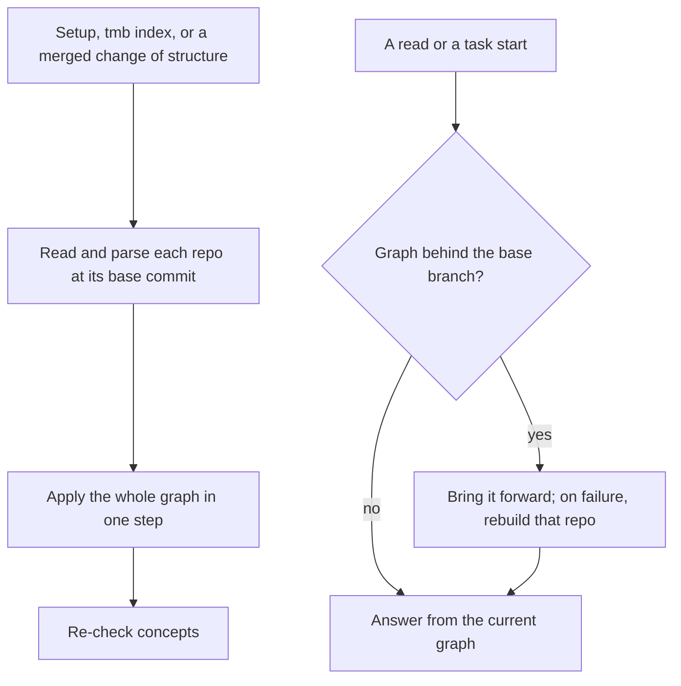

# Code graph

A graph of the project's code: its directories, files and symbols, and the links between them. Agents ask it where something lives and what depends on it, instead of reading whole files.

The plugin called this the world model.

## What it holds

- **Directories and files.** Each with a short summary taken from its README or its header.
- **Symbols.** Each file's definitions and the links between them: calls, imports, database reads and writes, and which tests cover what.
- **Concepts.** Flows and rules written by agents, each anchored to the symbols that carry it out. They link a design page to its code.

## What it answers

| Question | Asked by |
|---|---|
| What does this project look like? | The planner at the start of a session |
| Where does X live? | Every role |
| What calls or imports X, and which tests cover it? | The planner when it scopes a task; the worker before it changes X; the reviewer when it judges what a change may break |

## Rules

- **Built from git, never from the working folder.** Each repo is indexed at the commit of its base branch, so every session and worktree reads the same graph. A task's own commit is laid on top, so a worker sees its change and its base together.
- **It never guesses.** A reference is linked to a definition only on proof, such as a resolved import. What could not be resolved is reported as unresolved.
- **It can always be rebuilt.** Everything except concepts is derived from git. A rebuild keeps the concepts and re-checks each against the new graph; one whose code is gone is marked broken, never dropped.
- **It keeps itself fresh.** A read brings a graph that is behind its base branch forward before it answers. A full rebuild is the fallback.
- **Summaries are untrusted text.** They come from file contents, so they are shown to agents as data, never as instructions.
- **It works offline.** Indexing needs no network. Search by meaning uses a small local model; when that model is absent, search by name still works.

## Indexing

## Honest limits

Agents do not always use a graph when one is offered, and a symbol lookup can cost more than a plain text search for a simple question. So the graph is used where it earns its cost: scoping a task, and finding what a change may break. Plain search stays available for everything else, and every miss or wrong answer of the graph is recorded so its value can be measured.
