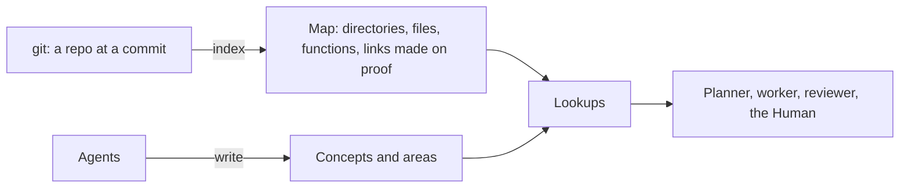
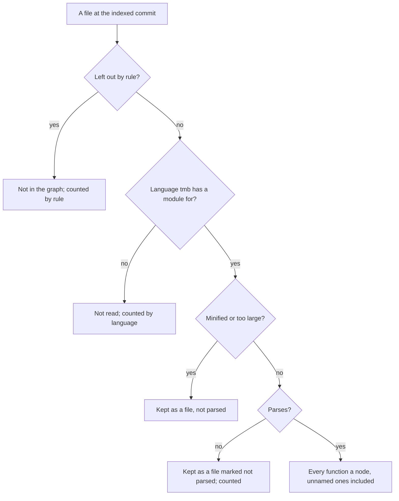
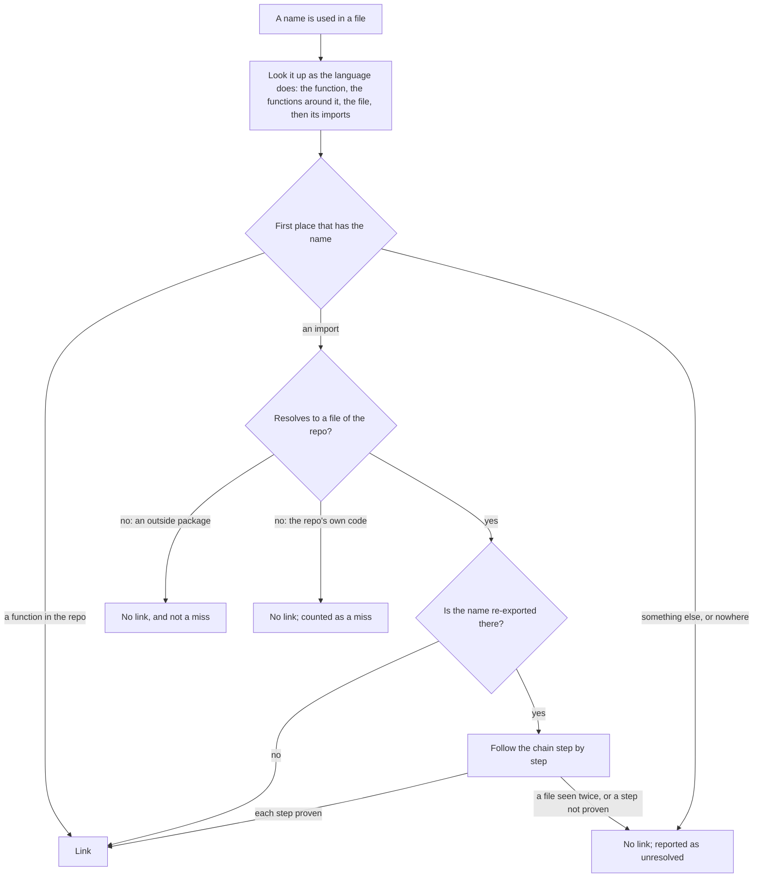
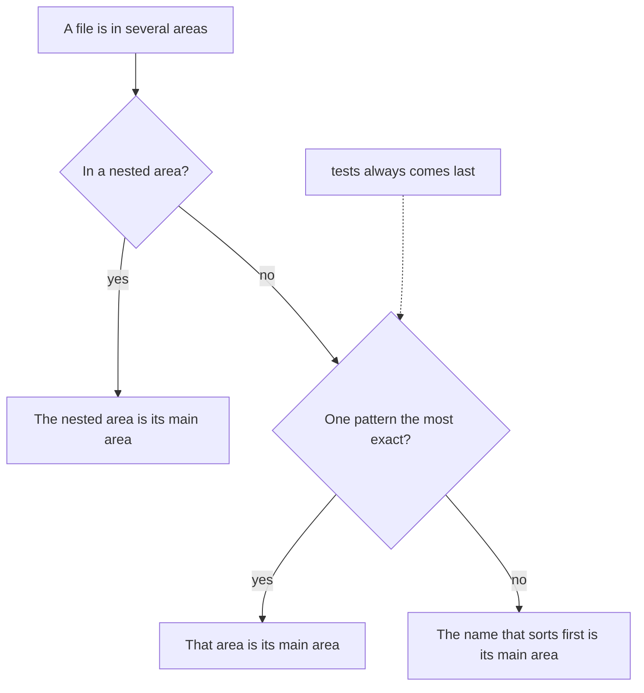
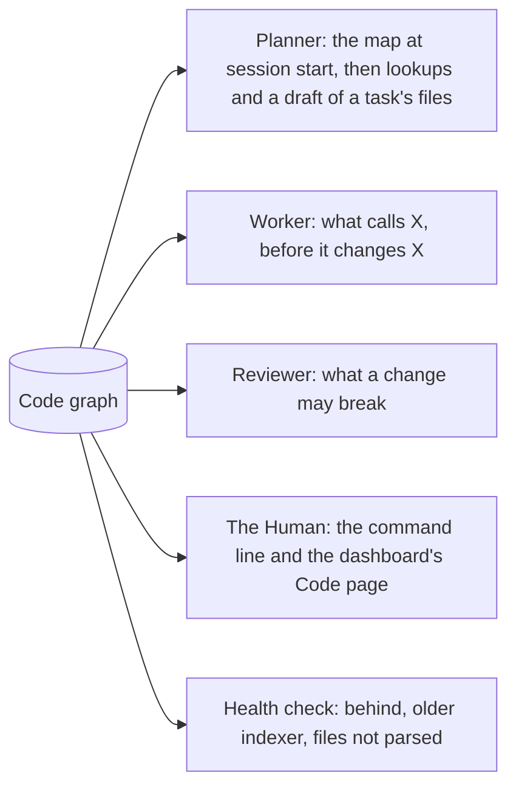

# Code graph

The planner is the architect of every project it works on. The code graph is the stable, queryable picture of the project it reasons from: its directories, files and symbols, and the links between them. Agents ask it where something lives and what depends on it, instead of reading whole files.

The code graph is the middle of the three knowledge layers ([README.md](README.md#three-layers-of-knowledge)): it holds the relationships the docs leave out and the code leaves implicit. A change to the code reaches it at the next index, so it never drifts from the code.

This page is the code graph in space: what it holds, how its parts connect and the reasons behind the design. How it is built, kept fresh and read through a task's layer is flow 2.2, in [2_CODE_GRAPH.md](../flows/2_CODE_GRAPH.md).

## Substrate

The code graph is not part of the record. It lives in its own file beside it, one per repo in a multi-repo workspace, and every row but the agent-written ones can be rebuilt from git.

- **It can always be rebuilt.** Everything except concepts and areas is derived from git. A rebuild throws the rest away, builds it again, keeps the concepts and areas and re-checks each against the new graph. One whose code is gone is marked broken, never dropped.
- **Indexing is not trajectory.** The record holds no entry for an index run. The graph file keeps, for each repo, the commit it was built at, when, and what it holds.
- **The commit and the graph are written together.** The commit a repo is indexed at, and the indexer version it was built with, are stored with the graph in one step, so an absent or emptied file always reads as never indexed.
- **A graph a newer tmb made is refused**, and the refusal says to update tmb.

| | Code graph | The record |
|---|---|---|
| Content | The project's map: directories, files, symbols, concepts and areas | Issues, notes and decisions, feature branches, tasks, runs, checks, reviews |
| Answers | "What does this project look like?", "Where does X live?", "Who calls X?" | "What did we decide?", "What's open?", "What did the worker commit?" |
| Source | Git, at a commit | The work, as it happens |

## Layers

- **Directories and files.** Each directory carries a summary from its README. Each file carries a short summary from its header. Summaries come from file contents, so every read presents them as untrusted: data, never instructions.
- **Symbols.** Each file's definitions and the links between them: calls, imports, database reads and writes, and which tests cover what. Every function is a node. It answers "where is X" and "who calls X" without re-reading code.
- **Concepts.** Agent-written flows and rules, each an ordered list of anchors to symbols or files. Every index of the base branch re-checks them. Concepts are the bridge from a design page here to the code that carries it out.
- **Areas.** The project's logical parts, such as login or billing, each a named group of files. See [Areas](#areas).

| Question | Asked by |
|---|---|
| What does this project look like? | The planner at the start of a session |
| Where does X live? | Every role |
| What calls or imports X, and which tests cover it? | The planner when it scopes a task; the worker before it changes X; the reviewer when it judges what a change may break |

## Design rationale

- **It never guesses.** A link is made only on proof, and that is the one promise. There is no second set of less-sure links, marked or not: studies of agents show wrong links cost more than missing ones, and none shows that marking a link as less sure helps. What could not be resolved is reported as unresolved. [Links on proof](#links-on-proof) has the rules.
- **Anchors are stable keys.** A concept anchor stores the path and the qualified name, not a row id. A re-parse never orphans it; a rename breaks it by design, so the concept is marked broken for review instead of silently following the wrong code.
- **Agents write concepts.** A concept is a flow or a rule, written through one tool with at least one anchor, and every anchor must be in the base branch's graph. Writing a name that exists replaces that concept. Any role may write one. Open, for the Human: whether only the planner writes concepts, at each close, and a worker only proposes them.
- **Built from git, never from the working folder.** Each repo is indexed at the commit of its base branch, so every session and worktree reads the same graph. One limit: the base branch is the local one, so a merge on GitHub is not seen until it is fetched.
- **One snapshot per repo, not history.** The graph holds each repo at one commit. On top sit layers: one per open feature branch and one per open task ([Task overlay](../flows/2_CODE_GRAPH.md#task-overlay)). Git is the history store: what changed between two commits is a diff, and the graph can be rebuilt at any commit.
- **One step per write.** An index reads and parses first, then applies the whole layer at once, so a reader sees the old graph or the new one, never a mix.
- **It works offline.** Indexing needs no network. Search is by name and by the words in a name; search by meaning is left out ([MEMORY.md](MEMORY.md#search)).
- **Answers stay shallow.** Search by name first, callers before callees, one step by default.
- **Honest limits.** Agents do not always use a graph when one is offered, and a symbol lookup can cost more than a plain text search for a simple question. So the graph is used where it earns its cost: scoping a task, and finding what a change may break. Plain search stays available for everything else, and an agent records every miss or wrong answer of the graph so its value can be measured.

## Every function

The graph shows code at function level, and no function is left out.

- **Every function is a node, unnamed ones included** (trustmybot/tmb#140), in TypeScript and JavaScript ([Languages](#languages)). Each symbol links to what contains it: a function, a class or the file. An unnamed function is named by where it is used, such as the callback of the call it is passed to, or else by its line.
- **Agents' answers do not change.** A lookup names the nearest named function, and unnamed functions stay out of search.
- **A coverage test holds it at 100%.** A second, independent parser, the TypeScript compiler, lists every function, and the graph must match it one to one, on tmb's own repo and on one public repo, hono at a fixed commit (trustmybot/tmb#247). [Benchmark](#benchmark) has the targets.
- **Nothing is skipped in silence.** A file that could not be parsed is in the graph as a file marked so, and indexing prints how many there are. "Not parsed" means only a file in a language tmb reads that failed to parse.
- **What the graph does not read is named and counted** (trustmybot/tmb#234). A lookup that finds nothing names the unread languages, so "not there" is never mistaken for "not read". A lookup of a file in an unread language says the file is there and its language is not read.
- **A minified file is kept as a file and not parsed** (trustmybot/tmb#232), whatever its name. The test is GitHub Linguist's: lines that average more than 110 characters. It holds for TypeScript and JavaScript. The reason: one bundle of one line can add thousands of functions and answer a search first.
- **Each caller and each callee is listed once, with its lines** (trustmybot/tmb#235). A test file full of unnamed callbacks is one caller with many lines, not one row per call. A row shows at most 10 lines and counts the rest. The cap of 50 counts distinct rows, and the answer says how many were cut. A call and a construction of the same target are two rows. The same holds in the tools' answers, on the command line and on the dashboard.

| What is not read | Rule |
|---|---|
| Left out by rule | Folders named `dist`, `node_modules` or `vendor`, as on Linguist's list of vendored paths; source maps; files named as minified; lockfiles |
| Read all the same | A folder named `build`: the graph is built from git, so build output that git ignores is never in it |
| Unread languages | Named from a copy of Linguist's programming languages, plus Vue and Svelte. Where languages share a file ending, Linguist's first one is named |
| Not counted | Prose, data, settings and images; code in a file ending tmb does not know. Planned (trustmybot/tmb#154): a file's language comes from Linguist's list |

### Languages

Each language is a module of its own (trustmybot/tmb#157). Every module answers the same questions for the engine, and one list names the modules, so adding a language touches nothing else. A language's parser loads only when a file in that language is read.

| Module | Every function a node | Lookup the way the language does it |
|---|---|---|
| TypeScript, TSX and JavaScript, one module | Yes | Yes |
| Python | Planned (trustmybot/tmb#141) | Yes |
| bash, SQL, Perl | Planned (trustmybot/tmb#141) | No |

## Links on proof

- **A name is looked up the way the language looks it up** (trustmybot/tmb#246), in TypeScript, JavaScript and Python. The first place that has the name decides. If what is found there is not a function in the repo, there is no link, and the lookup does not go on to another function of the same name. A call on the object itself looks only in its class and the class's parents.
  - A name imported inside a Python function holds only in that function. A name imported under a new name is looked up in the file that import names.
  - Left with no link, and planned as proofs of their own (trustmybot/tmb#249): a call on the parent, the object itself inside a class written as an expression, and a Python class with several parents unless exactly one of them has the method.
  - Planned (trustmybot/tmb#287): the lookup sees four more bindings. Without them each can give a wrong link.
- **Imports through a path alias or a package name resolve to their files** (trustmybot/tmb#147). A TypeScript or JavaScript import that is not a relative path is resolved the way the TypeScript compiler does it: through the nearest project settings file above the importing file, read at the indexed commit. An import of a package that lives in the same repo links to that package's entry file. Two packages of the same name are not linked.
- **A name that reaches a file through a re-export links to where it is declared** (trustmybot/tmb#233). A re-export is proof. The import's link to the re-exporting file stays.

| Re-exports | Followed | Not followed |
|---|---|---|
| TypeScript and JavaScript | By name, with or without a new name; an import followed by an export; a star, which never gives the default export; a star under a name | CommonJS; a re-export of a default export |
| Python | A top-level `from .a import f`, with or without a new name; `from .a import *`, which follows `__all__` when it is a plain list of names and otherwise the public top-level names | An import under `if` or `try`; an `__all__` built by code; `import pkg` followed by `pkg.f()`, which is not a re-export |
| Ties | A name the file declares or exports by name wins over a star | A name two stars bring from different declarations stays unresolved |

- **Every link between files is checked against the TypeScript compiler** (trustmybot/tmb#242), in TypeScript and JavaScript, on tmb's own repo and on hono at a fixed commit, on every pull request. A link is right when it names a declaration the compiler gives for that name. A missing link is no failure. A link the compiler cannot answer for is counted and not judged.
- **Misses are counted.** Each build counts the imports that name the repo's own code and link to no file, and indexing prints the count.

The design for links is trustmybot/tmb#250. Its next steps are in [Planned](#planned).

## Areas

The planner can say which logical part a piece of code belongs to, and tests are one area (trustmybot/tmb#146).

- **An area is a named group of files**, with a one-line purpose. It is defined by path patterns to include and to leave out. A path rule cannot tell login from billing, so the planner names the areas and tmb stores and checks them. A function takes its file's area.
- **Only the planner writes or removes an area.** It proposes the areas to the Human at onboarding ([2_ONBOARD.md](../flows/2_ONBOARD.md)). Every role can list them, and so can the Human from the command line.
- **"tests" is there from the start**, and holds every file the built-in test rule matches. The planner changes that rule on the area itself, with patterns to add and to leave out. It cannot be removed.
- **One level of nesting.** An area may have a parent.
- **A file can be in several areas, and has one main area**, by the order in the chart. A test file inside billing has billing as its main area and is also in tests.
- **Files in no area are listed, with their count**, so the planner sees what is not placed yet.
- **A pattern that matches no file is refused**, with the reason.
- **Areas are kept through a rebuild and re-checked**, as concepts are. One that matches no file is marked broken. One whose size moved by more than a quarter since it was written is marked for the planner to look at.
- **Where an area shows.** Every file's and function's answer names its areas, main one first. Search and scoping can stay inside one area and the areas nested in it, or leave areas out, such as tests. A filter matches any area a file is in, and the anchors a caller names stay in a scope regardless. An unknown area is refused with the list of areas. On the dashboard's Code page the files of an area inside a folder are drawn in one tinted box.
- **Why the most exact pattern wins.** In a CODEOWNERS file, the usual standard for "who owns which paths", the last matching pattern wins. Areas have no order between them, so the most exact pattern wins, as in URL routing.

## Consumers

- **The planner** reads the map at cold start and asks "where does X live" directly. A scope gives it a draft of a task's files: the hits for the task's objective, plus the callers, importers and tests of the symbols it names.
- **The dashboard has a Code page** (trustmybot/tmb#142): folders, then files, then functions, one level at a time, and a view of one function with its callers and what it calls. It never draws every function at once. In a multi-repo workspace it opens on the list of repos, and the page's address names the repo, so a link to one repo's graph can be shared.
- **The command line reads the same graph** as the tools ([the reference](../reference/README.md#the-record-from-the-command-line)).

## Benchmark

The graph is measured against the TypeScript compiler, on tmb's own repo and on one public repo, hono at a fixed commit.

- **Functions found has a target, 100%, and is a test** (trustmybot/tmb#247): the graph matches the compiler's list of functions one to one.
- **Links right has a target, 100%, and is a test** (trustmybot/tmb#242): no link the graph makes is wrong. **Links found is tracked and has no target**, so that nothing pushes the graph to guess.
- **Why links are missed.** The graph leaves a call unlinked when proving it needs the type of the thing it is called on, such as `import pkg` followed by `pkg.f()`.

## Schema

The code graph lives in its own SQLite file, apart from the record, so a build never holds the record's write lock: `.tmb/graph.db`, or in a multi-repo workspace one per repo, `.tmb/graphs/<repo>.db`. Its schema is `src/engine/graph/db.ts`, at `GRAPH_SCHEMA_VERSION = 5`.

**This section lists every table and column of the graph file.** A schema change updates it in the same pull request. Planned: a generator with a freshness test that fails when it drifts.

| Group | Tables | Rebuilt from |
|---|---|---|
| Layers | `layers` | the next read or build |
| Map | `dirs`, `files`, `symbols`, `edges` | a commit in git, one copy per layer |
| Parse cache | `parsed` | file contents, keyed by blob, language and extractor version |
| Concepts and areas | `concepts`, `concept_anchors`, `areas` | nothing: agents write them, and a rebuild keeps and re-checks them |
| Misses | `misses` | nothing: lookups that found nothing, or that an agent reported wrong |
| Search | `symbols_fts`, `files_fts`, `dirs_fts` | the rows they index |

- **Layers.** `base` is the base branch's commit. `task:<id>` is an open task's commit laid on top, and `feature:<id>` is a feature branch's tip, for each feature branch that is neither merged nor closed.
- **Its own schema version.** The graph file has its own version and upgrade steps, apart from the record's. A file a newer tmb made is refused. A layer built by an older extractor is rebuilt at the next read.
- **No link across the two files.** A graph row holds a task id, a feature id or a commit as a plain value.
- **Every graph has the `tests` area** from the start, marked `builtin`.

### Diagram

```mermaid
erDiagram

    concepts ||--o{ concept_anchors : "concept_id (CASCADE)"
    areas |o--o{ areas : "parent_id (SET NULL)"
    layers {
        TEXT layer PK
        TEXT commit_sha "NOT NULL"
        INTEGER extractor "NOT NULL"
        TEXT built_at "NOT NULL"
        INTEGER files "NOT NULL"
        INTEGER symbols "NOT NULL"
        INTEGER edges "NOT NULL"
        INTEGER unresolved "NOT NULL"
        INTEGER unresolved_imports "NOT NULL"
        INTEGER functions "NOT NULL"
        INTEGER not_parsed "NOT NULL"
        TEXT not_read "NOT NULL"
    }
    dirs {
        TEXT layer PK "NOT NULL"
        TEXT path PK "NOT NULL"
        TEXT parent
        INTEGER depth "NOT NULL"
        TEXT summary "NOT NULL"
        TEXT summary_source "NOT NULL"
        INTEGER file_count "NOT NULL"
    }
    files {
        TEXT layer PK "NOT NULL"
        TEXT path PK "NOT NULL"
        TEXT dir "NOT NULL"
        TEXT lang
        TEXT blob "NOT NULL"
        INTEGER size "NOT NULL"
        TEXT lane "NOT NULL"
        TEXT summary "NOT NULL"
        TEXT summary_source "NOT NULL"
        TEXT parse_error
    }
    symbols {
        INTEGER id PK
        TEXT layer "NOT NULL"
        TEXT path "NOT NULL"
        TEXT kind "NOT NULL"
        TEXT qualified_name "NOT NULL"
        TEXT name "NOT NULL"
        TEXT signature "NOT NULL"
        TEXT doc "NOT NULL"
        INTEGER start_line
        INTEGER end_line
        INTEGER exported "NOT NULL"
        INTEGER parent_id
        INTEGER unnamed "NOT NULL"
        INTEGER named_id
    }
    edges {
        TEXT layer "NOT NULL"
        INTEGER src_id "NOT NULL"
        INTEGER dst_id
        TEXT dst_name "NOT NULL"
        TEXT kind "NOT NULL"
        TEXT resolution "NOT NULL"
        INTEGER line
        TEXT hint
    }
    parsed {
        TEXT blob PK "NOT NULL"
        TEXT lang PK "NOT NULL"
        INTEGER extractor PK "NOT NULL"
        TEXT extraction
        TEXT error
    }
    concepts {
        TEXT id PK
        TEXT name "NOT NULL; UNIQUE"
        TEXT kind "NOT NULL"
        TEXT body "NOT NULL"
        TEXT status "NOT NULL"
        TEXT status_reason
        TEXT checked_at
        TEXT checked_sha
        TEXT created_by "NOT NULL"
        TEXT updated_by "NOT NULL"
        TEXT created_at "NOT NULL"
        TEXT updated_at "NOT NULL"
    }
    concept_anchors {
        TEXT concept_id PK,FK "NOT NULL; → concepts.id"
        INTEGER ordinal PK "NOT NULL"
        TEXT path "NOT NULL"
        TEXT qualified_name "NOT NULL"
        INTEGER present "NOT NULL"
    }
    areas {
        TEXT id PK
        TEXT name "NOT NULL; UNIQUE"
        TEXT purpose "NOT NULL"
        TEXT parent_id FK "→ areas.id"
        TEXT include "NOT NULL"
        TEXT exclude "NOT NULL"
        INTEGER builtin "NOT NULL"
        TEXT status "NOT NULL"
        TEXT status_reason
        INTEGER file_count "NOT NULL"
        INTEGER written_count "NOT NULL"
        TEXT checked_sha
        TEXT created_by "NOT NULL"
        TEXT updated_by "NOT NULL"
        TEXT created_at "NOT NULL"
        TEXT updated_at "NOT NULL"
    }
    misses {
        INTEGER id PK
        TEXT at "NOT NULL"
        TEXT lookup "NOT NULL"
        TEXT query "NOT NULL"
        TEXT detail "NOT NULL"
        TEXT actor "NOT NULL"
    }
```

### Tables

#### `layers`

| Column | Type | Null | Default | Constraints |
|---|---|---|---|---|
| `layer` | TEXT | nullable |  | PK |
| `commit_sha` | TEXT | NOT NULL |  |  |
| `extractor` | INTEGER | NOT NULL |  |  |
| `built_at` | TEXT | NOT NULL |  |  |
| `files` | INTEGER | NOT NULL |  |  |
| `symbols` | INTEGER | NOT NULL |  |  |
| `edges` | INTEGER | NOT NULL |  |  |
| `unresolved` | INTEGER | NOT NULL |  |  |
| `unresolved_imports` | INTEGER | NOT NULL | `0` |  |
| `functions` | INTEGER | NOT NULL | `0` |  |
| `not_parsed` | INTEGER | NOT NULL | `0` |  |
| `not_read` | TEXT | NOT NULL | `'{}'` |  |

#### `dirs`

| Column | Type | Null | Default | Constraints |
|---|---|---|---|---|
| `layer` | TEXT | NOT NULL |  |  |
| `path` | TEXT | NOT NULL |  |  |
| `parent` | TEXT | nullable |  |  |
| `depth` | INTEGER | NOT NULL |  |  |
| `summary` | TEXT | NOT NULL | `''` |  |
| `summary_source` | TEXT | NOT NULL | `'none'` |  |
| `file_count` | INTEGER | NOT NULL | `0` |  |

Table constraints:

- PRIMARY KEY `(layer, path)`

#### `files`

| Column | Type | Null | Default | Constraints |
|---|---|---|---|---|
| `layer` | TEXT | NOT NULL |  |  |
| `path` | TEXT | NOT NULL |  |  |
| `dir` | TEXT | NOT NULL |  |  |
| `lang` | TEXT | nullable |  |  |
| `blob` | TEXT | NOT NULL |  |  |
| `size` | INTEGER | NOT NULL |  |  |
| `lane` | TEXT | NOT NULL |  |  |
| `summary` | TEXT | NOT NULL | `''` |  |
| `summary_source` | TEXT | NOT NULL | `'none'` |  |
| `parse_error` | TEXT | nullable |  |  |

Table constraints:

- PRIMARY KEY `(layer, path)`

#### `symbols`

| Column | Type | Null | Default | Constraints |
|---|---|---|---|---|
| `id` | INTEGER | nullable |  | PK |
| `layer` | TEXT | NOT NULL |  |  |
| `path` | TEXT | NOT NULL |  |  |
| `kind` | TEXT | NOT NULL |  |  |
| `qualified_name` | TEXT | NOT NULL |  |  |
| `name` | TEXT | NOT NULL |  |  |
| `signature` | TEXT | NOT NULL | `''` |  |
| `doc` | TEXT | NOT NULL | `''` |  |
| `start_line` | INTEGER | nullable |  |  |
| `end_line` | INTEGER | nullable |  |  |
| `exported` | INTEGER | NOT NULL | `0` |  |
| `parent_id` | INTEGER | nullable |  |  |
| `unnamed` | INTEGER | NOT NULL | `0` |  |
| `named_id` | INTEGER | nullable |  |  |

#### `edges`

| Column | Type | Null | Default | Constraints |
|---|---|---|---|---|
| `layer` | TEXT | NOT NULL |  |  |
| `src_id` | INTEGER | NOT NULL |  |  |
| `dst_id` | INTEGER | nullable |  |  |
| `dst_name` | TEXT | NOT NULL |  |  |
| `kind` | TEXT | NOT NULL |  |  |
| `resolution` | TEXT | NOT NULL |  | CHECK `resolution IN ('exact', 'name', 'unresolved')` |
| `line` | INTEGER | nullable |  |  |
| `hint` | TEXT | nullable |  |  |

#### `parsed`

| Column | Type | Null | Default | Constraints |
|---|---|---|---|---|
| `blob` | TEXT | NOT NULL |  |  |
| `lang` | TEXT | NOT NULL |  |  |
| `extractor` | INTEGER | NOT NULL |  |  |
| `extraction` | TEXT | nullable |  |  |
| `error` | TEXT | nullable |  |  |

Table constraints:

- PRIMARY KEY `(blob, lang, extractor)`

#### `concepts`

| Column | Type | Null | Default | Constraints |
|---|---|---|---|---|
| `id` | TEXT | nullable |  | PK |
| `name` | TEXT | NOT NULL |  | UNIQUE |
| `kind` | TEXT | NOT NULL |  | CHECK `kind IN ('flow', 'rule')` |
| `body` | TEXT | NOT NULL |  |  |
| `status` | TEXT | NOT NULL |  | CHECK `status IN ('verified', 'broken')` |
| `status_reason` | TEXT | nullable |  |  |
| `checked_at` | TEXT | nullable |  |  |
| `checked_sha` | TEXT | nullable |  |  |
| `created_by` | TEXT | NOT NULL |  |  |
| `updated_by` | TEXT | NOT NULL |  |  |
| `created_at` | TEXT | NOT NULL |  |  |
| `updated_at` | TEXT | NOT NULL |  |  |

#### `concept_anchors`

| Column | Type | Null | Default | Constraints |
|---|---|---|---|---|
| `concept_id` | TEXT | NOT NULL |  | FK → `concepts.id` ON DELETE CASCADE |
| `ordinal` | INTEGER | NOT NULL |  |  |
| `path` | TEXT | NOT NULL |  |  |
| `qualified_name` | TEXT | NOT NULL | `''` |  |
| `present` | INTEGER | NOT NULL | `1` |  |

Table constraints:

- PRIMARY KEY `(concept_id, ordinal)`

#### `areas`

| Column | Type | Null | Default | Constraints |
|---|---|---|---|---|
| `id` | TEXT | nullable |  | PK |
| `name` | TEXT | NOT NULL |  | UNIQUE |
| `purpose` | TEXT | NOT NULL |  |  |
| `parent_id` | TEXT | nullable |  | FK → `areas.id` ON DELETE SET NULL |
| `include` | TEXT | NOT NULL |  |  |
| `exclude` | TEXT | NOT NULL |  |  |
| `builtin` | INTEGER | NOT NULL | `0` |  |
| `status` | TEXT | NOT NULL |  | CHECK `status IN ('ok', 'broken', 'review')` |
| `status_reason` | TEXT | nullable |  |  |
| `file_count` | INTEGER | NOT NULL | `0` |  |
| `written_count` | INTEGER | NOT NULL | `0` |  |
| `checked_sha` | TEXT | nullable |  |  |
| `created_by` | TEXT | NOT NULL |  |  |
| `updated_by` | TEXT | NOT NULL |  |  |
| `created_at` | TEXT | NOT NULL |  |  |
| `updated_at` | TEXT | NOT NULL |  |  |

#### `misses`

| Column | Type | Null | Default | Constraints |
|---|---|---|---|---|
| `id` | INTEGER | nullable |  | PK |
| `at` | TEXT | NOT NULL |  |  |
| `lookup` | TEXT | NOT NULL |  |  |
| `query` | TEXT | NOT NULL |  |  |
| `detail` | TEXT | NOT NULL | `''` |  |
| `actor` | TEXT | NOT NULL |  |  |

### Foreign keys

| Column | References | On delete |
|---|---|---|
| `concept_anchors.concept_id` | `concepts.id` | CASCADE |
| `areas.parent_id` | `areas.id` | SET NULL |

The graph file opens with `foreign_keys = ON`.

### Search indexes

All are FTS5 virtual tables.

| Index | File | Indexed columns | Unindexed columns | Tokenizer |
|---|---|---|---|---|
| `symbols_fts` | graph | `terms`, `doc` | `symbol_id`, `layer` | default |
| `files_fts` | graph | `terms`, `summary` | `layer`, `path` | default |
| `dirs_fts` | graph | `terms`, `summary` | `layer`, `path` | default |

### Indexes

| Index | Table | Columns | Unique |
|---|---|---|---|
| `files_dir` | `files` | `layer, dir` | no |
| `symbols_named` | `symbols` | `named_id` | no |
| `symbols_parent` | `symbols` | `parent_id` | no |
| `symbols_path` | `symbols` | `layer, path` | no |
| `symbols_qualified` | `symbols` | `layer, qualified_name COLLATE NOCASE` | no |
| `symbols_name` | `symbols` | `layer, name COLLATE NOCASE` | no |
| `edges_name` | `edges` | `layer, dst_name` | no |
| `edges_dst` | `edges` | `dst_id` | no |
| `edges_src` | `edges` | `src_id` | no |

## Planned

| Piece | Issue |
|---|---|
| Links found, measured for every release as a benchmark | trustmybot/tmb#244 |
| Every link records the proof it was made on, for a score per proof and for the dashboard; not added to an agent's answer | trustmybot/tmb#251 |
| A function says how many of its calls are not linked: linked, to code outside the repo, and not known. An agent that sees calls not known searches by text for the rest | trustmybot/tmb#252 |
| A method call linked when the object's type is written in the same function or class: the object itself, an object made there by the class's name, a written type, or a module's or class's name. The method must exist on that type or a parent of it, in the repo. Types worked out from callers, return values or chained calls are not used, because they cost much and find little | trustmybot/tmb#249 |
| Python, bash and the other languages get every function too, each with its own coverage test. Their rules are written as tree-sitter queries, the form GitHub's code navigation and Neovim use; TypeScript's rules move to that form after | trustmybot/tmb#141 |
| A file's language comes from Linguist's list | trustmybot/tmb#154 |
| A same-repo package whose entry is build output links to its source, only where the package's TypeScript settings state both the source and the output folder | trustmybot/tmb#236 |
