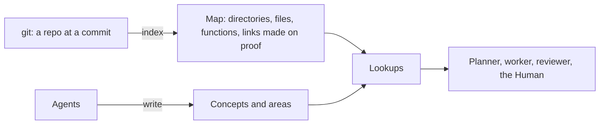
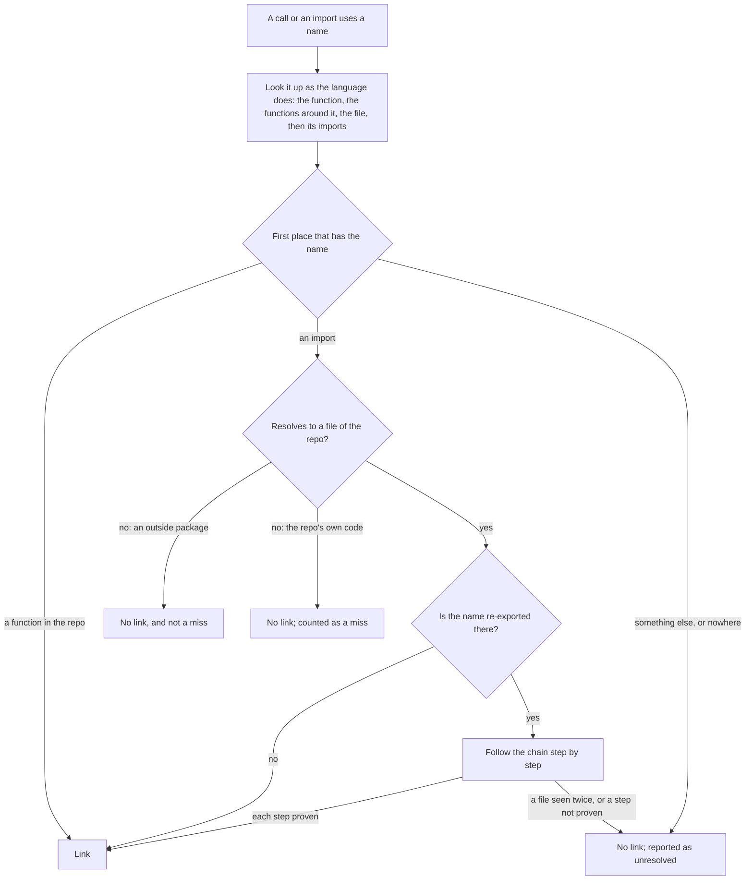
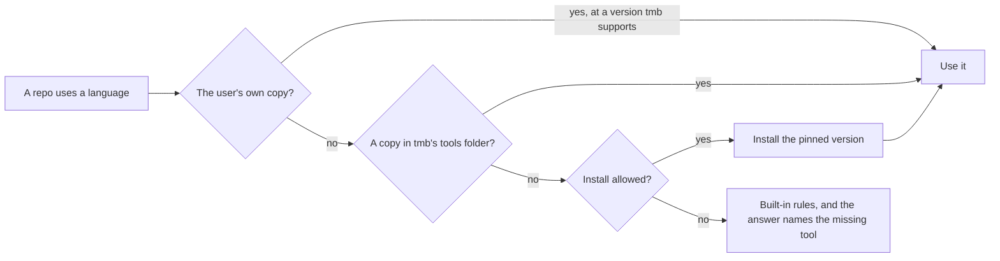
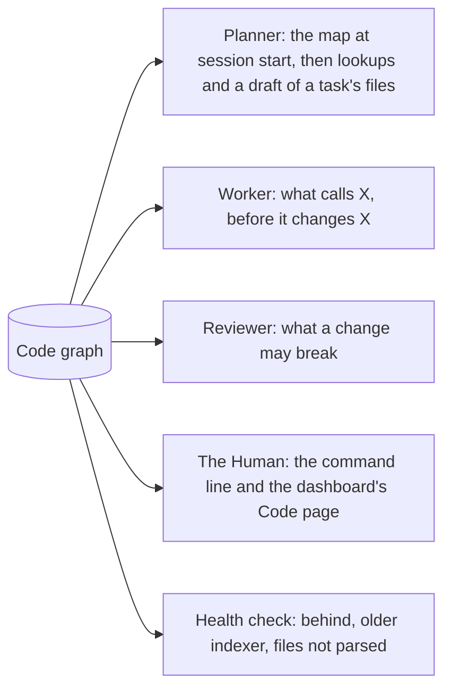

# Code graph

The code graph is the stable, queryable picture of a project: its directories, files and symbols, and the links between them. The planner is the architect of every project it works on and reasons from this picture. Agents ask it where something lives and what depends on it, instead of reading whole files.

It has two purposes, and the second stands on the first.

| Purpose | What it means | State |
|---|---|---|
| 1. Cover the codebase | An agent still reads code, but only the code that matters. The graph narrows the scope, so a task costs fewer tokens and fits a smaller context. A text search returns unrelated hits and misses real ones; the graph returns proven links. So it must hold close to 100% of the code's relationships | Built in part; measured in [Benchmark](#benchmark) |
| 2. Bridge design and code | Design and code drift apart in every real project. The graph ties a design to the code that carries it out, so the project's picture stays fresh and drift is seen | Open, for the Human. [Concepts](#concepts) and [Areas](#areas) are its first parts |

- **Example 1.** A worker is about to change `Cart.total`. A text search for "total" returns every use of the word. The graph returns the callers of that one method, and the worker reads only those.
- **Example 2.** A bridge on a graph that misses half the calls would tie a design to half the code. So coverage comes first.

It is the middle of the three knowledge layers ([README.md](README.md#three-layers-of-knowledge)): it holds the relationships the docs leave out and the code leaves implicit. A change to the code reaches it at the next index, so it never drifts from the code.

This page is the rules of the graph: what it holds, how its parts connect and why. The per-language cases, the edge cases and the schema's tables are in [CODE_GRAPH_DETAILS.md](CODE_GRAPH_DETAILS.md). How the graph is built, kept fresh and read through a task's layer is flow 2.2, in [2_CODE_GRAPH.md](../flows/2_CODE_GRAPH.md).

## Terms

| Word | Meaning | Example |
|---|---|---|
| Node | One thing in the graph: a directory, a file, or a symbol | The file `cart.ts`; the function `total` in it |
| Symbol | Something the code declares. [Kinds of symbol](#kinds-of-symbol) lists them | `class Cart`, `function total()` |
| Callable | Code that can be called: a function or a method | `total()`, `Cart.total()` |
| Name | The word the code uses for a symbol at one place. A name is not the symbol: the same word can mean different symbols in different files, and one symbol can be reached under several names | `total` in `cart.ts` and `total` in `report.ts` are two symbols. `import { total as sum }` makes `sum` a second name for one symbol |
| Qualified name | A symbol's full name inside its file, which tells it apart from others of the same name | `Cart.total` |
| Link | A proven relation between two nodes: a call, an import, a database read or write, or a test covering code | `checkout()` calls `Cart.total` |
| Resolve | To find which symbol a name means at the place it is used | `sum(...)` in `checkout.ts` resolves to `total` in `cart.ts` |
| Layer | One snapshot of a repo at one commit | The base branch's commit; an open task's commit |

## What it holds

| Kind | Holds | Source |
|---|---|---|
| Directories and files | Each directory with a summary from its README. Each file with a short summary from its header | Git |
| Symbols | Each file's definitions and the links between them: calls, imports, database reads and writes, and which tests cover what. Every function is a node | Git |
| Concepts | Flows and rules, each an ordered list of anchors to symbols or files. See [Concepts](#concepts) | Agents |
| Areas | The project's logical parts, such as login or billing. Each is a named group of files; Planned (trustmybot/tmb#308): of functions. See [Areas](#areas) | The planner |

Two things contain a symbol:

| Container | Kind | Decided by | Example |
|---|---|---|---|
| File | Physical | Git, with no judgment | A file with 10 classes and 100 functions holds all 110 symbols |
| Area | Logical | The planner's judgment | "billing" holds the code that bills, wherever its files are |

- **Example.** The symbols answer "where is X" and "who calls X" without re-reading code.
- **Edge case.** Summaries come from file contents, so every read presents them as untrusted: data, never instructions.

## Substrate

The code graph is not part of the record. It lives in its own file beside it, one per repo in a multi-repo workspace, and every row but the agent-written ones can be rebuilt from git. What the record holds is in [TRAJECTORY.md](TRAJECTORY.md).

- **Built from git, never from the working folder.** Each repo is indexed at the commit of its base branch, so every session and worktree reads the same graph. One limit: the base branch is the local one, so a merge on GitHub is not seen until it is fetched. Planned (trustmybot/tmb#70): the syncer brings what happened on the remote in, so the graph follows it.
- **One snapshot per repo, not history.** The graph holds each repo at one commit. On top sit layers: one per open feature branch and one per open task ([Task overlay](../flows/2_CODE_GRAPH.md#task-overlay)). Git is the history store, and the graph can be rebuilt at any commit.
- **The commit is on the layer, not on each node.** A layer records the one commit it was built at. A node records its file and its lines. The graph links no commit to another and keeps no node's past.
  - **Example.** "Who calls `total` now?" is a graph question, answered at the layer's commit. "When did `total` change, and why?" is a git question.
- **The graph file is not committed with the code.** It is a cache built from a commit, and the commit names it. Checking out an older commit and indexing gives that commit's graph again.
- **It can always be rebuilt.** Everything except concepts and areas is derived from git. A rebuild throws the rest away, builds it again, keeps the concepts and areas and re-checks each against the new graph. One whose code is gone is marked broken, never dropped.
- **One step per write.** An index reads and parses first, then applies the whole layer at once. A reader sees the old graph or the new one, never a mix.
- **The commit and the graph are written together.** The commit a repo is indexed at, and the indexer version it was built with, are stored with the graph in one step. So an absent or emptied file always reads as never indexed.
- **Issues and decisions are not in the graph.** The record already ties a commit to its task and its issue. Open, for the Human: whether a code answer also names the issues that changed that code, joined from the record at read time, and whether a concept links to a design page.
- **Indexing is not trajectory.** The record holds no entry for an index run. The graph file keeps, for each repo, the commit it was built at, when, and what it holds.
- **It works offline.** Indexing needs no network. Search is by name and by the words in a name; search by meaning is left out ([MEMORY.md](MEMORY.md#search)).
- **Edge case.** A newer tmb made the graph file. The graph is refused, and the refusal says to update tmb.

## Every function

The graph shows code at function level, and no function is left out.

- **Every function is a node, unnamed ones included**, in TypeScript and JavaScript ([Languages](#languages)). Each symbol links to what contains it: a function, a class or the file.
  - **What an unnamed function is.** A function written as a value with no name: an arrow function or a function expression in TypeScript and JavaScript, a `lambda` in Python (Planned, trustmybot/tmb#141). A nested helper that has a name is a named function, not this.
  - **Example.** In `items.map(x => x.price)` the callback is an unnamed function. Its node is named by where it is used, here the callback of `map`, or else by its line.
  - **Why it is a node.** A call made inside a callback needs an owner, and the count of functions can then be checked one to one against the compiler's list.
- **Unnamed functions never show to a reader.** They stay out of search, and a lookup names the nearest named function instead.
  - **Example.** A test calls `total()` inside `it("adds", () => { ... })`. The answer to "who calls `total`" names the nearest named function around the callback, not the callback.
  - **Its links can leave the file.** Nothing in another file can call a function with no name, but the calls it makes can reach any file, so they need this owner.
- **A coverage test holds it at 100%** ([Benchmark](#benchmark)).
- **Nothing is skipped in silence.** A file that could not be parsed is in the graph as a file marked so, and indexing prints how many there are. "Not parsed" means only a file in a language tmb reads that failed to parse.
- **What the graph does not read is named and counted.**
  - **Example.** A lookup finds nothing. Its answer names the unread languages, so "not there" is never mistaken for "not read". A lookup of a file in an unread language says the file is there and its language is not read.
- **A minified file is kept as a file and not parsed**, whatever its name. The test is the one used by [GitHub Linguist](https://github.com/github-linguist/linguist), the library GitHub uses to tell a repo's languages and to mark vendored and generated files: lines that average more than 110 characters. It holds for TypeScript and JavaScript.
  - **Why.** One bundle of one line can add thousands of functions and answer a search first.
- **A file's language comes from Linguist's data**, and the repo's `.gitattributes` wins. What happens to each file, what is left out by rule, and how a shared file ending is settled, are in [What is not read, and a file's language](CODE_GRAPH_DETAILS.md#what-is-not-read-and-a-files-language).
  - **Example.** `Makefile` is Makefile by its name. `run` has no ending and starts with `#!/usr/bin/env python3`, so it is Python.

### Kinds of symbol

The graph uses one set of kinds for every language. Each language module maps its own syntax to them. The stored kinds are this set, each stored under its name here in lower case. The lowest node is a callable or a field. Nothing inside a function is a node.

| Kind | Meaning, in any language | A node |
|---|---|---|
| File | One source file. The physical container | Yes |
| Type | A named shape that holds members: a class, an interface, a struct, a trait | Yes |
| Function | A callable declared outside any type | Yes |
| Method | A callable declared inside a type. It may need an object or only the type | Yes |
| Constructor | The method that runs when an object is made | Yes, as a method |
| Accessor | A method that is called like a field: a getter or a setter | Yes, as a method |
| Unnamed function | A callable written as a value with no name | Yes, hidden: a function or a method, marked unnamed |
| Field | Data stored on a type or on each of its objects | Planned (trustmybot/tmb#312) |
| File-level data | A constant or variable declared outside any type or function, each name a destructuring binds included | Yes |
| Data source | A place the code reads or writes data: a table, a bucket, a collection, a queue ([Data sources](#data-sources)) | A table, a database and a queue. Planned (trustmybot/tmb#398): a bucket and a collection |
| Local | A variable, a parameter or a statement inside a callable; a name bound by a block, a loop or a catch at file level, when the language's scope rule hides it from the rest of the file | No |

- **Everything is a node, and the graph judges nothing.** A member is in the graph whether or not anything uses it. Showing it costs almost nothing; deciding which members matter would cost a judgment on every one.
- **What uses a symbol is read from its links.** A symbol with links from outside its type or file has users there. One with none has none yet.
  - **Example.** `Cart.total` has callers in three files, so a change to it reaches them. `Cart.recount` is called only inside `Cart`, so a change to it stays there. Both are nodes; the links tell them apart.
  - **Edge case.** A static method is no different: `Cart.round(x)` may be called from anywhere, and its links show from where.
- **A member is always inside its type.** A method, a constructor, an accessor and a field are never standalone nodes: each is held by its type and named through it, as `Cart.total`.
- **Why it stops at callables and fields.** A local cannot be reached from another callable, so no question across the code needs it.

How TypeScript and Python write each kind, what a link rule means by a class, where a symbol's lines start, and which names the language's scope rule makes file-level data are in [Kinds of symbol: cases](CODE_GRAPH_DETAILS.md#kinds-of-symbol-cases).

### Languages

Each language is a module of its own. Every module answers the same questions for the engine, and one list names the modules, so adding a language touches nothing else. A language's parser loads only when a file in that language is read.

| Module | Every function a node | Lookup the way the language does it |
|---|---|---|
| TypeScript, TSX and JavaScript, one module | Yes | Yes |
| Python | Planned (trustmybot/tmb#141) | Yes |
| Go | Yes | Yes |
| Java | Yes | Yes |
| Rust | Yes | Yes |
| C, C++ | Planned (trustmybot/tmb#387): a function made by a macro is missed, and an `#if` inside a construct can hide one | Yes |
| bash, SQL, Perl | Planned (trustmybot/tmb#141) | No |

## Links on proof

The graph never guesses. A link is made only on proof, and that is the one promise. What could not be resolved is reported as unresolved. There is no second set of less-sure links, marked or not: a missing link is reported and the agent searches by text for the rest, while a wrong link sends it to the wrong code with no warning.

**How a name is resolved.** Not by searching for the word. tmb parses each file into its syntax tree with a parser (tree-sitter), so it knows which words are calls and imports and which are variables, strings or comments. It then resolves each called or imported name by the language's own scope rules, the way the compiler would. These built-in rules run no compiler; the TypeScript compiler is the independent check that every link they make is right ([Benchmark](#benchmark)). Asking the compiler itself is the second way ([Two ways to make links](#two-ways-to-make-links)).

- **Example 1.** Two files each declare `total`. A call in `checkout.ts` links to the one `checkout.ts` imports, never to the other.
- **Example 2.** A function calls a name imported from an outside package: no link, and not a miss. Outside means a package the project installs, such as one from a public registry. A package that lives in the same repo is the repo's own code and is linked.
- **Edge case.** `import pkg` followed by `pkg.f()`. Proving the call needs the type of the thing it is called on, so there is no link.
- **Misses are counted.** Each build counts the imports that name the repo's own code and link to no file, and indexing prints the count.

Which written type proves a method call, the lookup order, imports through an alias or a package name, re-exports and an import that names a folder are in [How a name is looked up](CODE_GRAPH_DETAILS.md#how-a-name-is-looked-up).

### The three states of a call

Every call is in exactly one state, and a function's answer gives the count of each.

| State | Meaning | Example |
|---|---|---|
| Linked | Proven to reach a symbol in the repo | `total()` declared in the same file |
| Outside | Proven to reach code outside the repo: an installed package or the language's built-ins | `import pkg` then `pkg.f()`; `JSON.parse()` |
| Not known | Neither is proven. The agent searches by text for these | `c.total()` where the type of `c` is not written |

- **What a call is.** A place where the code runs a callable: a call, a construction with `new` or by a class's name, a tagged template, a dynamic import, a call to the parent's constructor, and a decorator written as a call, `@cache()`.
  - **Not a call.** Naming a parent class, a JSX element, and a decorator written as a bare name, `@cache`. They are uses, and belong with what depends on a symbol beyond calls (trustmybot/tmb#148).
- **The nearest callable around a call owns it.** A call in an unnamed function is answered under the nearest named one. A field's value, a decorator and a parameter's default each have their own owner ([Who owns a call](CODE_GRAPH_DETAILS.md#who-owns-a-call)).
- **A built-in is outside only when nothing nearer declares the name.** The scope and the repo are looked up first, so a repo function named `parse` is never taken for the built-in.
- **The lists of built-ins are generated, never written by hand.** Each language module's list comes from the language's own tool, and a test fails when it is stale.
- **Edge case.** A language with no lookup of its own (bash, Perl, SQL): its calls get no state and are counted apart, so 100% holds for the languages that have one.

## Two ways to make links

The goal is links found close to 100%. tmb builds two ways to make links, side by side, and the benchmark compares them.

| | Way A: built-in rules | Way B: the language's own tool |
|---|---|---|
| Makes links with | The syntax tree and tmb's lookup rules ([Links on proof](#links-on-proof)) | The language's compiler or indexer, which knows types |
| Needs | Nothing installed | The tool, and the project set up for it |
| Strong at | Any repo, any commit, offline | A method call on an object, an inherited method, a worked-out type |
| Weak at | Calls that need a type | A repo that is not set up, a language with no tool, a commit the tool did not index |

- **The promise is the same for both.** A link is made only on proof. In way B the proof is the compiler's own answer for that name.
- **The nodes are the same for both.** The built-in parser decides which symbols exist. A way adds links and never adds or removes a node, so the two are compared link by link.
- **The language's tool is the default.** Where a language has a tool, way B makes its links. The built-in rules serve a language with no tool and are the fallback. tmb does not try to beat a language's own compiler, and a user trusts the compiler's answer more than tmb's.
- **Which tool: the official compiler first, then a reputable open source tool.** The choice is made by an A/B test on the benchmark, not by the word "official".
  - **Example 1.** TypeScript and JavaScript have an official compiler that knows types. It is the first candidate, and it is tested against the open source tools.
  - **Example 2.** Python's own compiler knows no types. Its candidates are the reputable type checkers, tested against each other.
  - **Edge case.** The official tool scores worse than an open source one. The open source one is used.
- **A setting picks the way**, per repo ([CONFIG.md](CONFIG.md)). Every link records the way that made it.
- **When the tool cannot run, way A builds the graph.** A carried tool cannot run when it fails to load or stops with an error; a tool tmb does not carry cannot run when the repo is not set up for it. Every link records the built-in rules. The repo's graph records that the language's tool was asked for and why it did not run, and the answer's freshness says so.
- **The tool's answer stands, and way B runs no code of the repo.** How the answer becomes a link, when a way B graph is stale, and what each language's tool reads are in [Way B: from the tool's answer to a link](CODE_GRAPH_DETAILS.md#way-b-from-the-tools-answer-to-a-link) and [Way B per language](CODE_GRAPH_DETAILS.md#way-b-per-language).
- **tmb uses only its pinned TypeScript compiler and its pinned pyright.** It never uses the repo's own copy or one on the machine's PATH, so one tmb gives one answer. Each comes with its standard library files, which it needs to know the language's built-ins. A tool is loaded only when way B builds a graph, so no other command starts slower for it.
- **tmb installs nothing while it builds a graph.** It never installs a project's dependencies, and it installs a tool only when asked ([where a language's tool comes from](#where-a-languages-tool-comes-from)), and an index is used only for the commit it was made at.
  - **Example.** `const c = makeCart(); c.total()`. Way A has no written type for `c`, so no link. Way B asks the compiler, which knows `makeCart` returns a `Cart`, and links to `Cart.total`.
- **Way A does not grow toward what a tool does.** Where a language has a tool, a link the built-in rules miss is the tool's to make. The built-in rules grow only for a language with no tool.
- **No rule is written for one repo.** A rule in either way is the language's rule. Neither way names a benchmark repo, a file or a symbol of one, and a failing benchmark case is fixed by the rule or left unlinked.

### Where a language's tool comes from

Finding and installing a tool is built, for rust-analyzer and clangd. Planned (trustmybot/tmb#395): the TypeScript compiler and pyright leave the tmb program and are installed the same way, so a developer who writes neither language carries neither tool. Until then tmb carries both.

**A tool is found or installed once per machine, and only for a language a repo uses.** tmb is installed once per machine, and so is each tool. Installing tmb installs no tool.

- **The user's copy comes first.** A copy on the machine at or above the lowest version tmb supports is used as it is. tmb installs no second one.
  - **Example.** A machine has no clangd. tmb installs its pinned clangd into its tools folder, once, for every project on the machine.
- **Only what a repo needs.** A tool is looked for when a repo in its language is indexed.
- **tmb installs a tool, never a language.** The `go` command, a JDK, the Rust toolchain and a Python environment are the user's. A repo cannot be built on a machine without them, and they are too large to add unasked.
- **An install is asked for, checked, and never part of a read.** `tmb tools install` installs the tools the repo's languages miss, or one language's. Running the command is the yes: it asks nothing. `tmb init` asks nothing either ([2_ONBOARD.md](../flows/2_ONBOARD.md#init-asks-nothing)): it names the missing tools and the command. A read of the graph downloads nothing: it uses the built-in rules and names the command.
- **The layer records whose copy built it**, with its version, so an answer can say which tool it rests on and a changed copy rebuilds the layer.
- **`tmb tools` lists them.** For each language in the repo: the tool, whose copy, its version, or that it is missing.
- **Edge case.** A copy of the TypeScript compiler or pyright in the repo's `node_modules` or on the PATH is never used. Their answers change from version to version, and each is a small library tmb loads, so tmb installs its pinned one and one tmb gives one answer.

Each language's tool and what tmb installs for it, the lowest version of each tool, the path setting, how an install is checked and how Go's helper is built are in [Finding and installing a tool: cases](CODE_GRAPH_DETAILS.md#finding-and-installing-a-tool-cases).

## Data sources

The graph is a code graph, not a data graph. A data source is a leaf at its edge: the graph says which code reads or writes it and never what is inside it.

| Level | Example | In the graph |
|---|---|---|
| Kind and name | `saveOrder` writes the table `orders` | Yes |
| Kind only | `exportReport` writes to object storage | Yes, when the code does not state the name |
| Inside the store | Columns, keys, lineage between tables | No |

- **A data source is one node: its kind and its name.** It has no members and no links to another data source. The links are reads and writes, from the code that touches it.
  - **Example.** A task changes the table `orders`. The graph answers which functions read or write `orders`, so the worker reads those and not the whole repo.
- **Whatever a statement names as a table is a table node.** The graph does not judge which tables matter.
- **A table's name is its last part.** `main.orders` and `orders` are one node. The graph does not know which database a statement runs on, so two databases that each hold an `orders` share one node.
- **A name the code does not state gives the kind alone.** This holds for a table as for a bucket.
- **A data source belongs to no file.** It is one node for the repo, wherever its name is written. A trigger is code, so it lives where it is written: in its file, or in the function that holds its string.
- **The names come from a tool.** A table name in an SQL statement, in a file or in a string in code, comes from an SQL parser chosen as every tool is ([Two ways to make links](#two-ways-to-make-links)). A call that reaches a store is known from the call's own answer: it goes outside the repo, to a package.
- **SQL in a string is found by parsing it.** Any string that starts like a statement is given to the parser, in any letter case. An interpolated value becomes a placeholder. A table counts only when the statement parses cleanly.
  - **Example 1.** `"select * from orders where id = " + id` parses, so it is a read of `orders`.
  - **Example 2.** The label `"Insert row"` starts like a statement and does not parse, so it gives nothing.
- **A pipeline's own graph is not rebuilt.** A tool that runs steps as a graph draws it itself. The functions its steps run are ordinary code nodes.
- **The list of store packages is generated, never written by hand.** It joins two sources from the OpenTelemetry project at pinned commits: its list of store systems, and its instrumentations, which say which package reaches which system. Planned (trustmybot/tmb#378): the list is generated, and no call is linked to a store through it yet.

The examples of each rule, triggers, indexes, the SQL parser and its dialects are in [Data sources: cases](CODE_GRAPH_DETAILS.md#data-sources-cases).

Open, for the Human: four questions on store packages, standard-library stores and object storage, listed at the end of the same section.

## Concepts

A concept is a flow or a rule, written by an agent. It is the bridge from a design page to the code that carries it out: a name, a one-line meaning, and an ordered list of anchors, each a symbol or a file.

| Concept | Kind | Anchors, in order |
|---|---|---|
| "Checkout" | Flow | `Cart.total`, then `chargeCard`, then `saveOrder`, then `sendReceipt` |
| "Only an admin deletes a user" | Rule | `requireAdmin`, then `deleteUser` |
| "Sign-up" | Flow across areas | `validateEmail` in login, `createAccount` in accounts, `sendWelcome` in mail |

- **Example 1.** The design says "an order is charged before it is saved". The planner asks for the concept "Checkout" and gets the four functions in that order, without searching.
- **Example 2.** A worker changes `chargeCard`. The concept shows it is step two of "Checkout", so the reviewer knows which flow to probe.
- **Area or concept.** An area answers "which part of the project is this code in". A concept answers "which code carries out this flow or rule, and in what order". One concept may cross several areas.
- **Agents write concepts**, through one tool, with at least one anchor. Every anchor must be in the base branch's graph. Writing a name that exists replaces that concept. Any role may write one. Open, for the Human: whether only the planner writes concepts, at each close, and a worker only proposes them.
- **Every index of the base branch re-checks them.** A rebuild keeps and re-checks them too ([Substrate](#substrate)).
- **Anchors are stable keys.** An anchor stores the path and the qualified name, not a row id.
  - **Example.** A file is parsed again. No anchor is orphaned.
  - **Edge case.** A function an anchor names is renamed. The anchor breaks by design: the concept is marked broken for review instead of silently following the wrong code.

## Areas

An area is a logical part of the project, such as login or billing, with a one-line purpose. With areas the planner can say which part a piece of code belongs to, and tests are one area.

**Planned: an area holds functions, not only files** (trustmybot/tmb#308). Folders match the design only in a well-kept codebase, so an area is a group of nodes at function level. A path pattern stays as the shortcut for whole files, and one file may hold functions of several areas.

- **Example.** `utils.ts` holds `formatInvoice` and `hashPassword`. The first is in billing and the second in login.
- **The planner judges, tmb stores.** Which functions belong to an area is the planner's call, as naming the areas is. tmb decides no placement by rule: it stores what the planner places, checks it at each index and lists what is not placed yet.

Until then an area is a named group of files, as below.

- **Defined by path patterns**, to include and to leave out. A path rule cannot tell login from billing, so the planner names the areas and tmb stores and checks them. A function takes its file's area.
- **Only the planner writes or removes an area.** It proposes the areas to the Human at onboarding ([2_ONBOARD.md](../flows/2_ONBOARD.md)). Every role can list them, and so can the Human from the command line.
- **"tests" is there from the start**, and holds every file the built-in test rule matches. The planner changes that rule on the area itself, with patterns to add and to leave out. It cannot be removed.
- **One level of nesting.** An area may have a parent.
- **A file can be in several areas, and has one main area**: its nested area, else the area with the most exact pattern, else the name that sorts first, and tests always comes last ([Areas: cases](CODE_GRAPH_DETAILS.md#areas-cases)).
  - **Example.** A test file inside billing has billing as its main area and is also in tests.

What happens when a pattern matches no file, a file is in no area or an area breaks, and where an area shows in answers, search and the dashboard, are in [Areas: cases](CODE_GRAPH_DETAILS.md#areas-cases).

## Consumers

| Question | Asked by |
|---|---|
| What does this project look like? | The planner at the start of a session |
| Where does X live? | Every role |
| What calls or imports X, and which tests cover it? | The planner when it scopes a task; the worker before it changes X; the reviewer when it judges what a change may break |

- **Agents read it through tmb's tools**, as calls that return an answer. The Human reads it on the dashboard's Code page and from the command line, which reads the same graph ([the reference](../reference/README.md#the-record-from-the-command-line)).
- **The planner** reads the map at cold start and asks "where does X live" directly. A scope gives it a draft of a task's files: the hits for the task's objective, plus the callers, importers and tests of the symbols it names.
- **The reviewer starts from git's diff.** The diff says what changed, and no graph tool repeats it. The reviewer asks the graph only what the diff cannot say: what calls a changed function, and which tests cover it.
- **The dashboard has a Code page**: folders, then files, then functions, one level at a time. It never draws every function at once.
- **Answers stay shallow.** Search by name first, callers before callees, one step by default.
- **Each caller and each callee is listed once, with its lines.** The caps on rows and lines are in [Answers and the Code page](CODE_GRAPH_DETAILS.md#answers-and-the-code-page).
- **Honest limits.** Agents do not always use a graph when one is offered, and a symbol lookup can cost more than a plain text search for a simple question. So the graph is used where it earns its cost: scoping a task, and finding what a change may break. Plain search stays available for everything else. An agent records every miss or wrong answer of the graph, so its value can be measured.

## Benchmark

The graph is measured against each language's own tool, on tmb's own repo and on public repos at fixed commits. The scores are kept in a file in the repo, and a test fails when a score falls.

| Measure | Target | How it is held |
|---|---|---|
| Functions found | 100% | A test: the compiler lists every function, and the graph must match that list one to one. A node of another language found inside a string, such as SQL in a TypeScript string, is not counted: the compiler does not read it |
| Links right | 100% | A test, in TypeScript and JavaScript, on every pull request: no link the graph makes is wrong, in the same file or across files |
| Links found | Close to 100% of the calls that can be proven | Scored per way and per language for every release. The score may not fall, except to remove links that were not proven |
| Calls accounted for | 100% | A test: in every function, linked plus outside plus not known equals the calls the compiler finds, and no call marked outside is one the compiler declares in the repo |

- **Links right comes before links found.** A change that raises links found and makes one wrong link fails.
  - **Edge case.** A fix removes links that were right by luck and not by proof. Links found falls, and the fall is accepted: the new score is recorded with the issue that removed them, and links right must still be 100%.
- **Example.** A file has 10 calls: 6 linked, 3 to an outside package, 1 not known. Links found is 6 of 7. Calls accounted for is 10 of 10.

The repos and each language's reference, how the scores are kept and when a link is right are in [Benchmark detail](CODE_GRAPH_DETAILS.md#benchmark-detail).

## Schema

The code graph lives in its own SQLite file, apart from the record, so a build never holds the record's write lock: `.tmb/graph.db`, or in a multi-repo workspace one per repo, `.tmb/graphs/<repo>.db`. Its schema is `src/engine/graph/db.ts`.

**The graph is rows in SQLite tables, not a graph database.** A node is a row and a link is a row that names two nodes. "Graph" is what the data means. The storage is relational.

- **Example.** "Who calls `tax`?" is one lookup: the rows of `edges` whose target is `tax`.

Why SQLite, and every table, column and index of the file, are in [the schema reference](CODE_GRAPH_DETAILS.md#schema).

## Planned

Every planned piece of the graph, with its issue, is listed in [Planned](CODE_GRAPH_DETAILS.md#planned).
