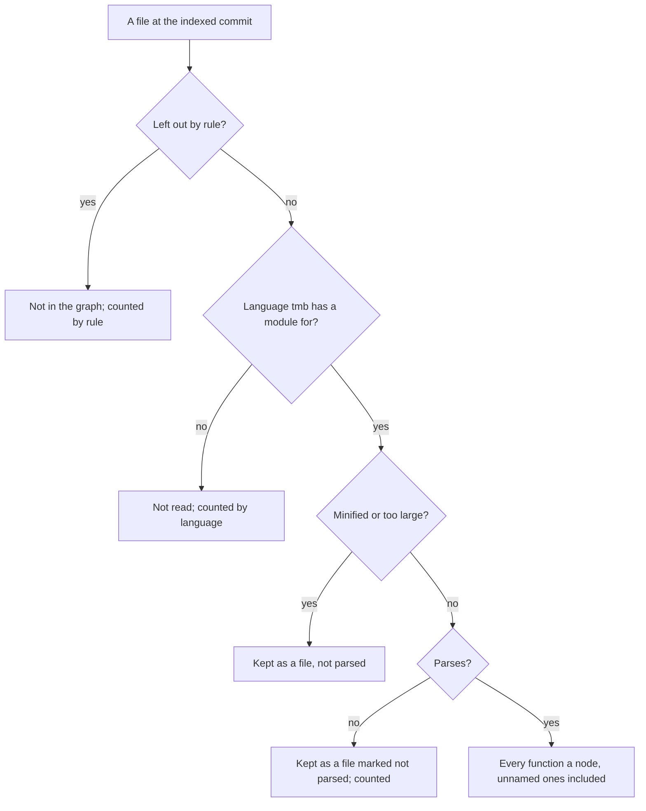
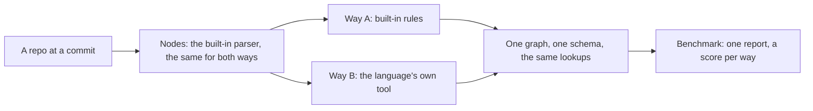
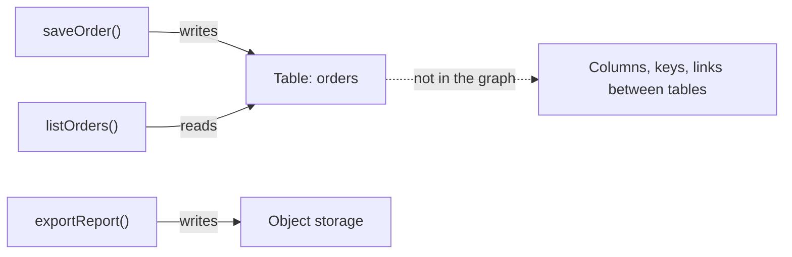
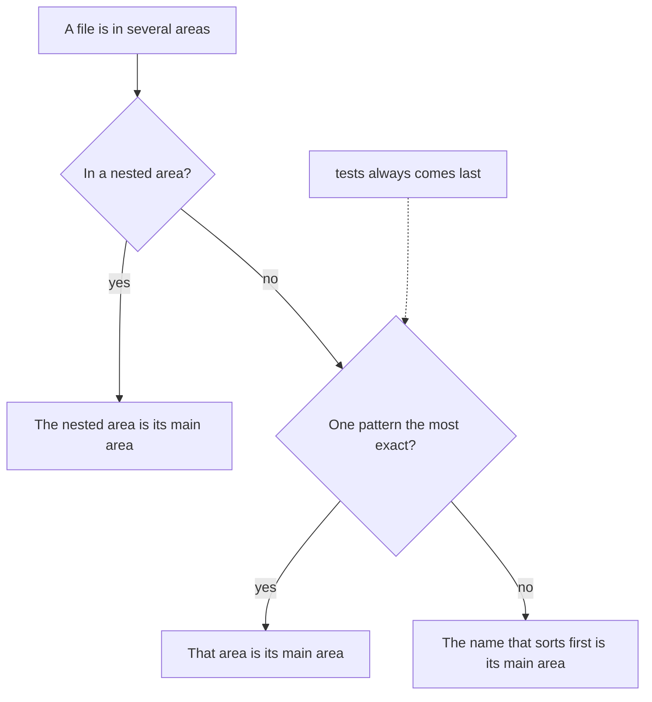
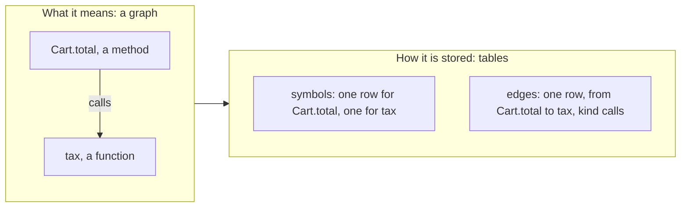

# Code graph: details

The per-language cases, the edge cases, the benchmark detail and the schema tables of the code graph. Each section names the rule it belongs to. The rules are in [CODE_GRAPH.md](CODE_GRAPH.md).

## What is not read, and a file's language

The cases of [Every function](CODE_GRAPH.md#every-function). What happens to each file at the indexed commit:

| What is not read | Rule |
|---|---|
| Left out by rule | Folders named `dist`, `node_modules` or `vendor`, as on Linguist's list of vendored paths; source maps; files named as minified; lockfiles |
| Read all the same | A folder named `build`: the graph is built from git, so build output that git ignores is never in it |
| Unread languages | Named from a copy of Linguist's programming languages, plus Vue and Svelte. Where languages share a file ending and Linguist's rules settle nothing, the file is named as one of them |
| Not counted | Prose, data, settings and images; code in a file ending tmb does not know |

**A file's language comes from Linguist's data**. tmb carries a copy of Linguist's language list and its rules for shared file endings, taken from a Linguist release. It asks in Linguist's own order: the file's name, its first line naming an interpreter, its ending, then the rules for a shared ending.

- **Example 1.** `Makefile` is Makefile by its name. `api.proto` is Protocol Buffer by its ending.
- **Example 2.** `run` has no ending and starts with `#!/usr/bin/env python3`. It is Python.
- **Example 3.** `legacy.pl` could be Perl or Prolog. It holds `use strict;`, which Linguist's rule reads as Perl.
- **Edge case 1.** The rules settle nothing and the file's ending is one a language module names as its own. That module reads it: `mod.rs` is Rust. Each module names its endings, and an ending belongs to one module, so a file the graph reads is never dropped for want of an answer. A `.h` file belongs to C, the language Linguist's own rule ends on: Linguist names a header with `class` or `namespace` C++, and one it leaves undecided is read as C.
- **Edge case 2.** The rules settle nothing and no module names the ending as its own. The file's language is named as "one of" the candidates. It is never guessed: an `.inc` file could be C++, PHP or Pascal, and is not parsed as C++ because C++ is on the list.
- **Edge case 3.** An empty file has no first line and nothing for a rule to match. Its name and ending decide: an empty `__init__.py` is Python.
- **Edge case 4.** A rule names another language for a file tmb would read: a `.ts` file that holds `<TS` is XML to Linguist. Linguist's answer stands, as it does on GitHub.
- **The repo's `.gitattributes` wins.** A `linguist-language` line there sets the language, the same line that fixes it on GitHub. It is the way out of edge case 4.
- **A dialect keeps its module.** Linguist names a `.sql` file SQL, PLpgSQL, TSQL, PLSQL or SQLPL. The SQL module reads it under any of the five names.
- **What is left out by rule does not change.** Linguist's longer list of vendored paths is not applied: it would drop files the graph reads now.
- **Checked against Linguist's own samples.** tmb's copy of the rules must name no sample a language other than Linguist's. Where a rule cannot run in tmb, it gives no answer, never a different one.

## Kinds of symbol: cases

The cases of [Kinds of symbol](CODE_GRAPH.md#kinds-of-symbol). How two languages write each kind:

| Kind | TypeScript | Python |
|---|---|---|
| Type | `class Cart {}`, `interface Item {}` | `class Cart:` |
| Function | `function total() {}` | `def total():` at the top of a file |
| Method | `total() {}` in a class; `static round() {}` | `def total(self):`; `@staticmethod`, `@classmethod` |
| Constructor | `constructor(owner) {}` | `def __init__(self, owner):` |
| Accessor | `get items() {}`, `set items(v) {}` | `@property`, `@items.setter` |
| Unnamed function | `x => x.price` | `lambda x: x.price` |
| Field | `items = []` in a class | `tax_rate = 0.08` in a class; `self.owner = owner` in a method |
| File-level data | `const MAX = 10` | `MAX = 10` |

- **A class is a type that objects are made from.** Where a link rule speaks of a class, it means such a type, as the language's own definition has it: a class in TypeScript and Python; a class, an enum or a record in Java; a class, a struct or a union in C++. It is not a kind of its own.
- **A symbol's lines start at its first decorator** and end at its last line, in every language, so a decorated symbol is one node and matches the reference's.
  - **A symbol's lines are its whole declaration.** A function written as the value of a field or of a file-level name is one callable node, and it starts where that declaration starts: its first decorator, else its first modifier or its name.
  - **Example.** `@bind() onChange = () => {}` starts at `@bind()`. A field whose type is written over three lines before the `=` starts at the field's name, not at the arrow.
  - **Example 2.** Go's file-level `var f = func() {}`, one name bound to one function, is the function `f`. So is a C++ file-level `auto f = [] {}`.
  - **Edge case.** The reference lists the function alone, starting at its arrow. The benchmark pairs the two when the reference's function is the declaration's value. It does not move the node's start.
- **The language's scope rule decides what is file-level data.** A name the whole file can see is a node, wherever it is written.
  - **Example 1.** TypeScript: `for (const x of xs)` at file level hides `x` from the rest of the file, so `x` is a local.
  - **Example 2.** TypeScript: `var x` inside a file-level block is seen by the whole file, so `x` is a node. Python: a file-level `for x in xs` binds a module name, so `x` is a node.
  - **Edge case.** A TypeScript `namespace` holds members, so it is a type, and a variable in it is a field (trustmybot/tmb#312). A Rust `mod` written inside a file is the same: a type node that holds its functions.
- **A member is always inside its type.**
  - **Example 1.** A class `Cart` with a method `total` gives two nodes in either language: the type `Cart` and the method `Cart.total`.
  - **Example 2.** Python's `@property def items(self)` is read as `cart.items`, with no call marks. It is an accessor, so it is a method node. The data behind it, `self._items`, is the field.
  - **Example 3.** Planned: `Cart.items` as a field node, so "who reads or writes `Cart.items`" has an answer.
  - **Edge case 1.** A field whose value is a function, `onChange = () => {}`. It is called like a method, so it is a callable node.
  - **Edge case 2.** A Python field has no declaration: `self.owner = owner` in any method creates it. The field's node is that name on the class, and each assignment is a write link.
  - **Edge case 3.** A method written outside its type's body, as Go's `func (c Cart) Total()` or a C++ `Cart::total` in another file. It is still named through its type, `Cart.Total`. It is held by the type when the same file declares the type, else by its file.
  - **Edge case 4.** A method listed in a type that has no name, as Go's `func f(x interface{ M() })`. No type node can hold it, so it is no node.

## How a name is looked up

The cases of [Links on proof](CODE_GRAPH.md#links-on-proof).

- **The type of the thing a method is called on is read from that thing's own declaration.** The built-in rules find the declaration by looking the name up in its own scope. Only a class name written as its type, with or without type arguments, or a `new` of that class, is proof.
  - **Example 1.** `const cart: Cart = load()` then `cart.total()`: link to `Cart.total`. `ctx: Context<Env>` then `ctx.text()`: link to `Context.text`.
  - **Example 2.** `(c) => c.text()`, where the type of `c` comes from the call the function is passed to. No type is written, so there is no link. The language's tool links it.
  - **Edge case.** Another function in the file declares `c: Context`. That proves nothing about this `c`.
- **A name is looked up the way the language looks it up**, in TypeScript, JavaScript and Python. The first place that has the name decides. If what is found there is a function or a file-level name of the repo, the call links to it, whatever the name holds. If it is anything else, there is no link, and the lookup does not go on to another function of the same name. A call on the object itself looks only in its class and the class's parents.
  - A name imported inside a Python function holds only in that function. A name imported under a new name is looked up in the file that import names.
  - Left with no link by the built-in rules, and linked by the language's tool: a call on the parent, the object itself inside a class written as an expression, and a Python class with several parents unless exactly one of them has the method.
- **Imports through a path alias or a package name resolve to their files**. A TypeScript or JavaScript import that is not a relative path is resolved the way the TypeScript compiler does it: through the nearest project settings file above the importing file, read at the indexed commit. An import of a package that lives in the same repo links to that package's entry file. Two packages of the same name are not linked.
  - **Example.** `import { total } from "@app/cart"` and `import { total } from "../cart"` reach the same file, so both link to the one `total` symbol. An alias adds a name, never a second symbol.
- **A name that reaches a file through a re-export links to where it is declared**. A re-export is proof. The import's link to the re-exporting file stays.

| Re-exports | Followed | Not followed |
|---|---|---|
| TypeScript and JavaScript | By name, with or without a new name; an import followed by an export; a star, which never gives the default export; a star under a name | CommonJS; a re-export of a default export |
| Python | A top-level `from .a import f`, with or without a new name; `from .a import *`, which follows `__all__` when it is a plain list of names and otherwise the public top-level names | An import under `if` or `try`; an `__all__` built by code; `import pkg` followed by `pkg.f()`, which is not a re-export |
| Ties | A name the file declares or exports by name wins over a star | A name two stars bring from different declarations stays unresolved |

- **An import that names a folder of files makes no import link.** Import links run from file to file. The calls into that folder's files carry the dependency.
  - **Example.** Go's `import "shop/cart"` names a package, which is every file in the folder `cart`. `cart.Total()` links to the function; the import line links to nothing.

## Who owns a call

The cases of [The three states of a call](CODE_GRAPH.md#the-three-states-of-a-call).

- **Who owns a call.** The nearest callable around it. A call in a field's initial value belongs to the type. A call in a file-level name's value, `const x = make()`, belongs to that name; when one value binds several names, `const { a, b } = make()`, it belongs to the file. A decorator's call belongs to what encloses the decorated thing, since it runs when that thing is defined and not when it is called: the type for anything inside a type (a method, an accessor, a field, or a parameter of one), the file for a top-level function or type. A call in a parameter's default value follows when the language runs it: with the definition in Python, `def build(self, x=make())`, so it belongs to what encloses the function, as a decorator's call does; on each call in TypeScript and JavaScript, so it belongs to the function. A call in an unnamed function is answered under the nearest named one.

## Way B: from the tool's answer to a link

The cases of [Two ways to make links](CODE_GRAPH.md#two-ways-to-make-links).

- **Way B also gives the call states.** A call is linked only when the tool's declaration is a node of the graph, outside when the declaration is outside the repo, and not known otherwise.
- **Way B makes the call links.** Another use of a name, such as a value passed on or a parent class, keeps its built-in link and records the built-in rules. Way B's answer for those comes with what depends on a symbol beyond calls (trustmybot/tmb#148).
- **The tool's declaration is matched to a node by place.** Same file, same name, overlapping lines. When two nodes fit, the one that starts on the same line wins. A declaration that fits no node leaves the call not known.
  - **Example.** The compiler says `c.total()` is declared at lines 40 to 52 of `cart.ts`. The node `Cart.total` covers those lines, so the call links to it.
- **A call that can go to more than one declaration links to each one that is a node.** It is linked when at least one is. This holds only where the language's rule proves each one, such as a union, an intersection, an overload or a merged declaration; several declarations that merely share the name stay unlinked.
  - **Example.** `element?.toString()`, where `element` is either a class of the repo or a built-in. The call links to the repo's `toString`.
- **A call is identified by its position in the file**, so two calls of one name on one line each get their own answer. The position is where the name it calls is written, else where the call starts.
  - **Example.** In `await get<string>(key)` and `a && b!.f()` the position is where `get` and `f` are written, which every parser agrees on.
- **Every link has a position, a use that is no call too.** The position is where the used name is written, in every language.
  - **Example 1.** In `items.map(format)` the link to `format` is at the word `format`.
  - **Example 2.** In `class B extends A` the link to `A` is at `A`; in `<Card />` it is at `Card`.
  - **Edge case.** In a shell script, `deploy --dry-run` links to the function `deploy` at the word `deploy`.
- **Way B reads the working tree.** The installed packages on disk are how it knows a call goes outside the repo. Without them a package call is not known. It is never guessed to be outside.
- **Way B follows the project's own configs.** A file is resolved under the config that owns it.
  - **Example.** A repo has a root config and one in `benchmarks/`. A file in `benchmarks/` is resolved by that folder's config, with whatever it extends.
  - **Edge case.** A file under no config gets the compiler's own defaults. tmb picks none of its own.
  - **The benchmark's reference reads the same configs**, so the reference is the compiler as the project sets it up.
- **A way B graph is stale when the tool or the installed packages change.** The layer records the tool's version, as the tool reports it, and the installed packages it read. A read that finds either changed rebuilds the layer, and the answer's freshness says so. A layer built by the built-in rules rests on neither.
  - **Example.** `npm install` moves a package to a new version. The next read rebuilds the TypeScript layer.
  - **Edge case.** The tool could not run when the layer was built. That is recorded too, so the layer is rebuilt once the tool can run.
- **tmb installs nothing while it builds a graph.** It never installs a project's dependencies, and it installs a tool only when asked ([where a language's tool comes from](CODE_GRAPH.md#where-a-languages-tool-comes-from)), and an index is used only for the commit it was made at.
  - **Example 1.** `const c = makeCart(); c.total()`. Way A has no written type for `c`, so no link. Way B asks the compiler, which knows `makeCart` returns a `Cart`, and links to `Cart.total`.
  - **Example 2.** A Python repo with no virtual environment. Way B still links the calls inside the repo. A call into a package is not known.
  - **Edge case.** A call decided only at run time, such as a method picked by a string. Neither way links it. It is counted as not known.

## Way B per language

The per-language cases of [Two ways to make links](CODE_GRAPH.md#two-ways-to-make-links).

- **Way B per language.** Each tool was chosen by its own A/B test.

| Language | Tool | Whose copy | Needs from the user |
|---|---|---|---|
| TypeScript, JavaScript | The TypeScript compiler | tmb's pinned copy, installed on ask | Nothing |
| Python | pyright | tmb's pinned copy, installed on ask | Nothing |
| Go | go/types, Go's own type checker | tmb carries a small helper | The `go` command |
| Java | javac | The user's JDK, with a small adapter tmb carries | A JDK |
| Rust | rust-analyzer | The user's | rust-analyzer and the Rust toolchain |
| C, C++ | clangd | The user's | clangd and the project's compile database |

- **A tool tmb cannot carry is the user's own copy.** A tool that is a large program per platform, or needs a runtime, is used from the user's machine. Without it, way A builds the graph and the answer says so, until the user asks tmb to install it ([where a language's tool comes from](CODE_GRAPH.md#where-a-languages-tool-comes-from)).
  - **Example.** A Rust repo on a machine with no rust-analyzer. The graph is built by the built-in rules, and the freshness line names the missing tool.
  - **Edge case 1.** C and C++ without the project's compile database. The tool guesses and gives wrong links, so way B does not run. The database is found where clangd looks for it. A database that cannot be read, or that names a file not on disk, counts as none.
  - **Edge case 2.** The database names some files and not others, such as the files for another platform. The tool answers for the files it names and for the headers they include. A call in any other file is not known.
- **Way B runs no code of the repo and downloads nothing.** It runs the language's tool and nothing the repo ships: no build script, macro program, annotation processor or build tool. What the tool cannot know without them is not known.
  - **Example.** A Go repo whose modules are not on disk. The calls inside the repo are linked; a call into a missing module is not known.
- **An answer given on an error is no answer.** When the tool reports an error at a call, such as an argument whose type is missing, the call is not known, even if the tool names a target.
- **The tool's answer stands.** tmb neither adds to it nor corrects it. A link the tool proves is made, whatever the proof rests on, and a call the tool does not answer is not known.
  - **Example 1.** `cli: Group` is later given a subclass of `Group`. The tool answers with the declared type, so `cli.add()` links to `Group.add`. A call through a base class links to the base's method the same way.
  - **Example 2.** A call under `if TYPE_CHECKING:` is a call like any other. A call in code the tool finds unreachable gets no answer from it, so it is not known.
  - **Edge case.** The tool answers for a different call than the one asked, such as the enclosing call when the called thing is a subscript or another call's result. That is no answer for this call, so it is not known.
- **A construction links to the class.** `Cart()` and `new Cart()` link to `Cart`, not to its `__init__`, `__new__` or constructor. An enum variant or a conversion written like a call, such as Go's `Celsius(x)`, links to its type the same way. So does a C++ placement `new (mem) Node(key)`, which links to `Node`.
- **A function with a declaration and a definition is one node: the definition.** A call links to the definition, the code that runs. A method that has only a declaration, such as an interface's, a trait's or a pure virtual one, is a node, and a call through the interface links to it.
  - **Example.** TypeScript: `interface Store { get(key: string): string }` gives the node `Store.get`, and `store.get(k)` on a `Store` links to it.
  - **Edge case 1.** A named type that lists its methods holds them, whatever keyword declares it: `type Store = { get(): string }` gives `Store.get` too.
  - **Edge case 2.** A class and an interface of one name both list `get`. The class's `get` is the definition, so it is the one node.
  - **Edge case 3.** A function with only a declaration, `declare function f()`, is no node. The code that runs is elsewhere, and nothing in the file proves where.
- **Inside a macro, the tool says what is a call.** The parser cannot see into a macro's input. A name there that is followed by a group in parentheses has the shape of a call. Way B asks the tool about each such name: it is a call when the tool answers a function or a method, and it is dropped otherwise.
  - **Example 1.** `println!("{}", total(cart))`. The tool answers that `total` is a function, so the call links to it.
  - **Example 2.** `assert_eq!(parse(x), Some(Item(1)))`. `parse` is a call. `Some` and `Item` are a variant and a tuple struct to the tool, so they are dropped.
  - **Edge case 1.** The built-in rules have no tool to ask. They keep each such name as a call that is not known, and make no link from it. `Item(1)` is then one more not-known call: the rules cannot tell it from a call.
  - **Edge case 2.** A word the parser treats as a keyword and the language does not, such as `default` in Rust, is a name: `default()` in a macro's input is a call. The language's own keyword list decides.
  - **Edge case 3.** C and C++: the parser already reads a macro's arguments as code, so calls there are found without this rule.
- **Overload stubs are one function.** The stubs are no nodes; the one definition that runs is the node, in either way. Stubs with no definition after them, as in a Python `Protocol`, are one node together: a method with only a declaration. A call that the tool resolves to a function's `@overload` stubs links to the function itself.
- **Way B for Python reads the environment in the working tree.** It uses the repo's own virtual environment and its project config, which names a `src` layout. It never runs the user's Python. With no environment, a package call is not known: tmb carries the tool's stubs for the standard library only.
  - **Which environment.** The one the project's config names, else the one folder at the top of the repo that holds `pyvenv.cfg`. Two or more with no config naming one count as none, and the answer's freshness says so. The config's choice is read the way the tool reads it, also when it names a folder outside the repo; a folder that is not there counts as no environment, and freshness says so.
- **Way B for Go reads the packages already on the machine.** Go's module cache is its installed packages. The helper runs the user's `go` with downloads off and with the user's own Go settings.
  - **Example.** A call into a module in the cache is outside. A call into a module that is not there is not known.
  - **Edge case 1.** A file that needs a C compiler to be read (cgo) is left out of the tool's run. Its functions are nodes, and its calls are not known.
  - **Edge case 2.** A module replaced by a folder outside the repo. Its calls are not known.
- **Way B for Java reads the sources and the JDK, and no build file.** Reading a Maven or Gradle file for its class path means running the build tool, which runs the repo's code. A call that needs a library's types is not known.
  - **Example.** A test calls `assertEquals(a, cart.total())`. JUnit is not on the class path, so javac reports an error at the call and it is not known. A call between the repo's own classes links.
  - **Edge case 1.** A repo with several modules is read as one set of sources.
  - **Edge case 2.** A method reference, `Cart::total`, is a use and no call. A constructor is named as Java names it, `Cart.Cart`.
- **Way B for Rust reads the Cargo workspaces the repo declares.** A file in no workspace is not loaded, and its calls are not known. No build script and no macro program is run.
  - **Edge case.** `Self(x)` in a tuple struct's own code. The tool gives no answer for it, so it is not known.

## Finding and installing a tool: cases

The cases of [Where a language's tool comes from](CODE_GRAPH.md#where-a-languages-tool-comes-from).

- **The user's copy comes first.** A copy on the machine at or above the lowest version tmb supports is used as it is. tmb installs no second one.
  - **Example 1.** A Rust developer has rust-analyzer from rustup. tmb uses it.
  - **Example 2.** A machine has no clangd. tmb installs its pinned clangd into its tools folder, once, for every project on the machine.
  - **Edge case 1.** The user's copy is older than tmb supports. tmb uses its own copy and says why.
  - **Edge case 2.** A setting names the path of a tool. That copy is used and nothing is searched. It is not held to the lowest version: the user named it, and the layer records its version.
  - **Edge case 3.** Apple's clangd reports Apple's own version number. tmb takes it as the LLVM release it is built from.
- **The path setting and tmb's tools folder are per machine.** Both sit in tmb's state folder, which each release channel keeps for itself. The setting is a file the user edits.
  - **Example.** A machine has the stable and the dev channel. Each keeps its own tools, so a pin that changes on dev never changes what stable uses.
- **The lowest version tmb supports** is per tool:

  | Tool | Lowest version |
  |---|---|
  | rust-analyzer | The one in Rust toolchain 1.92.0, or a standalone release built on or after 2025-09-14 |
  | clangd | 16 |
  | `go` | 1.22 |
  | JDK | 11 |
- **Only what a repo needs.** A tool is looked for when a repo in its language is indexed.
  - **Example.** A Python repo on a machine with no Rust. rust-analyzer is never looked for or installed.
- **tmb installs a tool, never a language.** The `go` command, a JDK, the Rust toolchain and a Python environment are the user's. A repo cannot be built on a machine without them, and they are too large to add unasked.
  - **Example.** A Java repo on a machine with no JDK. The built-in rules build the graph and the answer says a JDK is missing.
- **An install is asked for, checked, and never part of a read.** `tmb tools install` installs the tools the repo's languages miss, or one language's. Running the command is the yes: it asks nothing. `tmb init` asks nothing either ([2_ONBOARD.md](../flows/2_ONBOARD.md#init-asks-nothing)): it names the missing tools and the command. A read of the graph downloads nothing: it uses the built-in rules and names the command.
  - **How.** The pinned release comes from the tool's own release page and is checked against a checksum tmb carries. A failed check installs nothing and leaves nothing behind.
  - **Edge case.** A setting on the machine turns installs off, for a machine that may not download programs. Every tool is then the user's own or missing, and the note says installs are off.
  - **Edge case.** The tool has no release for this machine, such as clangd on Linux arm64. The note says so and offers nothing.
  - **Edge case.** tmb's pin moves to a newer release. A copy tmb already installed is still used; a new one is installed only when none on the machine is usable.
  - **Edge case.** The repo has no index yet, and the command names no language. It refuses: the index is how tmb knows the repo's languages.
  - **Edge case.** A tool's project publishes no checksum file. tmb's checksum is the hash of the official download, matched to the release page's own digest.
- **The layer records whose copy built it**, with its version, so an answer can say which tool it rests on and a changed copy rebuilds the layer.
- **`tmb tools` lists them.** For each language in the repo: the tool, whose copy, its version, or that it is missing.

| Language | Tool | The user's copy | tmb installs |
|---|---|---|---|
| TypeScript, JavaScript | The TypeScript compiler | Not looked for | The pinned compiler. Planned (trustmybot/tmb#395) |
| Python | pyright | Not looked for | The pinned pyright. Planned (trustmybot/tmb#395) |
| Go | go/types | The `go` command, needed | Nothing: tmb builds its small helper from source it carries, with the user's `go` |
| Java | javac | A JDK, needed | Nothing: tmb carries a small adapter |
| Rust | rust-analyzer | From rustup or on PATH; the Rust toolchain is needed | The pinned rust-analyzer |
| C, C++ | clangd | On PATH; the compile database is needed | The pinned clangd |

- **Go's helper is built once, from source tmb carries.**
  - **When.** The first time a Go repo is indexed. It is a local compile and downloads nothing, so a setting that turns installs off does not stop it.
  - **With the user's `go`,** the same one that then runs it. A helper built by an older `go` gives wrong answers, so it is rebuilt when the user's `go`, tmb's source or the machine's kind changes. The old one is removed once the new one is finished, so a build under way in another session is not cut off.
  - **The build takes none of the user's Go settings,** not the environment's and not Go's own settings file, and uses no network. The run takes them as before. The build uses the user's Go build cache.
  - **A failed build** means the built-in rules for Go, with a note that gives the whole error. It is not tried again until the user's `go` or tmb's source changes, or the user asks for a rebuild.
  - **The layer records** the user's `go` and the helper: its source and the `go` that built it, also when the build failed. `tmb tools` lists the helper with Go.
  - **Edge case.** The user sets Go to build for another operating system. The helper is still built for this machine.
  - **Edge case.** The helper cannot check a package at all, such as a repo or one of its dependencies that needs a newer Go than the user's. That is an error and the built-in rules are used; it is never taken as "no call is known". The helper tells these cases by Go's own signals, never by the text of a message. An ordinary type error in a file is not this case: its calls are not known, and counted.

## Data sources: cases

The cases of [Data sources](CODE_GRAPH.md#data-sources).

- **A data source is one node: its kind and its name.** It has no members and no links to another data source. The links are reads and writes, from the code that touches it.
  - **Example 1.** A task changes the table `orders`. The graph answers which functions read or write `orders`, so the worker reads those and not the whole repo.
  - **Example 2.** A function sends a file to a bucket named in a setting. The name is not in the code, so the link goes to the store alone: object storage.
  - **Edge case.** An index is inside the store, so it is no node. A trigger is code that runs in the store, so it is a function node, with a link to its table.
  - **Edge case.** The store runs a trigger; no code calls it by name. So no call ever links to a trigger, even one that shares its name.
  - **Edge case.** A trigger written in a string inside a method is still a function, and the method is its parent. Its kind follows SQL, where it is declared outside any type.
  - **A node names its own language when it differs from its file's.** A trigger in a TypeScript string is an SQL node in a TypeScript file. Every other node has its file's language.
- **Whatever a statement names as a table is a table node.** The graph does not judge which tables matter.
  - **Example 1.** A view, a virtual table and a system table such as `sqlite_master` are each a table node.
  - **Example 2.** `CREATE TABLE orders` and `CREATE INDEX … ON orders` change `orders`, so each is a write to `orders`. The index itself is no node.
  - **Example 3.** A trigger's body reads and writes tables. Those links start at the trigger.
  - **Edge case.** A foreign key is a link between two tables, so it is no link in the graph.
- **A table's name is its last part.** `main.orders` and `orders` are one node. The graph does not know which database a statement runs on, so two databases that each hold an `orders` share one node.
- **A name the code does not state gives the kind alone.** This holds for a table as for a bucket.
  - **Example 1.** A statement built around a table name held in a variable links to the store, not to a table.
  - **Example 2.** A placeholder stands where a table's name would be. The statement names no table there.
  - **Edge case.** `COPY orders FROM 's3://reports/…'` is a write to the table `orders`. The address is not read as a bucket: tmb keeps no list of address schemes of its own.
- **A data source belongs to no file.** It is one node for the repo, wherever its name is written. A trigger is code, so it lives where it is written: in its file, or in the function that holds its string.
- **The names come from a tool.** A table name in an SQL statement, in a file or in a string in code, comes from an SQL parser chosen as every tool is ([Two ways to make links](CODE_GRAPH.md#two-ways-to-make-links)). A call that reaches a store is known from the call's own answer: it goes outside the repo, to a package.
  - **The parser.** tmb carries sqlparser-rs, built from its source at a pinned version and loaded only when a repo has SQL.
  - **Edge case.** The parser cannot read a statement. The statement gives no link and is counted in the layer's note. tmb keeps no pattern of its own beside the parser.
- **SQL in a string is found by parsing it.** Any string that starts like a statement is given to the parser, in any letter case. An interpolated value becomes a placeholder. A table counts only when the statement parses cleanly.
  - **Example 1.** `"select * from orders where id = " + id` parses, so it is a read of `orders`.
  - **Example 2.** The label `"Insert row"` starts like a statement and does not parse, so it gives nothing.
  - **Edge case.** The string does not say which dialect it is. The parser tries every dialect. The tables count when every dialect that parses the string names the same ones.
  - **Edge case.** A label that is also a valid statement, such as `"Delete row"` or `"Select one from the list"`, gives a false table. Planned (trustmybot/tmb#350): the store the code uses names the dialect, so a label that is no statement in that dialect gives nothing.
- **A pipeline's own graph is not rebuilt.** A tool that runs steps as a graph draws it itself. The functions its steps run are ordinary code nodes.
  - **Example.** A scheduled pipeline has five steps. The graph holds the five functions and what each reads and writes, not the order the pipeline runs them in.

- **The list of store packages is generated, never written by hand.** It joins two sources from the OpenTelemetry project at pinned commits: its list of store systems, and its instrumentations, which say which package reaches which system. Planned (trustmybot/tmb#378): the list is generated, and no call is linked to a store through it yet.
  - **Example 1.** A call into `pg` is a link to a relational database. A call into `kafkajs` is a link to a queue.
  - **Example 2.** A store package the sources do not cover gives no data source node. Its SQL strings still give table nodes.
  - **Edge case.** A package serves several stores, such as a cloud provider's SDK. The package alone does not say the kind, so the call gives no data source node.

  - **Edge case.** Python code imports a module, and the list names the package it was installed from. The installed package's own metadata in the working tree says which package holds the module. With no environment, the call gives no data source node.

Open, for the Human:

- Whether a call into a store package is a read or a write. `pool.query(sql)` does not say, and the graph never guesses. Until this is answered such a call gives no link.
- How the kind is known for a package that serves several stores.
- Stores in a language's standard library, such as Python's `sqlite3`. The sources list packages only, so these give no store node.
- Object storage. The sources name no object store, so no call gives that kind today.

## Areas: cases

The cases of [Areas](CODE_GRAPH.md#areas).

- **Planned: an area holds functions, not only files** (trustmybot/tmb#308).
  - **Example 1.** `billing/` holds only billing code. One path pattern places every function in it.
  - **Example 2.** `utils.ts` holds `formatInvoice` and `hashPassword`. The first is in billing and the second in login.
  - **Example 3.** A test file tests both billing and login. Its billing tests are in billing and tests, its login tests in login and tests. The file is in all three.
- **A file can be in several areas, and has one main area**, by the order in the chart.

- **Example 1.** A test file inside billing has billing as its main area and is also in tests.
- **Example 2.** A test file that both a billing pattern and a login pattern match is in billing, login and tests. Its main area is the one with the most exact pattern.
- **Why the most exact pattern wins.** In a CODEOWNERS file, the usual standard for "who owns which paths", the last matching pattern wins. Areas have no order between them, so the most exact pattern wins, as in URL routing.

| Case | What happens |
|---|---|
| A pattern matches no file | Refused, with the reason |
| A file is in no area | Listed, with the count, so the planner sees what is not placed yet |
| A rebuild | Areas are kept and re-checked, as concepts are |
| An area matches no file at a re-check | Marked broken |
| An area's size moved by more than a quarter since it was written | Marked for the planner to look at |
| A search or a scope names an unknown area | Refused, with the list of areas |

Where an area shows:

- **Answers.** Every file's and function's answer names its areas, main one first.
- **Search and scoping** can stay inside one area and the areas nested in it, or leave areas out, such as tests. A filter matches any area a file is in. The anchors a caller names stay in a scope regardless.
- **The dashboard's Code page** draws the files of an area inside a folder in one tinted box.

## Answers and the Code page

The cases of [Consumers](CODE_GRAPH.md#consumers).

- **The dashboard has a Code page**: folders, then files, then functions, one level at a time, and a view of one function with its callers and what it calls. It never draws every function at once. In a multi-repo workspace it opens on the list of repos, and the page's address names the repo, so a link to one repo's graph can be shared.
- **Each caller and each callee is listed once, with its lines**, in the tools' answers, on the command line and on the dashboard. A row shows at most 10 lines and counts the rest. The cap of 50 counts distinct rows, and the answer says how many were cut.
  - **Example.** A test file full of unnamed callbacks is one caller with many lines, not one row per call.
  - **Edge case.** A call and a construction of the same target are two rows.

## Benchmark detail

The repos, the scoring rules and the judging rules of the [Benchmark](CODE_GRAPH.md#benchmark).

| Language | Repos | Reference for functions | Reference for links |
|---|---|---|---|
| TypeScript and JavaScript | tmb, hono | The TypeScript compiler | The TypeScript compiler |
| Python | flask, datasette | Python's own parser | Planned (trustmybot/tmb#399): a type checker's answer where it gives one; a link it cannot answer for is counted and not judged |
| Go | gin | Go's own parser | Go's type checker |
| Java | jsoup | javac | javac |
| Rust | ripgrep | rust-analyzer | rust-analyzer |
| C, C++ | libuv, leveldb | libclang | libclang |

- **The scores are kept in a file in the repo**, one set per way, per language and per repo. A test fails when a score falls. It runs with the heavy tests, not on every pull request; links right for TypeScript runs on every pull request.
- **Every repo is at a fixed commit, tmb's own included.** New code in tmb would otherwise move the scores with no change to the graph. A pin moves only in a pull request that runs the benchmark again.
- **Links found is scored against the reference**: of the in-repo links the reference gives, the share the graph has. Calls not known are not the measure, because some of them reach outside the repo.
- **The reference counts what the graph counts.** A call through a file-level variable that holds a function links to the variable, so the reference counts the variable as its target. Where the page says a thing is no node, such as an overload stub, the reference leaves it out too.
- **A reference that grows may raise the built-in rules' misses.** When the reference starts to count links the built-in rules cannot prove, their misses rise with no link lost. The new score is recorded with the issue, as an accepted fall is.
- **A language with no module is not scored.** It joins the benchmark when its module does (trustmybot/tmb#141).
- **The repos are named only in the benchmark.** No code of the graph names one ([Two ways to make links](CODE_GRAPH.md#two-ways-to-make-links)).
- **Every link is judged, in the same file or across files.**
- **Way B needs a second judge.** In TypeScript the reference is the compiler, which is also way B's source. Way B's links right is judged on Python and on samples checked by hand.
- **A link the compiler places outside the repo is wrong.** The graph links only the repo's own code, so a link to a repo symbol for a name the compiler declares only outside the repo fails the test.
- **When a link is right.** It names a declaration the compiler gives for that name. A missing link is no failure. A link the compiler cannot answer for is counted and not judged.
- **Why way A misses links.** It leaves a call unlinked when proving it needs the type of the thing it is called on ([Links on proof](CODE_GRAPH.md#links-on-proof)).

## Schema

Every table and column of the graph file. Where the file lives is in [Schema](CODE_GRAPH.md#schema).

### How the graph is stored

**The graph is rows in SQLite tables, not a graph database.** A node is a row and a link is a row that names two nodes. "Graph" is what the data means. The storage is relational.

| What the graph has | Where it is stored |
|---|---|
| A node: a directory, a file, a symbol | A row in `dirs`, `files` or `symbols` |
| A link: holds, calls, imports, reads, writes | A row in `edges`, naming the two nodes and the kind of link |
| The commit a graph was built at | A row in `layers` |

- **Example 1.** "Who calls `tax`?" is one lookup: the rows of `edges` whose target is `tax`.
- **Example 2.** "What does a change to `tax` reach?" follows links several steps. tmb repeats the one-step lookup. The storage has no path query of its own.
- **The diagram below is an entity-relationship diagram.** It fits because the storage is tables: it shows the tables and how their rows point at each other. It is not a picture of a project's graph. What a node and a link mean is in [Kinds of symbol](CODE_GRAPH.md#kinds-of-symbol) and [Links on proof](CODE_GRAPH.md#links-on-proof).

**Why SQLite.**

| Reason | What it means |
|---|---|
| Many programs open it at once | Several sessions, the dashboard and git's hook read and write the same graph. SQLite lets many programs read while one writes. The embedded graph database tested (Kuzu) and DuckDB let one program hold the file, so every other session had no graph |
| Nothing to install or run | SQLite is inside the tmb program. A graph database is a server to run, or a native engine to install beside tmb that can be missing or crash, and tmb runs no background program ([PRINCIPLES.md](PRINCIPLES.md#9-gate-the-outcome-never-babysit)) |
| One file per repo | The graph is a cache built from git. It is thrown away and rebuilt as one file, and it works offline |
| One step per write | A whole layer is applied in one transaction, so a reader sees the old graph or the new one |
| Search is built in | Search by name uses SQLite's own text index |
| The same store as the record | One kind of storage to upgrade, check and debug |
| The questions are short | Almost every question is one step or a few: who calls this, what is in this file. A graph database earns its place on long path queries, which tmb does not ask |

- **Example.** Two sessions work in one repo and a commit lands. Git's hook updates the graph while both sessions keep reading it.
- **Edge case.** Two programs write at the same moment. The second waits for the first, then writes.
- **Edge case.** A question that needs many steps over a very large repo would be slower than in a graph database. No such question is asked today.

### What the file holds

**This section lists every table and column of the graph file.** A schema change updates it in the same pull request. Planned: a generator with a freshness test that fails when it drifts.

| Group | Tables | Rebuilt from |
|---|---|---|
| Layers | `layers` | the next read or build |
| Map | `dirs`, `files`, `symbols`, `edges` | a commit in git, one copy per layer |
| Parse cache | `parsed` | file contents, keyed by blob, language and extractor version |
| Concepts and areas | `concepts`, `concept_anchors`, `areas` | nothing: agents write them, and a rebuild keeps and re-checks them |
| Misses | `misses` | nothing: lookups that found nothing, or that an agent reported wrong |
| Search | `symbols_fts`, `files_fts`, `dirs_fts` | the rows they index |

- **Layers.** `base` is the base branch's commit. `task:<id>` is an open task's commit laid on top, and `feature:<id>` is a feature branch's tip, for each feature branch that is neither merged nor closed.
- **Its own schema version.** The graph file has its own version and upgrade steps, apart from the record's. A file a newer tmb made is refused. A layer built by an older extractor is rebuilt at the next read.
- **No link across the two files.** A graph row holds a task id, a feature id or a commit as a plain value.
- **Every graph has the `tests` area** from the start, marked `builtin`.

### Diagram

```mermaid
erDiagram

    concepts ||--o{ concept_anchors : "concept_id (CASCADE)"
    areas |o--o{ areas : "parent_id (SET NULL)"
    layers {
        TEXT layer PK
        TEXT commit_sha "NOT NULL"
        INTEGER extractor "NOT NULL"
        TEXT built_at "NOT NULL"
        INTEGER files "NOT NULL"
        INTEGER symbols "NOT NULL"
        INTEGER edges "NOT NULL"
        INTEGER unresolved "NOT NULL"
        INTEGER unresolved_imports "NOT NULL"
        INTEGER functions "NOT NULL"
        INTEGER not_parsed "NOT NULL"
        TEXT not_read "NOT NULL"
        TEXT links "NOT NULL"
        TEXT links_note
        TEXT built_with
    }
    dirs {
        TEXT layer PK "NOT NULL"
        TEXT path PK "NOT NULL"
        TEXT parent
        INTEGER depth "NOT NULL"
        TEXT summary "NOT NULL"
        TEXT summary_source "NOT NULL"
        INTEGER file_count "NOT NULL"
    }
    files {
        TEXT layer PK "NOT NULL"
        TEXT path PK "NOT NULL"
        TEXT dir "NOT NULL"
        TEXT lang
        TEXT blob "NOT NULL"
        INTEGER size "NOT NULL"
        TEXT lane "NOT NULL"
        TEXT summary "NOT NULL"
        TEXT summary_source "NOT NULL"
        TEXT parse_error
    }
    symbols {
        INTEGER id PK
        TEXT layer "NOT NULL"
        TEXT path "NOT NULL"
        TEXT kind "NOT NULL"
        TEXT qualified_name "NOT NULL"
        TEXT name "NOT NULL"
        TEXT signature "NOT NULL"
        TEXT doc "NOT NULL"
        INTEGER start_line
        INTEGER end_line
        INTEGER exported "NOT NULL"
        INTEGER parent_id
        INTEGER unnamed "NOT NULL"
        INTEGER named_id
    }
    edges {
        TEXT layer "NOT NULL"
        INTEGER src_id "NOT NULL"
        INTEGER dst_id
        TEXT dst_name "NOT NULL"
        TEXT kind "NOT NULL"
        TEXT resolution "NOT NULL"
        INTEGER line
        INTEGER pos
        TEXT hint
        TEXT call_state
        TEXT way
    }
    parsed {
        TEXT blob PK "NOT NULL"
        TEXT lang PK "NOT NULL"
        INTEGER extractor PK "NOT NULL"
        TEXT extraction
        TEXT error
    }
    concepts {
        TEXT id PK
        TEXT name "NOT NULL; UNIQUE"
        TEXT kind "NOT NULL"
        TEXT body "NOT NULL"
        TEXT status "NOT NULL"
        TEXT status_reason
        TEXT checked_at
        TEXT checked_sha
        TEXT created_by "NOT NULL"
        TEXT updated_by "NOT NULL"
        TEXT created_at "NOT NULL"
        TEXT updated_at "NOT NULL"
    }
    concept_anchors {
        TEXT concept_id PK,FK "NOT NULL; → concepts.id"
        INTEGER ordinal PK "NOT NULL"
        TEXT path "NOT NULL"
        TEXT qualified_name "NOT NULL"
        INTEGER present "NOT NULL"
    }
    areas {
        TEXT id PK
        TEXT name "NOT NULL; UNIQUE"
        TEXT purpose "NOT NULL"
        TEXT parent_id FK "→ areas.id"
        TEXT include "NOT NULL"
        TEXT exclude "NOT NULL"
        INTEGER builtin "NOT NULL"
        TEXT status "NOT NULL"
        TEXT status_reason
        INTEGER file_count "NOT NULL"
        INTEGER written_count "NOT NULL"
        TEXT checked_sha
        TEXT created_by "NOT NULL"
        TEXT updated_by "NOT NULL"
        TEXT created_at "NOT NULL"
        TEXT updated_at "NOT NULL"
    }
    misses {
        INTEGER id PK
        TEXT at "NOT NULL"
        TEXT lookup "NOT NULL"
        TEXT query "NOT NULL"
        TEXT detail "NOT NULL"
        TEXT actor "NOT NULL"
    }
```

### Tables

#### `layers`

| Column | Type | Null | Default | Constraints |
|---|---|---|---|---|
| `layer` | TEXT | nullable |  | PK |
| `commit_sha` | TEXT | NOT NULL |  |  |
| `extractor` | INTEGER | NOT NULL |  |  |
| `built_at` | TEXT | NOT NULL |  |  |
| `files` | INTEGER | NOT NULL |  |  |
| `symbols` | INTEGER | NOT NULL |  |  |
| `edges` | INTEGER | NOT NULL |  |  |
| `unresolved` | INTEGER | NOT NULL |  |  |
| `unresolved_imports` | INTEGER | NOT NULL | `0` |  |
| `functions` | INTEGER | NOT NULL | `0` |  |
| `not_parsed` | INTEGER | NOT NULL | `0` |  |
| `not_read` | TEXT | NOT NULL | `'{}'` |  |
| `links` | TEXT | NOT NULL | `'built-in'` |  |
| `links_note` | TEXT | nullable |  |  |
| `built_with` | TEXT | nullable |  |  |

#### `dirs`

| Column | Type | Null | Default | Constraints |
|---|---|---|---|---|
| `layer` | TEXT | NOT NULL |  |  |
| `path` | TEXT | NOT NULL |  |  |
| `parent` | TEXT | nullable |  |  |
| `depth` | INTEGER | NOT NULL |  |  |
| `summary` | TEXT | NOT NULL | `''` |  |
| `summary_source` | TEXT | NOT NULL | `'none'` |  |
| `file_count` | INTEGER | NOT NULL | `0` |  |

Table constraints:

- PRIMARY KEY `(layer, path)`

#### `files`

| Column | Type | Null | Default | Constraints |
|---|---|---|---|---|
| `layer` | TEXT | NOT NULL |  |  |
| `path` | TEXT | NOT NULL |  |  |
| `dir` | TEXT | NOT NULL |  |  |
| `lang` | TEXT | nullable |  |  |
| `blob` | TEXT | NOT NULL |  |  |
| `size` | INTEGER | NOT NULL |  |  |
| `lane` | TEXT | NOT NULL |  |  |
| `summary` | TEXT | NOT NULL | `''` |  |
| `summary_source` | TEXT | NOT NULL | `'none'` |  |
| `parse_error` | TEXT | nullable |  |  |

Table constraints:

- PRIMARY KEY `(layer, path)`

#### `symbols`

| Column | Type | Null | Default | Constraints |
|---|---|---|---|---|
| `id` | INTEGER | nullable |  | PK |
| `layer` | TEXT | NOT NULL |  |  |
| `path` | TEXT | NOT NULL |  |  |
| `kind` | TEXT | NOT NULL |  |  |
| `qualified_name` | TEXT | NOT NULL |  |  |
| `name` | TEXT | NOT NULL |  |  |
| `signature` | TEXT | NOT NULL | `''` |  |
| `doc` | TEXT | NOT NULL | `''` |  |
| `start_line` | INTEGER | nullable |  |  |
| `end_line` | INTEGER | nullable |  |  |
| `exported` | INTEGER | NOT NULL | `0` |  |
| `parent_id` | INTEGER | nullable |  |  |
| `unnamed` | INTEGER | NOT NULL | `0` |  |
| `named_id` | INTEGER | nullable |  |  |
| `lang` | TEXT | NOT NULL | `''` | The node's own language when it differs from its file's |

#### `edges`

| Column | Type | Null | Default | Constraints |
|---|---|---|---|---|
| `layer` | TEXT | NOT NULL |  |  |
| `src_id` | INTEGER | NOT NULL |  |  |
| `dst_id` | INTEGER | nullable |  |  |
| `dst_name` | TEXT | NOT NULL |  |  |
| `kind` | TEXT | NOT NULL |  |  |
| `resolution` | TEXT | NOT NULL |  | CHECK `resolution IN ('exact', 'name', 'unresolved')` |
| `line` | INTEGER | nullable |  |  |
| `pos` | INTEGER | nullable |  |  |
| `hint` | TEXT | nullable |  |  |
| `call_state` | TEXT | nullable |  | CHECK `call_state IN ('linked', 'outside', 'not_known')` |
| `way` | TEXT | nullable |  | CHECK `way IN ('built-in', 'language-tool')` |

#### `parsed`

| Column | Type | Null | Default | Constraints |
|---|---|---|---|---|
| `blob` | TEXT | NOT NULL |  |  |
| `lang` | TEXT | NOT NULL |  |  |
| `extractor` | INTEGER | NOT NULL |  |  |
| `extraction` | TEXT | nullable |  |  |
| `error` | TEXT | nullable |  |  |

Table constraints:

- PRIMARY KEY `(blob, lang, extractor)`

#### `concepts`

| Column | Type | Null | Default | Constraints |
|---|---|---|---|---|
| `id` | TEXT | nullable |  | PK |
| `name` | TEXT | NOT NULL |  | UNIQUE |
| `kind` | TEXT | NOT NULL |  | CHECK `kind IN ('flow', 'rule')` |
| `body` | TEXT | NOT NULL |  |  |
| `status` | TEXT | NOT NULL |  | CHECK `status IN ('verified', 'broken')` |
| `status_reason` | TEXT | nullable |  |  |
| `checked_at` | TEXT | nullable |  |  |
| `checked_sha` | TEXT | nullable |  |  |
| `created_by` | TEXT | NOT NULL |  |  |
| `updated_by` | TEXT | NOT NULL |  |  |
| `created_at` | TEXT | NOT NULL |  |  |
| `updated_at` | TEXT | NOT NULL |  |  |

#### `concept_anchors`

| Column | Type | Null | Default | Constraints |
|---|---|---|---|---|
| `concept_id` | TEXT | NOT NULL |  | FK → `concepts.id` ON DELETE CASCADE |
| `ordinal` | INTEGER | NOT NULL |  |  |
| `path` | TEXT | NOT NULL |  |  |
| `qualified_name` | TEXT | NOT NULL | `''` |  |
| `present` | INTEGER | NOT NULL | `1` |  |

Table constraints:

- PRIMARY KEY `(concept_id, ordinal)`

#### `areas`

| Column | Type | Null | Default | Constraints |
|---|---|---|---|---|
| `id` | TEXT | nullable |  | PK |
| `name` | TEXT | NOT NULL |  | UNIQUE |
| `purpose` | TEXT | NOT NULL |  |  |
| `parent_id` | TEXT | nullable |  | FK → `areas.id` ON DELETE SET NULL |
| `include` | TEXT | NOT NULL |  |  |
| `exclude` | TEXT | NOT NULL |  |  |
| `builtin` | INTEGER | NOT NULL | `0` |  |
| `status` | TEXT | NOT NULL |  | CHECK `status IN ('ok', 'broken', 'review')` |
| `status_reason` | TEXT | nullable |  |  |
| `file_count` | INTEGER | NOT NULL | `0` |  |
| `written_count` | INTEGER | NOT NULL | `0` |  |
| `checked_sha` | TEXT | nullable |  |  |
| `created_by` | TEXT | NOT NULL |  |  |
| `updated_by` | TEXT | NOT NULL |  |  |
| `created_at` | TEXT | NOT NULL |  |  |
| `updated_at` | TEXT | NOT NULL |  |  |

#### `misses`

| Column | Type | Null | Default | Constraints |
|---|---|---|---|---|
| `id` | INTEGER | nullable |  | PK |
| `at` | TEXT | NOT NULL |  |  |
| `lookup` | TEXT | NOT NULL |  |  |
| `query` | TEXT | NOT NULL |  |  |
| `detail` | TEXT | NOT NULL | `''` |  |
| `actor` | TEXT | NOT NULL |  |  |

### Foreign keys

| Column | References | On delete |
|---|---|---|
| `concept_anchors.concept_id` | `concepts.id` | CASCADE |
| `areas.parent_id` | `areas.id` | SET NULL |

The graph file opens with `foreign_keys = ON`.

### Search indexes

All are FTS5 virtual tables.

| Index | File | Indexed columns | Unindexed columns | Tokenizer |
|---|---|---|---|---|
| `symbols_fts` | graph | `terms`, `doc` | `symbol_id`, `layer` | default |
| `files_fts` | graph | `terms`, `summary` | `layer`, `path` | default |
| `dirs_fts` | graph | `terms`, `summary` | `layer`, `path` | default |

### Indexes

| Index | Table | Columns | Unique |
|---|---|---|---|
| `files_dir` | `files` | `layer, dir` | no |
| `symbols_named` | `symbols` | `named_id` | no |
| `symbols_parent` | `symbols` | `parent_id` | no |
| `symbols_path` | `symbols` | `layer, path` | no |
| `symbols_qualified` | `symbols` | `layer, qualified_name COLLATE NOCASE` | no |
| `symbols_name` | `symbols` | `layer, name COLLATE NOCASE` | no |
| `edges_name` | `edges` | `layer, dst_name` | no |
| `edges_dst` | `edges` | `dst_id` | no |
| `edges_src` | `edges` | `src_id` | no |

## Planned

| Piece | Tracked in |
|---|---|
| The TypeScript compiler and pyright leave the tmb program | trustmybot/tmb#395 |
| A type's fields are nodes, with read and write links | trustmybot/tmb#312 |
| A bucket and a collection are data sources ([Data sources](CODE_GRAPH.md#data-sources)) | trustmybot/tmb#398 |
| Python's benchmark reference is a type checker | trustmybot/tmb#399 |
| A Java anonymous class creation links to its type | trustmybot/tmb#376 |
| A call into a store package links to the store | trustmybot/tmb#378 |
| Every C and C++ function a node | trustmybot/tmb#387 |
| Python, bash and the other languages get every function too, each with its own coverage test. Their rules are written as tree-sitter queries, the form GitHub's code navigation and Neovim use; TypeScript's rules move to that form after | trustmybot/tmb#141 |
| A task's scope follows table links: a function in scope that reads or writes a table brings in the file that defines the table | trustmybot/tmb#309 |
| The planner keeps concepts and areas written: a rule for when it writes them, and a view of the code not yet placed | trustmybot/tmb#310 |
