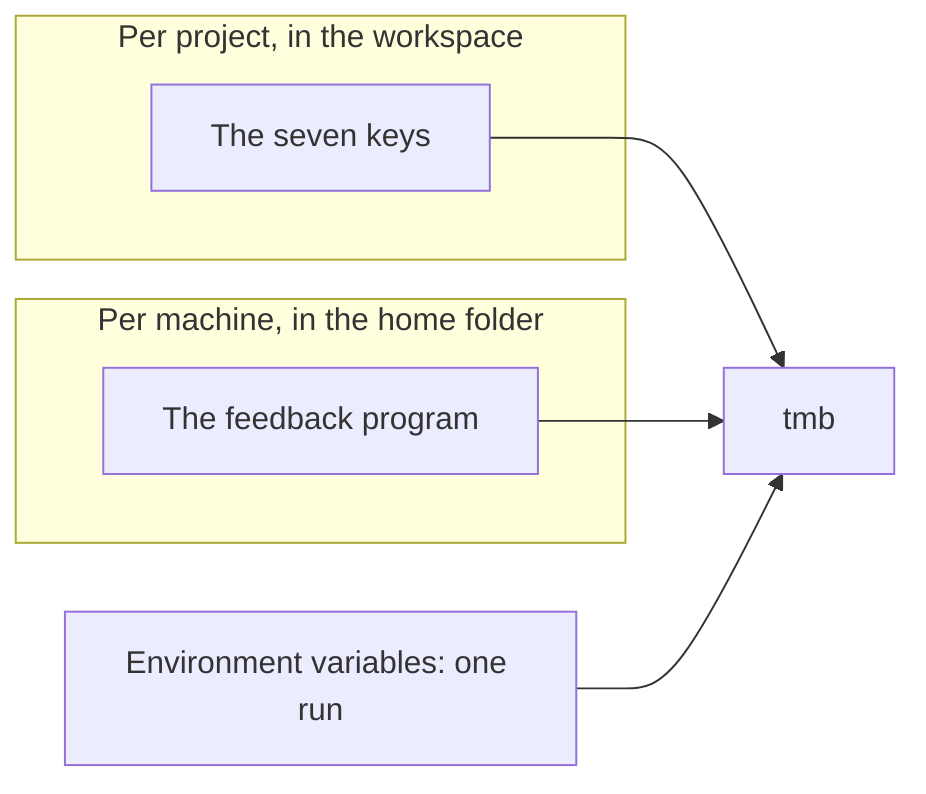
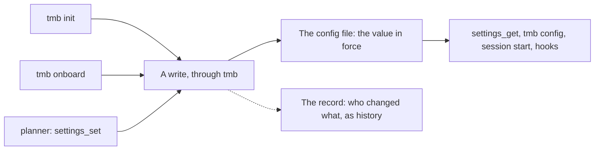

# Configuration

tmb's settings: where each one lives, who may set it and what it does. The user's guide to each is in the [reference](../reference/README.md#set-up-a-project).

## Settings live in three places

**A setting lives where its owner is: the project, the person's machine, or one run.**

- **Project settings** are the seven [keys](#keys). They belong to the workspace and are the same for every session in it.
- **Machine settings** belong to the person, not the project ([Kept per machine](#kept-per-machine-not-in-the-record)).
- **Environment variables** hold for one run ([Environment variables](#environment-variables)).

## Project settings live in a config file

**Planned (trustmybot/tmb#305). The seven project keys live in one TOML file, `.tmb/config.toml`, in the workspace. tmb reads a setting from that file and never from the record. The record is for trajectory only.**

The planner reads them with `settings_get`. Hooks only read them.

- **Example 1.** The record cannot be read. tmb still reads the base branch and the checks from the file.
- **Example 2.** The planner sets `base_branch` to the value already in force. Nothing is written or recorded.
- **Example 3.** A write names an unknown key, a blank text or a value of the wrong shape. tmb refuses it.
- **Example 4.** Every write goes through tmb, which also records it as a setting change. That history says who changed what. No reader takes a value from it.
- **Example 5.** The file is local. git ignores tmb's folder, so the file is never committed.
- **Example 6.** The file's first line is a comment that says who may edit it: the Human, or an agent with the Human's approval. That line is the whole fence. No guard watches the file.
- **Edge case.** The Human edits the file by hand. tmb reads the new value. That edit has no history, and no check compares the file with the record.

## Keys

**This table lists every key in `src/engine/settings.ts`.** Planned (trustmybot/tmb#440): a generator with a freshness test.

| Key | Type | Default | Set by | Effect |
|---|---|---|---|---|
| `host` | string: a host id | unset until `tmb init`, which stores the host it wired | `tmb init` | The host the project is set up for: Claude Code. |
| `base_branch` | string | unset. Onboard offers the branch origin names as its default, else the current branch, else `main` | the planner via `settings_set`; `tmb onboard --base` | The branch pull requests merge into. Not used in a multi-repo workspace, where each repo has its own in `repos`. |
| `review_mode` | string: `agile` \| `truest` | unset, with no default. tmb recommends `agile` and never picks it | the Human only: by answering the planner, which stores the answer with `settings_set`, or with `tmb onboard` | `agile`: one review of each feature branch as a whole. `truest`: a review of every task before its pull request. No task starts while it is unset. |
| `checks` | string[]: shell commands | unset. Onboard offers the commands it finds in the project | the planner via `settings_set`; `tmb onboard --check`, once per command | The commands that must pass before a task closes. The list given replaces the old one; `[]` means none. Each command gets 10 minutes. Not used in a multi-repo workspace. |
| `shared_folders` | string[]: folders inside the repo | unset, read as none. tmb detects none | the planner via `settings_set`, named from the repo's toolchain; `tmb onboard --shared-folder`, once per folder | The folders every task worktree links from the main folder ([Shared folders are linked](#shared-folders-are-linked-not-installed)). The list given replaces the old one. Not used in a multi-repo workspace. |
| `graph_links` | string: `built-in` \| `language-tool` | `language-tool` | the planner via `settings_set` | Which way makes the code graph's links ([CODE_GRAPH.md](CODE_GRAPH.md#two-ways-to-make-links)). A language with no tool uses `built-in`, and the answer says so. |
| `repos` | object: `{"<repo path>": policy}` | unset in a single-repo project. In a multi-repo workspace `tmb init` fills it with the repos it finds | `tmb init`; the planner via `settings_set`; `tmb onboard --repo <name>` | One policy per folder of a workspace, by its path from the workspace folder. |

### The `repos` policy

A repo is named by its path inside the workspace, relative and with forward slashes, such as `tmb` or `apps/web`. Any field not in this table is refused.

| Field | Type | Effect |
|---|---|---|
| `base_branch` | string | The branch the repo's pull requests merge into. Required unless the repo is exempt. |
| `checks` | string[] | The checks the repo's tasks run. |
| `shared_folders` | string[] | The folders the repo's task worktrees link from its main folder. |
| `review_mode` | `agile` \| `truest` | The repo's own review mode. A repo that names none follows the workspace's `review_mode`. The Human's choice, as the workspace's is. |
| `graph_links` | `built-in` \| `language-tool` | The repo's own way to make links. A repo that names none follows the workspace's. |
| `exempt` | `true` | tmb does no work in the repo and wires nothing in it. |
| `git` | `false` only | The folder is not a repo: tmb records it and leaves it alone. It takes no other field. |

## Unset means not set

**Every key is null until it is first set. Readers treat null as "not set", never as a silent default.**

- **Example 1.** `review_mode` is null. No task starts, and tmb does not pick `agile` for the Human.
- **Example 2.** A session starts as the planner and `base_branch`, `review_mode` or `checks` is empty. The session start says so, and the planner applies the base branch and checks it recommends ([`2_ONBOARD.md`](../flows/2_ONBOARD.md)).

## The way a review mode was chosen is recorded

**The setting change that sets a review mode also holds the way the Human chose it.** This holds for the workspace's mode and for one repo's own.

- **Example 1.** The Human answers the planner's question at the first session. The change says `planner`.
- **Example 2.** The Human runs `tmb onboard --review-mode truest` and types yes. The change says `onboard`.
- **Edge case.** An old record holds `init`. It is kept as it is.

## Branch policy is per repo in a multi-repo workspace

**A single-repo project keeps its branch policy in the project keys `base_branch`, `checks` and `shared_folders`. A multi-repo workspace keeps each repo's in `repos`.**

- **Example 1.** A workspace holds `api` and `web`. Each has its own base branch and checks under `repos`.
- **Example 2.** In that workspace the planner sets the project key `base_branch`. tmb refuses the write.
- **Edge case.** There is no key for a branching model. A repo has one base branch, and feature branches are cut from it ([`3_GIT.md`](../flows/3_GIT.md)).

## Shared folders are linked, not installed

**Every task worktree links the shared folders from its repo's main folder, so a worker starts ready to build and test without an install per task.** The planner names them, and keeps the main folder's dependencies installed ([ROLES.md](ROLES.md#each-role-hands-the-next-a-ready-environment)).

- **Example 1.** A Node project sets `shared_folders` to `["node_modules"]`. Each task worktree holds a link named `node_modules` to the main folder's, and the tests import as they do there.
- **Example 2.** Three workers run at once. Their worktrees link the same folder, which none of them writes.
- **Example 3.** git does not see the links: tmb hides each shared folder in the repository's own exclude list, so a worktree with links still reads as clean.
- **Example 4.** A task changes the dependencies. Its worker replaces the link with a real install inside its worktree, so the shared folder never changes under the other workers.
- **Edge case.** The list is empty, or the main folder lacks a folder it names. The worktree has no link there: `task_start` names the missing folder, and a worker that finds the worktree not ready reports it to the planner.

## Kept per machine, not in the record

**One setting belongs to the person, not the project.** It is kept in each channel's program state folder, such as `~/.local/state/tmb-dev`.

| Setting | Values | Default | Set by | Effect |
|---|---|---|---|---|
| feedback program | `on` \| `off` | `on` on dev and rc, `off` on stable | `tmb feedback on` and `off`; on stable, the first run's question | Whether the planner may offer to draft a bug report. `tmb feedback` works either way. |

## Environment variables

| Variable | Effect |
|---|---|
| `TMB_UNATTENDED=1` | Marks the run as one where no one can answer. Only `1` counts. |
| `TMB_NO_UPDATE=1` | Turns self-update off. |
| `TMB_NO_FEEDBACK=1` | Turns the feedback program off, whatever the setting says. |
| `DO_NOT_TRACK=1` | The same as `TMB_NO_FEEDBACK=1`. |
| `TMB_FEEDBACK_REPO=owner/name` | Sends reports to another repo. |
| `TMB_STATE_DIR` | Names the program's machine-wide state folder. |
| `TMB_RELEASES_URL`, `TMB_RELEASES_API` | Name another release repo for the installer and the updater. |
| `TMB_CHANNEL`, `TMB_INSTALL_VERSION` | Read by the installer: the channel to install, or one exact release. |
| `TMB_NO_MODIFY_PATH` | Read by the installer: leave the shell's PATH setup alone. |

## Planned: more in the config file

- **For a repo shared with others** (trustmybot/tmb#411): the user's account on the remote, and which remote repository issues come from, such as the upstream of a fork. The record reads both and stores neither.
- **The project's issue labels** (trustmybot/tmb#417): the groups, each label with a description, how many of a group one issue may carry, and the mapping from labels the project already has. tmb ships a default list ([ISSUES.md](ISSUES.md#the-list-is-a-setting)). The record holds which labels each issue carries, never the list.
