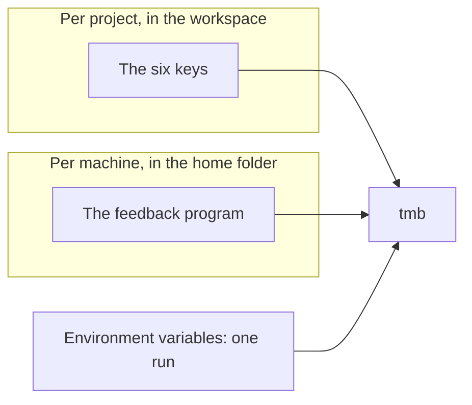
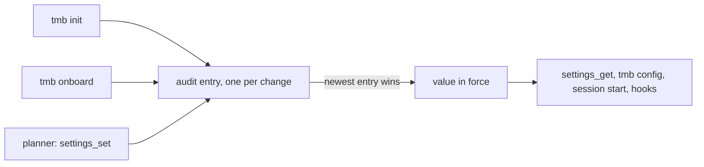

# Configuration

tmb's settings: where each one lives, who may set it and what it does. The user's guide to each is in the [reference](../reference/README.md#set-up-a-project).

## Settings live in three places

- **Project settings** are the six [keys](#keys). They belong to the workspace and are the same for every session in it.
- **Machine settings** belong to the person, not the project ([Kept per machine](#kept-per-machine-not-in-the-record)).
- **Environment variables** hold for one run ([Environment variables](#environment-variables)).

## A project setting is an audit entry

The project settings are a fixed list of six keys, kept in the record. There is no settings table: each change is one entry in the record's audit trail, named `setting:<key>`, and the newest entry is the value in force.

The planner reads them with `settings_get` and writes them with `settings_set`. `tmb init` and `tmb onboard` write them from the terminal, and `tmb config` shows them. Hooks only read them.

- **Example 1.** The planner sets `base_branch` to the value already in force. Nothing is recorded.
- **Example 2.** A write names an unknown key, a blank text or a value of the wrong shape. tmb refuses it.

## Keys

**This table lists every key in `src/engine/settings.ts`.** Planned: a generator with a freshness test.

| Key | Type | Default | Set by | Effect |
|---|---|---|---|---|
| `host` | string: a host id | unset until `tmb init`, which stores the host it wired | `tmb init`; `tmb onboard --host <id>` names another wired host | The host the project is set up for. |
| `host_roles` | object: `{"<host id>": "planner" \| "reviewer"}` | a host with no entry is `planner` | `tmb init --role`, `tmb onboard --role` | The role each host's main agent takes: it plans, or it only reviews. A worker is always a subagent. |
| `base_branch` | string | unset. Onboard offers the branch origin names as its default, else the current branch, else `main` | the planner via `settings_set`; `tmb onboard --base` | The branch pull requests merge into. Not used in a multi-repo workspace, where each repo has its own in `repos`. |
| `review_mode` | string: `agile` \| `truest` | unset, with no default. tmb recommends `agile` and never picks it | the Human only: by answering the planner, which stores the answer with `settings_set`, or with `tmb onboard` | `agile`: one review of each feature branch as a whole. `truest`: a review of every task before its push. No task starts while it is unset. |
| `checks` | string[]: shell commands | unset. Onboard offers the commands it finds in the project | the planner via `settings_set`; `tmb onboard --check`, once per command | The commands that must pass before a task closes. The list given replaces the old one; `[]` means none. Each command gets 10 minutes. Not used in a multi-repo workspace. |
| `repos` | object: `{"<repo path>": policy}` | unset in a single-repo project. In a multi-repo workspace `tmb init` fills it with the repos it finds | `tmb init`; the planner via `settings_set`; `tmb onboard --repo <name>` | One policy per folder of a workspace, by its path from the workspace folder. |

### The `repos` policy

A repo is named by its path inside the workspace, relative and with forward slashes, such as `tmb` or `apps/web`. Any field not in this table is refused.

| Field | Type | Effect |
|---|---|---|
| `base_branch` | string | The branch the repo's pull requests merge into. Required unless the repo is exempt. |
| `checks` | string[] | The checks the repo's tasks run. |
| `review_mode` | `agile` \| `truest` | The repo's own review mode. A repo that names none follows the workspace's `review_mode`. The Human's choice, as the workspace's is. |
| `exempt` | `true` | tmb does no work in the repo and wires nothing in it. |
| `git` | `false` only | The folder is not a repo: tmb records it and leaves it alone. It takes no other field. |

## Unset means not set

Every key is null until it is first set. Readers treat null as "not set", never as a silent default.

- **Example 1.** `review_mode` is null. No task starts, and tmb does not pick `agile` for the Human.
- **Example 2.** A session starts as the planner and `base_branch`, `review_mode` or `checks` is empty. The session start says so, and the planner applies the base branch and checks it recommends ([`2_ONBOARD.md`](../flows/2_ONBOARD.md)).
- **Edge case.** The one fallback is a host's role: a host with no entry in `host_roles` is the planner.

## The way a review mode was chosen is recorded

Two more audit entries sit beside the setting itself and record how a review mode was chosen:

| Entry | Holds |
|---|---|
| `review_mode_chosen` | Which way the Human chose the workspace's mode: `init` (kept for old records), `onboard` or `planner`. |
| `repo_review_mode_chosen` | The same for one repo's own mode: the repo, its mode and the way. |

## Branch policy is per repo in a multi-repo workspace

A single-repo project keeps its branch policy in the two project keys, `base_branch` and `checks`. A multi-repo workspace does not use them: each repo has its own in `repos`.

- **Example.** In a multi-repo workspace the planner calls `settings_set` for `base_branch`. tmb refuses the project key there.
- **No branching model key.** A repo has one base branch, and feature branches are cut from it ([`3_GIT.md`](../flows/3_GIT.md)).

## Kept per machine, not in the record

One setting belongs to the person, not the project. It is kept in each channel's program state folder, such as `~/.local/state/tmb-dev`.

| Setting | Values | Default | Set by | Effect |
|---|---|---|---|---|
| feedback program | `on` \| `off` | `on` on dev and rc, `off` on stable | `tmb feedback on` and `off`; on stable, the first run's question | Whether the planner may offer to draft a bug report. `tmb feedback` works either way. |

## Environment variables

| Variable | Effect |
|---|---|
| `TMB_UNATTENDED=1` | Marks the run as one where no one can answer. Only `1` counts. |
| `TMB_NO_UPDATE=1` | Turns self-update off. |
| `TMB_NO_FEEDBACK=1` | Turns the feedback program off, whatever the setting says. |
| `DO_NOT_TRACK=1` | The same as `TMB_NO_FEEDBACK=1`. |
| `TMB_FEEDBACK_REPO=owner/name` | Sends reports to another repo. |
| `TMB_STATE_DIR` | Names the program's machine-wide state folder. |
| `TMB_RELEASES_URL`, `TMB_RELEASES_API` | Name another release repo for the installer and the updater. |
| `TMB_CHANNEL`, `TMB_INSTALL_VERSION` | Read by the installer: the channel to install, or one exact release. |
| `TMB_NO_MODIFY_PATH` | Read by the installer: leave the shell's PATH setup alone. |

## Planned: a config file

Planned (trustmybot/tmb#305). The project settings move out of the record into one text file in the workspace, with a table per purpose.

- **Why.** A text file needs no reader and can be read when the database cannot. The record is then for trajectory only.
- **Writes still go through tmb,** which records each change in the audit trail.
- **A Human-only key stays fenced.** tmb compares the file with the last recorded value and refuses a mismatch until the Human confirms on a terminal.
- **Open, for the Human:** whether the file is committed to git, so a team shares it.
