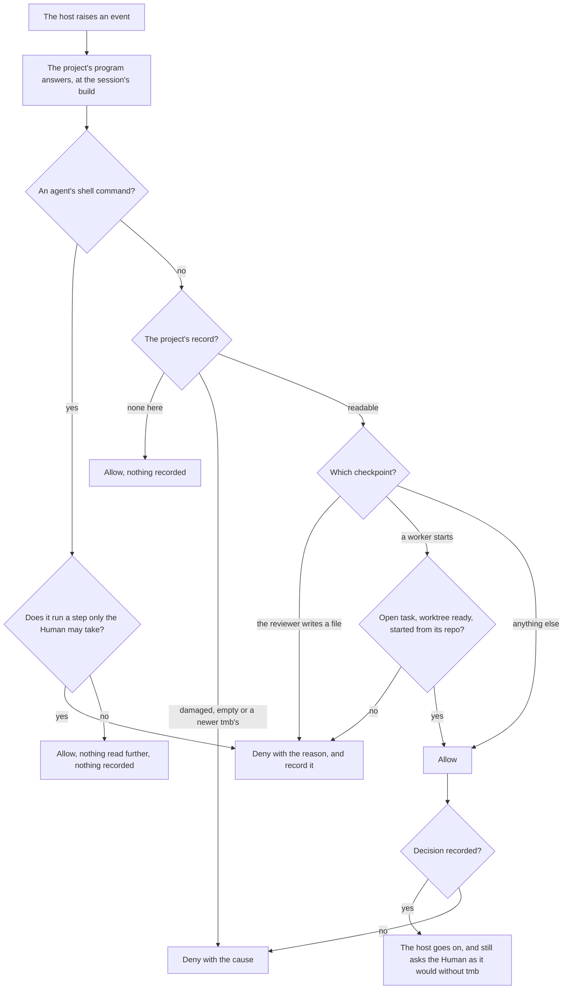
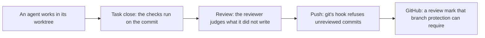

# Containment

tmb keeps a project's data inside the project, keeps its own program and state in two named places on the machine, and changes nothing it did not write. It does not watch each step an agent takes: it gates the outcome at checkpoints. This page states the boundaries, the checkpoints that keep them, and why. For the code that enforces each one, ask the code graph.

## The invariant

- **A project's data stays in the project.** The record, the code graph and the task worktrees sit in tmb's own folder there. Nothing about a project is kept anywhere else on the machine.
- **tmb writes only where the Human ran it.** A project gets tmb's files when the Human runs init in it, never because a session opened there. In a project with no record every gate allows and nothing is recorded.
- **tmb changes only what it wrote.** In a host file or a hook it shares with the Human or another tool, tmb adds its own marked entries and leaves the rest. Remove takes out exactly those ([INSTALL.md](INSTALL.md#upgrade)).
- **Reads outside the project are read-only and named.** tmb looks for the host's program on the machine, reads Codex's user config to see whether the project is trusted, reads a plugin project's database when the Human migrates it, and reads GitHub through the Human's own command line.
- **The host's own instruction file is never written.** The role reaches a session as the engine's answer to its session start ([HOSTS.md](HOSTS.md#cold-start)). Planned (trustmybot/tmb#112): a cheatcode may add one reference line and take it out again ([CHEATCODES.md](CHEATCODES.md)).
- **No login, no trust, no host settings.** tmb never reads, stores or passes on a login. It never trusts a project or a hook on the Human's behalf, and never changes a repo's branch protection. It changes no host setting beyond its own entries.

The plugin's three exceptions are gone: tmb has no embedding model, no runtime dependencies to install and no host cache to repair.

## What tmb writes in the project

Everything of tmb's own sits in its project folder: the record, one code graph per repo, the task worktrees, and small notes on which host files init created. Outside that folder init writes only these:

- the host's project files, through its adapter: the tool server's registration, the event wiring and the role files, each marked as tmb's ([HOSTS.md](HOSTS.md#what-an-adapter-provides)). A role file tmb did not write is never overwritten;
- git's pre-push hook in each repo tmb works in. A hook that is another tool's is left alone; with the Human's yes tmb adds one line first in it;
- ignore lines for its folder and for the host files that are the Human's alone. Remove leaves these lines;
- `git init`, once, in a folder that is in no repo and holds none;
- feature and task branches in git, which tmb never deletes while they hold work.

Planned: the skill files tmb ships, and the agent and cheatcode files the Human approves one by one ([EXTENDING.md](EXTENDING.md)).

## What tmb writes on the machine

tmb is one program for the whole machine, so two things live outside any project. Each channel's program has its own, and one never touches another's.

| Where | Holds |
|---|---|
| The user's program folder | The program, under its channel's name. The installer adds the folder to PATH unless told not to. |
| The program's state folder | Kept builds, the time of the last look for an update, a marker per running session, the person's feedback setting, drafts of bug reports and the last error |

- **The feedback setting is the person's**, not a project's, which is why it is here.
- **Nothing is deleted by itself.** An old build goes only on the Human's yes ([INSTALL.md](INSTALL.md#upgrade)).
- **Scratch files go to the system's temp folder** and are removed when the step ends.

## Tests never touch the live record

- **Machine-wide state is swapped before any test runs.** Every tmb a test starts, in its own process or as a child, keeps its state in a scratch folder, never the person's. The feedback program is off for them.
- **Each test works in a project of its own.** A fixture is copied into a fresh repo in a temp folder, removed on exit. The record is found only in a folder or above it, so a temp folder never reaches a real one.
- **Rows a past run left behind are never deleted by an agent.** `tmb doctor` shows what it finds, and the Human decides.

Planned, from the plugin's design: under a test flag the record is never looked up, so a test run started inside a tmb project cannot reach its record either.

## One program, one build, one engine

Several things could answer for one project: two channels' programs, an old build beside a new one, two hosts. Three rules keep a checkpoint from running twice or at two versions:

1. **One program per project.** The project is tied to the program whose init last wired it. Its host events, its tool server and git's push hook all call that program.
2. **One build per session.** While a session runs, every tmb call in its project runs the build the session started with. The host files are refreshed only at a session start with no task open ([INSTALL.md](INSTALL.md#upgrade)).
3. **One engine.** Every way in asks the same engine, and every rule is written once against tmb's own events ([HOSTS.md](HOSTS.md#tmbs-own-events)). An adapter holds no rule.

One host event, answered:

### Gates fail closed

- **A record tmb cannot read denies.** A record that is damaged, empty, or reshaped by a newer tmb denies every file write, agent start and push, and the deny names the cause and the way out (trustmybot/tmb#185).
- **A decision tmb cannot record denies.**
- **No record allows.** A project tmb was never set up in is not tmb's to gate. A push hook left in such a repo lets the push go and says so in one line.
- **A deny always says why**, and what would be allowed.
- **One limit, accepted.** When tmb itself cannot answer a host event, such as input it cannot parse, the host goes on and tmb writes a note: a tmb fault must never break the Human's session. The close and the push still check everything.
- **A push hook that fails refuses the push.** Where tmb's line sits in another tool's hook, it does nothing on a machine without tmb, so a teammate's push is not blocked.

## Checkpoints, not a guard on every write

tmb checks what is delivered, like CI, and does not watch each step (trustmybot/tmb#98). The plugin judged every file write and parsed every shell command to predict what it would write. That cannot be done in general: it denied good commands and missed real writes, and it was the babysitting that made the plugin heavy. tmb builds no per-write guard, no shell parser and no sandbox. Whether the host's sandbox is on is the Human's own setting.

| Mistake | Caught at |
|---|---|
| A worker starts with no task, or on a closed one | Its start: denied |
| A worker writes outside its worktree | Its host keeps a worker's edits in a folder of its own, where the host can. The close names anything that changed in the main folder since the task started, with the command that puts it back. tmb puts nothing back: the list can hold the Human's own edits. |
| A task changes files outside its spec | The close names each file. It refuses only on its checks. |
| A docs task changes code | The close refuses, and names the file |
| The reviewer edits what it judges | Its role has no editing tool, and a write the host names as the reviewer's is denied. A file written from its shell is not seen. |
| Unreviewed commits leave the machine | git's pre-push hook, whoever typed the push |
| An agent takes a step that is the Human's alone | The terminal's typed yes, and the host's deny of that shell command ([HOSTS.md](HOSTS.md#ways-into-the-engine)) |
| Two tasks change the same file | No lock. git settles it when the work is merged, and a clash holds back the later task's close. |

- **Hooks are for checkpoints.** A host event is wired only where a checkpoint needs it: a session's start and end, an agent's start and stop, a file write, and a shell command.
- **git's own hooks first.** A push is judged by git's pre-push hook, not by reading an agent's command, so it holds on every host and for a push typed by hand. tmb builds a hook of its own only where git has none.
- **The engine reads no shell command**, with one exception: it looks for a step only the Human may take, and denies that.
- **What a host cannot raise, a later checkpoint catches.** Nothing switches over: the close and the push check every change whatever the host raised.
- **The engine does the git steps itself.** It, not an agent, cuts branches and worktrees, folds, pushes and opens pull requests, so every step is recorded.
- **Deliberate evasion is out of the threat model.** Agents make mistakes but do not attack tmb. The fences stop the plain path, and the record shows each deny.

Planned:

- **A skipped gate is found later.** The sync with the remote records it as a finding (trustmybot/tmb#70).
- **Freeze.** One request stops all work in a project until the Human starts it again (trustmybot/tmb#64).

## Enforcement

Tests hold each rule: a damaged, empty or newer record denies; init and remove leave the Human's entries alone, and remove takes out exactly what init added; a program updates only itself and keeps its own state; a step that is the Human's alone is refused without a terminal. Two lints run with them: the engine never names a host outside its adapter, and every test's machine-wide state is a scratch folder.

Open, for the Human: the plugin also had a lint that fails on any write to the home folder. tmb has none.
