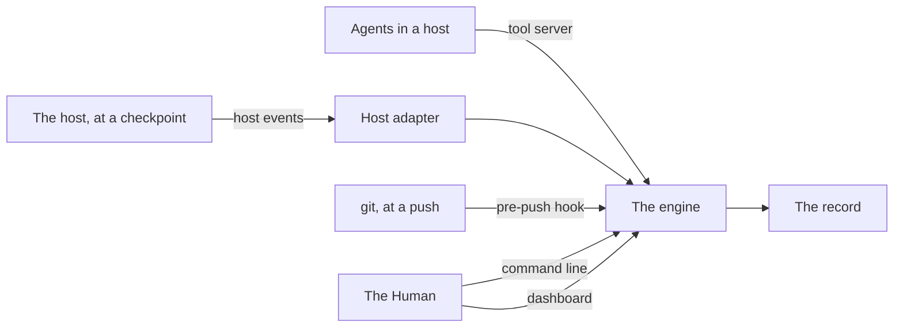
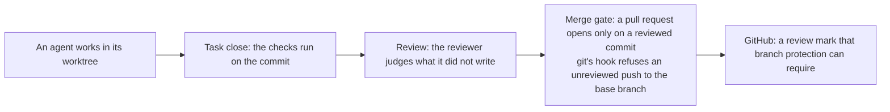
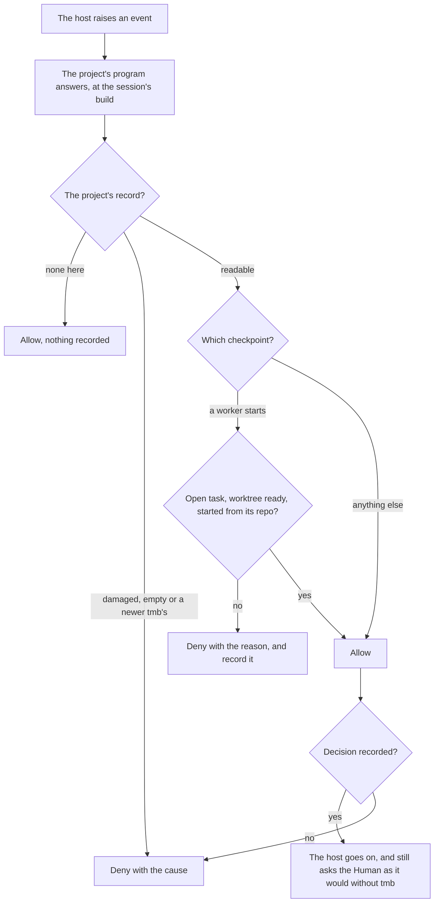

# The engine

The engine is tmb itself: the record, the code graph, the workflow and the gate. This page says how it is reached, where it judges an outcome, and what it writes. A point where it judges an outcome is a checkpoint: an agent's start, a task's close, the review, a push. How the host is wired to it is in [ADAPTERS.md](ADAPTERS.md).

Everything before [Containment](#containment) is the design. Containment is detail for building and debugging.

## Ways into the engine

**Every way in calls the same engine.**

| Way in | Used by | Why |
|---|---|---|
| Tool server | Agents in a host | They read briefs and the code graph, and record their work. |
| Host events, through the host adapter | The host, at a checkpoint | The engine can refuse an action no agent asked it about. |
| Git's pre-push hook | git | A push to the base branch is checked even when typed by hand. |
| Command line | The Human | Every step the Human runs by hand, such as init, onboard and `tmb doctor`, the health check. The list is in the [reference](../reference/README.md). |
| Dashboard | The Human | A local web page over the record. |
| Desktop program | The Human | Planned (trustmybot/tmb#79), with the dashboard built in. |

tmb has no slash commands: each action is a terminal command or a tool the planner calls.

**A step only the Human may take is fenced at the command line.** The command line records every caller as the Human. So it runs such a step only on a terminal, after the Human types yes.

The fenced steps are: waiving a review, of a feature branch or of a task; setting the review mode; removing tmb from a project. An update is not one.

- **Example 1.** The Human waives a review on a terminal and types yes. The command line runs the step.
- **Example 2.** An agent runs the same command in its shell, which has no terminal. The command line refuses and changes nothing.
- **Edge case: a run with no one to ask.** In unattended mode, such as CI, a run with no terminal may set the review mode where none is set, for the workspace or for one repo. It never changes a mode that is set, so an agent that turns unattended mode on for its own command cannot undo the Human's choice. Nothing else passes.
- **Edge case: the fence is not proof.** An agent that writes a script which opens its own terminal can pass it. tmb builds no stronger fence, and the host's own permission prompt shows the Human a command before an agent runs it.

## Unattended mode

**A session with no one to answer is started in unattended mode.** At session start the engine puts one instruction first in its answer: no one can answer in this run, so apply your defaults and name each default you used.

- **Example 1.** A run in CI, a scheduled job or an agent test.
- **Example 2.** A question has a recommended answer. That answer counts as the answer: the agent records it as a decision on its issue, names it in its answer, and goes on.
- **Edge case.** A choice the agent's role leaves to the Human alone is never a default. The agent stops only when no default is safe, and says why.

| Rule | Why |
|---|---|
| The instruction comes first, before the role | A host may show the agent only the head of a long context, so an instruction at the end holds only some of the time. |
| Whoever starts the run sets the mode, for that run only | It is not stored in the project, so the next session the Human opens is a normal one. |
| It comes from the engine | The Human's prompt needs no special wording. |
| It changes guidance only | The gate allows and denies exactly as in a normal session. |

## Containment

**tmb keeps a project's data inside the project, keeps its own program and state in two named places on the machine, and changes nothing it did not write.** For the code that enforces each rule, ask the code graph.

### Checkpoints, not a guard on every write

**tmb checks what is delivered, like CI** ([PRINCIPLES.md](PRINCIPLES.md)). It builds no per-write guard, no shell parser and no sandbox. Judging every file write, or parsing every shell command to predict what it writes, cannot be done in general: it denies good commands and misses real writes. Whether the host's sandbox is on is the Human's own setting.

| Mistake | Caught at |
|---|---|
| A worker starts with no task, or on a closed one | Its start: denied |
| A worker writes outside its worktree | Its host keeps a worker's edits in a folder of its own, where the host can. The close names anything that changed in the main folder since the task started, with the command that puts it back. tmb puts nothing back: the list can hold the Human's own edits. |
| A task changes files outside its spec | The close names each file. It refuses only on its checks. |
| A docs task changes code | The close refuses, and names the file |
| The reviewer edits what it judges | Its role has no editing tool ([ROLES.md](ROLES.md#reviewer)) |
| An unreviewed commit heads for the base branch | The merge gate refuses its pull request. git's pre-push hook refuses a push straight to the base branch, whoever typed it |
| An agent takes a step that is the Human's alone | The command line's fence ([Ways into the engine](#ways-into-the-engine)) |
| Two tasks change the same file | No lock. git settles it when the work is merged, and a clash holds back the later task's close. |

- **The engine does the git steps itself.** It, not an agent, cuts branches and worktrees, folds, pushes and opens pull requests, so every step is recorded.
- **Edge case: deliberate evasion.** It is out of the threat model. Agents make mistakes but do not attack tmb. The fences stop the plain path, and the record shows each deny.

Planned:

- **A skipped gate is found later.** The sync with the remote records it as a finding (trustmybot/tmb#70).
- **Freeze.** One request stops all work in a project until the Human starts it again (trustmybot/tmb#64).

### tmb's own events

**tmb has few hooks. Each is one tmb event, whatever raised it.**

| tmb event | Raised when | The engine's answer | Raised by | In Claude Code |
|---|---|---|---|---|
| Session start | A host session opens in a tmb project | The role, the rules and the open work. Never a deny. | Host | Its session start event |
| Before an agent start | The host is about to start a subagent | A worker needs an open task with a ready worktree; a reviewer's run is opened | Host | Before a call of its agent tool |
| An agent start that failed | The host could not start the subagent | The run that was opened is ended | Host | After a failed call of its agent tool |
| A worker in its folder | A worker reads its brief or closes its task, which tells the engine which folder it works in | That folder becomes the task's worktree | Host | Before a call of tmb's brief or close tool |
| After an agent stop | A subagent has ended | Its run is ended, with the tokens it used where the host tells | Host | Its subagent stop event, with the subagent's token use |
| Before a push | A push is about to leave the machine | Refused only when it brings unreviewed commits to the base branch, or deletes it | git | git's pre-push hook |

- **Example 1.** An event carries the same fields whatever raised it: the role, the task and what is about to happen. A push tmb makes for an agent carries that agent's role. A push typed by hand is the Human's.
- **Example 2.** A push is judged by git's pre-push hook, not by reading an agent's command.
- **Edge case.** A task's start and close are not events. The engine checks them itself when it is asked, and a refusal there goes to the caller without a recorded decision.
- **Edge case.** tmb ships its own rules only. Users cannot add rules of their own on these events.

### One program, one build, one engine

**A checkpoint never runs twice or at two versions.** Several things could answer for one project: two channels' programs, or an old build beside a new one. Three rules keep it to one:

1. **One program per project.** The project is tied to the program whose init last wired it. Its host events, its tool server and git's push hook all call that program. Planned (trustmybot/tmb#305): a command typed with another channel's program still runs, with one warning line that names the project's program. tmb reads the tie from the wiring, never from the record.
2. **One build per session.** While a session runs, every tmb call in its project runs the build the session started with. The host files are refreshed only at a session start with no task open ([1_INSTALL.md](../flows/1_INSTALL.md#upgrade)).
3. **One engine.** Every way in asks the same engine.

One host event, answered ([Gates fail closed](#gates-fail-closed) has every case):

### Gates fail closed

**A gate that cannot read the record or record its decision denies. A deny always says why, and what would be allowed.**

| Case | Result |
|---|---|
| **A record tmb cannot read** | Closed. A record that is damaged, empty, or reshaped by a newer tmb denies every agent start and push. The deny names the cause and the way out. |
| **A decision tmb cannot record** | Closed: it denies. |
| **A push hook that fails** | Closed: it refuses the push. |
| **No record** | Open: it allows, and nothing is recorded. A project tmb was never set up in is not tmb's to gate. A push hook left in such a repo lets the push go and says so in one line. |
| **A host event tmb itself cannot answer**, such as input it cannot parse | Open: the host goes on and tmb writes a note. A tmb fault must never break the Human's session. The close and the push still check everything. |
| **tmb's line in another tool's push hook**, on a machine without tmb | Open: it does nothing, so a teammate's push is not blocked. |

### What tmb writes, and where

**tmb writes only its own entries, only where the Human ran it.**

| Rule | What it means |
|---|---|
| **A project's data stays in the project** | The record, one code graph per repo, the task worktrees and small notes on which host files init created sit in tmb's own folder there. Nothing about a project is kept anywhere else on the machine. |
| **tmb writes only where the Human ran it** | A project gets tmb's files when the Human runs init in it, never because a session opened there. |
| **tmb changes only what it wrote** | In a host file or a hook it shares with the Human or another tool, tmb adds its own marked entries and leaves the rest. Remove takes out exactly those ([1_INSTALL.md](../flows/1_INSTALL.md#upgrade)). |
| **Reads outside the project are read-only and named** | tmb looks for the host's program on the machine and reads GitHub through the Human's own command line. |
| **The host's own instruction file is never written** | The role reaches a session as the engine's answer to its session start. Planned (trustmybot/tmb#112): a cheatcode may add one reference line and take it out again ([4_EXTENDING.md](../flows/4_EXTENDING.md#cheatcodes)). |
| **No login, no trust, no host settings** | tmb never changes a repo's branch protection, and changes no host setting beyond its own entries. |

**In a project.** Outside its own folder, init writes only these:

| What | Limit |
|---|---|
| The host's project files, through its adapter: the tool server's registration, the event wiring and the role files | Each is marked as tmb's. A role file tmb did not write is never overwritten, and one the Human edited is kept ([below](#a-file-tmb-wrote-at-an-update)). |
| git's pre-push hook in each repo tmb works in | A hook that is another tool's is left alone; with the Human's yes tmb adds one line first in it. |
| Ignore lines for its folder and for the host files that are the Human's alone | Remove leaves these lines. |
| `git init` | Once, in a folder that is in no repo and holds none. |
| Feature and task branches in git | tmb never deletes them while they hold work. |

### A file tmb wrote, at an update

**Planned (trustmybot/tmb#461). tmb keeps the checksum of each project file it writes. An update replaces a file only while the checksum still matches. An edited file is the Human's.**

| The file | An update, a refresh, or init run again |
|---|---|
| Not written by tmb | Never touched |
| tmb's, unchanged | Replaced by this version's |
| tmb's, edited since | Kept. The session start and the health check say so, and that deleting it and running init brings tmb's back |
| tmb's, unchanged, for something this version no longer ships | Removed |
| The same, edited | Kept, and named |
| An agent or a skill the Human approved (Planned, trustmybot/tmb#437) | Never removed. It is in the record, and is written again from it when missing |
| Missing | Written |

- **Example.** The Human tunes the worker's prompt in its role file. The next update leaves the file, and the health check says it differs from this version's.
- **Edge case.** A settings file holds the Human's entries and tmb's. tmb changes only its own entries.

Planned (trustmybot/tmb#436, trustmybot/tmb#437, trustmybot/tmb#112): the skill files tmb ships, and the agent and cheatcode files the Human approves one by one ([4_EXTENDING.md](../flows/4_EXTENDING.md)).

**On the machine.** tmb is one program for every project, so two things live outside any project. Each channel's program has its own, and one never touches another's.

| Where | Holds |
|---|---|
| The user's program folder | The program, under its channel's name. The installer adds the folder to PATH unless told not to. |
| The program's state folder | Kept builds, the time of the last look for an update, a marker per running session, the person's feedback setting, drafts of bug reports and the last error |

- **Edge case.** Nothing is deleted by itself. An old build goes only on the Human's yes ([1_INSTALL.md](../flows/1_INSTALL.md#upgrade)).
- **Edge case.** Scratch files go to the system's temp folder and are removed when the step ends.

### Tests never touch the live record

**A test works on scratch state and a project of its own, never the person's.**

- **Example 1.** Machine-wide state is swapped before any test runs. Every tmb a test starts, in its own process or as a child, keeps its state in a scratch folder. The feedback program is off for them.
- **Example 2.** Each test works in a project of its own. A fixture is copied into a fresh repo in a temp folder, removed on exit. The record is found only in a folder or above it, so a temp folder never reaches a real one.
- **Edge case.** A past run left rows behind. An agent never deletes them: `tmb doctor` shows what it finds, and the Human decides.
- Planned (trustmybot/tmb#444): under a test flag the record is never looked up, so a test run started inside a tmb project cannot reach its record either.

### Enforcement

**Tests hold each rule, and two lints run with them.**

- **The tests.** A damaged, empty or newer record denies. Init and remove leave the Human's entries alone, and remove takes out exactly what init added. A program updates only itself and keeps its own state. A step that is the Human's alone is refused without a terminal.
- **The lints.** The engine never names a host outside its adapter, and every test's machine-wide state is a scratch folder.

Open, for the Human: whether a lint fails on any write to the home folder.
