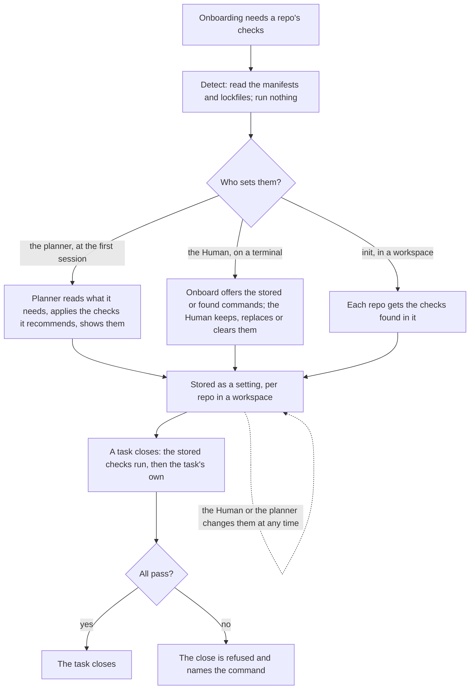

# The repo's checks

Every case of flow 2.3 in [FLOWS.md](FLOWS.md): how tmb learns the commands that must pass before a task closes, without a hardcoded toolset. The plugin kept a per-machine profile of install, test and lint commands; tmb finds the checks at onboarding and stores them as a setting.

- **Detect runs nothing.** It reads the files a stack leaves behind and suggests commands: a package manifest's lint, typecheck and test scripts, run with the tool its lockfile names, and the usual test command of a Python, Rust or Go project. The list is in the [reference](../reference/README.md#onboard).
- **A suggestion, never the rule.** The planner works out what it recommends from the suggestion and the project. The Human confirms or replaces it.
- **A setting, not a cache.** The checks are stored in the record with the other settings, and every change is kept in the audit trail. They change only when the Human or the planner changes them; a stored list is never overwritten by a new detection.
- **One list per repo.** A project of one repo has one list. In a workspace each repo has its own, and the project-wide list is not read ([GIT.md](GIT.md#multi-repo-workspaces)).
- **A task adds its own.** A task's spec can name more checks. At close the stored checks run first, then the task's, each with a time limit, in the task's worktree. A task with no checks at all never closes ([TASKS.md](TASKS.md)).
- **The repo is the source of truth.** Teammates, CI and editors enforce the same rules without tmb, so tmb suggests only commands the repo already defines.

## Open, for the Human

The plugin's profile did more. tmb has built none of this, and the difference list does not say whether it should:

- **Checked on use.** The plugin compared a profile's evidence with the repo each time and detected again when they differed. In tmb a changed repo keeps its stored checks until someone changes them.
- **One profile per package root.** tmb detects at the repo's top folder only.
- **Install commands and missing tools.** tmb records neither, and does not tell the Human what to install.
- **Overrides, waivers and declines per category.** tmb stores one plain list of commands.
