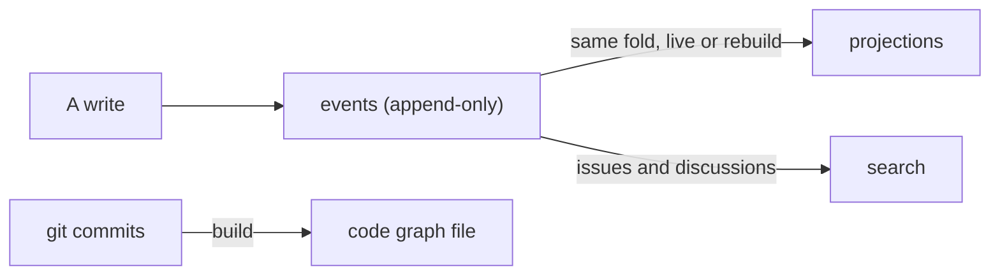
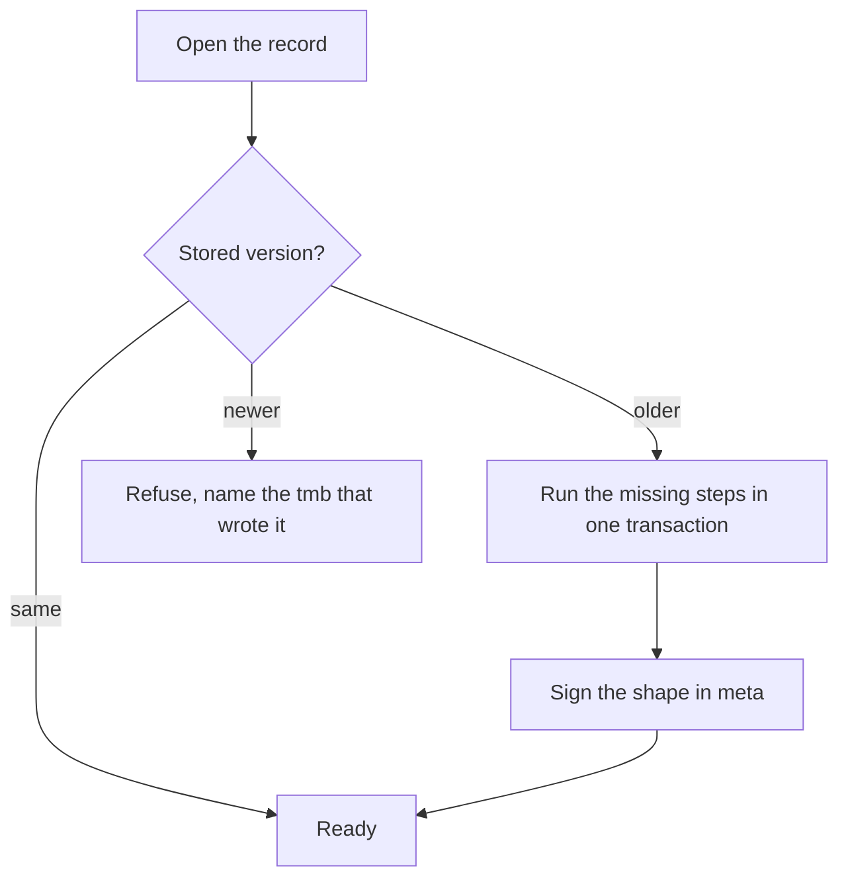

# Trajectory DB — Entity Relationship Diagram

Two SQLite files per project, both in the project's `.tmb/` folder and gitignored:

| File | Holds | Schema | Version |
|---|---|---|---|
| `.tmb/trajectory.db` | The record: every event and the current state derived from them | `src/engine/store/schema.ts` | `SCHEMA_VERSION = 11` (`PRAGMA user_version`) |
| `.tmb/graph.db` | The code graph ([`2_CODE_GRAPH.md`](../flows/2_CODE_GRAPH.md)) | `src/engine/graph/db.ts` | `GRAPH_SCHEMA_VERSION = 5` |

In a workspace of several repos, the repos share one record, and each repo has its own graph file at `.tmb/graphs/<repo>.db`.

**This page lists every table and column of the two schemas.** A schema change updates this page in the same pull request. Planned: a generator with a freshness test that fails when the page drifts.

## Overview

The record is tmb's cold memory ([`MEMORY.md`](MEMORY.md)): the only source of truth for workflow state. Its tables fall into four groups, and the code graph is a fifth, in its own file:

- **Events** — `events`, the one append-only table. Every write to the record is one event; nothing else is the source of truth.
- **Projections** — `issues`, `discussions`, `features`, `tasks`, `runs`, `check_runs`, `reviews`, `guard_decisions`, `audit`. Each row is the current state of one record, folded from its events. They can be emptied and rebuilt from `events`.
- **Search** — `search`, one full-text index over issues and discussions.
- **Meta** — `meta`, the record's own facts: which tmb wrote its shape.
- **Code graph** — the project map (`layers`, `dirs`, `files`, `symbols`, `edges`, `parsed`), what agents wrote about it (`concepts`, `concept_anchors`, `areas`), its measured misses (`misses`) and its full-text indexes. No foreign key crosses into the record.

## Design requirements

Every table, and every change to one, meets these two requirements.

- **Trajectory.** The record exists to keep the trajectory of work. Every table either records a step in it (a fact) or describes something that takes part in it (a dimension). Anything else does not belong in it.
- **Consistency.** Naming is consistent. A projection table is plural and its record kind is the singular: `tasks` → `task`, `check_runs` → `check_run`. Every projection row carries its id, `created_by` (the JSON actor of its first event) and `created_at` (that event's time). Ids are ULIDs, never autoincrement.

## Diagram

```mermaid
erDiagram
    issues ||--o{ discussions : "issue_id (NO ACTION)"
    tasks |o--o{ tasks : "replaces (NO ACTION)"
    features |o--o{ tasks : "feature_id (NO ACTION)"
    issues ||--o{ tasks : "issue_id (NO ACTION)"
    features |o--o{ runs : "feature_id (NO ACTION)"
    tasks |o--o{ runs : "task_id (NO ACTION)"
    tasks ||--o{ check_runs : "task_id (NO ACTION)"
    runs |o--o{ reviews : "run_id (NO ACTION)"
    features |o--o{ reviews : "feature_id (NO ACTION)"
    concepts ||--o{ concept_anchors : "concept_id (CASCADE)"
    areas |o--o{ areas : "parent_id (SET NULL)"

    events {
        TEXT id PK
        TEXT record_kind "NOT NULL"
        TEXT record_id "NOT NULL"
        TEXT type "NOT NULL"
        TEXT data "NOT NULL"
        TEXT actor_kind "NOT NULL"
        TEXT actor_role
        TEXT actor_host
        TEXT at "NOT NULL"
    }

    issues {
        TEXT id PK
        TEXT title "NOT NULL"
        TEXT body "NOT NULL"
        TEXT state "NOT NULL"
        TEXT milestone
        TEXT created_by "NOT NULL"
        TEXT created_at "NOT NULL"
        TEXT updated_at "NOT NULL"
    }

    discussions {
        TEXT id PK
        TEXT issue_id FK "NOT NULL; → issues.id"
        TEXT kind "NOT NULL"
        TEXT body "NOT NULL"
        TEXT created_by "NOT NULL"
        TEXT created_at "NOT NULL"
    }

    features {
        TEXT id PK
        TEXT name "NOT NULL; UNIQUE"
        TEXT base_branch "NOT NULL"
        TEXT base_commit "NOT NULL"
        TEXT state "NOT NULL"
        TEXT created_by "NOT NULL"
        TEXT created_at "NOT NULL"
        TEXT updated_at "NOT NULL"
        TEXT pr_url
        TEXT repo
        TEXT drop_reason
    }

    tasks {
        TEXT id PK
        TEXT issue_id FK "NOT NULL; → issues.id"
        TEXT title "NOT NULL"
        TEXT spec "NOT NULL"
        TEXT state "NOT NULL"
        TEXT branch
        TEXT commit_sha
        TEXT created_by "NOT NULL"
        TEXT created_at "NOT NULL"
        TEXT updated_at "NOT NULL"
        TEXT worktree
        TEXT base_commit
        TEXT feature_id FK "→ features.id"
        TEXT kind
        TEXT review_mode
        TEXT push_result
        TEXT push_detail
        TEXT pr_url
        TEXT main_snapshot
        TEXT repo
        TEXT drop_reason
        TEXT replaces FK "→ tasks.id"
    }

    runs {
        TEXT id PK
        TEXT task_id FK "→ tasks.id"
        TEXT role "NOT NULL"
        TEXT started_at "NOT NULL"
        TEXT ended_at
        TEXT outcome
        TEXT cost
        TEXT created_by "NOT NULL"
        TEXT created_at "NOT NULL"
        TEXT feature_id FK "→ features.id"
    }

    check_runs {
        TEXT id PK
        TEXT task_id FK "NOT NULL; → tasks.id"
        TEXT commit_sha "NOT NULL"
        TEXT started_at "NOT NULL"
        TEXT ended_at
        TEXT result
        TEXT created_by "NOT NULL"
        TEXT created_at "NOT NULL"
        TEXT commands "NOT NULL"
    }

    reviews {
        TEXT id PK
        TEXT target_kind "NOT NULL"
        TEXT target "NOT NULL"
        TEXT verdict "NOT NULL"
        TEXT findings "NOT NULL"
        TEXT created_by "NOT NULL"
        TEXT created_at "NOT NULL"
        TEXT feature_id FK "→ features.id"
        TEXT commit_sha
        TEXT run_id FK "→ runs.id"
    }

    guard_decisions {
        TEXT id PK
        TEXT event "NOT NULL"
        TEXT decision "NOT NULL"
        TEXT reason "NOT NULL"
        TEXT created_by "NOT NULL"
        TEXT created_at "NOT NULL"
    }

    audit {
        TEXT id PK
        TEXT what "NOT NULL"
        TEXT detail "NOT NULL"
        TEXT created_by "NOT NULL"
        TEXT created_at "NOT NULL"
    }

    meta {
        TEXT key PK
        TEXT value "NOT NULL"
    }

    layers {
        TEXT layer PK
        TEXT commit_sha "NOT NULL"
        INTEGER extractor "NOT NULL"
        TEXT built_at "NOT NULL"
        INTEGER files "NOT NULL"
        INTEGER symbols "NOT NULL"
        INTEGER edges "NOT NULL"
        INTEGER unresolved "NOT NULL"
        INTEGER unresolved_imports "NOT NULL"
        INTEGER functions "NOT NULL"
        INTEGER not_parsed "NOT NULL"
        TEXT not_read "NOT NULL"
    }

    dirs {
        TEXT layer PK "NOT NULL"
        TEXT path PK "NOT NULL"
        TEXT parent
        INTEGER depth "NOT NULL"
        TEXT summary "NOT NULL"
        TEXT summary_source "NOT NULL"
        INTEGER file_count "NOT NULL"
    }

    files {
        TEXT layer PK "NOT NULL"
        TEXT path PK "NOT NULL"
        TEXT dir "NOT NULL"
        TEXT lang
        TEXT blob "NOT NULL"
        INTEGER size "NOT NULL"
        TEXT lane "NOT NULL"
        TEXT summary "NOT NULL"
        TEXT summary_source "NOT NULL"
        TEXT parse_error
    }

    symbols {
        INTEGER id PK
        TEXT layer "NOT NULL"
        TEXT path "NOT NULL"
        TEXT kind "NOT NULL"
        TEXT qualified_name "NOT NULL"
        TEXT name "NOT NULL"
        TEXT signature "NOT NULL"
        TEXT doc "NOT NULL"
        INTEGER start_line
        INTEGER end_line
        INTEGER exported "NOT NULL"
        INTEGER parent_id
        INTEGER unnamed "NOT NULL"
        INTEGER named_id
    }

    edges {
        TEXT layer "NOT NULL"
        INTEGER src_id "NOT NULL"
        INTEGER dst_id
        TEXT dst_name "NOT NULL"
        TEXT kind "NOT NULL"
        TEXT resolution "NOT NULL"
        INTEGER line
        TEXT hint
    }

    parsed {
        TEXT blob PK "NOT NULL"
        TEXT lang PK "NOT NULL"
        INTEGER extractor PK "NOT NULL"
        TEXT extraction
        TEXT error
    }

    concepts {
        TEXT id PK
        TEXT name "NOT NULL; UNIQUE"
        TEXT kind "NOT NULL"
        TEXT body "NOT NULL"
        TEXT status "NOT NULL"
        TEXT status_reason
        TEXT checked_at
        TEXT checked_sha
        TEXT created_by "NOT NULL"
        TEXT updated_by "NOT NULL"
        TEXT created_at "NOT NULL"
        TEXT updated_at "NOT NULL"
    }

    concept_anchors {
        TEXT concept_id PK,FK "NOT NULL; → concepts.id"
        INTEGER ordinal PK "NOT NULL"
        TEXT path "NOT NULL"
        TEXT qualified_name "NOT NULL"
        INTEGER present "NOT NULL"
    }

    areas {
        TEXT id PK
        TEXT name "NOT NULL; UNIQUE"
        TEXT purpose "NOT NULL"
        TEXT parent_id FK "→ areas.id"
        TEXT include "NOT NULL"
        TEXT exclude "NOT NULL"
        INTEGER builtin "NOT NULL"
        TEXT status "NOT NULL"
        TEXT status_reason
        INTEGER file_count "NOT NULL"
        INTEGER written_count "NOT NULL"
        TEXT checked_sha
        TEXT created_by "NOT NULL"
        TEXT updated_by "NOT NULL"
        TEXT created_at "NOT NULL"
        TEXT updated_at "NOT NULL"
    }

    misses {
        INTEGER id PK
        TEXT at "NOT NULL"
        TEXT lookup "NOT NULL"
        TEXT query "NOT NULL"
        TEXT detail "NOT NULL"
        TEXT actor "NOT NULL"
    }
```

`events`, `guard_decisions`, `audit`, `meta`, `search` and the code graph's map tables declare no foreign key. An event names its record by `record_kind` and `record_id`; a graph row names its layer, path or symbol id as a plain value.

## Tables

### The record (`trajectory.db`)

#### `events`

| Column | Type | Null | Default | Constraints |
|---|---|---|---|---|
| `id` | TEXT | nullable |  | PK |
| `record_kind` | TEXT | NOT NULL |  | CHECK `record_kind IN ('issue','discussion','task','run','check_run','review','guard_decision','audit','feature')` |
| `record_id` | TEXT | NOT NULL |  |  |
| `type` | TEXT | NOT NULL |  |  |
| `data` | TEXT | NOT NULL |  | CHECK `json_valid(data)` |
| `actor_kind` | TEXT | NOT NULL |  | CHECK `actor_kind IN ('human','agent')` |
| `actor_role` | TEXT | nullable |  | CHECK `actor_role IN ('planner','worker','reviewer')` |
| `actor_host` | TEXT | nullable |  |  |
| `at` | TEXT | NOT NULL |  |  |

Table constraints:

- CHECK `(actor_kind = 'human' AND actor_role IS NULL AND actor_host IS NULL) OR (actor_kind = 'agent' AND actor_role IS NOT NULL AND length(trim(actor_host)) > 0)`

#### `issues`

| Column | Type | Null | Default | Constraints |
|---|---|---|---|---|
| `id` | TEXT | nullable |  | PK |
| `title` | TEXT | NOT NULL |  | CHECK `length(trim(title)) > 0` |
| `body` | TEXT | NOT NULL | `''` |  |
| `state` | TEXT | NOT NULL | `'open'` | CHECK `state IN ('open','closed')` |
| `milestone` | TEXT | nullable |  |  |
| `created_by` | TEXT | NOT NULL |  |  |
| `created_at` | TEXT | NOT NULL |  |  |
| `updated_at` | TEXT | NOT NULL |  |  |

#### `discussions`

| Column | Type | Null | Default | Constraints |
|---|---|---|---|---|
| `id` | TEXT | nullable |  | PK |
| `issue_id` | TEXT | NOT NULL |  | FK → `issues.id` ON DELETE NO ACTION |
| `kind` | TEXT | NOT NULL |  | CHECK `kind IN ('note','decision')` |
| `body` | TEXT | NOT NULL |  | CHECK `length(trim(body)) > 0` |
| `created_by` | TEXT | NOT NULL |  |  |
| `created_at` | TEXT | NOT NULL |  |  |

#### `features`

| Column | Type | Null | Default | Constraints |
|---|---|---|---|---|
| `id` | TEXT | nullable |  | PK |
| `name` | TEXT | NOT NULL |  | UNIQUE; CHECK `length(trim(name)) > 0` |
| `base_branch` | TEXT | NOT NULL |  |  |
| `base_commit` | TEXT | NOT NULL |  |  |
| `state` | TEXT | NOT NULL | `'open'` |  |
| `created_by` | TEXT | NOT NULL |  |  |
| `created_at` | TEXT | NOT NULL |  |  |
| `updated_at` | TEXT | NOT NULL |  |  |
| `pr_url` | TEXT | nullable |  |  |
| `repo` | TEXT | nullable |  |  |
| `drop_reason` | TEXT | nullable |  |  |

#### `tasks`

| Column | Type | Null | Default | Constraints |
|---|---|---|---|---|
| `id` | TEXT | nullable |  | PK |
| `issue_id` | TEXT | NOT NULL |  | FK → `issues.id` ON DELETE NO ACTION |
| `title` | TEXT | NOT NULL |  | CHECK `length(trim(title)) > 0` |
| `spec` | TEXT | NOT NULL | `''` |  |
| `state` | TEXT | NOT NULL |  |  |
| `branch` | TEXT | nullable |  |  |
| `commit_sha` | TEXT | nullable |  |  |
| `created_by` | TEXT | NOT NULL |  |  |
| `created_at` | TEXT | NOT NULL |  |  |
| `updated_at` | TEXT | NOT NULL |  |  |
| `worktree` | TEXT | nullable |  |  |
| `base_commit` | TEXT | nullable |  |  |
| `feature_id` | TEXT | nullable |  | FK → `features.id` ON DELETE NO ACTION |
| `kind` | TEXT | nullable |  |  |
| `review_mode` | TEXT | nullable |  |  |
| `push_result` | TEXT | nullable |  |  |
| `push_detail` | TEXT | nullable |  |  |
| `pr_url` | TEXT | nullable |  |  |
| `main_snapshot` | TEXT | nullable |  |  |
| `repo` | TEXT | nullable |  |  |
| `drop_reason` | TEXT | nullable |  |  |
| `replaces` | TEXT | nullable |  | FK → `tasks.id` ON DELETE NO ACTION |

#### `runs`

| Column | Type | Null | Default | Constraints |
|---|---|---|---|---|
| `id` | TEXT | nullable |  | PK |
| `task_id` | TEXT | nullable |  | FK → `tasks.id` ON DELETE NO ACTION |
| `role` | TEXT | NOT NULL |  | CHECK `role IN ('planner','worker','reviewer')` |
| `started_at` | TEXT | NOT NULL |  |  |
| `ended_at` | TEXT | nullable |  |  |
| `outcome` | TEXT | nullable |  |  |
| `cost` | TEXT | nullable |  | CHECK `cost IS NULL OR json_valid(cost)` |
| `created_by` | TEXT | NOT NULL |  |  |
| `created_at` | TEXT | NOT NULL |  |  |
| `feature_id` | TEXT | nullable |  | FK → `features.id` ON DELETE NO ACTION |

#### `check_runs`

| Column | Type | Null | Default | Constraints |
|---|---|---|---|---|
| `id` | TEXT | nullable |  | PK |
| `task_id` | TEXT | NOT NULL |  | FK → `tasks.id` ON DELETE NO ACTION |
| `commit_sha` | TEXT | NOT NULL |  |  |
| `started_at` | TEXT | NOT NULL |  |  |
| `ended_at` | TEXT | nullable |  |  |
| `result` | TEXT | nullable |  |  |
| `created_by` | TEXT | NOT NULL |  |  |
| `created_at` | TEXT | NOT NULL |  |  |
| `commands` | TEXT | NOT NULL | `'[]'` | CHECK `json_valid(commands)` |

#### `reviews`

| Column | Type | Null | Default | Constraints |
|---|---|---|---|---|
| `id` | TEXT | nullable |  | PK |
| `target_kind` | TEXT | NOT NULL |  | CHECK `target_kind IN ('commit','branch')` |
| `target` | TEXT | NOT NULL |  |  |
| `verdict` | TEXT | NOT NULL |  |  |
| `findings` | TEXT | NOT NULL | `'[]'` | CHECK `json_valid(findings)` |
| `created_by` | TEXT | NOT NULL |  |  |
| `created_at` | TEXT | NOT NULL |  |  |
| `feature_id` | TEXT | nullable |  | FK → `features.id` ON DELETE NO ACTION |
| `commit_sha` | TEXT | nullable |  |  |
| `run_id` | TEXT | nullable |  | FK → `runs.id` ON DELETE NO ACTION |

#### `guard_decisions`

| Column | Type | Null | Default | Constraints |
|---|---|---|---|---|
| `id` | TEXT | nullable |  | PK |
| `event` | TEXT | NOT NULL |  |  |
| `decision` | TEXT | NOT NULL |  | CHECK `decision IN ('allow','deny')` |
| `reason` | TEXT | NOT NULL |  |  |
| `created_by` | TEXT | NOT NULL |  |  |
| `created_at` | TEXT | NOT NULL |  |  |

#### `audit`

| Column | Type | Null | Default | Constraints |
|---|---|---|---|---|
| `id` | TEXT | nullable |  | PK |
| `what` | TEXT | NOT NULL |  | CHECK `length(trim(what)) > 0` |
| `detail` | TEXT | NOT NULL | `''` |  |
| `created_by` | TEXT | NOT NULL |  |  |
| `created_at` | TEXT | NOT NULL |  |  |

#### `meta`

| Column | Type | Null | Default | Constraints |
|---|---|---|---|---|
| `key` | TEXT | nullable |  | PK |
| `value` | TEXT | NOT NULL |  | CHECK `json_valid(value)` |

### Planned: `docs`

Planned (trustmybot/tmb#302). One row per design document, so the planner finds the design whether it lives in the repo, outside it such as on a wiki, or in the record itself. A projection like the others: record kind `doc`, folded from its events.

| Column | Type | Null | Default | Constraints |
|---|---|---|---|---|
| `id` | TEXT | nullable |  | PK |
| `repo` | TEXT | nullable |  | The repo the document describes, named as `features.repo` and `tasks.repo` name theirs; NULL is the project folder itself |
| `location` | TEXT | NOT NULL |  | A path inside the repo, a link outside it, or a name for a document kept in the record. UNIQUE with `repo`; CHECK `length(trim(location)) > 0` |
| `body` | TEXT | nullable |  | The document's text, only for a document kept in the record; NULL when it lives at `location` |
| `title` | TEXT | NOT NULL |  | CHECK `length(trim(title)) > 0` |
| `purpose` | TEXT | NOT NULL |  | What the document is for and when to read it. CHECK `length(trim(purpose)) > 0` |
| `state` | TEXT | NOT NULL | `'current'` | `current` or `retired`. A retired row is kept |
| `created_by` | TEXT | NOT NULL |  |  |
| `created_at` | TEXT | NOT NULL |  |  |
| `updated_at` | TEXT | NOT NULL |  |  |

- **A document lives in one place.** One in the repo or outside it stays there, and the row says where that is and what it is for. One kept in the record has its text in `body`, for a project that keeps no docs in its code.
- **The planner records and updates it;** the Human may. An updated event may change `location`, `body`, `title`, `purpose` and `state`.
- **A task's spec names a row** as the design it implements ([`3_TASKS.md`](../flows/3_TASKS.md)).

### The code graph (`graph.db`)

#### `layers`

| Column | Type | Null | Default | Constraints |
|---|---|---|---|---|
| `layer` | TEXT | nullable |  | PK |
| `commit_sha` | TEXT | NOT NULL |  |  |
| `extractor` | INTEGER | NOT NULL |  |  |
| `built_at` | TEXT | NOT NULL |  |  |
| `files` | INTEGER | NOT NULL |  |  |
| `symbols` | INTEGER | NOT NULL |  |  |
| `edges` | INTEGER | NOT NULL |  |  |
| `unresolved` | INTEGER | NOT NULL |  |  |
| `unresolved_imports` | INTEGER | NOT NULL | `0` |  |
| `functions` | INTEGER | NOT NULL | `0` |  |
| `not_parsed` | INTEGER | NOT NULL | `0` |  |
| `not_read` | TEXT | NOT NULL | `'{}'` |  |

#### `dirs`

| Column | Type | Null | Default | Constraints |
|---|---|---|---|---|
| `layer` | TEXT | NOT NULL |  |  |
| `path` | TEXT | NOT NULL |  |  |
| `parent` | TEXT | nullable |  |  |
| `depth` | INTEGER | NOT NULL |  |  |
| `summary` | TEXT | NOT NULL | `''` |  |
| `summary_source` | TEXT | NOT NULL | `'none'` |  |
| `file_count` | INTEGER | NOT NULL | `0` |  |

Table constraints:

- PRIMARY KEY `(layer, path)`

#### `files`

| Column | Type | Null | Default | Constraints |
|---|---|---|---|---|
| `layer` | TEXT | NOT NULL |  |  |
| `path` | TEXT | NOT NULL |  |  |
| `dir` | TEXT | NOT NULL |  |  |
| `lang` | TEXT | nullable |  |  |
| `blob` | TEXT | NOT NULL |  |  |
| `size` | INTEGER | NOT NULL |  |  |
| `lane` | TEXT | NOT NULL |  |  |
| `summary` | TEXT | NOT NULL | `''` |  |
| `summary_source` | TEXT | NOT NULL | `'none'` |  |
| `parse_error` | TEXT | nullable |  |  |

Table constraints:

- PRIMARY KEY `(layer, path)`

#### `symbols`

| Column | Type | Null | Default | Constraints |
|---|---|---|---|---|
| `id` | INTEGER | nullable |  | PK |
| `layer` | TEXT | NOT NULL |  |  |
| `path` | TEXT | NOT NULL |  |  |
| `kind` | TEXT | NOT NULL |  |  |
| `qualified_name` | TEXT | NOT NULL |  |  |
| `name` | TEXT | NOT NULL |  |  |
| `signature` | TEXT | NOT NULL | `''` |  |
| `doc` | TEXT | NOT NULL | `''` |  |
| `start_line` | INTEGER | nullable |  |  |
| `end_line` | INTEGER | nullable |  |  |
| `exported` | INTEGER | NOT NULL | `0` |  |
| `parent_id` | INTEGER | nullable |  |  |
| `unnamed` | INTEGER | NOT NULL | `0` |  |
| `named_id` | INTEGER | nullable |  |  |

#### `edges`

| Column | Type | Null | Default | Constraints |
|---|---|---|---|---|
| `layer` | TEXT | NOT NULL |  |  |
| `src_id` | INTEGER | NOT NULL |  |  |
| `dst_id` | INTEGER | nullable |  |  |
| `dst_name` | TEXT | NOT NULL |  |  |
| `kind` | TEXT | NOT NULL |  |  |
| `resolution` | TEXT | NOT NULL |  | CHECK `resolution IN ('exact', 'name', 'unresolved')` |
| `line` | INTEGER | nullable |  |  |
| `hint` | TEXT | nullable |  |  |

#### `parsed`

| Column | Type | Null | Default | Constraints |
|---|---|---|---|---|
| `blob` | TEXT | NOT NULL |  |  |
| `lang` | TEXT | NOT NULL |  |  |
| `extractor` | INTEGER | NOT NULL |  |  |
| `extraction` | TEXT | nullable |  |  |
| `error` | TEXT | nullable |  |  |

Table constraints:

- PRIMARY KEY `(blob, lang, extractor)`

#### `concepts`

| Column | Type | Null | Default | Constraints |
|---|---|---|---|---|
| `id` | TEXT | nullable |  | PK |
| `name` | TEXT | NOT NULL |  | UNIQUE |
| `kind` | TEXT | NOT NULL |  | CHECK `kind IN ('flow', 'rule')` |
| `body` | TEXT | NOT NULL |  |  |
| `status` | TEXT | NOT NULL |  | CHECK `status IN ('verified', 'broken')` |
| `status_reason` | TEXT | nullable |  |  |
| `checked_at` | TEXT | nullable |  |  |
| `checked_sha` | TEXT | nullable |  |  |
| `created_by` | TEXT | NOT NULL |  |  |
| `updated_by` | TEXT | NOT NULL |  |  |
| `created_at` | TEXT | NOT NULL |  |  |
| `updated_at` | TEXT | NOT NULL |  |  |

#### `concept_anchors`

| Column | Type | Null | Default | Constraints |
|---|---|---|---|---|
| `concept_id` | TEXT | NOT NULL |  | FK → `concepts.id` ON DELETE CASCADE |
| `ordinal` | INTEGER | NOT NULL |  |  |
| `path` | TEXT | NOT NULL |  |  |
| `qualified_name` | TEXT | NOT NULL | `''` |  |
| `present` | INTEGER | NOT NULL | `1` |  |

Table constraints:

- PRIMARY KEY `(concept_id, ordinal)`

#### `areas`

| Column | Type | Null | Default | Constraints |
|---|---|---|---|---|
| `id` | TEXT | nullable |  | PK |
| `name` | TEXT | NOT NULL |  | UNIQUE |
| `purpose` | TEXT | NOT NULL |  |  |
| `parent_id` | TEXT | nullable |  | FK → `areas.id` ON DELETE SET NULL |
| `include` | TEXT | NOT NULL |  |  |
| `exclude` | TEXT | NOT NULL |  |  |
| `builtin` | INTEGER | NOT NULL | `0` |  |
| `status` | TEXT | NOT NULL |  | CHECK `status IN ('ok', 'broken', 'review')` |
| `status_reason` | TEXT | nullable |  |  |
| `file_count` | INTEGER | NOT NULL | `0` |  |
| `written_count` | INTEGER | NOT NULL | `0` |  |
| `checked_sha` | TEXT | nullable |  |  |
| `created_by` | TEXT | NOT NULL |  |  |
| `updated_by` | TEXT | NOT NULL |  |  |
| `created_at` | TEXT | NOT NULL |  |  |
| `updated_at` | TEXT | NOT NULL |  |  |

#### `misses`

| Column | Type | Null | Default | Constraints |
|---|---|---|---|---|
| `id` | INTEGER | nullable |  | PK |
| `at` | TEXT | NOT NULL |  |  |
| `lookup` | TEXT | NOT NULL |  |  |
| `query` | TEXT | NOT NULL |  |  |
| `detail` | TEXT | NOT NULL | `''` |  |
| `actor` | TEXT | NOT NULL |  |  |

## Foreign keys

| Column | References | On delete |
|---|---|---|
| `discussions.issue_id` | `issues.id` | NO ACTION |
| `tasks.replaces` | `tasks.id` | NO ACTION |
| `tasks.feature_id` | `features.id` | NO ACTION |
| `tasks.issue_id` | `issues.id` | NO ACTION |
| `runs.feature_id` | `features.id` | NO ACTION |
| `runs.task_id` | `tasks.id` | NO ACTION |
| `check_runs.task_id` | `tasks.id` | NO ACTION |
| `reviews.run_id` | `runs.id` | NO ACTION |
| `reviews.feature_id` | `features.id` | NO ACTION |
| `concept_anchors.concept_id` | `concepts.id` | CASCADE |
| `areas.parent_id` | `areas.id` | SET NULL |

The record opens with `foreign_keys = ON`, and so does the graph file.

## Search indexes

All are FTS5 virtual tables.

| Index | File | Indexed columns | Unindexed columns | Tokenizer |
|---|---|---|---|---|
| `search` | record | `title`, `body` | `record_kind`, `record_id`, `issue_id` | `porter unicode61 remove_diacritics 2` |
| `symbols_fts` | graph | `terms`, `doc` | `symbol_id`, `layer` | default |
| `files_fts` | graph | `terms`, `summary` | `layer`, `path` | default |
| `dirs_fts` | graph | `terms`, `summary` | `layer`, `path` | default |

There are no embedding tables: search is ranked word search plus the code graph.

## Indexes

| Index | Table | Columns | Unique |
|---|---|---|---|
| `idx_events_record` | `events` | `record_id, id` | no |
| `idx_issues_state` | `issues` | `state, id` | no |
| `idx_discussions_issue` | `discussions` | `issue_id, kind, id` | no |
| `idx_features_state` | `features` | `state, id` | no |
| `idx_tasks_feature` | `tasks` | `feature_id, id` | no |
| `idx_tasks_state` | `tasks` | `state, id` | no |
| `idx_tasks_issue` | `tasks` | `issue_id, id` | no |
| `idx_runs_feature` | `runs` | `feature_id, id` | no |
| `idx_runs_open` | `runs` | `role, ended_at, id` | no |
| `idx_runs_task` | `runs` | `task_id, id` | no |
| `idx_check_runs_task` | `check_runs` | `task_id, id` | no |
| `idx_reviews_feature` | `reviews` | `feature_id, id` | no |
| `files_dir` | `files` | `layer, dir` | no |
| `symbols_named` | `symbols` | `named_id` | no |
| `symbols_parent` | `symbols` | `parent_id` | no |
| `symbols_path` | `symbols` | `layer, path` | no |
| `symbols_qualified` | `symbols` | `layer, qualified_name COLLATE NOCASE` | no |
| `symbols_name` | `symbols` | `layer, name COLLATE NOCASE` | no |
| `edges_name` | `edges` | `layer, dst_name` | no |
| `edges_dst` | `edges` | `dst_id` | no |
| `edges_src` | `edges` | `src_id` | no |

## Triggers

| Trigger | Table | Does |
|---|---|---|
| `events_no_update` | `events` | Refuses every UPDATE: events are append-only |
| `events_no_delete` | `events` | Refuses every DELETE: events are append-only |

## The code graph file

The code graph lives in its own file, apart from the record, so a build never holds the record's write lock. [`2_CODE_GRAPH.md`](../flows/2_CODE_GRAPH.md) holds the design these tables carry.

| Group | Tables | Rebuilt from |
|---|---|---|
| Layers | `layers` | the next read or build |
| Map | `dirs`, `files`, `symbols`, `edges` | a commit in git, one copy per layer |
| Parse cache | `parsed` | file contents, keyed by blob, language and extractor version |
| Concepts and areas | `concepts`, `concept_anchors`, `areas` | nothing: agents write them, and a rebuild keeps and re-checks them |
| Misses | `misses` | nothing: lookups that found nothing, or that an agent reported wrong |
| Search | `symbols_fts`, `files_fts`, `dirs_fts` | the rows they index |

- **Layers.** `base` is the base branch's commit. `task:<id>` is an open task's commit laid on top, and `feature:<id>` is a feature branch's tip, for each feature branch that is neither merged nor closed.
- **Its own schema version.** The graph file has its own version and upgrade steps, apart from the record's. A file a newer tmb made is refused. A layer built by an older extractor is rebuilt at the next read.
- **No link across the two files.** A graph row holds a task id, a feature id or a commit as a plain value.
- **Every graph has the `tests` area** from the start, marked `builtin`.

## How the groups connect

- Every discussion and task belongs to one issue. A task may also belong to a feature branch, and may name the dropped task it replaces.
- A run links to what it worked on: a task, or a feature branch for a branch review. A review names the feature branch and commit it judged, and the run that wrote it.
- A feature branch and a task record the repo they were cut in; NULL is the project folder itself.
- Settings are not a table: each change to a setting is an `audit` row, and the newest row is the value in force ([`CONFIG_KEYS.md`](CONFIG_KEYS.md)).
- A few references are soft: `reviews.target`, `tasks.branch` and every commit column hold a name or a SHA with no declared foreign key.

## Rules the data keeps

- **Events are append-only.** Two triggers refuse any UPDATE or DELETE on `events`.
- **Current state is a fold.** The live write path and the rebuild apply the same function to each event, so a rebuilt projection matches the live one.
- **Two event types.** An event is `created` or `updated`. Each record kind lists the columns a created event fills and the columns an updated event may change; `discussions`, `reviews`, `guard_decisions` and `audit` rows never change.
- **Every write has an actor.** The Human, or an agent named by its role and host. A human actor carries no role or host; an agent actor carries both.
- **Verdicts are append-only.** A new review adds a row. A review names the exact commit it judged, so a later commit is never taken as reviewed.
- **Checks are recorded, not re-run.** Each run of a task's checks is a `check_runs` row with each command it ran and the commit it ran at.
- **Cost is metered, not stored as totals.** A run's `cost` holds the tokens it used per model, filled when the run ends.
- **Nothing is dropped silently.** A dropped task or feature branch keeps its row and its `drop_reason`.
- **Roles are enforced by the engine, not the schema.** Each operation checks which role may call it ([`RESPONSIBILITIES.md`](RESPONSIBILITIES.md)).

## Schema migration policy

The record's schema is a list of steps, one per version; step *i* takes a database from version *i* to *i + 1*, so a new database and an upgraded one end with the same tables. On open, every missing step runs in one transaction, so the file is never left between versions, and the shape is signed in `meta` with the version and program that wrote it. A record a newer tmb reshaped is refused, never downgraded, and the refusal names the program that wrote it.

