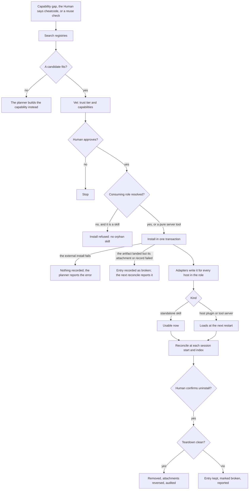
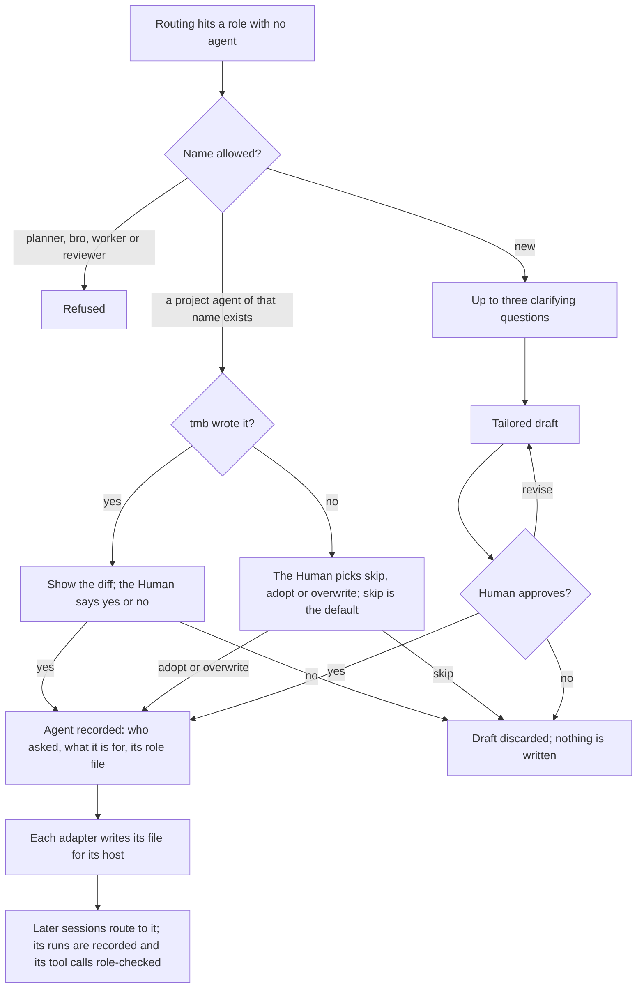
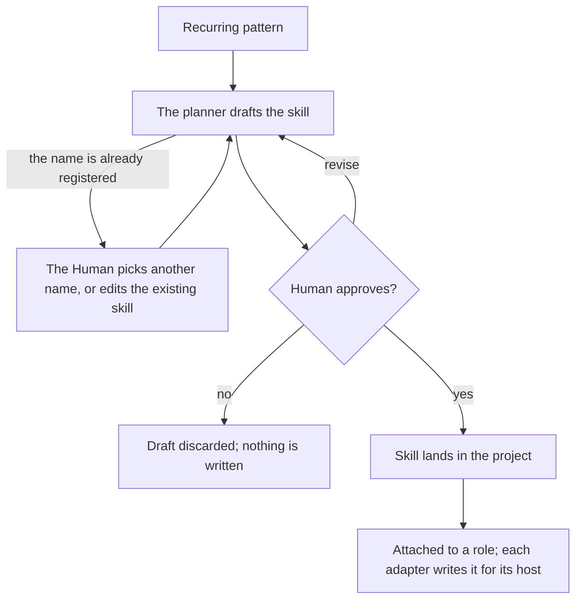
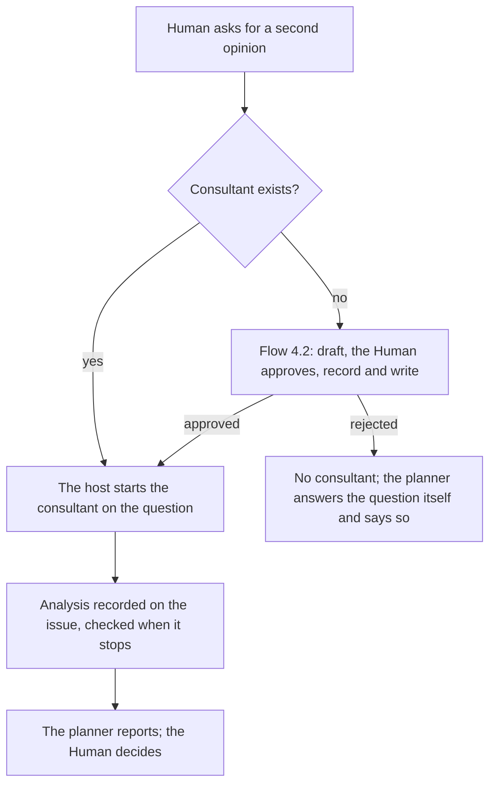
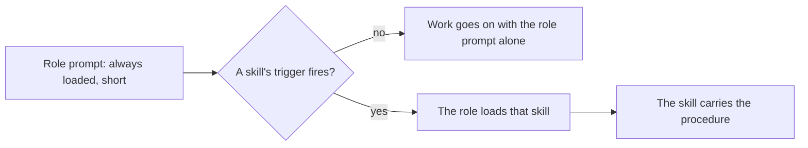
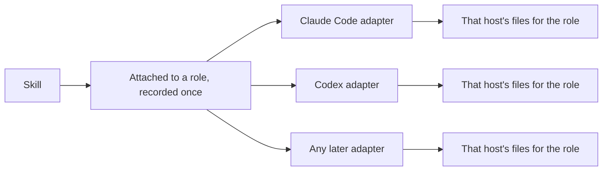

# Extending the team

How a project extends its team: published capabilities (cheatcodes), created agents, skills and consultants. This page holds every case of flows 4.1 to 4.4 in [FLOWS.md](FLOWS.md). What each agent may do once it exists is in [RESPONSIBILITIES.md](RESPONSIBILITIES.md).

tmb ships three roles: planner, worker and reviewer. Everything else on this page is **Planned** ([Planned](#planned)).

One rule holds for all four flows: the planner drafts or proposes, the Human approves each item, tmb records it, and each adapter writes it for its host. Nothing is written without the approval.

## The flows

### 4.1 Cheatcode lifecycle

**Planned (trustmybot/tmb#112).** A cheatcode is a published skill, tool server or host plugin. The planner acquires one instead of building the capability by hand. A skill is attached to a role once and reaches every host in that role.

Detail: [Cheatcodes](#cheatcodes).

### 4.2 Agent creation

**Planned.** tmb manages a created agent the way it manages the worker and the reviewer: the agent is recorded, its runs are recorded, its tool calls are checked against its role, and its work passes the same checkpoints.

Detail: [Created agents](#created-agents).

### 4.3 Skill creation

**Planned.** A recurring pattern becomes a project skill. tmb's own skills are written the same way ([tmb's own skills](#tmbs-own-skills)).

The planner never edits a role's prompt: attaching a skill only extends the role's skill list ([Attachment](#attachment)). The attach step also takes a skill the Human downloaded.

### 4.4 Consultant invocation

**Planned.** A consultant is one kind of created agent: it advises, and never decides or writes workflow state.

The planner judges when a question fits a consultant: tmb's hooks are checkpoints, so nothing injects a routing hint on each prompt.

## Created agents

A created agent is in the harness from its first run, like the worker and the reviewer.

| What tmb does | For a created agent |
|---|---|
| Records the agent | Who asked for it, what it is for, and its role file. |
| Writes its file | Each adapter writes it in its host's format. The files stay local to this checkout. |
| Records its runs | Each run is in the record, like a worker's or a reviewer's. |
| Checks its tool calls | Against its role, like the worker's and the reviewer's. |
| Gates its work | The same checkpoints: close, review and push. |

- **The backbone names are refused.** A project agent named planner, bro, worker or reviewer would shadow the workflow backbone.
- **A backbone role is never copied.** Attaching a skill or a cheatcode to the worker or the reviewer extends that role's lists; the adapters write the result.
- **Every draft starts from one generic scaffold.** There is no per-role template; the clarifying questions tailor the draft.
- **An approval covers one file and lapses.** A draft approved but not written within a short window needs a new approval.
- **tmb never touches an agent file it did not write.** Setup leaves such a file alone and says so, and replaces only its own.
- **A consultant holds no workflow state.** Its run and its analysis are recorded; it starts no task, closes none and records no verdict.

## tmb's own skills

**Planned.** A tmb skill holds one situational procedure of tmb's own harness, loaded on demand, so each role's always-loaded prompt stays short. The placement test in [JUDGMENT_LAYER.md](../prompt-engineering/JUDGMENT_LAYER.md) decides what goes where: judgment needed on every run stays in the role's prompt, a procedure needed only in some situations goes to a skill, and deterministic logic goes to code.

Skills are written once, host-neutral, like the roles. Each adapter writes them in its host's format.

The procedures in tmb's flows that a skill would hold. **The whole table is Planned, and the names are not fixed.**

| Procedure | Loaded by | When |
|---|---|---|
| Onboarding: the base branch, the checks, the review mode question, the project's areas | Planner | A session starts in a project whose settings are empty (flow 2.1). |
| Writing a spec and scoping it from the code graph | Planner | Before each code task (flow 3.1). |
| Agent search: several word queries, then follow the code graph | Planner | It must find where a thing lives or what depends on it (flow 2.2). |
| Doc review | Planner, reviewer | Grading a docs or prompts change (flow 3.2). |
| Retry and escalation | Planner | A check fails at close, a review fails, a fold or rebase conflicts, or a run never ended (flow 3.4). |
| PR comment triage | Planner | Review comments reach a pull request tmb opened (flow 3.5; depends on trustmybot/tmb#70). |
| Running parallel sessions | Planner | The Human asks for several independent streams of work (flow 3.8). |
| Truest mode: a review and a pull request per task | Planner | A task is in a repo set to truest (flow 3.10). |
| Installing a cheatcode | Planner | A task needs a capability the project lacks (flow 4.1; depends on trustmybot/tmb#112). |
| Creating an agent or a skill | Planner | Routing hits a role with no agent, or a recurring pattern needs encoding (flows 4.2 and 4.3). |
| The review procedure: what to read, what to probe, findings and the verdict | Reviewer | It is started on a feature branch or on a task's commit (flows 3.9 and 3.10). |
| Reporting a tmb bug | Planner | tmb itself breaks and the feedback program is on (flow 5.1). |

## Cheatcodes

**Planned (trustmybot/tmb#112).**

### Judgment and code

The pipeline (search, record, vet, install, activate) is deterministic: tools and checkpoints, not a checklist in a prompt. Three decisions stay with the planner's judgment:

- **Do I lack a capability this task needs?** A classification.
- **Is this candidate trustworthy enough to install?** Weigh the signals and ask the Human.
- **Which role consumes it?** The one the Human named, or one inferred from the domain; the Human answers when it is ambiguous. A pure server tool needs none.

[DETERMINISTIC_LAYER.md](../prompt-engineering/DETERMINISTIC_LAYER.md) explains how tmb decides what a prompt judges and what code enforces.

### Stages

What each stage guarantees beyond the [chart](#41-cheatcode-lifecycle):

- **Vet** reports a trust tier and the candidate's capabilities. It never decides.
- **Install** runs the external install first, and its failure records nothing. Then one transaction holds the registry entry, its attachments to the consuming role, and the audit. It is idempotent on name and source.
- **Reconcile** checks the registry against what is on disk at each session start and index, and audits drift.

### Registries

Discovery queries real, reputable registries, never a self-built index. Each source has a tier, which also shows how far to trust it, and official sources always rank above curated ones:

- **Tier 1, official:** the MCP registry and a host's own plugin marketplace.
- **Tier 2, curated:** PulseMCP.

A registry that fails adds no candidates and the search goes on. So an environment without web access gets an empty result, never a crash.

A passive path keeps the registry honest too: each index records capabilities already present in the project (local skills, enabled host plugins, configured tool servers) that tmb does not track yet.

### Safety invariants

- **Human-approved, never silent.** Approval is per candidate, and the install fails closed without it. An approval is for one source at one version and is used up by one install, so a reinstall or a new version asks again, and a decline is audited with the candidate.
- **The host's own install path only.** A host plugin installs through that host's marketplace, never by copying files or loading a plugin directory.
- **Web posture respected.** Discovery obeys any rule that denies web access, and the Human sees the sources before install.
- **The user project only.** Materialization writes the project's host files, through the adapters. It never changes tmb's shipped roles.

### Attachment

Installing loads a cheatcode; attachment decides which role can use it. A skill, published or written in the project, is attached to a role once, and each adapter writes it in its host's format for every host in that role.

| Kind | Attachment |
|---|---|
| Standalone skill | Attached to the consuming role. The skill's file is fetched from its source as part of the install, and an install that cannot fetch it is refused. |
| Host plugin contributing skills | The install loads its skills in that host; a role with a restricted skill list gets the name added. |
| Host plugin contributing a tool | The tool is added to what the consuming role may use in that host. |
| Tool server | Registering the server is the attachment: any role can call it. |

Every attachment is recorded so an uninstall reverses exactly what was wired. A host plugin reaches one host only; a skill or a tool server reaches every host.

### Hot-load

A cheatcode's kind decides whether it works in the current session; nothing is guessed. A standalone skill is usable at once. Host plugins and tool servers load at the next restart, so their install reports that a restart is needed.

### Teardown

Acquisition must be reversible. An uninstall reverses each recorded attachment, removes the artifact through the host's own uninstall path, and audits the removal, in one transaction. It is idempotent, and honest: when teardown fails, the entry stays, marked broken, and the result says so instead of claiming a clean removal.

Removing is safer than adding, so the planner proposes an uninstall and the Human confirms it; no gate holds it. When an open task depends on the cheatcode, the planner says so before removing it. Uninstalling a standalone skill removes its file and its name from every role it was attached to, on every host.

## Planned

- tmb's own skills.
- Skill creation and attachment to a role.
- Cheatcodes (trustmybot/tmb#112).
- Agent creation, recorded and harnessed.
- Consultants, as created agents.
