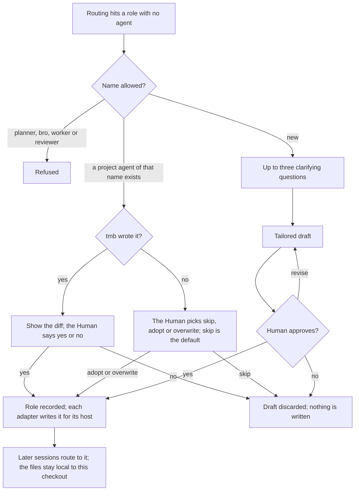
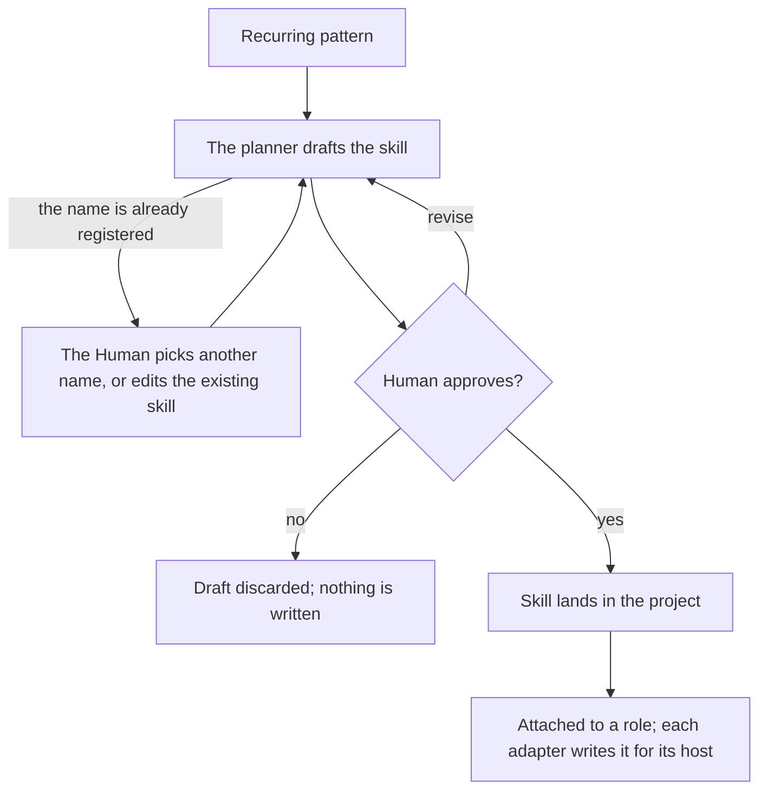
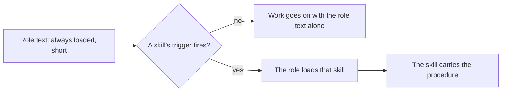
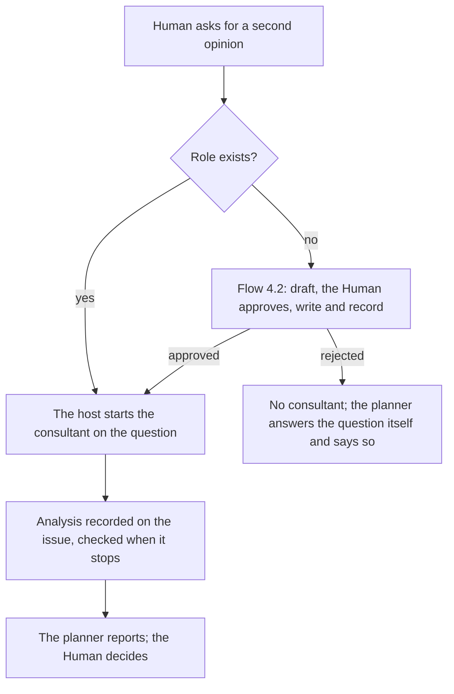

# Extending the team

Every case of flows 4.2 to 4.4 in [FLOWS.md](FLOWS.md): how a project gains agents, skills and second opinions, and what each path refuses. Acquiring a published capability (flow 4.1) is in [CHEATCODES.md](CHEATCODES.md); what each agent may do once it exists is in [RESPONSIBILITIES.md](RESPONSIBILITIES.md).

Today tmb ships three roles and no skill. Everything else on this page is Planned or Open ([Shipped and planned](#shipped-and-planned)).

## 4.2 Agent creation

**Open, for the Human:** whether tmb carries the plugin's agent creation over. The plugin's design, in tmb's words:

The planner, worker and reviewer names are refused because a project copy would shadow the workflow backbone.

- **Every draft starts from one generic scaffold.** There is no per-role template; the clarifying questions tailor the draft.
- **An approval covers one file and lapses.** A draft approved but not written within a short window needs a new approval.
- **tmb never touches an agent file it did not write.** Shipped: setup leaves such a file alone and says so, and replaces only its own.
- **A backbone role is never copied.** Attaching a skill or a cheatcode to the worker or the reviewer extends that role's lists; the adapters write the result.

## 4.3 Skill creation

**Planned.** tmb has no skills yet.

The planner never edits a role's prompt; attaching a skill only extends the role's skill list. A skill is attached to a role once and reaches every host in that role. The attach step also takes a skill the Human downloaded.

## tmb's own skills

**Planned; must ship.** tmb ships its own skills, as the plugin shipped 13. A skill is loaded on demand, so the always-loaded role text stays short. Today each procedure sits in a role's text.

- Skills are written once, host-neutral, like the roles. Each adapter writes them in its host's format.
- New for tmb: a search skill. It teaches the planner to search with several word queries and to follow the code graph.

What the plugin shipped, in tmb's words. **Open, for the Human:** which of these tmb keeps, and under what names.

| Skill | Loaded by | When |
|---|---|---|
| Planning | Planner | The first code task of a session: scope, spec, start the worker, hand off to review. |
| Spec authoring | Planner | Each turn that writes a spec; raises effort for it. |
| Push gate | Planner | A push is refused, the Human asks for a review, or a milestone is reached. |
| Comment triage | Planner | Review comments reach a pull request it owns. Depends on triage, Planned. |
| Recovery | Planner | A tool or the tool server fails. |
| Concerns protocol | Planner | It disagrees with the Human's plan. |
| Audit | Planner | The Human asks for an audit or an architecture review. |
| Cheatcode | Planner | A task needs a capability the project lacks. Depends on [cheatcodes](CHEATCODES.md), Planned. |
| Skill creator | Planner | The Human asks to capture a repeatable behaviour ([4.3](#43-skill-creation)). |
| Docs conventions | Any role | Editing prompts or docs. |
| Doc review | Any role | Checking a change to prompts or docs. |
| Worker checklist | Worker | Its self-review before close. |
| Review | Reviewer | Judging a diff and recording the verdict. |

## 4.4 Consultant invocation

**Open, for the Human:** whether tmb carries consultants over. The plugin's design, in tmb's words:

The consultant never decides and never writes workflow state. The planner judges when a question fits a consultant: tmb's hooks are checkpoints, so nothing injects a routing hint on each prompt.

## Shipped and planned

| Part | State |
|---|---|
| Three roles, written once and written to each host by its adapter | Shipped |
| Setup leaves an agent file tmb did not write alone | Shipped |
| tmb's own skills | Planned; must ship |
| Skill creation and attachment to a role | Planned |
| Cheatcodes | Planned (trustmybot/tmb#112) |
| Agent creation | Open, for the Human |
| Consultants | Open, for the Human |
| Roundtable | Not carried over |
