# tmb Workflows

This file is the starting point for every flow. Each flow gets one chart of its ideal case, a short description, and a link to its detail page. The detail page holds every other case, failures included, and how to debug them. A flow whose chart says everything has no detail page. Who owns each quality check, and how a task hands from one owner to the next, is in [TASKS.md](TASKS.md#quality-layers).

It is the ground truth for the workflow. Behaviour that is decided but not built is marked Planned, with its GitHub issue. A PR that changes a flow updates its chart here, and its detail page, in the same PR. Neither names an internal function, file or table. The code graph says what enforces a step, and the code holds the logic. A flow may name what the Human types: a `tmb ...` terminal command.

tmb gates the outcome and never watches each step. Its checks run at three checkpoints: a task's close, the review, and the push.

Flows are grouped by when they run, and numbered within their group.

| Group | # | Flow | Trigger | Agents | State it leaves |
|---|---|---|---|---|---|
| 1. Install | 1.1 | [Install and session start](#11-install-and-session-start) | One-step install, `tmb init` once per project, then every session start | — (tmb itself) | the project's record, the host's files, git's pre-push hook, the code graph |
| 1. Install | 1.2 | [Updates and channels](#12-updates-and-channels) | A session start, or `tmb update` | — (tmb itself) | a newer build, and an audit entry for each refresh of a project's wiring |
| 1. Install | 1.3 | [Move a plugin project](#13-move-a-plugin-project) | `tmb migrate` | — (the Human) | the plugin's records, copied into tmb's record |
| 2. Cold start | 2.1 | [First contact](#21-first-contact) | A session start in a project whose settings are empty | planner | the base branch, the checks and the review mode, and who chose the mode |
| 2. Cold start | 2.2 | [Index and code-graph refresh](#22-index-and-code-graph-refresh) | `tmb init`, `tmb index`, or any lookup that finds the graph behind its base branch | — (the engine) | a code graph per repo |
| 2. Cold start | 2.3 | [Environment profile](#23-environment-profile) | The planner needs a repo's checks | planner | the repo's checks, as a project setting |
| 3. Agent task handling | 3.1 | [Code task](#31-code-task) | An ask that changes code | planner → worker; reviewer per the review mode | issue, decision, task, run, check and review records; a reviewed branch and its PR |
| 3. Agent task handling | 3.2 | [Docs task](#32-docs-task) | An ask that changes only docs or prompts | planner writes it; reviewer sees it in the same review | as 3.1, the task marked docs |
| 3. Agent task handling | 3.3 | [Push gate](#33-push-gate) | Any push, tmb's own or typed by hand | reviewer records the verdict; git asks the engine | a verdict or waiver per reviewed commit, and a mark on GitHub |
| 3. Agent task handling | 3.4 | [Retry and escalation](#34-retry-and-escalation) | A failed check, a review fail, a conflict or a run that never ended | planner ↔ the author | a task still open or reopened, fix tasks, or a dropped task |
| 3. Agent task handling | 3.5 | [PR comment triage](#35-pr-comment-triage) | Review comments reach a PR tmb opened (Planned, trustmybot/tmb#70) | planner → worker, or the planner itself | fix tasks on the PR's branch |
| 3. Agent task handling | 3.6 | [Multi-repo workspaces](#36-multi-repo-workspaces) | `tmb init` in a folder that holds several repos | planner | one record; per repo a policy, a pre-push hook and a code graph |
| 3. Agent task handling | 3.7 | [Bulk cleanup](#37-bulk-cleanup) | `tmb doctor --fix` | — (the Human) | leftovers removed, each on the Human's yes |
| 3. Agent task handling | 3.8 | [Parallel lanes](#38-parallel-lanes) | Several independent streams of work, each too large for one turn | one planner per session, each with its own workers and reviewer | no lane record: the shared record, and one branch and worktree per task |
| 3. Agent task handling | 3.9 | [Agile mode](#39-agile-mode) | A task in a repo the Human set to agile (recommended) | planner → worker; reviewer once, on the whole feature branch | a feature branch of closed tasks; one verdict or waiver, then one PR |
| 3. Agent task handling | 3.10 | [Truest mode](#310-truest-mode) | A task in a repo the Human set to truest | planner → worker → reviewer, per task | a verdict or waiver per task, and one PR per task |
| 3. Agent task handling | 3.11 | [Project with no remote](#311-project-with-no-remote) | Reviewed work in a repo that has no remote | planner; the Human merges locally | a branch or task recorded ready, then merged |
| 3. Agent task handling | 3.12 | [Unattended run](#312-unattended-run) | A session with no one to answer, such as CI | planner | each default it applied, recorded as a decision |
| 3. Agent task handling | 3.13 | [Several hosts on one record](#313-several-hosts-on-one-record) | `tmb init` once per host, each with a role | a planner on one host, a reviewer on another | every record names the role and the host that made it |
| 4. Extending the team | 4.1 | [Cheatcode lifecycle](#41-cheatcode-lifecycle) | A capability gap (Planned, trustmybot/tmb#112) | planner (Human approves) | a skill given to a role |
| 4. Extending the team | 4.2 | [Agent creation](#42-agent-creation) | A role the project has no agent for (Planned) | planner | a project agent, recorded and harnessed like the worker |
| 4. Extending the team | 4.3 | [Skill creation](#43-skill-creation) | A recurring pattern needs encoding (Planned) | planner | a project skill |
| 4. Extending the team | 4.4 | [Consultant invocation](#44-consultant-invocation) | The Human asks for a second opinion (Planned) | planner → consultant | the consultant's analysis |
| 5. Reporting tmb bugs | 5.1 | [Bug report](#51-bug-report) | tmb itself breaks, or `tmb feedback` | planner (Human approves each report) | a record of each report filed and each form opened |

## 1. Install

### 1.1 Install and session start

tmb is one compiled program per platform, installed in one step, with nothing to install first. `tmb init` prepares a project once and asks nothing. From then on the host raises its session start, and the engine answers with the role, the rules and the open work from the record. [INSTALL.md](INSTALL.md) covers each case and how to debug it; [HOSTS.md](HOSTS.md) covers what an adapter writes.

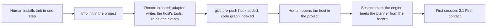

### 1.2 Updates and channels

An install follows one channel: stable, rc or dev. Each channel is a program of its own name, side by side with the others, and updates only itself. A running session keeps the build it started with, so a task never meets a new build half way. With no network tmb runs the build it has. [INSTALL.md](INSTALL.md) covers channels, pinned builds and package managers.

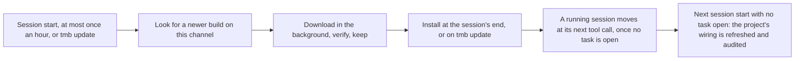

### 1.3 Move a plugin project

A project of the TMB plugin starts fresh in tmb. `tmb migrate` is a one-way copy of its records and leaves the plugin's database unchanged. In a workspace each plugin repo goes to the repo of the same name, or to one the Human names; tmb never guesses. The [reference](../reference/README.md#move-a-plugin-project) covers its use.

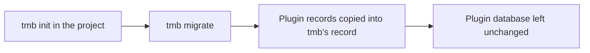

## 2. Cold start

`tmb init` builds the record and the code graph (2.2). The first session then finds the settings empty and runs first contact (2.1), which takes each repo's checks from its environment profile (2.3). Later sessions skip what is already done.

### 2.1 First contact

Onboarding happens by itself. The planner applies the base branch and the checks it recommends, and shows them. The review mode is the Human's alone: it decides how many tokens a project uses, so tmb recommends agile and never picks. No task starts until the Human has chosen. `tmb onboard` sets the same settings from a terminal, at any time. tmb sets up no sandbox. [ONBOARD.md](ONBOARD.md) covers each setting and each way to set it.

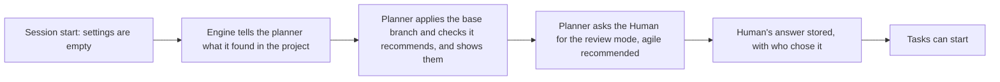

### 2.2 Index and code-graph refresh

The code graph is the project map the planner scopes tasks from: files with their summaries, symbols and the links between them. Each repo has its own graph, built from its base branch. Every lookup first brings a graph that is behind forward, so no agent has to ask for a refresh. A lookup for an open task or a feature branch answers from that work's own commit. [WORLD_MODEL.md](WORLD_MODEL.md) covers what the graph holds and how it stays current.

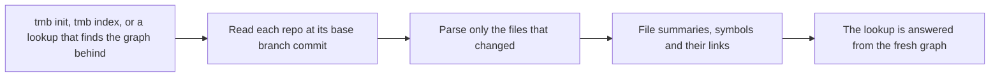

### 2.3 Environment profile

tmb suggests a repo's checks from the files its stack leaves behind. It is a suggestion only: the planner applies it at first contact, and the Human or the planner can replace it. The checks are a project setting, per repo in a workspace, and they run at every task's close. [ONBOARD.md](ONBOARD.md#the-repos-checks) covers what is read.

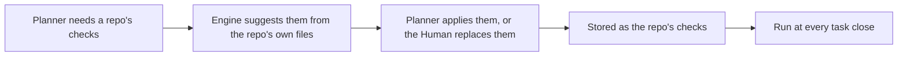

## 3. Agent task handling

[TASKS.md](TASKS.md) holds every case of flows 3.1 to 3.5: what each step guarantees, the failure paths and how to debug a stuck task. The engine, not an agent, creates branches and worktrees, runs checks, folds, pushes and opens pull requests. Agents ask for these through tmb's tools, so every step is recorded.

### 3.1 Code task

The canonical chain: the planner plans and writes the spec, a worker implements, the engine runs the checks at close, the reviewer reviews, and the Human merges. The host starts the worker and the reviewer as its own subagents; tmb starts no agent. When the review happens depends on the repo's review mode: once per feature branch in agile (3.9), once per task in truest (3.10).

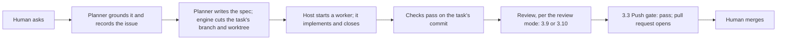

### 3.2 Docs task

The planner writes a docs or prompts change itself, in a task worktree marked as docs. The planner judges the kind; the engine checks the call by file type at close and refuses a docs task that touched any other file. Its checks run at close like any task's, and the reviewer sees it in the same review as the code tasks. Planned: a doc-review skill the planner and the reviewer both grade with.

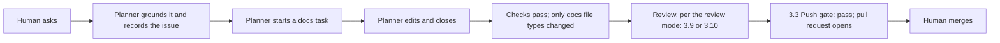

### 3.3 Push gate

The gate is git's own pre-push hook, so it holds on any host and for a push typed by hand. A push is refused unless the record holds what the repo's review mode requires for its commits: a reviewer's pass or the Human's waiver. Each verdict and waiver also sets a mark on that exact commit on GitHub, which the repo's branch protection can require before a merge. The gate denies when it cannot read the record, and allows in a project tmb was never set up in.

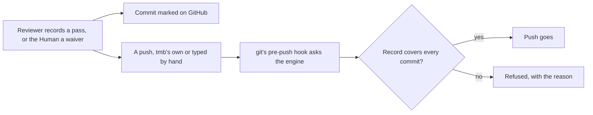

### 3.4 Retry and escalation

Work that fails goes back to its author without waiting on the Human. Nothing waits for a timer: tmb runs only when something calls it, so a stuck task is found at the next session start or by `tmb doctor`. Planned (trustmybot/tmb#165): after two review fails in a row, no worker starts on the task until the planner has recorded the cause.

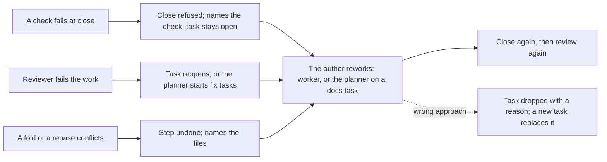

### 3.5 PR comment triage

Planned (trustmybot/tmb#70): a sync with the remote brings review comments into the record, and the planner sorts them into tasks on the PR's branch. No unreviewed commit reaches an open pull request: the new tip is pushed to the same pull request only after its review or a waiver.

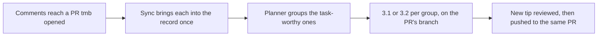

### 3.6 Multi-repo workspaces

A project is a set of repos sharing one record. A project folder that is a git work tree is a project of one repo. A folder that is not one, and holds repos, is a workspace: tmb runs from it and its repos share the record there. Only managed repos get the workflow; an exempt repo and a folder that is no repo are listed and left alone. The repo comes from the work, never from the folder a session runs in. [GIT.md](GIT.md#multi-repo-workspaces) covers how each operation resolves to its repo.

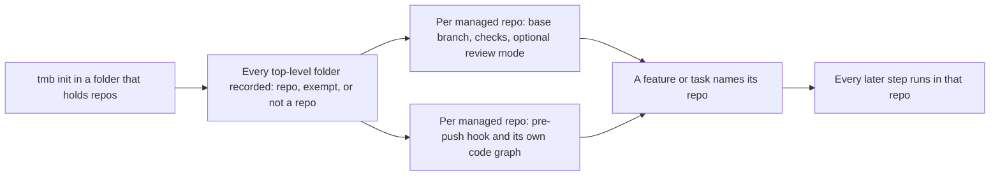

### 3.7 Bulk cleanup

tmb cleans up only what it wrote, and only on the Human's yes to each item. `tmb doctor` lists what is left on disk: old builds no session uses, entries of ended sessions, and worktrees and branches of closed and dropped tasks. A worktree holding work nobody committed stays. A tracked repo file is deleted through a task like any other change.

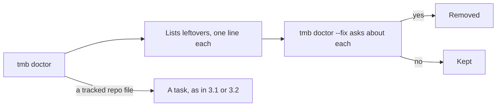

### 3.8 Parallel lanes

tmb does not manage lanes and keeps no lane record. Starting sessions and messaging between them are the host's features. tmb gives every session the same footing: one shared record to resume from, a branch and a worktree per task, and a planner that is told which open tasks share a file. Two tasks may change the same file; git settles it at the merge, and a clash holds back the later task's close. Lane PRs merge like any other PR. Planned: guidance for running parallel sessions in the planner's prompt; which session made each entry (trustmybot/tmb#63); a freeze that stops every session at once (trustmybot/tmb#64). [RESPONSIBILITIES.md](RESPONSIBILITIES.md#parallel-lanes) holds every case.

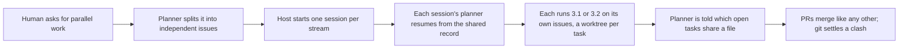

### 3.9 Agile mode

The recommended mode. Work builds up on one long-lived feature branch per milestone, cut from the remote's base branch. Each task closes on its checks alone, with no review of its own, folds into the feature branch, and the branch is pushed only as a backup, with no pull request. The Human tries the branch in a separate worktree at any time. At the milestone the base branch is merged in, the reviewer reviews the whole branch once, and only then does it go to the base branch as one pull request, unless the Human waives the review. A workspace has one review mode and a repo can name its own. A task keeps the mode it started in. [AGILE.md](AGILE.md) holds every case, including a branch that ends merged, closed or dropped.

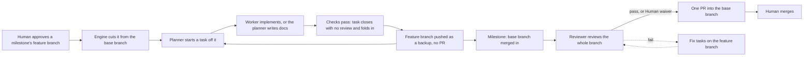

### 3.10 Truest mode

For a repo where nothing may reach the base branch unreviewed. There is no feature branch: each task is cut from the base branch, waits in review after its checks pass, and gets its own pull request after a pass or a per-task Human waiver. Before the first push the engine rebases the reviewed commit when the base branch moved; an open pull request is never rebased. [AGILE.md](AGILE.md) compares the two modes; [TASKS.md](TASKS.md) holds every case.

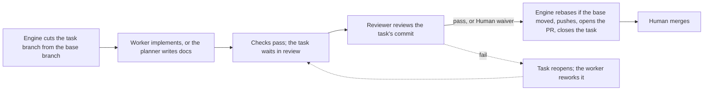

### 3.11 Project with no remote

In a repo with no remote nothing is pushed and no pull request is opened. A close skips the backup push and says so. After the review passes, or the Human waives it, the pull request step records the work as ready and gives the Human the command to merge it locally. tmb records the merge once the local base branch holds the work, and looks at session start, when features or tasks are listed, and for the dashboard. A ready branch still takes fix tasks. [GIT.md](GIT.md) covers every case.

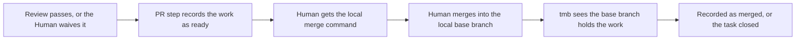

### 3.12 Unattended run

A session with no one to answer, such as a run in CI, a scheduled job or an agent test, is started in unattended mode by whoever starts the run, for that run only. It changes guidance only: the checkpoints allow and refuse exactly as in a normal session. A choice the role leaves to the Human alone, such as the review mode, is never a default. [HOSTS.md](HOSTS.md) covers it.

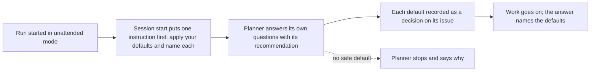

### 3.13 Several hosts on one record

Each host connects to the same record in the same project and takes a role, the planner by default. The agents never talk to each other: the record is the handoff. Who starts the second host is the Human's or the first host's business, not tmb's. [HOSTS.md](HOSTS.md) covers hosts, adapters and each host's limits.

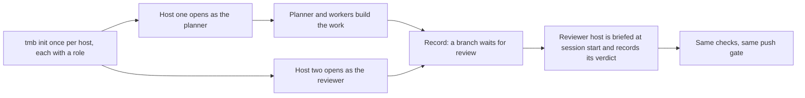

## 4. Extending the team

All of group 4 is Planned. tmb ships three roles: planner, worker and reviewer. [EXTENDING.md](EXTENDING.md) covers all four flows.

### 4.1 Cheatcode lifecycle

Planned (trustmybot/tmb#112). The planner acquires a published skill instead of building a capability by hand, and the Human approves each install. A skill is given to a role once, for every host in that role. [EXTENDING.md](EXTENDING.md#cheatcodes) covers every stage, the trust design and teardown.

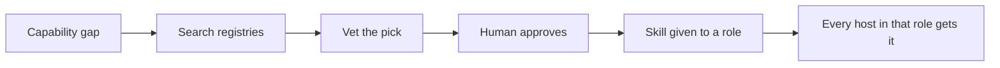

### 4.2 Agent creation

Planned. When routing hits a role the project has no agent for, the planner drafts one and the Human approves it. tmb records the agent and harnesses it like the worker and the reviewer: its runs are recorded, its tool calls are checked against its role, and its work passes the same checkpoints.

```mermaid
flowchart LR
    A["Role with no agent"] --> B["Up to three questions"]
    B --> C["Tailored draft"]
    C --> D["Human approves"]
    D --> E["Agent written for the host and registered"]
```

### 4.3 Skill creation

Planned. tmb ships its own skills, loaded on demand. A recurring pattern becomes a project skill the same way: the planner drafts, the Human approves.

```mermaid
flowchart LR
    A["Recurring pattern"] --> B["Planner drafts the skill"]
    B --> C["Human approves"]
    C --> D["Skill lands in the project"]
```

### 4.4 Consultant invocation

Planned. A consultant is one kind of created agent: it advises and never writes workflow state. It answers a second-opinion question; the planner reports its analysis, and the Human decides.

```mermaid
flowchart LR
    A["Human asks for a second opinion"] --> B["Consultant started on the question"]
    B --> C["Analysis recorded on the issue"]
    C --> D["Planner reports, Human decides"]
```

## 5. Reporting tmb bugs

### 5.1 Bug report

Nothing is ever sent by itself. The feedback program is on by default on dev and rc, and on stable the first run asks once; the setting is the person's, per machine. With it on, the planner may draft a report when tmb itself breaks. `tmb feedback` drafts one on request either way. A report is a public issue on tmb's source repo from the Human's own GitHub account, and holds no source code, file contents, prompts, agent messages or environment variables. The [reference](../reference/README.md#report-a-bug-in-tmb) covers its use. Planned: a check for an earlier or matching report before a new one is offered.

```mermaid
flowchart LR
    A["tmb itself breaks"] --> O{"Feedback on, or the Human ran tmb feedback?"}
    O -- no --> N["No offer"]
    O -- yes --> B["Cleaned draft"]
    B --> C["Human reads the full draft"]
    C -- no --> R["Dropped"]
    C -- yes --> D{"GitHub CLI signed in?"}
    D -- yes --> E["Filed to tmb's repo and recorded"]
    D -- no --> S["Bug form opens filled in; the Human submits; recorded as opened"]
```
