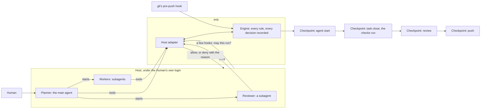
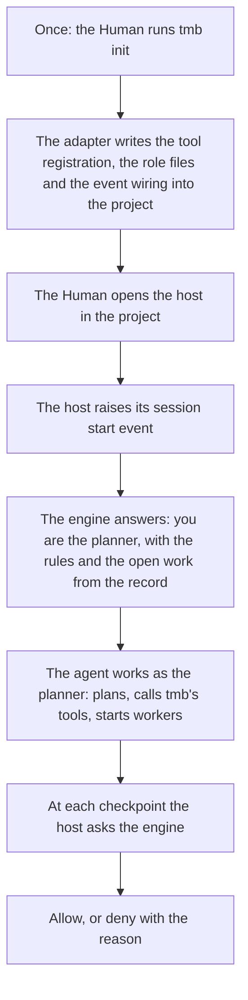
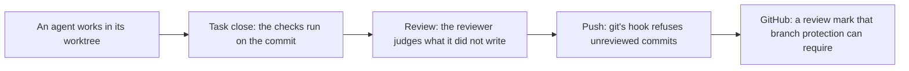
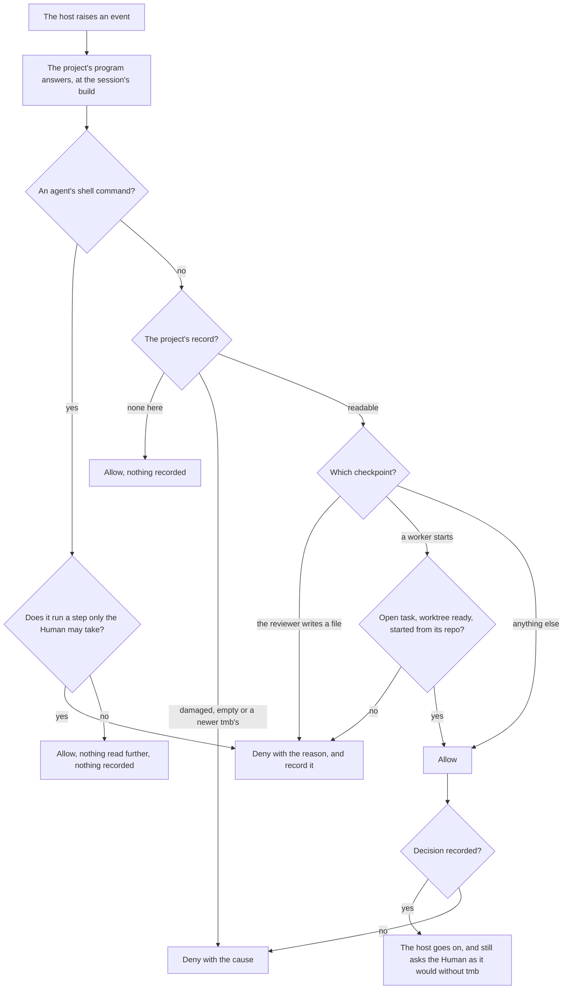
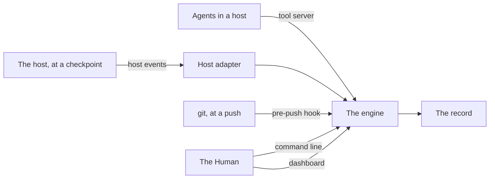

# Hosts and adapters

How tmb works with an agent program without being built for one, and how it holds its rules there. Serving any host is the reason tmb exists: it is a program of its own that a host is wired to. The top-level rule of the design: the engine knows nothing about any host, and everything a host needs is in its adapter.

The first five sections are the design. From [Containment](#containment) on, the page is detail for building and debugging.

## Terms

- **Host.** The agent program the Human talks to, such as Claude Code. The host's main agent is the planner.
- **Engine.** tmb itself: the record, the code graph, the workflow and the gate.
- **Host adapter.** The one part of tmb that knows a host: its file formats, its events and its limits.
- **Checkpoint.** A point where the engine judges an outcome: an agent's start, a task's close, the review, a push.

## The rule

- **The engine never names a host.** A new host is a new adapter and no change to the engine. A host is never hardcoded outside its adapter: not in the record, not in the workflow, not in a prompt the engine owns. A lint fails the build when the engine names a host.
- **Roles are written once**, in a host-neutral form. The adapter turns them into the host's own format.
- **Every rule is in the engine**, written once against tmb's own events. A host hook and git's hook only raise one. An adapter that grows a rule is a defect.
- **Hooks are for checkpoints.** tmb gates the outcome and does not watch each step an agent takes. A host hook is wired only where a checkpoint needs one, and git's own hook is used wherever git has one.
- **tmb leaves the rest to the host.** It starts no agent, runs no model and manages no parallel sessions. Hosts do that better, and tmb ships what they lack: one record, one code graph, and one workflow with the gate that enforces it.

## Many agents, started by the host

The host starts the workers and the reviewer as its own subagents. tmb does not start the host's models and never reads, stores or passes on a login.

| Step | Who |
|---|---|
| Decide that a task needs a worker | Planner |
| Prepare the task's branch, a worktree and the brief | Engine |
| Start the worker as a subagent, in a folder of its own | Host |
| Check that the start is allowed: the task is open, its worktree is ready | Engine, asked by the adapter |
| Make the worker's folder the task's worktree, when the worker first reads its brief. Claude Code only. | Engine |
| Do the work, reading the brief and the code graph through tmb's tools | Worker |
| Run the checks, record the result, close or refuse, and report what changed outside the task | Engine |

Why this way:

- **It runs on the Human's subscription.** The work is ordinary use of the host by its own user. Anthropic's terms do not allow a third-party program to route requests through a user's subscription login, so a design where tmb starts Claude itself would need an API key.
- **It uses what the host already does well:** parallel subagents, a model and effort per role, isolation, and permission prompts shown to the Human.
- **It works wherever the host runs.** Claude Code fires the same events in its command line and in its desktop app. Planned: tmb's own desktop program (trustmybot/tmb#79).

Several workers at once, each on its own task and worktree, is the host's parallel subagents plus git: each task has its own branch, two open tasks may change the same file, and git settles it when their work is merged. A clash refuses the later task's close until it is resolved. The engine tells the planner which open tasks share a file, as information.

## What an adapter provides

| Part | What it does |
|---|---|
| Detect | Finds the host's program on the machine. |
| Set up | Registers tmb's tool server with the host, writes the role definitions in the host's format, and wires the host's events to the engine. Per project, when the Human runs init. |
| Name what is left | Lists the steps only the Human can take, such as trusting the project, and any wiring that is missing. |
| Translate events | Turns a host event into the engine's neutral question, and the engine's allow or deny into the host's answer. |
| Report limits | Says what the host cannot do, such as deny a tool call or set a model per role. Each adapter states its limits; the engine does not read them. |
| Reconnect | Says how a session picks up tmb's tools again after the tool server moved to a new build. |
| Remove | Undoes exactly what setup added. |

| Host | Support | Tools | Roles |
|---|---|---|---|
| Claude Code, command line and desktop app | Supported | Tool server from the project's settings | Agent files in the project |
| Codex | Can be set up, and init says it is not a supported host. What holds there and what does not: [What each host can deny](#what-each-host-can-deny). | Tool server from the project's config | Agent files in the project |
| Others | Planned | | |

The same three building blocks, a tool server, role files and events, exist in both hosts, which is what makes one adapter shape enough.

## Cold start

How a plain host agent becomes the planner. The agent does not work this out itself: tmb tells it at the start of every session, through what `tmb init` wired once.

- **The role prompts guide.** They tell the planner to plan, write a spec and ask the engine to start a task. An agent can ignore a prompt.
- **The gate holds.** The host itself asks the engine at a checkpoint, and the engine answers from the record. An agent cannot skip that.
- **The answer carries more than the role:** the open work, what onboarding left empty ([ONBOARD.md](ONBOARD.md)), and a map of the project from the code graph.
- A session resumes from the record, so a new session needs nothing from the conversation before it.

## Containment

tmb keeps a project's data inside the project, keeps its own program and state in two named places on the machine, and changes nothing it did not write. For the code that enforces each rule, ask the code graph.

### Checkpoints, not a guard on every write

tmb checks what is delivered, like CI (trustmybot/tmb#98). Judging every file write and parsing every shell command to predict what it writes cannot be done in general: it denies good commands and misses real writes. tmb builds no per-write guard, no shell parser and no sandbox. Whether the host's sandbox is on is the Human's own setting.

| Mistake | Caught at |
|---|---|
| A worker starts with no task, or on a closed one | Its start: denied |
| A worker writes outside its worktree | Its host keeps a worker's edits in a folder of its own, where the host can. The close names anything that changed in the main folder since the task started, with the command that puts it back. tmb puts nothing back: the list can hold the Human's own edits. |
| A task changes files outside its spec | The close names each file. It refuses only on its checks. |
| A docs task changes code | The close refuses, and names the file |
| The reviewer edits what it judges | Its role has no editing tool, and a write the host names as the reviewer's is denied. A file written from its shell is not seen. |
| Unreviewed commits leave the machine | git's pre-push hook, whoever typed the push |
| An agent takes a step that is the Human's alone | The terminal's typed yes, and the host's deny of that shell command ([Ways into the engine](#ways-into-the-engine)) |
| Two tasks change the same file | No lock. git settles it when the work is merged, and a clash holds back the later task's close. |

- **The engine does the git steps itself.** It, not an agent, cuts branches and worktrees, folds, pushes and opens pull requests, so every step is recorded.
- **Deliberate evasion is out of the threat model.** Agents make mistakes but do not attack tmb. The fences stop the plain path, and the record shows each deny.

Planned:

- **A skipped gate is found later.** The sync with the remote records it as a finding (trustmybot/tmb#70).
- **Freeze.** One request stops all work in a project until the Human starts it again (trustmybot/tmb#64).

### tmb's own events

The few hooks tmb has. Each is one tmb event, whatever raised it.

| tmb event | Raised when | The engine's answer | Raised by |
|---|---|---|---|
| Session start | A host session opens in a tmb project | The role, the rules and the open work. Never a deny. | Host |
| Before an agent start | The host is about to start a subagent | A worker needs an open task with a ready worktree; a reviewer's run is opened | Host |
| An agent start that failed | The host could not start the subagent | The run that was opened is ended | Host |
| A worker in its folder | A worker reads its brief or closes its task, which tells the engine which folder it works in | That folder becomes the task's worktree | Host |
| Before a file write | An agent is about to write a file | Denied for the reviewer, whether it is a subagent the host names or a host set up as the reviewer | Host |
| Before a shell command | An agent is about to run a shell command | Denied only when it takes a step that is the Human's alone. Nothing else is read. | Host |
| After an agent stop | A subagent has ended | Its run is ended, with the tokens it used where the host tells | Host |
| Session end | A host session closes | A run still open for a host set up as the reviewer is ended, with no verdict | Host |
| Before a push | Commits are about to leave the machine | Refused while they are not reviewed, as the review mode asks | git |

- An event carries the same fields whatever raised it: the role, the host, the task and what is about to happen. A push tmb makes for an agent carries that agent's role and host; a push typed by hand is the Human's (trustmybot/tmb#134).
- **A push is judged by git's pre-push hook**, not by reading an agent's command, so it holds on every host and for a push typed by hand.
- A task's start and close are not events. The engine checks them itself when it is asked, and a refusal there goes to the caller without a recorded decision.
- tmb ships its own rules only. Users cannot add rules of their own on these events.

### What each host can deny

| | Claude Code | Codex |
|---|---|---|
| Can deny | Yes, from the project's settings, inside subagents too | Commands, file writes, tmb's tools and a subagent's start, after the Human trusts the project and its hooks |
| Asks tmb | Only for the tools below | Before every tool call. The adapter passes on only those it knows; any other goes on. |
| Names the agent that makes a call | Yes | No |

| tmb event | Claude Code | Codex |
|---|---|---|
| Session start | Its session start event | Its session start event |
| Before an agent start | Before a call of its agent tool | Before a call of its spawn tool. The call may name no role: it is allowed, and recorded as a finding. |
| An agent start that failed | After a failed call of its agent tool | Not raised |
| A worker in its folder | Before a call of tmb's brief or close tool | Not raised |
| Before a file write | Before a call of one of its edit tools, once per file | Before a patch, once per file it names, and a patch sent through the shell |
| Before a shell command | Before a call of its shell tool | Before a call of one of its shell tools |
| After an agent stop | Its subagent stop event, with the subagent's token use | Its subagent stop event |
| Session end | Its session end event | Its session end event |
| Before a push | git's pre-push hook, the same on every host | The same |

What does not hold on Codex:

- **A worker's folder is not tied to its task**, and the engine does not check where a worker was started from.
- **A call is judged under the role its host was set up with.** A Codex set up as the reviewer is held to the reviewer's rules. With Codex as the planner, the engine cannot tell a subagent's write from the planner's, so a reviewer subagent's write goes through. Open, for the Human: whether a reviewer subagent is allowed under a Codex planner.
- **Setup cannot tell whether the hooks are trusted**, so it always lists that step. It never trusts a project or its hooks on the Human's behalf.

**What a host cannot raise or deny, a later checkpoint catches.** The adapter reports it and nothing switches over: the close and the push check every change whatever the host raised.

### One program, one build, one engine

Several things could answer for one project: two channels' programs, an old build beside a new one, two hosts. Three rules keep a checkpoint from running twice or at two versions:

1. **One program per project.** The project is tied to the program whose init last wired it. Its host events, its tool server and git's push hook all call that program.
2. **One build per session.** While a session runs, every tmb call in its project runs the build the session started with. The host files are refreshed only at a session start with no task open ([INSTALL.md](INSTALL.md#upgrade)).
3. **One engine.** Every way in asks the same engine.

One host event, answered:

### Gates fail closed

Closed:

- **A record tmb cannot read denies.** A record that is damaged, empty, or reshaped by a newer tmb denies every file write, agent start and push, and the deny names the cause and the way out (trustmybot/tmb#185).
- **A decision tmb cannot record denies.**
- **A push hook that fails refuses the push.**
- **A deny always says why**, and what would be allowed.

Open:

- **No record allows, and nothing is recorded.** A project tmb was never set up in is not tmb's to gate. A push hook left in such a repo lets the push go and says so in one line.
- **A host event tmb itself cannot answer**, such as input it cannot parse: the host goes on and tmb writes a note. A tmb fault must never break the Human's session. The close and the push still check everything.
- **tmb's line in another tool's push hook** does nothing on a machine without tmb, so a teammate's push is not blocked.

### What tmb writes, and where

- **A project's data stays in the project.** The record, one code graph per repo, the task worktrees and small notes on which host files init created sit in tmb's own folder there. Nothing about a project is kept anywhere else on the machine.
- **tmb writes only where the Human ran it.** A project gets tmb's files when the Human runs init in it, never because a session opened there.
- **tmb changes only what it wrote.** In a host file or a hook it shares with the Human or another tool, tmb adds its own marked entries and leaves the rest. Remove takes out exactly those ([INSTALL.md](INSTALL.md#upgrade)).
- **Reads outside the project are read-only and named.** tmb looks for the host's program on the machine, reads Codex's user config to see whether the project is trusted, reads a plugin project's database when the Human migrates it, and reads GitHub through the Human's own command line.
- **The host's own instruction file is never written.** The role reaches a session as the engine's answer to its session start. Planned (trustmybot/tmb#112): a cheatcode may add one reference line and take it out again ([EXTENDING.md](EXTENDING.md#cheatcodes)).
- **No login, no trust, no host settings.** tmb never changes a repo's branch protection, and changes no host setting beyond its own entries.

Outside its own folder, init writes only these in a project:

- the host's project files, through its adapter: the tool server's registration, the event wiring and the role files, each marked as tmb's. A role file tmb did not write is never overwritten;
- git's pre-push hook in each repo tmb works in. A hook that is another tool's is left alone; with the Human's yes tmb adds one line first in it;
- ignore lines for its folder and for the host files that are the Human's alone. Remove leaves these lines;
- `git init`, once, in a folder that is in no repo and holds none;
- feature and task branches in git, which tmb never deletes while they hold work.

Planned: the skill files tmb ships, and the agent and cheatcode files the Human approves one by one ([EXTENDING.md](EXTENDING.md)).

On the machine, tmb is one program for every project, so two things live outside any project. Each channel's program has its own, and one never touches another's.

| Where | Holds |
|---|---|
| The user's program folder | The program, under its channel's name. The installer adds the folder to PATH unless told not to. |
| The program's state folder | Kept builds, the time of the last look for an update, a marker per running session, the person's feedback setting, drafts of bug reports and the last error |

- **Nothing is deleted by itself.** An old build goes only on the Human's yes ([INSTALL.md](INSTALL.md#upgrade)).
- **Scratch files go to the system's temp folder** and are removed when the step ends.

### Tests never touch the live record

- **Machine-wide state is swapped before any test runs.** Every tmb a test starts, in its own process or as a child, keeps its state in a scratch folder, never the person's. The feedback program is off for them.
- **Each test works in a project of its own.** A fixture is copied into a fresh repo in a temp folder, removed on exit. The record is found only in a folder or above it, so a temp folder never reaches a real one.
- **Rows a past run left behind are never deleted by an agent.** `tmb doctor` shows what it finds, and the Human decides.
- Planned: under a test flag the record is never looked up, so a test run started inside a tmb project cannot reach its record either.

### Enforcement

Tests hold each rule: a damaged, empty or newer record denies; init and remove leave the Human's entries alone, and remove takes out exactly what init added; a program updates only itself and keeps its own state; a step that is the Human's alone is refused without a terminal. Two lints run with them: the engine never names a host outside its adapter, and every test's machine-wide state is a scratch folder.

Open, for the Human: whether a lint fails on any write to the home folder.

## Unattended mode

A session with no one to answer, such as a run in CI, a scheduled job or an agent test, is started in unattended mode. At session start the engine puts one instruction first in its answer: no one can answer in this run, so apply your defaults and name each default you used (trustmybot/tmb#281).

- **A recommended answer counts as the answer.** The agent records it as a decision on its issue, names it in its answer, and goes on. A choice its role leaves to the Human alone is never a default. It stops only when no default is safe, and says why.
- **The instruction comes first, before the role.** A host may show the agent only the head of a long context, so an instruction at the end holds only some of the time.
- **Whoever starts the run sets the mode, for that run only.** It is not stored in the project, so the next session the Human opens is a normal one.
- **It comes from the engine**, so it works the same on every host and the Human's prompt needs no special wording.
- **It changes guidance only.** The gate allows and denies exactly as in a normal session.

## Different models on one task

- **One vendor, several models.** The host already runs a different model per subagent. The adapter writes a role's model into the host's role definitions when the role names one. No role tmb ships names a model, so each runs on the host's default.
- **Several vendors.** Each host connects to the same record in the same project and takes a role: Claude Code plans and writes, and Codex, opened in the same project, reviews. Both read the same brief and pass the same checks and gate. The agents never talk to each other: the record is the handoff. Who starts the second host is the Human's or the first host's business, not tmb's.
  - **A role per host.** Setup records the role each host takes in the project, the planner by default. Session start briefs a host in its role: a host set up as the reviewer is told which feature branches wait for a review, and that includes a branch whose pull request is open and whose new tip is not reviewed. Two hosts may both be planners, as two sessions of one host may. Open, for the Human: whether two planner hosts stay allowed.
  - **A reviewer that is a host's main agent.** Its run opens at that host's session start and ends with the verdict it records.
- **Local models.** They arrive through a host that supports them. The adapter writes a role's model as given, and the model's provider is the host's own setup.

Every record names the role and the host that made it. The role is the one the caller gives, checked against an open run of that role on that host: tmb cannot prove which agent called. With two hosts, the host's name shows that the review came from another vendor's agent.

## Ways into the engine

| Way in | Used by | Why |
|---|---|---|
| Tool server | Agents in a host | They read briefs and the code graph, and record their work. |
| Host events | The host, at a checkpoint | The engine can refuse an action no agent asked it about. |
| Git's pre-push hook | git | A push is checked even when typed by hand. |
| Command line | The Human | Init and onboard, settings, indexing, update, remove, migration from the plugin, feedback, and `tmb doctor`, the health check (trustmybot/tmb#160). The list is in the [reference](../reference/README.md). |
| Dashboard | The Human | A local web page over the record. |
| Desktop program | The Human | Planned (trustmybot/tmb#79). |

All of them call the same engine. tmb has no slash commands: each action is a terminal command or a tool the planner calls. The command line records every caller as the Human, so a step only the Human may take has two fences there (trustmybot/tmb#179):

- **The steps:** waiving a review, of a feature branch or of a task; setting the review mode; removing tmb from a project. An update is not one.
- **A terminal and a typed yes.** The command line runs such a step only on a terminal, after the Human types yes. With no terminal it refuses and changes nothing.
- **The host's guard.** Where the host lets tmb see an agent's shell command before it runs, as Claude Code and Codex do, the guard denies one that takes such a step, says why, and records the deny. Every other shell command passes and nothing is recorded. A host that cannot show tmb a shell command has the first fence only.
- **One exception, for a run with no one to ask.** In unattended mode, such as CI, a run with no terminal may set the review mode where none is set, for the workspace or for one repo. It never changes a mode that is set, so an agent that turns unattended mode on for its own command cannot undo the Human's choice (trustmybot/tmb#223). Nothing else passes.
- **What the fences are not.** They stop an agent that takes the plain path, and the record shows each deny. They are not proof: an agent that writes a script which opens its own terminal can pass both, and on Codex an agent's shell tool can open a terminal, so only the guard stands there. A fence no agent can pass needs something only the Human has, such as the operating system's own password prompt. Open, for the Human: whether tmb builds one.
