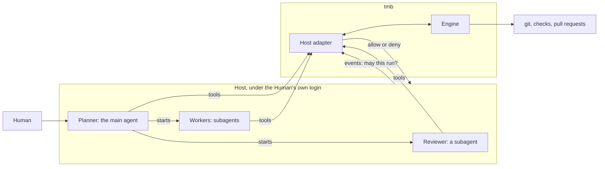

# Hosts and adapters

How tmb works with an agent program without being built for one. This is the top-level rule of the design: the engine knows nothing about any host, and everything a host needs is in its adapter.

## Terms

- **Host.** The agent program the Human talks to, such as Claude Code. The host's main agent is the planner.
- **Engine.** tmb itself: the record, the code graph, the workflow and the gate.
- **Host adapter.** The one part of tmb that knows a host: its file formats, its events and its limits.

## The rule

- The engine never names a host. A new host is a new adapter and no change to the engine.
- A host is never hardcoded outside its adapter: not in the record, not in the workflow, not in a prompt the engine owns.
- Roles are written once, in a host-neutral form. The adapter turns them into the host's own format.

## Many agents, started by the host

The host starts the workers and the reviewer as its own subagents. tmb does not start the host's models and never reads, stores or passes on a login.

| Step | Who |
|---|---|
| Decide that a task needs a worker | Planner |
| Prepare the worktree and the brief | Engine |
| Start the worker as a subagent | Host |
| Check that the start is allowed: the task exists, its worktree is ready, the role and effort match | Engine, asked by the adapter |
| Do the work, reading the brief and the code graph through tmb's tools | Worker |
| Run the checks, record the result, close or refuse | Engine |

Why this way:

- **It runs on the Human's subscription.** The work is ordinary use of the host by its own user. Anthropic's terms do not allow a third-party program to route requests through a user's subscription login, so a design where tmb starts Claude itself would need an API key.
- **It uses what the host already does well:** parallel subagents, a model and effort per role, isolation, and permission prompts shown to the Human.
- **It works wherever the host runs.** Claude Code fires the same events in its command line and in its desktop app.

Running several workers at once, each on its own task and worktree, is the host's parallel subagents plus the engine's rule that two open tasks never share a file.

## What an adapter provides

| Part | What it does |
|---|---|
| Detect | Finds the host, its version and what it supports. |
| Install | Registers tmb's tool server with the host, writes the role definitions in the host's format, and wires the host's events to the engine. Per project, with the Human's consent. |
| Translate events | Turns a host event (a tool call, a subagent start or stop, a session start) into the engine's neutral question, and the engine's allow or deny into the host's answer. It holds no rules of its own. |
| Report limits | Says what the host cannot do, such as deny a tool call or set a model per role, so the engine can fall back or refuse. |
| Remove | Undoes exactly what install added. |

All rules stay in the engine. An adapter that grows a rule is a defect.

## Hosts

| Host | Status | Tools | Roles | Events that can deny |
|---|---|---|---|---|
| Claude Code, command line and desktop app | First | Tool server from the project's settings | Agent files in the project | Yes, from the project's settings, inside subagents too |
| Codex | Planned | Tool server from its config | Agent files in the project | Yes, after the Human trusts them |
| Others | Planned | | | |

The same three building blocks exist in both hosts checked so far, which is what makes one adapter shape enough.

When a host cannot deny an action, the engine's own layers still hold: checks at close, and git's pre-push hook ([WORKFLOW.md](WORKFLOW.md#the-gate)).

## Agents from different vendors on one task

Planned, after the first host works end to end. A second kind of adapter, a runner, lets the engine start another vendor's agent program as a worker or reviewer, such as a Codex reviewer under a Claude Code planner. A runner starts the vendor's own unmodified program under the Human's own login for that program, and only where that vendor's terms allow it. Local models arrive the same way, through a host or runner that supports them.

## Doors into the engine

| Door | Used by |
|---|---|
| Tool server | Agents in the host. |
| Command line | The Human, git hooks and host events. |
| Dashboard | The Human, as a local web page. |

All three call the same engine, so a rule cannot be skipped by choosing another door.
