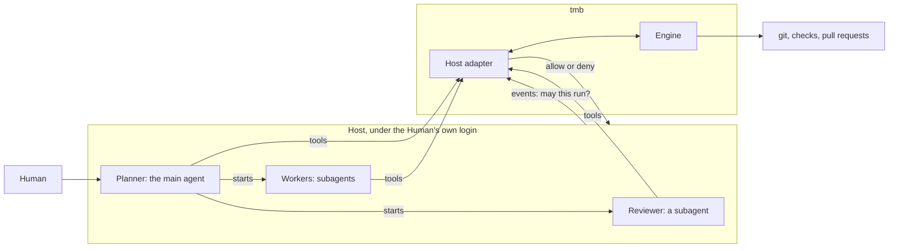
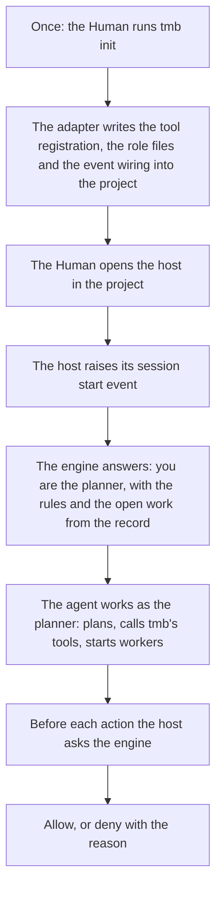
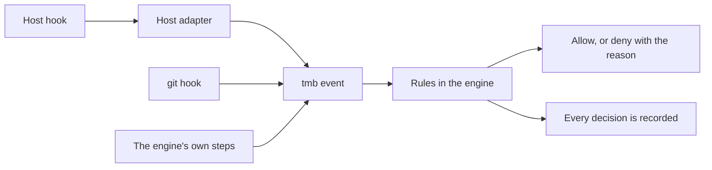

# Hosts and adapters

How tmb works with an agent program without being built for one. This is the top-level rule of the design: the engine knows nothing about any host, and everything a host needs is in its adapter.

## Terms

- **Host.** The agent program the Human talks to, such as Claude Code. The host's main agent is the planner.
- **Engine.** tmb itself: the record, the code graph, the workflow and the gate.
- **Host adapter.** The one part of tmb that knows a host: its file formats, its events and its limits.

## The rule

- The engine never names a host. A new host is a new adapter and no change to the engine.
- A host is never hardcoded outside its adapter: not in the record, not in the workflow, not in a prompt the engine owns.
- Roles are written once, in a host-neutral form. The adapter turns them into the host's own format.

## Many agents, started by the host

The host starts the workers and the reviewer as its own subagents. tmb does not start the host's models and never reads, stores or passes on a login.

| Step | Who |
|---|---|
| Decide that a task needs a worker | Planner |
| Prepare the task's branch, a worktree and the brief | Engine |
| Start the worker as a subagent, in a folder of its own | Host |
| Check that the start is allowed: the task exists, its worktree is ready | Engine, asked by the adapter |
| Make the worker's folder the task's worktree, when the worker first reads its brief | Engine |
| Do the work, reading the brief and the code graph through tmb's tools | Worker |
| Run the checks, record the result, close or refuse, and report what changed outside the task | Engine |

Why this way:

- **It runs on the Human's subscription.** The work is ordinary use of the host by its own user. Anthropic's terms do not allow a third-party program to route requests through a user's subscription login, so a design where tmb starts Claude itself would need an API key.
- **It uses what the host already does well:** parallel subagents, a model and effort per role, isolation, and permission prompts shown to the Human.
- **It works wherever the host runs.** Claude Code fires the same events in its command line and in its desktop app.

Running several workers at once, each on its own task and worktree, is the host's parallel subagents plus git: each task has its own branch, two open tasks may change the same file, and git settles it when their work is merged. A clash refuses the later task's close until it is resolved. The engine tells the planner which open tasks share a file, as information.

## What an adapter provides

| Part | What it does |
|---|---|
| Detect | Finds the host, its version and what it supports. |
| Install | Registers tmb's tool server with the host, writes the role definitions in the host's format, and wires the host's events to the engine. Per project, with the Human's consent. |
| Translate events | Turns a host event (a tool call, a subagent start or stop, a session start) into the engine's neutral question, and the engine's allow or deny into the host's answer. It holds no rules of its own. |
| Report limits | Says what the host cannot do, such as deny a tool call or set a model per role, so the engine can fall back or refuse. As built, each adapter states its limits and the engine does not read them yet. |
| Remove | Undoes exactly what install added. |

All rules stay in the engine. An adapter that grows a rule is a defect.

## Cold start

How a plain host agent becomes the planner. The agent does not work this out itself: tmb tells it at the start of every session, through what `tmb init` wired once.

- **The role prompts guide.** They tell the planner to plan, write a spec and ask the engine to start a task. An agent can ignore a prompt.
- **The gate holds.** The host itself asks the engine before an action, and the engine answers from the record. An agent cannot skip that.
- A session resumes from the record, so a new session needs nothing from the conversation before it.

## Unattended mode

A session with no one to answer, such as a run in CI, a scheduled job or an agent test, is started in unattended mode. At session start the engine puts one instruction first in its answer: no one can answer in this run, so apply your defaults and name each default you used. A question the agent has a recommended answer for counts as answered by that recommendation: it records it as a decision on its issue, names it in its answer, and goes on with the work (trustmybot/tmb#281). A choice its role leaves to the Human alone is never a default. It stops only when no default is safe, and says why. The instruction comes before the role, not after it: a host may show the agent only the head of a long context and keep the rest in a file the agent reads only if it chooses to, so an instruction at the end held only some of the time (trustmybot/tmb#281).

- Whoever starts the run sets the mode, for that run only. It is not stored in the project, so the next session the Human opens is a normal one.
- It comes from the engine, so it works the same on every host and the Human's prompt needs no special wording.
- It changes guidance only. The gate allows and denies exactly as in a normal session.

## tmb's own events

tmb has its own hook system. Rules are written once against tmb's events, never against a host's or git's. Host hooks and git hooks are only sources that raise a tmb event.

| tmb event | Raised when | Raised by |
|---|---|---|
| Session start | A host session opens in a tmb project | Host |
| Before a file write | An agent is about to write a file. Denied for the reviewer, whether it is a subagent the host names or a host set up as the reviewer. | Host |
| A worker in its folder | A worker reads its brief or closes its task, which tells the engine which folder it works in | Host |
| Before an agent start | The host is about to start a subagent | Host |
| After an agent stop | A subagent has ended | Host |
| Before a push | Commits are about to leave the machine | git |

- An event carries the same fields whatever raised it: the role, the host, the task and what is about to happen. A push tmb makes for an agent carries that agent's role and host; a push typed by hand is the Human's (trustmybot/tmb#134).
- A task's start and close are not events. The engine checks them itself when it is asked, and a refusal there goes to the caller without a recorded decision.
- A rule answers allow or deny, and a deny always says why and what would be allowed.
- Version 1 ships tmb's own rules only. Users cannot add rules of their own on these events.
- A host that cannot raise an event is reported by its adapter. Nothing switches over: the close and the push check every change whatever the host raised, so they catch what an earlier event missed.

## Hosts

| Host | Status | Tools | Roles | Events that can deny |
|---|---|---|---|---|
| Claude Code, command line and desktop app | First | Tool server from the project's settings | Agent files in the project | Yes, from the project's settings, inside subagents too |
| Codex | Built at level 9. Not supported and not tested before v2. | Tool server from the project's config | Agent files in the project | The host can, for commands, file writes, tmb's tools and a subagent's start, after the Human trusts the project and its hooks. tmb judges file writes and a subagent's start only. |
| Others | Planned | | | |

The same three building blocks exist in both hosts checked so far, which is what makes one adapter shape enough.

Setup never trusts a project or its hooks on the Human's behalf: it says what the Human must trust. It cannot tell whether the hooks have been trusted yet, so it always lists that step. Checked against Codex's docs on 2026-11-19; nothing was run.

Codex does not say which agent makes a tool call. A call is judged under the role its host was set up with, so a Codex set up as the reviewer is held to the reviewer's rules. With Codex as the planner, the engine cannot tell a worker's or a reviewer subagent's write from the planner's, so a reviewer subagent's write goes through, and that rule falls back to the close and the push. Proposed, for the Human's review, and to be confirmed on a real Codex.

When a host cannot deny an action, the engine's own layers still hold: checks at close, and git's pre-push hook ([WORKFLOW.md](WORKFLOW.md#the-gate)).

## What tmb leaves to the host

tmb starts no agent, runs no model and manages no parallel sessions. Hosts do that better, and tmb ships what they lack: one record, one code graph, and one workflow with the gate that enforces it. Together they are the harness the host's agents work inside.

## Different models on one task

- **One vendor, several models.** The host already runs a different model per subagent. The adapter writes each role's model into the host's role definitions.
- **Several vendors.** Built at level 9, and not supported or tested before v2. Each host connects to the same record in the same project and takes a role: Claude Code plans and writes, and Codex, opened in the same project, reviews. Both read the same brief and pass the same checks and gate. The agents never talk to each other: the record is the handoff. Who starts the second host is the Human's or the first host's business, not tmb's.
  - **A role per host.** Setup records the role each host takes in the project, the planner by default. Session start briefs a host in its role: a host set up as the reviewer is told which feature branches wait for a review, and that includes a branch whose pull request is open and whose new tip is not reviewed. Two hosts may both be planners, as two sessions of one host already are. Proposed, for the Human's review.
  - **A reviewer that is a host's main agent.** Its run opens at that host's session start and ends with the verdict it records.
- **Local models.** They arrive through a host that supports them. The adapter writes a role's model as given, and the model's provider is the host's own setup.

Every record names the role and the host that made it. The role is the one the caller gives, checked against an open run of that role on that host: tmb cannot prove which agent called. With two hosts, the host's name shows that the review came from another vendor's agent.

## Ways into the engine

| Way in | Used by | Why |
|---|---|---|
| Tool server | Agents in a host | They read briefs and the code graph, and record their work. |
| Host events | The host, before an agent acts | The engine can refuse an action no agent asked it about. |
| Git's pre-push hook | git | A push is checked even when typed by hand. |
| Command line | The Human | Init and onboard, indexing, and `tmb doctor`, the health check (trustmybot/tmb#160). |
| Dashboard | The Human | A local web page over the record. |

All of them call the same engine. The command line records every caller as the Human, so a step only the Human may take has two fences there (trustmybot/tmb#179), decided by the Human on 2026-11-20:

- **The steps:** waiving a review, of a feature branch or of a task; setting the review mode; removing tmb from a project. An update is not one.
- **A terminal and a typed yes.** The command line runs such a step only on a terminal, after the Human types yes. With no terminal it refuses and changes nothing.
- **The host's guard.** Where the host lets tmb see an agent's shell command before it runs, as Claude Code and Codex do, the guard denies one that takes such a step, says why, and records the deny. Every other shell command passes and nothing is recorded.
- **One exception, for a run with no one to ask.** In unattended mode, such as CI, a run with no terminal may set the review mode where none is set, for the workspace or for one repo. It never changes a mode that is set, so an agent that turns unattended mode on for its own command cannot undo the Human's choice (trustmybot/tmb#223). Nothing else passes.
- **What the fences are not.** They stop an agent that takes the plain path, and the record shows each deny. They are not proof: an agent that writes a script which opens its own terminal can pass both, and on Codex an agent's shell tool can open a terminal, so only the guard stands there. A fence no agent can pass needs something only the Human has, such as the operating system's own password prompt. Not planned; proposed, for the Human's review, as a v1.x question.
- A host that cannot show tmb an agent's shell command has the first fence only.
