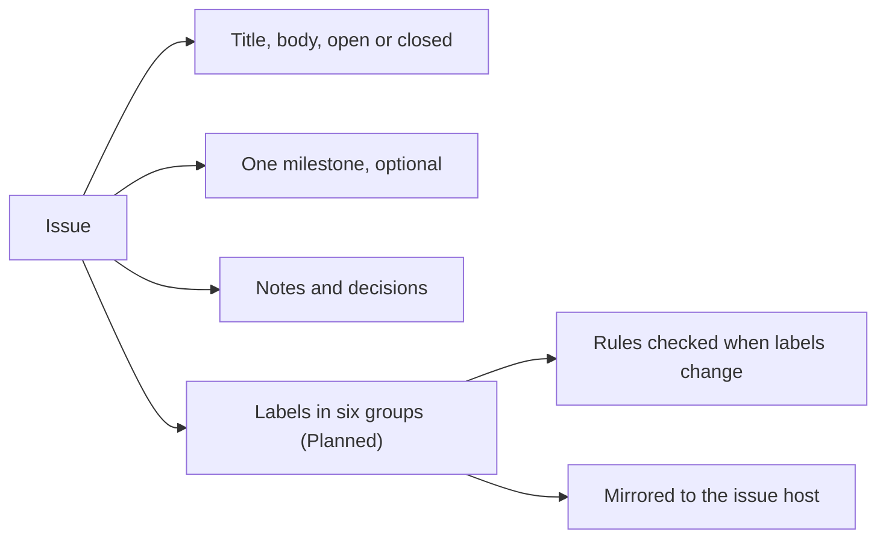
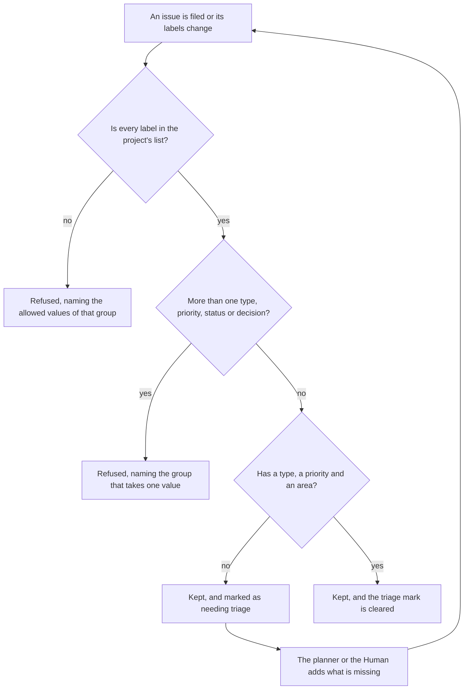

# Issue labels

How a project's issue board stays searchable when agents file most of its issues: six groups of labels, the rules for each, and how a project makes the scheme its own.

An issue in tmb's record is a goal with a title, a body, a state of open or closed, and one optional milestone. It carries notes and decisions, and ranked word search finds it by its words ([MEMORY.md](MEMORY.md#search)).

**Planned:** the label scheme on this page, and the mirror to GitHub or GitLab. [Planned](#planned) lists the pieces.

## Why a scheme

A search is only as good as the labels, so the scheme is a small, closed vocabulary with one meaning per label.

- **Why search.** An agent files an issue in seconds, so a board grows faster than one person can read it. Issues are then found by search, whether an agent or the Human is searching.
- **What breaks search.** A label an agent invented, and a label that means two things.

## The six groups

| Group | Answers | Per issue | Who sets it |
|---|---|---|---|
| Type | What kind of work is this? | Exactly one | Whoever files the issue |
| Priority | How soon? | Exactly one | Whoever files it; the Human can change it |
| Area | Which part of the project? | One or more | Whoever files it, or inferred from the paths the issue names |
| Status | Is it ready to be worked on? | At most one | tmb, when a required label is missing |
| Decision | Did the planner decide something here for the Human? | At most one | the planner |
| Theme | Which kind of problem is it, whatever the area? | Any number | Whoever files it |

**Type, priority and area are required.** An issue without all three is not triaged, and its status says so until it has them.

**Area says where, theme says what kind.**

- **Example 1.** An area is a part of the project, such as its login or its billing.
- **Example 2.** A theme cuts across areas: a design gap, a prompt problem, a guard that blocks valid work.
- **Edge case.** One issue does not make a theme. A project adds a theme only once several issues share it.

**Decision is the Human's review queue.** One search shows everything that waits on the Human, with no thread to read.

- **Example 1.** The planner decides something on the Human's behalf in an issue or a pull request. It marks the item as needing the Human and lists those decisions in one section of the body.
- **Example 2.** The Human has answered. The planner marks the item reviewed.

## How a label is written

| Rule | Why |
|---|---|
| **Group, a slash, then the value, all in lower case with no spaces**, such as the bug type or the high priority | A name with a space must be quoted in every search and every command, and a quoting slip is the commonest way an agent's search goes wrong |
| **Every label has a description** | An agent that reads the list knows what each label means without guessing from its name |
| **One meaning per label** | Two labels that could both fit are merged, not kept |

## How labels are applied

An agent picks from the project's list and never invents. tmb checks the rules each time an issue is filed or its labels change.

- **The list is the whole vocabulary.** A label outside it is refused. This also keeps text an agent read in an issue from turning into a label.
- **Unsure means unset.** An agent that cannot tell the type or the area leaves it off, and the issue stays marked for triage. A wrong label hides an issue from every later search; a missing one is found.
- **A new theme or status needs the Human.** Those two groups grow without limit, so the planner proposes a new value and the Human approves it.

## One board, two authors

A person and the planner both file issues, and both produce the same issue. One field list serves the web form and the planner's draft, so the two read the same and are triaged by the same rules.

On tmb's own board, a bug report tmb drafts and the web form share one field list. For a project's own board this is Planned.

| Author | Knows | Fills in |
|---|---|---|
| A person | What they saw and how badly it blocks them | The form's opening questions |
| The planner | The part of the code, the versions, the steps and the exact output | Every field it knows |

- **A form asks a person only what they know.** Each issue form requires its opening questions, written in plain words, and nothing that needs knowledge of the project's internals. Everything else is optional.
- **The planner supplies the rest.** The Human reads the planner's draft whole and says yes before it is filed. An issue a person files with fields left empty is completed at triage, by the planner or the Human.
- **An empty answer is honest.** A field a person cannot answer stays empty and the issue is marked for triage, by the same rule as a label: a wrong answer misleads every later reader, a missing one is filled in.

## A project makes it its own

**A project starts with labels that work.** tmb ships a ready environment, and labels are part of it: with no knowledge of a project, the planner cannot invent good ones. So every group has a shipped default, and a new project can file and find issues from its first session.

| Group | Shipped default |
|---|---|
| Type, priority, status, decision | The same everywhere: the types, the priorities, the triage status and the two decision values |
| Theme | A list of four problems common to software projects: a design gap, docs that have drifted from the code, a regression, and technical debt. The project drops what it does not use and adds its own |
| Area | None shipped: areas come from the project, once tmb knows it |

**Areas come from the code graph.** The planner proposes areas only after the first index: the project's main parts, what their READMEs say they are, and the paths each one covers. The Human edits the list ([2_ONBOARD.md](../flows/2_ONBOARD.md)).

- **Why the paths.** An area can later be inferred from the paths an issue names.
- **Edge case.** A repo has no code yet. The planner proposes none and asks again when an index first finds some.
- **Planned.** The code graph holds these areas as named groups of files ([CODE_GRAPH.md](CODE_GRAPH.md#areas)). Using them as the area labels of an issue is Planned.

**Everything can be changed.** The Human can rename, add or drop any label, in any group, per project. The per-issue rules follow the project's own list.

**A project that already has labels keeps them.** The planner offers a mapping from the existing labels to the groups. Nothing on GitHub or GitLab is renamed, created or removed without the Human's yes.

- **Edge case.** A label the mapping leaves out stays on its issues and is ignored by the rules.

**The local record is the source.** Labels are kept in the record and mirrored to GitHub or GitLab.

- **Edge case.** The issue host does not let the user apply labels. The local record still holds them, and a search through tmb still finds the issue.

## What the scheme does not do

| It does not | Because |
|---|---|
| Replace the milestone | A milestone says which body of work an issue belongs to, and a feature branch collects a milestone's tasks ([3_WORKFLOW.md](../flows/3_WORKFLOW.md)) |
| Carry state tmb already records | A task's lifecycle and its review mode live in the record, not in labels ([3_TASKS.md](../flows/3_TASKS.md), [3_WORKFLOW.md](../flows/3_WORKFLOW.md)) |
| Replace the issue host's own fields | A host such as GitHub or GitLab that has a native issue type or priority field enforces one value itself |

**Open:** whether tmb should use those native fields in place of the type and priority groups. Their behaviour differs by account and by tool version.

## Planned

- Labels on an issue in the record, in any group.
- The six groups, with one value per group enforced for type, priority, status and decision, and several areas allowed.
- Lower-case names with a slash, for a project's labels.
- Area labels inferred from the paths an issue names.
- The onboarding question, the shipped themes and the mapping of existing labels.
- Labels mirrored to GitHub or GitLab.
- The planner's procedure for choosing labels and for the decision group.
- Issue forms and the shared field list on a project's own board.
