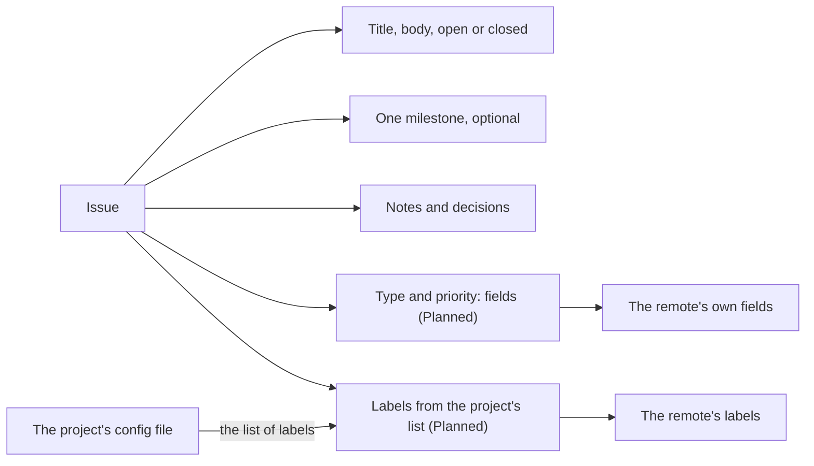
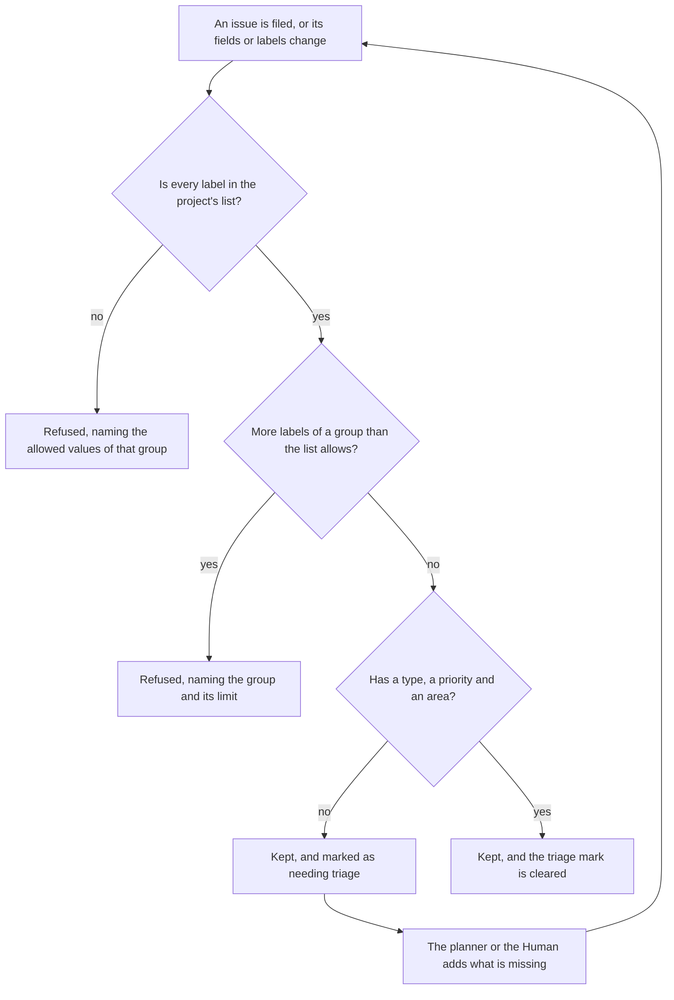

# Issues: fields and labels

How a project's issue board stays searchable when agents file most of its issues: what an issue's own fields say, what labels say, and where a project sets its labels.

**An issue's type and priority are the remote's own fields. Labels say only what no field says, and the project's list of labels is a setting.**

An issue in tmb's record is a goal with a title, a body, a state of open or closed, and one optional milestone. It carries notes and decisions, and ranked word search finds it by its words ([MEMORY.md](MEMORY.md#search)).

**Planned:** type, priority and labels on an issue (trustmybot/tmb#402), and the label list as a setting and its rules (trustmybot/tmb#417). The syncer already reads the remote's issues, with their type, labels and milestone, into the record ([TRAJECTORY.md](TRAJECTORY.md#when-the-syncer-runs)), and a change to a mirrored issue goes to the remote first ([TRAJECTORY.md](TRAJECTORY.md#a-change-to-a-mirrored-issue-goes-to-the-remote-first)).

## Fields before labels

**tmb adds nothing a remote already has.** Where the remote has a field for a fact, the fact is that field, in the record and on the remote.

| Fact | Per issue | In the record | On GitHub |
|---|---|---|---|
| Type: what kind of work | Exactly one | A field of the issue | The issue type |
| Priority: how soon | Exactly one | A field of the issue | The Priority field |
| Milestone: which body of work | At most one | A field of the issue | The milestone |
| Everything else worth a search | See [the label groups](#the-label-groups) | Labels | Labels |

- **Example 1.** The planner files a bug it rates high. The issue's type is bug and its priority is high. It carries no label for either.
- **Example 2.** The Human changes the priority in the browser. The record takes the field's new value ([TRAJECTORY.md](TRAJECTORY.md#what-the-record-takes-from-a-github-issue)).
- **Edge case.** The remote has no such field, such as a repo with no issue types. The record still keeps the type and the priority, and a search through tmb still uses them. tmb makes no label to stand in for the field.
- **Edge case.** The remote's field has a value outside tmb's four priorities. The record keeps it as it is and orders it last.

**Planned** (trustmybot/tmb#403): tmb's own board moves its type labels to issue types. Its priority is already the field.

## The label groups

A search is only as good as the labels, so the list is small and closed, with one meaning per label.

- **Why search.** An agent files an issue in seconds, so a board grows faster than one person can read it. Issues are then found by search, whether an agent or the Human is searching.
- **What breaks search.** A label an agent invented, and a label that means two things.

| Group | Answers | Per issue | Who sets it |
|---|---|---|---|
| Area | Which part of the project? | One or more | Whoever files it, or inferred from the paths the issue names |
| Status | Is it ready to be worked on? | At most one | tmb, when something required is missing |
| Decision | Did the planner decide something here for the Human? | At most one | the planner |
| Theme | Which kind of problem is it, whatever the area? | Any number | Whoever files it |

**A type, a priority and an area are required.** An issue without all three is not triaged, and its status says so until it has them.

**Area says where, theme says what kind.**

- **Example 1.** An area is a part of the project, such as its login or its billing.
- **Example 2.** A theme cuts across areas: a design gap, a prompt problem, a guard that blocks valid work.
- **Edge case.** One issue does not make a theme. A project adds a theme only once several issues share it.

**Decision is the Human's review queue.** One search shows everything that waits on the Human, with no thread to read.

- **Example 1.** The planner decides something on the Human's behalf in an issue or a pull request. It marks the item as needing the Human and lists those decisions in one section of the body.
- **Example 2.** The Human has answered. The planner marks the item reviewed.

## The list is a setting

**The project's labels are set in its config file, not in tmb.** The file names the groups, the labels in each with a description, and how many of a group one issue may carry ([CONFIG.md](CONFIG.md#planned-more-in-the-config-file)). tmb ships a default list, so a new project can file and find issues from its first session.

| Group | Shipped default |
|---|---|
| Status, decision | The triage status and the two decision values |
| Theme | Four problems common to software projects: a design gap, docs that have drifted from the code, a regression, and technical debt |
| Area | None: areas come from the project, once tmb knows it |

- **Example 1.** A project drops the regression theme and adds one of its own. The Human edits the list, and the rules follow the new list at once.
- **Example 2.** A project wants a fifth group. It adds the group to the list with its labels. tmb treats it as it treats the shipped four.
- **Edge case.** A project already has labels. The planner offers a mapping from them to the groups, and the mapping is part of the setting. Nothing on the remote is renamed, created or removed without the Human's yes.
- **Edge case.** A label the mapping leaves out stays on its issues and is ignored by the rules.
- **Edge case.** The list is edited while issues carry a label it no longer has. The issues keep the label, and the next change to their labels is checked against the new list.

**The record holds what each issue carries, never the list.** The list is a choice, so it is a setting. Which labels an issue has, and each change to them, is what happened, so it is in the record.

**Areas come from the code graph.** The planner proposes areas only after the first index: the project's main parts, what their READMEs say they are, and the paths each one covers. The Human edits the list ([2_ONBOARD.md](../flows/2_ONBOARD.md)).

- **Why the paths.** An area can later be inferred from the paths an issue names.
- **Edge case.** A repo has no code yet. The planner proposes none and asks again when an index first finds some.
- **Planned.** The code graph holds these areas as named groups of files ([CODE_GRAPH.md](CODE_GRAPH.md#areas)). Using them as the area labels of an issue is Planned (trustmybot/tmb#417).

## How a label is written

| Rule | Why |
|---|---|
| **Group, a slash, then the value, all in lower case with no spaces** | A name with a space must be quoted in every search and every command, and a quoting slip is the commonest way an agent's search goes wrong |
| **Every label has a description** | An agent that reads the list knows what each label means without guessing from its name |
| **One meaning per label** | Two labels that could both fit are merged, not kept |

These are the shipped list's rules. A project that maps its own labels keeps their names.

## How fields and labels are applied

An agent picks from the project's list and never invents. tmb checks the rules each time an issue is filed or changed.

- **The list is the whole vocabulary.** A label outside it is refused. This also keeps text an agent read in an issue from turning into a label.
- **Unsure means unset.** An agent that cannot tell the type or the area leaves it off, and the issue stays marked for triage. A wrong value hides an issue from every later search; a missing one is found.
- **A new label needs the Human.** The planner proposes it and the Human adds it to the list.
- **Edge case.** A label arrives from the remote that is not in the list. The record keeps it, since the remote is the truth for what it holds, and the rules ignore it.

## One board, two authors

A person and the planner both file issues, and both produce the same issue. One field list serves the web form and the planner's draft, so the two read the same and are triaged by the same rules.

On tmb's own board, a bug report tmb drafts and the web form share one field list. For a project's own board this is Planned (trustmybot/tmb#417).

| Author | Knows | Fills in |
|---|---|---|
| A person | What they saw and how badly it blocks them | The form's opening questions |
| The planner | The part of the code, the versions, the steps and the exact output | Every field it knows |

- **A form asks a person only what they know.** Each issue form requires its opening questions, written in plain words, and nothing that needs knowledge of the project's internals. Everything else is optional.
- **The planner supplies the rest.** The Human reads the planner's draft whole and says yes before it is filed. An issue a person files with fields left empty is completed at triage, by the planner or the Human.
- **An empty answer is honest.** A field a person cannot answer stays empty and the issue is marked for triage, by the same rule as a label: a wrong answer misleads every later reader, a missing one is filled in.

## What labels do not do

| They do not | Because |
|---|---|
| Say the type or the priority | The remote has a field for each ([Fields before labels](#fields-before-labels)) |
| Replace the milestone | A milestone says which body of work an issue belongs to, and a feature branch collects a milestone's tasks ([3_WORKFLOW.md](../flows/3_WORKFLOW.md)) |
| Carry state tmb already records | A task's lifecycle and its review mode live in the record, not in labels ([3_TASKS.md](../flows/3_TASKS.md), [3_WORKFLOW.md](../flows/3_WORKFLOW.md)) |
