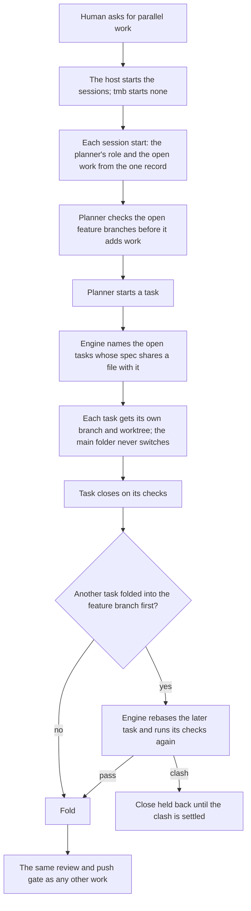

# Parallel lanes

Flow 3.8 in [FLOWS.md](FLOWS.md): several sessions working in one project at once. A lane is one such session with the work it took.

tmb keeps no lane record and manages no lanes. The host starts sessions, carries messages between them and lists them. tmb gives every session the same record, and its tools tell the planner what it needs to stay out of another session's way.

## What the planner's prompt and tools give

- **The record is the handoff.** A session resumes from the record and needs nothing from another conversation. The planner records a goal as an issue at once, and each decision on its issue, so every session sees them.
- **Session start lists the open work,** whichever session started it: open issues with their newest decision, open tasks with their issue, feature branch and worktree, truest tasks in review, and pull requests that ended since the last session.
- **The planner checks the feature branches first.** Its prompt has it add to an open feature branch rather than cut a second one for the same work. Feature names are unique in the record.
- **Starting a task names shared files.** When a file in the new task's spec is also in another open task's spec, the task still starts and the answer names those tasks. It is information, never a refusal, and only tasks in the same repo are compared.
- **A worktree per task.** Each task has its own branch and worktree, and the engine cuts and moves branches without checking them out, so no session switches the main folder under another.
- **No lock, and no lost fold.** Two tasks may change the same file. A fold is refused when the feature branch moved under it, and the later task is rebased first, so git settles the overlap and a clash holds back only the later task's close.
- **A close reports the main folder.** It lists what changed there since the task started. With several sessions that can be another session's edit or the Human's own, so tmb puts nothing back and the planner raises the list to the Human.
- **The health check finds what stalled:** an open task no agent run is on, a run that never ended, and a worktree the host's files do not wire. The planner's session start names the count in one line.
- **One gate for all.** The push gate and the review judge commits, not sessions.

## What is left to the host

- Starting a session, a worker or a reviewer, and running several at once.
- Messages between sessions, and each session's end-of-turn report.
- The list of running sessions.
- Permission prompts shown to the Human.

Two sessions of one host may both be planners. Two hosts may share a project too, each in its own role ([HOSTS.md](HOSTS.md)).

## What tmb leaves out

- **No merge queue, lane priority or merge order of its own.** The Human decides what merges first by merging it first.
- **No file leases and no dependency between sessions.** Two sessions that changed the same file meet as an ordinary rebase or merge conflict.
- **No hub.** No session holds the state of the others.
- **No review mode per lane.** A mode belongs to the project or to a repo ([AGILE.md](AGILE.md#where-the-review-mode-is-set)).

## Planned

- **Session start saying which session started each open task.** Today it lists every open task and not who holds it; the record keeps no session.
- **Guidance in the planner's prompt for parallel work.** Today the prompt says nothing about it. The design carried from the plugin: the planner proposes a split and never starts sessions unasked; it reads each issue's likely files from the code graph and keeps issues that touch the same files in one session; it tells the Human which overlaps it could not remove; the Human approves the split.
