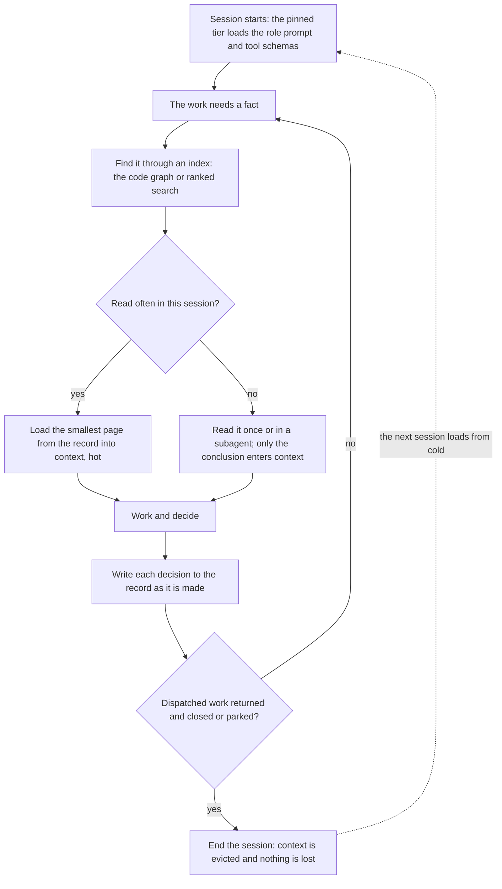
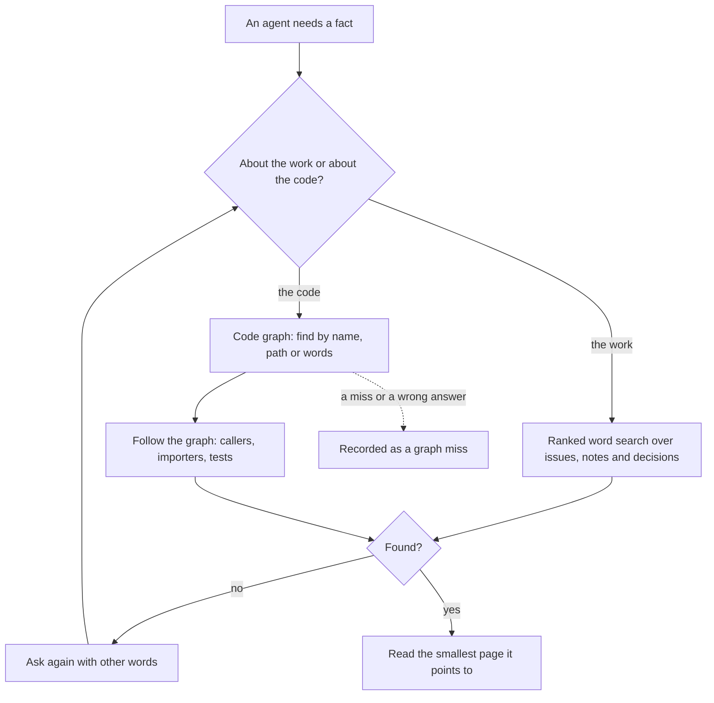
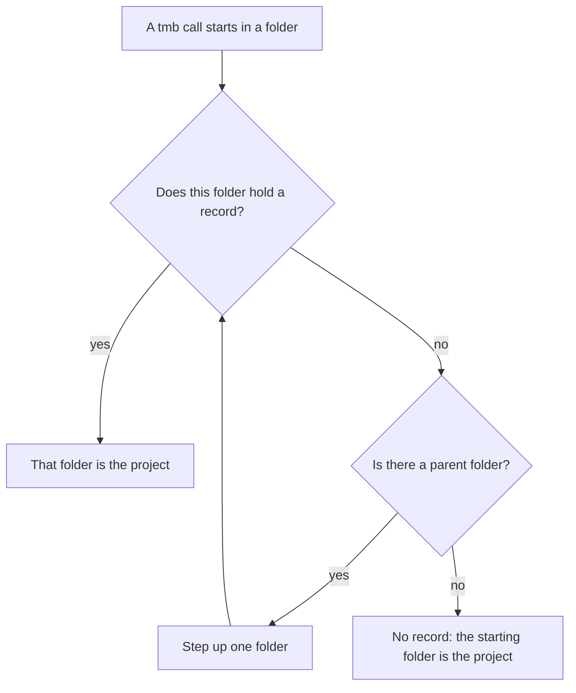
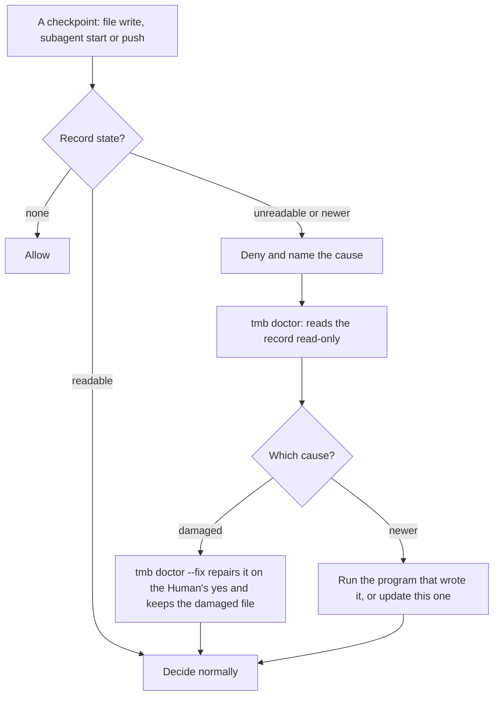

# Memory model

The key principle of tmb's memory, for every agent on every host. Any change to what an agent loads, keeps or stores follows it. How many tokens tmb saves depends on how well memory swaps from hot to cold, and loads from cold to hot when needed.

tmb's memory works like a computer's:

| Tier | Computer | tmb | Holds | Cost |
|---|---|---|---|---|
| Cold | Hard disk | The record, and the code graph beside it | Everything permanent: issues, decisions, specs, verdicts, the project map | Paid once per load |
| Hot | RAM | Session context | Only what the current work reads often | Paid on every call while it stays |
| Pinned | Kernel | Role prompt, tool schemas, skill listing (skills are Planned) | What every call needs to function | Paid on every call by every agent, never evicted |

**The record is the only source of truth. Context is a disposable cache of it: everything is written to the record as it happens, so context is never the only copy. Every agent loads the smallest page it needs, and ends its session at a task boundary.**

One agent session moves memory between the tiers like this:

## Context is not RAM

Context differs from real hardware in four ways, and the design decisions sit there.

**Hot storage charges rent.** RAM costs nothing to hold. Context is re-read on every call, so an item costs its size times the calls left in the session.

- **Example.** An item read once comes back as a conclusion and does not stay.

**No single item can be swapped out.** Context is append-only. So most savings come from not loading an item and from ending sessions on time.

- **Example 1.** Ending the session removes everything and loses nothing.
- **Example 2.** A subagent works like a separate process with its own address space: only its return value enters the caller's context.
- **Edge case.** Compaction is the only other thing that removes items. It loses detail and happens at a time tmb does not choose.

**Write through, never write back.** Context is volatile, so a decision reaches the record when it is made, before the work moves on. Evicting then loses nothing.

- **Example 1.** A decision is anything a later step reads back, such as a status change, a verdict or a spec.
- **Edge case.** A change of state is added as an event, never written over, so the history stays.

**Evict at boundaries.** A session ends when its dispatched work has returned and been closed or parked.

- **Edge case.** The one timer that matters is prompt cache expiry. The next call then pays full price for the whole context, so a cold restart is usually cheaper.

**tmb trims its own tools, not the shell.** tmb watches no shell command, so it does not trim shell output on its way into context. What keeps context small is the size of what tmb's own tools return.

## Loading from cold

- **Pages, not the disk.** A read returns the smallest useful unit: a brief, a section or a ranked snippet, never a dump.
- **An index first.** The code graph and ranked search snippets are the page table: they say where to read before anything is read.
- **The session start is one small page.** The planner starts with its role, the open work from the record, the project's directories from the code graph as last indexed, and one line when the health check has something to show.
- **The record must be trustworthy.** A stale record makes agents re-derive state or keep their own copies, which breaks the model. A memory file written to carry state between sessions signals a design flaw to fix.

## Search

Search is ranked word search plus the code graph. tmb ships no embedding model.

| Search | Looks in | Matches | Returns |
|---|---|---|---|
| Record search | Issue titles and bodies, notes and decisions | Every word of the query | Ranked snippets |
| Code search ([CODE_GRAPH.md](CODE_GRAPH.md)) | Names, paths, and the words in a name or a summary | Every word first, then any word | Ranked hits |

- **Agent search first.** A skill (Planned) teaches the planner to search with several word queries and to follow the graph from each hit. Misses are measured on real questions.
- **Embeddings only on evidence.** Search by meaning is added only if measured misses show that word search and the graph do not find what is there.
- **Edge case.** Graph misses are recorded for that measurement. Misses of record search are not.

## Every agent keeps little hot

| Agent | Keeps hot | Loads from cold when needed |
|---|---|---|
| planner | The Human's current ask and the work in flight | Issues, decisions, the project map; investigation goes to a subagent |
| worker | One task's spec and the files it edits | Its task brief, the code graph |
| reviewer | One task's or one feature branch's diff and its findings | Its brief, check runs, the code graph |
| consultant (Planned) | One question | Notes and decisions, the code graph |

## Where the record lives

One database file per project, inside the project's folder and left out of git: `.tmb/trajectory.db`. `tmb init` creates it. A multi-repo workspace shares one, in the workspace folder ([3_GIT.md](../flows/3_GIT.md)).

- **The nearest record wins.** A session that moved into a subfolder, or into one repo of a workspace, still finds its project.
- **Edge case.** A `.tmb` folder with no database in it is passed over.
- **The code graph is not in the record.** It has its own file beside it, `.tmb/graph.db`, or in a multi-repo workspace one per repo, `.tmb/graphs/<repo>.db` ([CODE_GRAPH.md](CODE_GRAPH.md#substrate)).
- **The engine is the only writer and the only migrator.** Agents, the command line and the dashboard change the record only through it. A record an older tmb wrote is upgraded by the next tmb command.
- **Other records are shown, not merged.** The health check lists records in a folder above the project or below it.

## A gate never passes what it cannot check

A gate denies when the record is unreadable and allows when there is no record.

| Record state | Meaning | Gates | Other commands |
|---|---|---|---|
| No record | tmb was never set up here | Allow: tmb stays out of projects it never touched | Offer `tmb init` |
| Readable | The record answers a read | Decide normally | Run normally |
| Unreadable | Damaged or empty: a record file that is there but empty counts | Deny, naming the cause | None runs; each stops and names the cause. `tmb doctor` still runs |
| Made by a newer tmb | A newer program reshaped it: a downgrade, or two channels in one project | Deny, naming the version and the program that wrote it | None runs. Nothing downgrades a record; run the newer program there, or update this one |

- **Denied:** subagent starts and pushes, and every tmb command and tool but the health check.
- **Still possible:** reading files and running shell commands, because tmb watches neither. So the agent can see what is wrong and tell the Human.

## The health check finds what is wrong

`tmb doctor` is the health check. It checks the machine and the project, prints one line per check with the step that fixes it, and exits 1 when a check failed. [The reference](../reference/README.md#check-this-machine-and-project) lists every check.

- **It only reads.** The health check never deletes without the Human's yes and never touches a file tmb did not write. With a terminal, its fix mode asks about each fix, one at a time.
- **It runs with a broken record.** Every check that does not need the record still runs; the ones that do say why they were skipped.
- **A start without an end is a finding.** It lists runs and checks with a start and no end, and open tasks no agent run is on ([TRAJECTORY.md](TRAJECTORY.md)).
- **The code graph is checked too.** A graph behind its base branch, built by an older indexer, or holding files that could not be parsed is a finding, with `tmb index` as the fix.
- **The planner hears of it in one line** at session start, "N things need a look", from the quick checks only, so its context stays small.
- **Edge case.** A check that fails by itself looks like tmb's own bug. Its line says so and names the bug report command.

## Design test

Ask these of any change that adds context, a tool result, a prompt line or a store:

1. Which tier does it live in, and is that the cheapest tier that works?
2. If it is hot or pinned, how many calls pay for it, and is it read often enough to earn that?
3. If it is hot, what evicts it, and is it already in the record by then?
4. If it is loaded from cold, is that the smallest page, and can it be found through an index?
