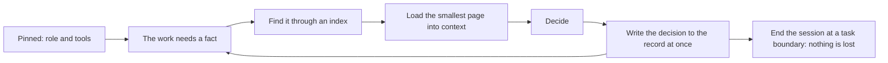

# Memory model

What an agent loads, keeps and writes back, and what each costs. Any change that adds context, a tool, a prompt line or a tool answer follows this page.

**The record is the only source of truth. Context is a disposable copy of part of it.**

| Tier | Like a computer's | In tmb | Cost |
|---|---|---|---|
| Cold | Disk | The record ([TRAJECTORY.md](TRAJECTORY.md)) and the code graph ([CODE_GRAPH.md](CODE_GRAPH.md)) | Paid once per load |
| Hot | RAM | The session's context | Paid on every call while it stays |
| Pinned | Kernel | The role prompt and the descriptions of tmb's tools | Paid on every call, never dropped |

## 1. Hot memory charges rent

Context is read again on every call. An item costs its size times the calls left in the session.

- **Example 1.** A fact read once comes back as a conclusion and does not stay.
- **Example 2.** A subagent has its own context. Only what it returns enters the caller's.
- **Edge case.** Nothing can be dropped from context one item at a time. The savings come from not loading, and from ending the session.

## 2. Write through

A decision reaches the record when it is made, before the work moves on. Dropping context then loses nothing.

- **Example 1.** A verdict, a spec and a status change are each written by the tool call that makes them.
- **Example 2.** A session ends mid-task. The next one reads the task from the record and goes on.
- **Edge case.** An agent keeps a notes file to carry state between sessions. That is a gap in the record, to fix in the record.

## 3. Load a page through an index

A read returns the smallest useful unit, and an index says where to read before anything is read.

- **Example 1.** A worker gets its task's brief, not the issue's whole thread.
- **Example 2.** The planner asks the code graph which files a change touches, then reads those files.
- **Edge case.** A tool that could answer with a long list answers with the top of it and says how many more there are. The code map does this today; a cap on every tool's answer is Planned (trustmybot/tmb#420).

## 4. Pinned memory is the dearest

Every agent pays for the role prompt and every tool description on every call. A line or a tool stays pinned only if most calls need it.

- **Example 1.** A rule only the reviewer needs is in the reviewer's prompt, not the planner's.
- **Example 2.** Guidance needed for one kind of work loads when that work starts, not at session start. Planned, as skills (trustmybot/tmb#112).
- **Edge case.** A tool few sessions call still costs every session its description. It is merged into another tool or cut.

**Planned** (trustmybot/tmb#420): each role is offered only the tools it uses, with shorter descriptions. Today every role gets every tool.

## 5. The engine enforces what it owns and advises the rest

The host owns the context. tmb cannot drop an item from it or end a session. tmb controls only what it puts in.

| tmb controls, so the engine enforces | The host controls, so the role prompt advises |
|---|---|
| The size of each tool's answer | When the session ends |
| What the session start adds ([1_INSTALL.md](../flows/1_INSTALL.md#session-start)) | What the agent reads with the host's own tools |
| The brief a worker or the reviewer starts with | Whether a search goes to a subagent |
| Writing each decision to the record | When the host compacts context |
| How many tools it offers, and how long each description is | |

- **Example 1.** The code map's answer is capped by the engine. No prompt line asks the agent to read less of it.
- **Example 2.** "End the session once the work is closed or parked" is advice in the planner's prompt. Nothing blocks a session that runs on.
- **Edge case.** tmb watches no shell command, so shell output enters context untrimmed.

## 6. Every agent keeps little hot

| Agent | Keeps hot | Loads from cold when needed |
|---|---|---|
| Planner | The Human's current ask and the work in flight | Issues, decisions, the project map |
| Worker | One task's spec and the files it edits | Its brief, the code graph |
| Reviewer | One feature branch's diff and its findings | Its brief, check runs, the code graph |

The roles are in [ROLES.md](ROLES.md).

## Search

**Search is ranked word search plus the code graph. tmb ships no embedding model.**

| An agent asks about | It uses | Details |
|---|---|---|
| The work: issues, notes, decisions | Ranked word search over the record | [TRAJECTORY.md](TRAJECTORY.md#search) |
| The code | The code graph: find by name, path or words, then follow callers and tests | [CODE_GRAPH.md](CODE_GRAPH.md) |

- **Example.** No hit. The agent asks again with other words before it reads files by hand.
- **Edge case.** Search by meaning is added only if measured misses show that words and the graph do not find what is there.

## Design test

Ask these of any change that adds context, a tool, a tool answer or a prompt line:

1. Which tier does it live in, and is that the cheapest one that works?
2. If it is hot or pinned, how many calls pay for it, and is it read often enough to earn that?
3. Is it already in the record before context is dropped?
4. If it is loaded from cold, is it the smallest page, found through an index?
5. Does the engine enforce it, or does it rest on advice? If on advice, can it be moved to something tmb controls?
