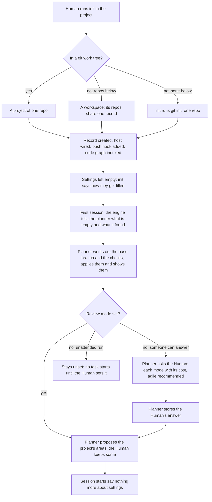
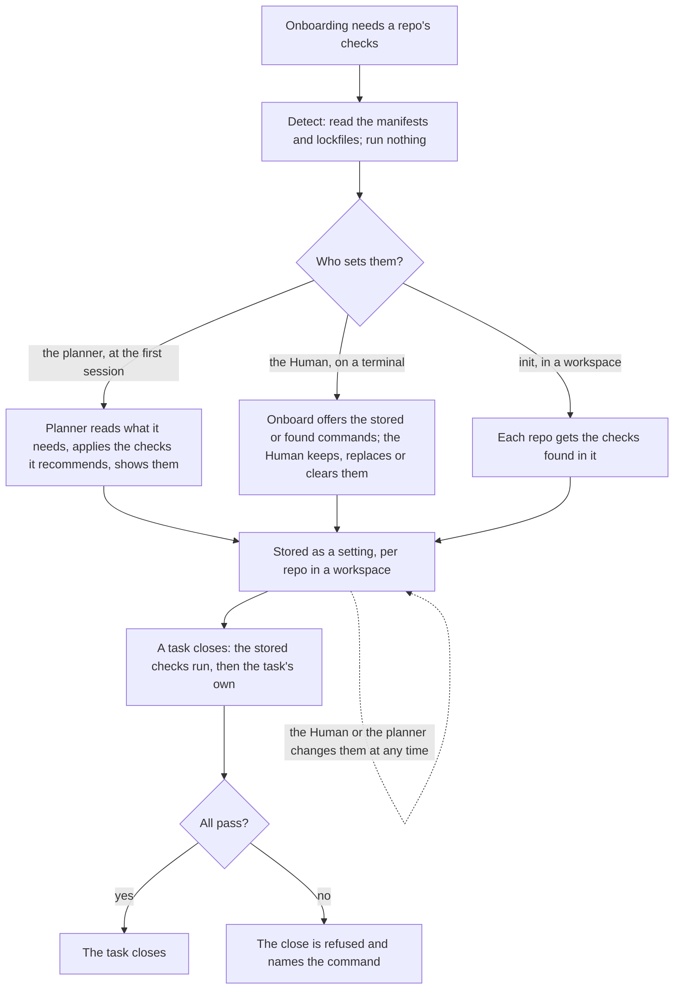

# First contact

Every case of flows 2.1 and 2.3 in [FLOWS.md](FLOWS.md): how tmb learns a project's shape, its policy and [its checks](#the-repos-checks). It takes two steps: a terminal step that asks nothing, and the planner's onboarding at the first session.

`tmb onboard` sets the same settings from a terminal, and can be run again at any time. No task starts until the review mode is set.

## Steps

Each round of the plugin's onboarding, and its place in tmb.

| Plugin round | In tmb | Who | Leaves |
|---|---|---|---|
| 0: pick the project, remove stray DBs | No question. The record is the nearest one in the folder or above it. `tmb doctor` shows other records above or below. Init refuses a second project in a repo whose push hook already names another. | init | nothing |
| 1: Local-only or Remote-tracked | No question. tmb reads each repo's remote when it needs it: with none, nothing is pushed and no pull request opens ([GIT.md](GIT.md)). | engine | nothing |
| 2: branching, PR target, remotes | The base branch per repo: origin's default branch, else the current branch, else `main`. No branching-model question: the review mode decides the branches ([AGILE.md](AGILE.md)). | init in a workspace, else the planner; or `tmb onboard` | each repo's base branch |
| 3: issue sync | Planned, inside the syncer (trustmybot/tmb#70). | | |
| 4: Bash sandbox | Removed. tmb sets up no sandbox. | | |
| 5: bug reports | The feedback program ([INSTALL.md](INSTALL.md#bug-reports)): on with a notice on dev and rc; on stable the planner asks once per machine. | init's last lines, or the planner | the person's setting, per machine and channel |
| 5b: review mode | Agile or truest, the Human's choice. tmb recommends agile and never picks. In a workspace: the workspace's mode once, then once whether any repo takes its own (trustmybot/tmb#216). | the planner's question, or `tmb onboard` on a terminal | the review mode, and how it was chosen |
| 5c: pre-push hook on or off | No switch. Init installs the hook. Where a repo's pre-push hook is another tool's, the Human is asked whether tmb adds its one line first in it (trustmybot/tmb#184). A repo marked exempt gets none. | init; `tmb onboard` on a terminal | git's pre-push hook per repo |
| 6: verification defaults | The checks: found in the project and stored as a setting, not as a file in the repo ([The repo's checks](#the-repos-checks)). | the planner, or `tmb onboard` | the checks, per repo in a workspace |
| 7: no-code path classes | Not carried over. A project declares no list of docs paths: the planner names each task's kind, and the engine checks a docs task by file type at its close ([TASKS.md](TASKS.md)). | | |
| (new) the host's role | Planner unless the Human names the reviewer; one role per host ([HOSTS.md](HOSTS.md#different-models-on-one-task)). | init, or `tmb onboard` | the host and its role |
| (new) areas | Once the code graph is built, the planner proposes named parts of the project, one line each, and writes those the Human keeps ([WORLD_MODEL.md](WORLD_MODEL.md)). | the planner | the areas |

- **Init asks nothing.** It never waits for input, on a terminal or not (trustmybot/tmb#162). It sets the host and its role and, in a workspace, each repo's base branch and found checks. Every other setting stays empty.
- **Onboarding happens by itself.** When a planner's session starts and the base branch, the review mode or the checks is empty, the engine says so, with what it found. The planner applies what it recommends before other work and shows it. It reminds the Human that `tmb onboard` can be run again, and that it can change a value when asked.
- **The review mode is the Human's choice** (trustmybot/tmb#114). It decides how many tokens a project uses. Three ways set it: the planner's question, `tmb onboard` on a terminal, or its review-mode flag with a typed yes. The record keeps which. It is a step only the Human may take ([HOSTS.md](HOSTS.md#ways-into-the-engine)).
- **Unattended runs.** The planner applies its recommendations and names each value in its answer. It never sets the review mode, so the first task is refused and the refusal names `tmb onboard`. One exception: a run with no terminal may set a mode where none is set, never change one (trustmybot/tmb#223).
- **Re-runs keep what stands.** `tmb onboard` offers each stored value first and changes a setting only when the Human gives a new one. Init run again keeps every stored setting and, in a workspace, each repo's policy; it adds repos that appeared and drops those that are gone, one line each. The same answers change no file and record nothing.
- **Every change is kept.** Each change to a setting is an entry in the record's audit trail, and the newest entry is the value in force.
- **Without a terminal `tmb onboard` never waits.** Each question takes its default, and the review mode stays as it is.
- **Repos come from init.** Init records every top-level folder of a workspace, repo or not, and finds repos up to two folders down. Later steps never scan or guess ([GIT.md](GIT.md#multi-repo-workspaces)).
- **Nothing lands in the repo's working tree** beyond the ignore lines: settings live in the record, so there is no file for the Human to commit.
- **Failures.** Init with no host installed stops and changes nothing. `tmb onboard` before init says so and changes nothing.

## The repo's checks

The checks are the commands that must pass before a task closes. tmb hardcodes no toolset: it finds a repo's checks at onboarding and stores them as a setting.

- **Detect runs nothing.** It reads the files a stack leaves behind and suggests commands: a package manifest's lint, typecheck and test scripts, run with the tool its lockfile names, and the usual test command of a Python, Rust or Go project. The list is in the [reference](../reference/README.md#onboard).
- **A suggestion, never the rule.** The planner works out what it recommends from the suggestion and the project. The Human confirms or replaces it.
- **The repo is the source of truth.** Teammates, CI and editors enforce the same rules without tmb, so tmb suggests only commands the repo already defines.
- **A stored list is never overwritten by a new detection.** The checks change only when the Human or the planner changes them. A repo that changed keeps its stored checks until then.
- **One list per repo.** A project of one repo has one list. In a workspace each repo has its own, and the project-wide list is not read ([GIT.md](GIT.md#multi-repo-workspaces)).
- **A task adds its own.** A task's spec can name more checks. At close the stored checks run first, then the task's, each with a time limit, in the task's worktree. A task with no checks at all never closes ([TASKS.md](TASKS.md)).

### Open, for the Human

Parts of the plugin's environment profile that tmb has not built, with no call yet on whether it should:

- **Checked on use.** Comparing the stored checks with the repo on each use, and detecting again when they differ.
- **One profile per package root.** tmb detects at the repo's top folder only.
- **Install commands and missing tools.** tmb records neither, and does not tell the Human what to install.
- **Overrides, waivers and declines per category.** tmb stores one plain list of commands.

## How a card is written

The planner asks through its host's question tool. A person who has never used tmb must be able to answer from the card alone.

- **A card only when the Human must choose.** The planner applies the base branch and the checks without a card and shows them. It asks for the review mode, the areas to keep and, on stable, the feedback program.
- **One option is recommended, with its cost.** For the review mode: one option per mode with what it costs, agile marked as recommended. A card that asks for consent recommends nothing.
- **Repo modes are asked only in a workspace.** A project of one repo takes the project's mode.

Planned:

- **The feature comes first.** The question opens by saying what tmb does here, in one or two sentences, and then asks.
- **tmb's own names.** A card uses the name tmb uses everywhere, such as docs task or review mode, and says what it means.
- **Each option says its benefit and its risk or cost**, in one short line.
- **The card shows the actual values.** Commands and branch names appear on the card, shortened with a count when the list is long.
- **Plain, short sentences.** Setting names and file formats stay off the card.
- **The planner recommends a mode per repo** from what each repo shows, with the reason beside it.
