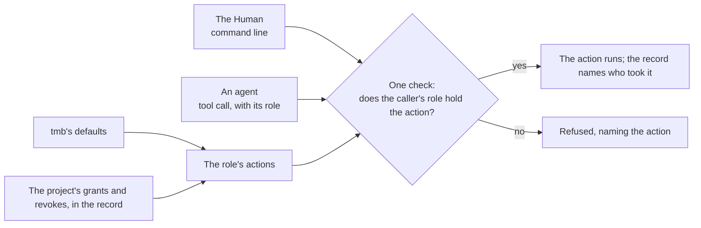

# Permissions

Who may take each action in a tmb project, and why. What each role is for is in [ROLES.md](ROLES.md).

## 1. Each role holds a set of actions, and nothing else

**Every action has a name, and each role holds a set of them. Sets overlap, and an action a role does not hold is denied.** A tool call and a command-line command ask the same check.

| Action | Does | Human | Planner | Worker | Reviewer |
|---|---|---|---|---|---|
| `tmb.uninstall` | Remove tmb from the machine. Planned (trustmybot/tmb#498) | ✓ | | | |
| `project.remove` | Remove tmb's wiring from a project, keep the record | ✓ | | | |
| `project.purge` | Remove the wiring and delete the record for good | ✓ | | | |
| `permissions.manage` | Grant or revoke a role's actions | ✓ | ✓ | | |
| `settings.review-mode` | Choose or change the review mode | ✓ | ✓ on the Human's ask | | |
| `feature.waive`, `task.waive` | Waive a review | ✓ | ✓ on the Human's ask | | |
| `role.create`, `role.delete` | Create a role, or delete one the project created | | ✓ | | |
| `settings.set`, `issue.*`, `feature.start`, `feature.update`, `feature.drop`, `feature.pr`, `task.start`, `task.drop`, `task.pr`, `graph.write`, `feedback.send` | Other settings, issues and notes, feature branches, start or drop a task, open a pull request, the code graph's knowledge, feedback to tmb | | ✓ | | |
| `task.close` | Close a task | | ✓ any task | ✓ its own | |
| `review.record` | Record a review verdict | | | | ✓ |
| `record.read`, `graph.read` | Read the record, a brief and the code graph | ✓ | ✓ | ✓ | ✓ |

- **Example 1.** A worker calls `task_start`. The worker does not hold `task.start`, so the call is refused, naming the action.
- **Example 2.** The reviewer reads a task's brief. Reading a brief is reading the record, which every role may do.
- **Edge case.** An agent names a role that is neither shipped nor created. It holds only what every role may: reading the record and the code graph.

## 2. The Human holds a narrow set

**The Human is a role, not a super-role. It holds only the steps that are the Human's call: remove, purge and uninstall, managing roles, the review mode and the waivers.** tmb keeps its demands on the Human's attention small, and the planner acts for the Human on everything else.

- **Example 1.** The Human types `tmb task waive T-3 --reason "typo fix"`. The Human holds `task.waive`, and the command runs once the Human types yes on the terminal ([ENGINE.md](ENGINE.md#ways-into-the-engine)).
- **Example 2.** The Human wants a new issue. They say so in the chat, and the planner records it. There is no command that writes an issue.
- **Edge case.** The Human wants the planner to stop opening pull requests. They run `tmb role revoke planner feature.pr`.

## 3. The planner takes the Human's steps only when asked

**The planner waives a review or sets the review mode only when the Human asked for it, in the Human's words.** tmb cannot tell the Human's ask from the planner's own decision, so the rule lives in the planner's prompt. Each waiver needs a reason, and the record names who waived.

- **Example 1.** Human: "That task only fixes a typo, waive its review." The planner waives it, with the Human's words as the reason.
- **Example 2.** The reviewer failed a branch, and the planner thinks the finding is wrong. It reports to the Human and waives nothing.
- **Edge case.** In an unattended run no one can ask, so the planner never sets or changes the review mode there ([ENGINE.md](ENGINE.md#unattended-mode)).

**The cost: review no longer gates the planner itself.** A planner that waives can open a pull request no reviewer passed. The record of who waived, and why, is what the Human has.

## 4. Roles are data

**A role is a row in the record, like a user in an access list. The planner creates a role with its prompt and its actions, changes its actions later, and deletes it.** Creating one gives the project a real agent of that name ([ROLES.md](ROLES.md#agents-a-project-creates)); deleting it takes the agent away.

- **Example 1.** The planner creates `designer` with the action `task.close`. A designer agent holds reading the record and the code graph, and closing a task, only.
- **Example 2.** The planner later grants `designer` the action `issue.note`, then deletes the role when the work is done. Its grants go with it, so a role made again under that name starts with none.
- **Example 3.** The Human runs `tmb role list`, then `tmb role grant worker task.drop` on a terminal and types yes. The worker may now drop its own task.
- **Edge case.** A role's actions are tmb's defaults, plus the project's grants, minus its revokes, and the newest change to one action wins. So an update that changes a default keeps the project's change.

## 5. What no one can change

**Three limits hold whatever the grants say.**

| Limit | Why |
|---|---|
| The Human's fixed steps, remove, purge and uninstall, are never granted | They are command-line steps with no tool, and they end tmb's work in a project |
| The roles tmb ships are never deleted | The workflow is built on them |
| The planner does not grant actions to its own role, nor one it does not hold | An agent would widen its own reach; the Human grants those with `tmb role grant` |

- **Example 1.** `tmb role grant planner project.purge` is refused: it is the Human's alone.
- **Example 2.** The planner asks to grant itself `review.record`. It is refused, and the message names the command the Human runs instead.
- **Edge case.** Reading, which every role may do, is never revoked, and the Human's own actions do not change.

## 6. Every close is signed

**The planner may close any task, and every close names who closed it. A planner's close of a worker's task carries a reason, kept as a note on the task's issue.** The close rule is in [3_TASKS.md](../flows/3_TASKS.md#who-closes-a-task).

- **Example 1.** A worker closes its own task. The record names the worker; nothing more is asked.
- **Example 2.** A worker's run ended before it closed. The planner closes the task with the reason, and the issue shows the planner's note.
- **Edge case.** The planner closes a worker's task with no reason. The close is refused and says to pass one.
