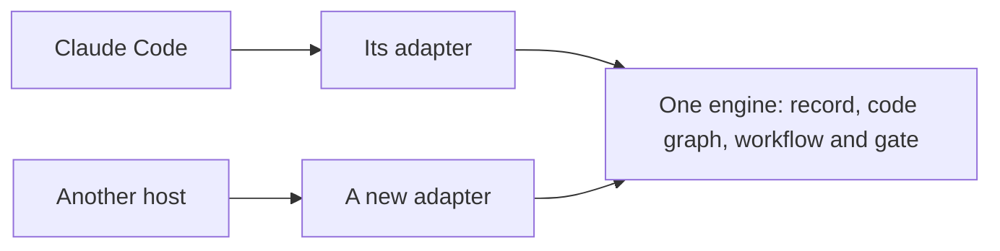
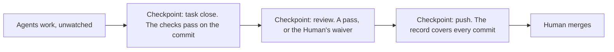

# Design philosophy

The principles behind how tmb is shaped. Each is the reason a design looks the way it does; the other pages here show how it is built. How tmb keeps its own design, relationships and logic apart is in the [README](README.md).

## 1. Ideas become goals, goals become tasks

Work starts as the Human's idea and reaches code only through two conversions, each recorded where the next actor will look.

- **Idea to goal.** The planner grounds the idea in past decisions and the code graph, then asks two questions before anything is built: is it actionable, and does something existing (a maintained package or a published capability) already cover it? An actionable idea becomes an issue: the goal. Its plan lives in the issue, and every later choice is recorded as a decision; when two decisions conflict, the newest wins.
- **Goal to tasks.** The planner splits the goal into tasks. Each task's spec is a contract: the intent, numbered success criteria, the files it may touch, and the checks that verify it. A spec too large for one worker run splits into linked tasks, so each run fits in one context.

Every later check is judged against these records, never against what someone remembers the Human meant.

## 2. Dev-vs-user-runtime boundary

tmb's docs, test harness and release scripts describe how this project is built: its test levels, its repository, its milestones and its release gates. None of it ships to a user's project.

The shipped runtime (the role prompts, the tools, the commands, the adapters and the dashboard) is about the user's project and is self-contained. It never refers to tmb's own development process, because a user has none of it and a prompt that cites it leaks meaningless internal context. When a shipped surface needs a rule tmb's docs also describe, it states the rule directly. For the same reason, a feature built for tmb's own needs must work in any user's project, reading that project's labels, milestones and repos from its data rather than assuming tmb's.

## 3. Cut entropy at handoffs

The trajectory exists to cut the context lost at each handoff: Human → planner → worker → reviewer → the next session, or the next host. Stability comes first, then efficiency.

Judge a proposed feature by one question: does it reduce loss at a handoff, or make a past decision re-findable? One discussion maps to one issue, so every decision is findable from the work it shaped.

## 4. One owner per check

Each layer owns one level of quality, and no layer repeats another's check; a repeated check costs tokens and blurs who answers for a miss.

- **The Human** owns intent.
- **The planner** owns the environment, the spec and the architecture. It judges whether the change fits the whole system, without re-running checks or re-reading the diff.
- **The worker** owns functionality. Before closing it reviews its own work: every criterion and edge case has a change behind it, nothing outside the task was touched on the way, the tests for what it touched pass, and its report answers every criterion with evidence. When the spec contradicts itself or a fact is missing, it stops and reports rather than guessing.
- **The reviewer** owns the diff. It reads it cold and probes what depends on it, and it is strict: a missed bug costs more than a rework.

The planner and the reviewer complement each other because they know different things. The planner holds the full picture, so it can judge whether a change fits the system, but it tends to read a line for what the line was meant to do. The reviewer starts with a fresh context and did not write the change, so it is more likely to catch a local bug that the planner would explain away.

## 5. Code enforces, prompts judge

What code can check, code checks; a prompt keeps only the calls that need judgment. A rule stated only in a prompt is a rule the model may skip.

Gates fail closed. A gate that cannot read the record denies, because a gate that blocks only what it foresaw lets through the rest. A rule is written as a refusal of the wrong step, or as a tool that does the right one, never as a hope that the agent will do it.

## 6. Remove cleanly

When a design is replaced, delete the old one outright. Code, prompts and docs describe only what is true now, with no notes about what used to be and no commented-out remnants. The reason for a removal lives in the commit message and PR description, where history belongs.

## 7. Memory is hot and cold

The record is the only source of truth. Context is a disposable cache of it: everything is written to the record as it happens, so context is never the only copy. That is what lets a new session, or another host, carry on. Every agent loads the smallest page it needs and ends at a task boundary. [MEMORY.md](./MEMORY.md) covers the tiers, what each costs, and how to tell which tier a fact belongs in.

## 8. Any host, through adapters

A harness built as a plugin serves one agent program, and nobody can build a plugin for every model. So tmb is one compiled program per platform, which also leaves room for a desktop program (Planned, trustmybot/tmb#79). The engine never names a host. Everything a host needs is in its adapter, and a new host is a new adapter with no change to the engine. [HOSTS.md](HOSTS.md) covers it.

- **The host runs the agents.** tmb starts no agent, runs no model and manages no parallel sessions. The work runs on the Human's own login to the host.
- **Roles are written once**, host-neutral. The adapter turns them into the host's format.
- **An adapter holds no rules.** One that grows a rule is a defect.
- **The same functions on every host.** tmb ships them as terminal commands and agent tools, not as host commands.

## 9. Gate the outcome, never babysit

A harness that watches every step is heavy. tmb checks only what is delivered, as CI does: the planner writes each task's spec, the agents work unwatched, and the checkpoints judge the result. There is no guard on each edit and no reading of shell commands.

tmb is not built into the agent. The host runs the agent's loop, and tmb stands at the points the host and git open to an outside program.

| tmb can | Through | How strong |
|---|---|---|
| **Guide** an agent | Text at session start and in the role prompts | Weak. An agent can ignore a prompt. |
| **Offer tools** | Its tool server and command line, over the record and the code graph | Strong for a step that has to go through tmb, because the rule is inside the tool. |
| **Refuse** an outcome | The checkpoints: task close, review, push | Strong. The engine or git enforces it, not the agent. |
| **Remember** | The record, kept outside any conversation | What lets a new session, or another host, carry on. |

| tmb cannot | So |
|---|---|
| Make an agent take an action | A rule is a refusal or a tool, never a hope. |
| See what the host does not show it | tmb records what it needs from what it gets. A host's limits are reported by its adapter. |
| Outlive a change in the host's events | The adapter is the one part that follows the host. |
| Stop the Human from switching it off | That is the Human's choice. tmb ships options, not enforcement against its own user. |
| See an agent's reasoning or steer the model in the middle of a turn | No design depends on it. |

- **A later checkpoint catches what an earlier one missed.** The close and the push check every change, whatever a host raised or failed to raise.
- **tmb runs when something calls it:** a session, a hook, git, the command line or the dashboard. There is no background program that could be left running, and nothing waits for a timer. Work that has to happen now and then is triggered by what already happens, such as a session start.

## 10. Git before a new wheel

Use git where git can do the job, and build nothing of tmb's own unless it is necessary. Hooks are for checkpoints, and git's own hooks come before a host's: the push gate is git's pre-push hook, so it holds on every host and for a push typed by hand.

- **git settles what git can settle.** Two tasks may change the same file with no lock of tmb's own: each has its branch and worktree, and the merge decides.
- **The engine does the git steps itself**: branches, worktrees, folds, pushes and pull requests. Agents ask through tmb's tools, so every step is recorded and no agent is trusted to follow a git procedure.
- **Reuse before building applies to tmb too.** tmb leaves to the host what the host does well, and builds no sandbox and no lane manager.
