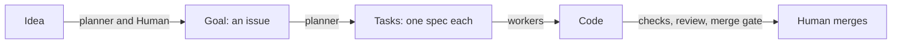
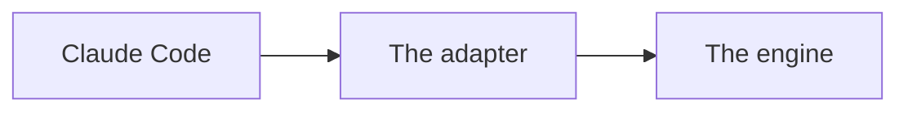
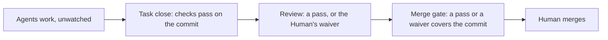

# Design principles

The ten principles behind tmb's design. Each has one rule and a few examples, from the easy case to an edge case.

## 1. Idea to goal, goal to tasks

**Idea to goal.** The planner helps the Human turn an idea into a goal that can be acted on. It reads the past decisions and the code graph first, then asks about what the idea leaves open. The goal is recorded as an issue.

- **Example 1.** Human: "Give our website a light and a dark theme." Planner: "Should it also follow the user's system setting?"
- **Example 2.** Human: "The website should default to the dark theme." Planner: "Our docs and code say the default is Auto. Should the new default apply to users who already chose one?"
- **Example 3.** Human: "Add a date picker." Planner: "The UI library we already use has one. Use it, or build our own?"
- **Edge case.** Human: "Make it faster." This is not actionable yet. Planner: "Which page, and how fast is fast enough?"

The planner looks at every idea from these angles and raises only the ones that matter for it:

| Angle | The question |
|---|---|
| Scope | What is in, and what is left out? |
| Cost | How much work, and how much to run and maintain? |
| Trade-off | What gets worse so that this gets better? |
| Conflict | Does it contradict a past decision, the docs or the code? |
| Reuse | Does a maintained package or an existing part already do it? |
| Who is affected | Which users, data or other parts change with it? |
| Risk | What can break, and can the change be undone? |
| Generality | Does it solve the general case, or special-case one input? (trustmybot/tmb#306) |
| Done | How will we know it works? |
| Priority | Why now, and before what? |

**Goal to tasks.** The planner splits the goal into tasks. Each task has a spec: the intent, numbered success criteria, the files it may touch and the checks that prove it.

- **Example 1.** The theme goal becomes three tasks: the colour tokens, the toggle, and saving the choice.
- **Edge case.** A spec too large for one worker run is split into linked tasks, so each run fits in one context.

**Decisions are recorded, and a conflict goes to the Human.** Every choice on an issue is recorded as a decision. Later checks are judged against the record, not against what someone remembers.

- **Example.** A new decision says "default to dark" and an earlier one says "default to Auto". The planner asks the Human; the answer is the decision in force.

**A confirmed architecture change reaches both ends.** It is written into the project's high-level design (its docs or wiki, where it has one), and the code graph picks up the code that follows ([CODE_GRAPH.md](CODE_GRAPH.md)).

## 2. Development and shipped runtime stay apart

tmb has two sides. Nothing from the first appears in the second.

| Side | What it is | For |
|---|---|---|
| Development | These docs, the test harness and the release scripts | People and agents developing tmb |
| Shipped runtime | The role prompts, tools, commands, adapters and dashboard | A user and the agents in the user's project |

- **Example 1.** A role prompt needs a rule these docs also state. The prompt states the rule itself. It does not cite the docs ([who reads these docs](../README.md#who-reads-these-docs)).
- **Example 2.** A feature built for tmb's own needs, such as issue labels, reads the labels from the project's data. It never assumes tmb's labels.
- **Edge case.** tmb is used to develop tmb. The planner reads these docs as that project's design docs, the same as in any user's project.

## 3. Lose nothing at a handoff

Context is lost at each handoff: Human → planner → worker → reviewer → the next session. The trajectory exists to cut that loss. Stability comes first, then efficiency.

- **Example 1.** A session ends in the middle of a task. The next session reads the record and carries on.
- **Example 2.** One discussion maps to one issue, so a decision can be found from the work it shaped.
- **Test for a new feature.** Does it cut loss at a handoff, or make a past decision findable? If neither, it does not belong.

## 4. One owner per check

Each role owns one level of quality. No role repeats another's check: a repeated check costs tokens and blurs who answers for a miss.

| Role | Owns | Example |
|---|---|---|
| Human | Intent | "Default to dark." |
| Planner | The environment, the spec and the architecture | Judges whether the change fits the whole system. It does not re-run checks or re-read the diff. |
| Worker | Functionality | Before closing, confirms every criterion has a change behind it, nothing outside the task was touched, and the tests pass. |
| Reviewer | The diff | Reads it cold and probes what depends on it. It is strict: a missed bug costs more than a rework. |

- **Edge case.** The spec contradicts itself or a fact is missing. The worker stops and reports. It does not guess.
- **Why planner and reviewer both.** The planner knows the whole picture but reads a line for what it was meant to do. The reviewer did not write the change, so it catches the local bug the planner would explain away.

## 5. Code enforces, prompts judge

What code can check, code checks. A prompt keeps only the calls that need judgment, because a model may skip a rule that lives only in a prompt.

- **Example 1.** "A task closes only when its checks pass" is a refusal inside the close tool, not a sentence in the worker's prompt.
- **Example 2.** "Does this change fit the architecture?" needs judgment, so it stays with the planner.
- **Edge case.** A gate cannot read the record. It denies. Gates fail closed.

## 6. Remove cleanly

When a design is replaced, the old one is deleted. Code, prompts and docs describe only what is true now.

- **Example.** A setting is renamed. Every page and prompt uses the new name. No "formerly", no commented-out code.
- **Where the reason goes.** The commit message and the pull request.

## 7. Memory is hot and cold

The record is the only source of truth. An agent's context is a disposable copy of part of it. Details are in [MEMORY.md](MEMORY.md).

- **Example 1.** Everything is written to the record as it happens, so a crashed session loses nothing.
- **Example 2.** An agent loads the smallest page it needs and ends at a task boundary.

## 8. The host, through one adapter

tmb is one compiled program, not a plugin of the agent program. The engine never names the host. Everything the host needs is in its adapter. Details are in [ADAPTERS.md](ADAPTERS.md).

- **Example 1.** Claude Code changes a file format. The adapter changes. The engine does not.
- **Example 2.** Roles are written once. The adapter turns them into Claude Code's format.
- **Example 3.** Every function is a terminal command or an agent tool.
- **Edge case.** An adapter grows a rule of its own. That is a defect: rules live in the engine.
- **What tmb leaves to the host.** Starting agents, running models and managing parallel sessions, on the Human's own login.
- **Host feature or tmb's own.** tmb uses the host's feature when it serves the outcome. Where the host's default works against the outcome, tmb corrects it: with a refusal or a tool when code can check it, with prompt text when only judgment can.
  - **Example 1.** The host can watch a pull request's checks. tmb adds no watcher of its own.
  - **Example 2.** A model tends to answer from memory. Code cannot check that, so the planner's prompt tells it to verify first.
  - **Example 3.** The host lets an agent close its own work. tmb's close tool refuses until the task's checks pass.
  - **Edge case.** The host adds a feature tmb already built. tmb's own is removed unless the record or a gate needs it.

## 9. Gate the outcome, never babysit

tmb checks what is delivered, as CI does. Agents work unwatched. There is no guard on each edit and no reading of shell commands.

| tmb can | Through | Strength |
|---|---|---|
| Guide an agent | Session-start text and role prompts | Weak: a prompt can be ignored |
| Offer tools | Its tool server and command line | Strong where a step must go through the tool |
| Refuse an outcome | Task close, review, pull request, a push to the base branch | Strong: the engine or git enforces it |
| Remember | The record | Lets a new session carry on |

- **Example 1.** A worker's change breaks a test. Nothing stops the edit. The close runs the task's checks on the commit and refuses it.
- **Example 2.** A host fails to raise an event. The merge gate still checks the commit: a later checkpoint catches what an earlier one missed.
- **Edge case.** The Human switches tmb off. That is the Human's choice. tmb does not enforce against its own user.
- **What tmb cannot do.** Make an agent act, see an agent's reasoning, or steer a model mid-turn. So a rule is a refusal or a tool, never a hope.
- **No background program.** tmb runs only when a session, a hook, git, the command line or the dashboard calls it. Periodic work is triggered by what already happens, such as a session start.

## 10. Git before a new wheel

Where git can do the job, tmb uses git. tmb builds nothing of its own unless it must.

- **Example 1.** The push gate on the base branch is git's pre-push hook, so it holds for an agent's push and for a push typed by hand.
- **Example 2.** Two tasks change the same file. There is no lock: each has its branch and worktree, and the merge decides.
- **Example 3.** The engine does the git steps itself (branches, worktrees, folds, pushes, pull requests). Agents ask through tmb's tools, so every step is recorded.
- **Edge case.** tmb needs a sandbox or a lane manager. The host does that well, so tmb builds neither.
