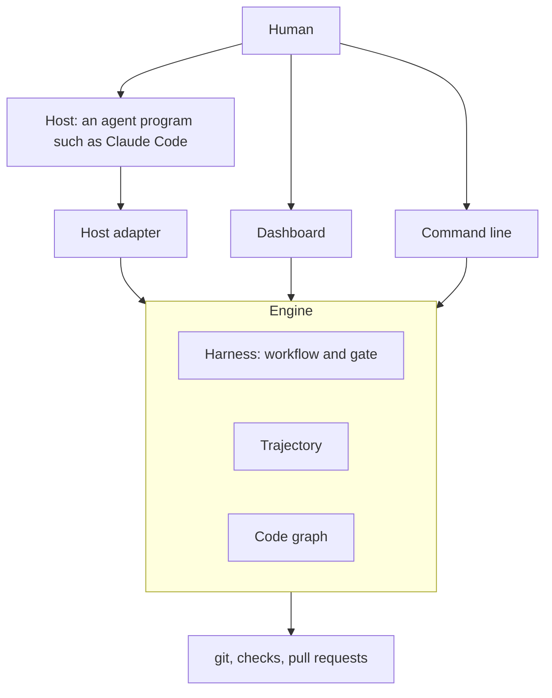

# Architecture

The design of tmb. These docs state what the engine does and why. They name no functions, files or tables: code relationships belong to the code graph, and logic belongs to the code.

Each doc states the design as decided. A rule that is decided but not built carries a "Planned" note. A rule the Human has not confirmed carries "Proposed, for the Human's review".

## The shape

- The **host** runs the agents: its main agent plans, and it starts the workers and the reviewer as its own subagents, under the Human's own login.
- The **engine** holds the three pillars. It briefs the agents, records what they do, and decides what is allowed.
- The **host adapter** is the only part that knows a host. Claude Code is first; another host is another adapter ([HOSTS.md](HOSTS.md)).

## Docs in this folder

| Doc | Answers |
|---|---|
| [HOSTS.md](HOSTS.md) | How does tmb work with Claude Code without being built for it, and how do several agents run? |
| [WORKFLOW.md](WORKFLOW.md) | What path does work take from request to merge, and what stops a wrong step? |
| [TRAJECTORY.md](TRAJECTORY.md) | What is recorded, and how is work resumed from it? |
| [CODE_GRAPH.md](CODE_GRAPH.md) | How is the code graph built and queried? |
| [DISTRIBUTION.md](DISTRIBUTION.md) | How is tmb packaged, installed and updated? |
| [GLOSSARY.md](GLOSSARY.md) | What does each word mean, and what did the plugin call it? |

## Decided

Decided by the Human on 2026-11-18.

| Topic | Decision |
|---|---|
| Form | A standalone program. It is not a plugin of any agent. |
| Language | TypeScript, shipped as one compiled file per platform. |
| Platforms | macOS, Windows and Linux. |
| Hosts | Claude Code first, in its command line and its desktop app. No host is hardcoded: each is an adapter, so another such as Codex can be added. |
| Login | The Human's subscription to the host. No API key is needed. |
| Roles | The host's main agent is the planner. Workers and the reviewer are subagents the host starts. The engine briefs, records and gates them. |
| Different models | Each role can use a different model. Agents from different vendors work on one task by connecting their hosts to the same record. Planned, after the first host. |
| Records | Shareable from the first schema: history is kept as events, every record names the role and host that made it, and ids never collide across machines. |
| What tmb does not do | Start agents, run models or manage parallel sessions. The host does. |
| Agents left out of version 1 | DeepSeek Harness, as host or as worker. |
| Network | The engine works with no internet access. Running fully offline with local models needs a host that supports them. |
| Install and updates | One-step install. Three channels: dev, rc and stable. Updates are pushed to each channel. |
| Version 1 scope | What the TMB plugin does today, without the features the plugin has dropped and without anything that exists only for Claude Code outside its adapter. |
| Review modes | Agile is the default and is built first. Truest is built last. |
| Dashboard | Version 1 serves it as a local web page. Version 2 is a desktop program with the dashboard built in. |
| License | Functional Source License 1.1 with Apache 2.0 as the future license. Free for any use, including inside a company, except a competing commercial product or service. |
| Plugin projects | A fresh start. A one-way migration tool carries a plugin project's records over. |

## Build order

The order serves one goal: tmb is used to build tmb as early as possible. Each step is a GitHub milestone, and its issues say which plugin code they reuse.

| Step | Delivers | After it |
|---|---|---|
| 0. Packaging test | One compiled file on three platforms that opens the database, parses code and answers a tool call. | The language decision is confirmed or reopened. |
| 1. First build | Engine, trajectory, the Claude Code adapter, agile mode, docs tasks written by the planner, workers on code tasks, checks at close. | tmb's own development moves onto tmb. |
| 2. Code graph | Indexing, lookups, and their use in scoping a task. | Tasks are scoped from the graph, not by reading files. |
| 3. Feature branch review | The reviewer, the review of a whole feature branch, the pre-push gate, the Human's waiver. | A milestone reaches the base branch reviewed. |
| 4. Dashboard | The local web page over the record. | The Human sees the work without asking an agent. |
| 5. Distribution | One-step install, three channels, pushed updates, the migration tool. | Others can install it. |
| 6. More hosts and vendors | A second host adapter, two hosts on one record, local models. | Mixed teams of agents. |
| 7. Truest mode | Review of every task before its push. | Version 1 is complete. |

## Reuse from the plugin

Most of the plugin's logic is host-neutral and carries over. What is tied to Claude Code is rebuilt as engine rules behind the adapter.

| Area | Verdict |
|---|---|
| Record store and its schema | Reuse, from a fresh first version with the dropped features' tables removed. |
| Workflow logic: issues, tasks, starting a task, close, review, feature branches, integrate | Reuse, called directly by the engine. |
| Code graph: parsing, symbols, graph, freshness, concepts | Reuse as is. |
| Search by meaning | Leave out at first: its model is the one part that needs a native module and a download. |
| Git's pre-push judge | Reuse as is. |
| Git and pull request helpers, issue sync | Reuse as is. |
| Dashboard, server and pages | Reuse, reading the engine's database. |
| Guards written as Claude Code hooks | Rebuild: the rules move into the engine, the adapter only translates events. |
| Shell command analysis for guards | Decide at step 3. |
| Role prompts and skills | Rewrite once, host-neutral. |
| Workflow tests that drive the tools end to end | Port as the engine's contract tests. |
| Roundtable, cheatcodes, lanes, headless shim, sandbox setup | Drop. |

## Open

- How much of the plugin's guard set the first build needs, beyond checks at close.
- Which second host comes first.
