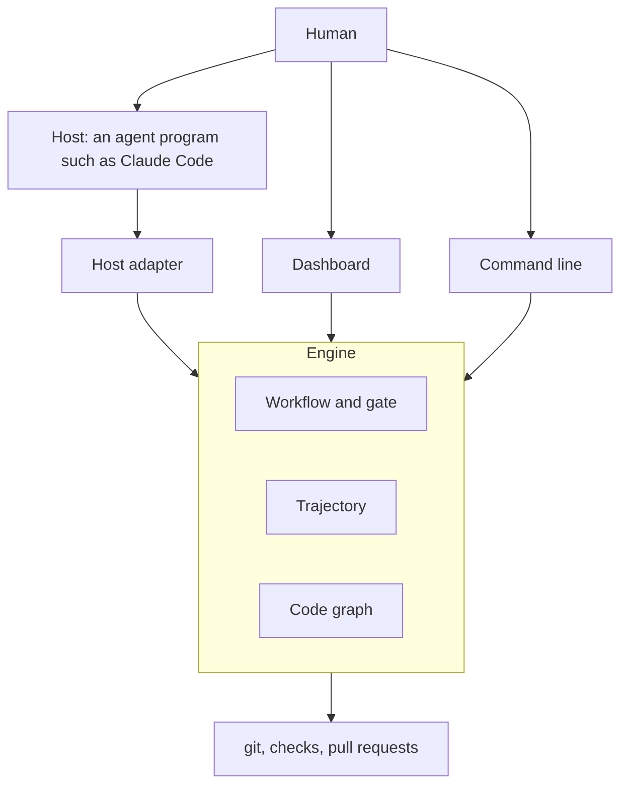

# Architecture

tmb's design of record: how tmb is shaped and why. Read it to understand a part of tmb before you change it, or to check that a change still fits the design.

A rule that is decided but not built carries **Planned**. A rule the Human has not settled carries **Open, for the Human**.

## Two kinds of page

| Kind | Pages | For |
|---|---|---|
| **High-level design** | This page, [PHILOSOPHY.md](PHILOSOPHY.md), [FLOWS.md](FLOWS.md), [RESPONSIBILITIES.md](RESPONSIBILITIES.md) | What tmb is and how work flows. Short, one chart per flow. The Human reviews these. |
| **Low-level design** | Every other page | The detail under a high-level flow: every other case, failures, and how to debug them. For building and debugging tmb. |

- A detail page follows the high-level pages. Where they disagree, the high-level page wins and the detail page is fixed.
- **No schedule here.** Versions, milestones and the state of the work live on the GitHub board and in the record. These pages hold the design only, so they do not go stale when work moves.

## The shape

tmb is a harness around the agents a host runs. It is one compiled program per platform, not a plugin of any agent program.

- The **host** runs the agents under the Human's own login: its main agent is the planner, and it starts the workers and the reviewer as its own subagents.
- The **engine** briefs the agents, records what they do, and gates the outcome.
- The **host adapter** is the only part that knows a host ([HOSTS.md](HOSTS.md)).

## Three layers of knowledge

tmb's own repo keeps each fact in exactly one of three layers, at the level of detail that layer holds best:

- **High-level design: these docs.** Components, boundaries, flows, invariants and the reasons behind them. They name no functions, files, tables or tool parameters, so a refactor does not make them stale.
- **Mid-level relationships: the code graph.** What lives where and what depends on what, derived from the code so it cannot drift from it. [WORLD_MODEL.md](WORLD_MODEL.md) covers it.
- **Low-level logic: the code.** How a step is done, in self-explaining names and tests.

A fact belongs in the lowest layer that can hold it. A rule that a check can enforce goes in code. A relationship that the code graph can derive goes in the code graph. Only the design and its reasons stay here. When a page here starts naming symbols, the detail has drifted into the wrong layer: move it down, don't copy it. Two exceptions: a generated page guarded by a freshness test, such as [ERD.md](ERD.md) and [CONFIG_KEYS.md](CONFIG_KEYS.md); and the install and debugging sections of a detail page, which may name what a user types or sees (commands, settings, environment variables, messages and file locations), never internal functions or tables.

This rule is how tmb develops itself. It comes from our experience of design and code drifting apart, not from research evidence that it prevents that drift. In a user's project, tmb provides the bottom two layers: the code graph and the code.

## Reading guide

New to tmb? Read in this order:

1. [PHILOSOPHY.md](PHILOSOPHY.md) — why tmb is built the way it is.
2. [FLOWS.md](FLOWS.md) — the starting point for every flow: what happens, one ideal-case chart each, and a link to its detail page.
3. [HOSTS.md](HOSTS.md) — how tmb works with any host through an adapter.
4. [RESPONSIBILITIES.md](RESPONSIBILITIES.md) — who does each step.
5. [TASKS.md](TASKS.md) — every case of a code task and a docs task from ask to merge, who owns each quality check, and why a task gets stuck.
6. [MEMORY.md](MEMORY.md) and [WORLD_MODEL.md](WORLD_MODEL.md) — what agents remember and how they find their way around a project.
7. [GIT.md](GIT.md) — where the work sits at every stage of a task.
8. [EXTENDING.md](EXTENDING.md) — how a project adds agents, skills and cheatcodes.

Looking for one answer instead?

| Question | Read |
|---|---|
| Why does tmb do X at all? | [PHILOSOPHY.md](PHILOSOPHY.md) |
| What happens when the Human asks for Y? | [FLOWS.md](FLOWS.md) |
| How does tmb work with a host such as Claude Code without being built for it? | [HOSTS.md](HOSTS.md) |
| How is tmb installed and updated, and what do I check when it is missing or degraded? | [INSTALL.md](INSTALL.md) |
| What does first contact ask, and what does it record? | [ONBOARD.md](ONBOARD.md) |
| How does the planner learn a repo's checks? | [ONBOARD.md](ONBOARD.md#the-repos-checks) |
| Who owns which quality check? | [TASKS.md](TASKS.md#quality-layers) |
| Why is my task stuck? | [TASKS.md](TASKS.md) |
| What is recorded, and how is work resumed from it? | [TRAJECTORY.md](TRAJECTORY.md) |
| What does agile review mode skip, and when is the skipped review done? | [AGILE.md](AGILE.md) |
| How does a project gain an agent, a skill or a second opinion? | [EXTENDING.md](EXTENDING.md) |
| How are issues labelled, and how do I find what waits on me? | [ISSUES.md](ISSUES.md) |
| Which agent may do Z? | [RESPONSIBILITIES.md](RESPONSIBILITIES.md) |
| What does an agent see at the start of a turn? | [MEMORY.md](MEMORY.md) |
| How does the planner know where code lives? | [WORLD_MODEL.md](WORLD_MODEL.md) |
| How do several sessions work in parallel? | [RESPONSIBILITIES.md](RESPONSIBILITIES.md#parallel-lanes) |
| Which branch is the work on, and which repo? | [GIT.md](GIT.md) |
| May tmb write to this path? | [HOSTS.md](HOSTS.md#containment) |
| How will the planner add a published skill? | [EXTENDING.md](EXTENDING.md#cheatcodes) |
| What does the record store? | [ERD.md](ERD.md) |
| Which project settings exist? | [CONFIG_KEYS.md](CONFIG_KEYS.md) |
| What do I type? | The [reference](../reference/README.md) |
| What does a word mean? | [Glossary](#glossary) |
| Where does function X live? | Not here: ask the code graph |

## Index

- [PHILOSOPHY.md](PHILOSOPHY.md) — The principles behind the design: how an idea becomes tasks, the dev-vs-user-runtime boundary, one owner per quality check, code over prompts for enforcement, clean removal, hot and cold memory, any host, gating the outcome, and git before a new wheel.
- [FLOWS.md](FLOWS.md) — The starting point for every flow: the index of all flows from install to bug reports, and one ideal-case chart each linking to its detail page.
- [HOSTS.md](HOSTS.md) — How tmb works with an agent program without being built for one: the engine, the adapter, what each host can and cannot do, containment (what tmb writes and where, and how its gates fail), and several hosts on one record.
- [INSTALL.md](INSTALL.md) — Install, channels, updates and session start in every case, and what to check when tmb is missing or degraded.
- [ONBOARD.md](ONBOARD.md) — First contact: the settings, who sets each, and how a re-run keeps what still stands.
- [TASKS.md](TASKS.md) — Every case of a task from ask to merge: the code task and the docs task with each step's owner, the push gate both share, retry and escalation, PR comment triage, the quality-layer rules, and debugging a stuck task.
- [TRAJECTORY.md](TRAJECTORY.md) — The record: what is kept of sessions, agent runs and checks, and how a hang or a dead run is found from it.
- [AGILE.md](AGILE.md) — The review modes: where the mode is set, the long-lived feature branch agile tasks fold into without a per-task review, the one review of that branch, the gate on its one PR into the base branch, and how a mode switch treats tasks already started.
- [ISSUES.md](ISSUES.md) — The groups of issue labels, the rules for each, and how a project makes the scheme its own.
- [EXTENDING.md](EXTENDING.md) — How a project gains agents, skills and consultants, and what each path refuses.
- [RESPONSIBILITIES.md](RESPONSIBILITIES.md) — What each shipped role is for, what it may and may not do, and why the roles are split this way.
- [MEMORY.md](MEMORY.md) — The memory model every agent follows: cold storage in the record, hot session context, and pinned prompts, with the cost of each tier.
- [WORLD_MODEL.md](WORLD_MODEL.md) — The code graph the planner reasons from: its purpose, its boundaries, and why it is a derived cache rebuilt by indexing.
- [GIT.md](GIT.md) — Where each actor's git state lives at every stage of a task, and how a multi-repo workspace resolves each operation to its repo.
- [ERD.md](ERD.md) — The record's schema as an entity relationship diagram. Generated from the schema.
- [CONFIG_KEYS.md](CONFIG_KEYS.md) — Every project setting tmb reads, with its default and what it changes. Generated from the code.
- [The reference](../reference/README.md) — What a user types: install, channels, setup, every command, and the steps only the Human may take.
- [tests/README.md](../../tests/README.md) — How tmb is tested.

## Decisions

| Topic | Decision |
|---|---|
| Form | A standalone program. It is not a plugin of any agent. |
| Language | TypeScript, shipped as one compiled file per platform. Nothing else, Node included, has to be installed first. |
| Platforms | macOS, Windows and Linux. |
| Hosts | Claude Code, in its command line and its desktop app. No host is hardcoded: each is an adapter. |
| Login | The Human's subscription to the host. No API key is needed. |
| Roles | The host's main agent is the planner. Workers and the reviewer are subagents the host starts. The engine briefs, records and gates them. |
| Role prompts | Written once, host-neutral. The adapter turns them into each host's format. |
| Commands | Every function is a `tmb ...` terminal command or an agent tool, the same on every host. |
| Gate | tmb gates the outcome at task close, review and push. It puts no guard on each edit. |
| Different models | Each role can use a different model. Agents from different vendors work on one task by connecting their hosts to the same record. |
| Records | Shareable from the first schema: history is kept as events, every record names the role and host that made it, and ids never collide across machines. |
| What tmb does not do | Start agents, run models, manage parallel sessions or set up a sandbox. The host does. |
| Network | The engine works with no internet access. Running fully offline with local models needs a host that supports them. |
| Install and updates | One-step install. Three channels: dev, rc and stable. Updates are pushed to each channel. |
| Review modes | Agile and truest, a mode per repo. Agile is recommended; the Human chooses. |
| Search | Ranked word search plus the code graph. No embedding model. Agent search comes first: a skill teaches the planner to search with several word queries and follow the graph (Planned). Embeddings only if measured misses are real. |
| Dashboard | A local web page that reads the engine's record. A desktop program with the dashboard built in is Planned (trustmybot/tmb#79). |
| Remote | GitHub only. |
| Sync with the remote | Planned (trustmybot/tmb#70). It brings pull request comments into the record and syncs issues both ways; issues that exist only on GitHub are not all copied in. |
| Created agents | Planned. An agent a project creates is recorded and harnessed like the worker and the reviewer ([EXTENDING.md](EXTENDING.md)). |
| License | Functional Source License 1.1 with Apache 2.0 as the future license. Free for any use, including inside a company, except a competing commercial product or service. |
| Plugin projects | A fresh start. A one-way migration tool carries a plugin project's records over. |

## Glossary

The words tmb uses. tmb prefers the name a developer already knows. The product name is lowercase: tmb.

| Word | Meaning |
|---|---|
| The Human | The developer tmb works for. |
| Host | An agent program, such as Claude Code, that runs the agents. |
| Harness | tmb as a whole: the record, the code graph, and the workflow with the gate that enforces it, around the agents a host runs. It is not the program that runs the model; that is the host. |
| Engine | tmb without its adapters: the record, the code graph, the workflow and the gate. |
| Host adapter | The one part of tmb that knows a host: its file formats, its events and its limits. |
| Gate | What stops a step that the workflow does not allow. |
| Planner | The role that plans, writes the spec and talks to the Human: the host's main agent. It is addressed as bro in conversation. |
| Worker | The role that carries out one task, of any kind. |
| Reviewer | The role that judges a diff and records a verdict. It edits nothing. |
| Trajectory | The record of the work. The term is used in agent research for the sequence of an agent's steps. |
| Code graph | The index of a project's files, its symbols and the links between them. |
| Index (`tmb index`) | Building the code graph. |
| Concept | An agent-written note in the code graph, anchored to code. |
| Area | A logical part of a project, such as login or billing: a named group of files in the code graph, written by the planner. "tests" is built in. |
| Init (`tmb init`) | Preparing a project folder for tmb. It asks nothing. |
| Onboard (`tmb onboard`) | Setting tmb's settings for a project. The planner also onboards a project by itself at the first session with empty settings. |
| Workspace | A project folder that is no git repo and holds several repos sharing one record. |
| Issue | One goal of the Human's, with the discussion and decisions that shaped it. |
| Task | One change that one agent can finish in one run, with its spec. |
| Docs task | A task that changes only docs or prompts. The planner writes it. |
| Start a task | The engine cuts the task's branch and worktree, so a worker can be started on it. |
| Milestone | A group of issues the Human wants to judge as a whole. |
| Base branch | The branch a pull request merges into. |
| Feature branch | A long-lived branch that collects a milestone's tasks. |
| Agile mode | One review per feature branch. |
| Truest mode | A review of every task before its push. |
| In review | A truest task whose checks passed and whose review has not passed yet. |
| Lane | One of several sessions working in a project at once, with the work it took. tmb keeps no lane record ([RESPONSIBILITIES.md](RESPONSIBILITIES.md#parallel-lanes)). |
| Skill | Planned. Guidance tmb ships for a role, loaded on demand. |
| Cheatcode | Planned (trustmybot/tmb#112). A published skill, tool server or host plugin that the planner finds, vets and installs after the Human's yes. A skill is given to a role once, for every host in that role. |
