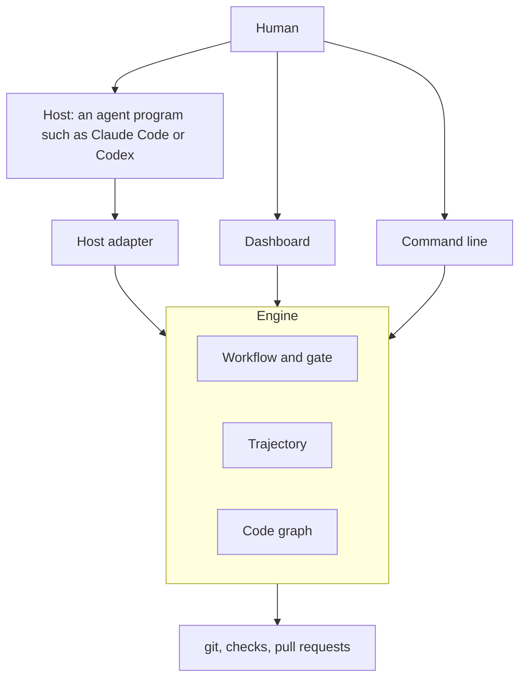

# Architecture

tmb's design of record: how tmb is shaped and why. Read it to understand a part of tmb before you change it, or to check that a change still fits the design.

A rule that is decided but not built carries **Planned**. A rule the Human has not settled carries **Open, for the Human**.

## The shape

tmb is a harness around the agents a host runs. It is one compiled program per platform, not a plugin of any agent program.

- The **host** runs the agents under the Human's own login: its main agent is the planner, and it starts the workers and the reviewer as its own subagents.
- The **engine** briefs the agents, records what they do, and gates the outcome.
- The **host adapter** is the only part that knows a host ([HOSTS.md](HOSTS.md)).

## Three layers of knowledge

tmb's own repo keeps each fact in exactly one of three layers, at the level of detail that layer holds best:

- **High-level design: these docs.** Components, boundaries, flows, invariants and the reasons behind them. They name no functions, files, tables or tool parameters, so a refactor does not make them stale.
- **Mid-level relationships: the code graph.** What lives where and what depends on what, derived from the code so it cannot drift from it. [WORLD_MODEL.md](WORLD_MODEL.md) covers it.
- **Low-level logic: the code.** How a step is done, in self-explaining names and tests.

A fact belongs in the lowest layer that can hold it. A rule that a check can enforce goes in code. A relationship that the code graph can derive goes in the code graph. Only the design and its reasons stay here. When a page here starts naming symbols, the detail has drifted into the wrong layer: move it down, don't copy it. Two exceptions: a generated page guarded by a freshness test, such as [ERD.md](ERD.md) and [CONFIG_KEYS.md](CONFIG_KEYS.md); and the install and debugging sections of a detail page, which may name what a user types or sees (commands, settings, environment variables, messages and file locations), never internal functions or tables.

This rule is how tmb develops itself. It comes from our experience of design and code drifting apart, not from research evidence that it prevents that drift, and users cannot opt in to it yet. In a user's project, tmb provides the bottom two layers: the code graph and the code.

## Reading guide

New to tmb? Read in this order:

1. [PHILOSOPHY.md](PHILOSOPHY.md) — why tmb is built the way it is.
2. [FLOWS.md](FLOWS.md) — the starting point for every flow: what happens, one ideal-case chart each, and a link to its detail page.
3. [HOSTS.md](HOSTS.md) — how tmb works with any host through an adapter.
4. [RESPONSIBILITIES.md](RESPONSIBILITIES.md) — who does each step.
5. [TASKS.md](TASKS.md) — every case of a code task and a docs task from ask to merge, who owns each quality check, and why a task gets stuck.
6. [MEMORY.md](MEMORY.md) and [WORLD_MODEL.md](WORLD_MODEL.md) — what agents remember and how they find their way around a project.
7. [GIT.md](GIT.md) — where the work sits at every stage of a task.
8. [CONTAINMENT.md](CONTAINMENT.md), [CHEATCODES.md](CHEATCODES.md) and [EXTENDING.md](EXTENDING.md) — the safety boundary, and how tmb extends itself inside it.

Looking for one answer instead?

| Question | Read |
|---|---|
| Why does tmb do X at all? | [PHILOSOPHY.md](PHILOSOPHY.md) |
| What happens when the Human asks for Y? | [FLOWS.md](FLOWS.md) |
| How does tmb work with Claude Code or Codex without being built for either? | [HOSTS.md](HOSTS.md) |
| How is tmb installed and updated, and what do I check when it is missing or degraded? | [INSTALL.md](INSTALL.md) |
| What does first contact ask, and what does it record? | [ONBOARD.md](ONBOARD.md) |
| How does the planner learn a repo's checks? | [ENVIRONMENT.md](ENVIRONMENT.md) |
| Who owns which quality check? | [TASKS.md](TASKS.md#quality-layers) |
| Why is my task stuck? | [TASKS.md](TASKS.md) |
| What is recorded, and how is work resumed from it? | [TRAJECTORY.md](TRAJECTORY.md) |
| What does agile review mode skip, and when is the skipped review done? | [AGILE.md](AGILE.md) |
| How does a project gain an agent, a skill or a second opinion? | [EXTENDING.md](EXTENDING.md) |
| How are issues labelled, and how do I find what waits on me? | [ISSUES.md](ISSUES.md) |
| Which agent may do Z? | [RESPONSIBILITIES.md](RESPONSIBILITIES.md) |
| What does an agent see at the start of a turn? | [MEMORY.md](MEMORY.md) |
| How does the planner know where code lives? | [WORLD_MODEL.md](WORLD_MODEL.md) |
| How do several sessions work in parallel? | [LANES.md](LANES.md) |
| Which branch is the work on, and which repo? | [GIT.md](GIT.md) |
| May tmb write to this path? | [CONTAINMENT.md](CONTAINMENT.md) |
| How will the planner add a published skill? | [CHEATCODES.md](CHEATCODES.md) |
| What does the record store? | [ERD.md](ERD.md) |
| Which project settings exist? | [CONFIG_KEYS.md](CONFIG_KEYS.md) |
| What do I type? | The [reference](../reference/README.md) |
| What does a word mean, and what did the plugin call it? | [Glossary](#glossary) |
| Where does function X live? | Not here: ask the code graph |

## Index

- [PHILOSOPHY.md](PHILOSOPHY.md) — The principles behind the design: how an idea becomes tasks, the dev-vs-user-runtime boundary, one owner per quality check, code over prompts for enforcement, clean removal, hot and cold memory, any host, gating the outcome, and git before a new wheel.
- [FLOWS.md](FLOWS.md) — The starting point for every flow: the index of all flows from install to bug reports, and one ideal-case chart each linking to its detail page.
- [HOSTS.md](HOSTS.md) — How tmb works with an agent program without being built for one: the engine, the adapter, what each host can and cannot do, and several hosts on one record.
- [INSTALL.md](INSTALL.md) — Install, channels, updates and session start in every case, and what to check when tmb is missing or degraded.
- [ONBOARD.md](ONBOARD.md) — First contact: the settings, who sets each, and how a re-run keeps what still stands.
- [ENVIRONMENT.md](ENVIRONMENT.md) — How the planner learns a repo's checks, with the repo as the source of truth.
- [TASKS.md](TASKS.md) — Every case of a task from ask to merge: the code task and the docs task with each step's owner, the push gate both share, retry and escalation, PR comment triage, the quality-layer rules, and debugging a stuck task.
- [TRAJECTORY.md](TRAJECTORY.md) — The record: what is kept of sessions, agent runs and checks, and how a hang or a dead run is found from it.
- [LANES.md](LANES.md) — Flow 3.8: parallel sessions are the host's; tmb keeps no lane record, and the planner's prompt and tools help it run them.
- [AGILE.md](AGILE.md) — The review modes: where the mode is set, the long-lived feature branch agile tasks fold into without a per-task review, the one review of that branch, the gate on its one PR into the base branch, and how a mode switch treats tasks already started.
- [ISSUES.md](ISSUES.md) — The groups of issue labels, the rules for each, and how a project makes the scheme its own.
- [EXTENDING.md](EXTENDING.md) — How a project gains agents, skills and consultants, and what each path refuses.
- [RESPONSIBILITIES.md](RESPONSIBILITIES.md) — What each shipped role is for, what it may and may not do, and why the roles are split this way.
- [MEMORY.md](MEMORY.md) — The memory model every agent follows: cold storage in the record, hot session context, and pinned prompts, with the cost of each tier.
- [WORLD_MODEL.md](WORLD_MODEL.md) — The code graph the planner reasons from: its purpose, its boundaries, and why it is a derived cache rebuilt by indexing.
- [GIT.md](GIT.md) — Where each actor's git state lives at every stage of a task, and how a multi-repo workspace resolves each operation to its repo.
- [CONTAINMENT.md](CONTAINMENT.md) — tmb's promise to write nothing outside the project it runs in, the layers that keep it, and the few declared exceptions.
- [CHEATCODES.md](CHEATCODES.md) — Planned: how a published skill is given to a role once, for every host in that role, and the trust and approval gates on the way.
- [ERD.md](ERD.md) — The record's schema as an entity relationship diagram. Generated from the schema.
- [CONFIG_KEYS.md](CONFIG_KEYS.md) — Every project setting tmb reads, with its default and what it changes. Generated from the code.
- [The reference](../reference/README.md) — What a user types: install, channels, setup, every command, and the steps only the Human may take.
- [tests/README.md](../../tests/README.md) — How tmb is tested, and which tests each level of the build order adds.

## Decisions

| Topic | Decision |
|---|---|
| Form | A standalone program. It is not a plugin of any agent. |
| Language | TypeScript, shipped as one compiled file per platform. Nothing else, Node included, has to be installed first. |
| Platforms | macOS, Windows and Linux. |
| Hosts | Claude Code first, in its command line and its desktop app. No host is hardcoded: each is an adapter, as Codex is. |
| Login | The Human's subscription to the host. No API key is needed. |
| Roles | The host's main agent is the planner. Workers and the reviewer are subagents the host starts. The engine briefs, records and gates them. |
| Different models | Each role can use a different model. Agents from different vendors work on one task by connecting their hosts to the same record. Built at level 9, and supported from v2. |
| Records | Shareable from the first schema: history is kept as events, every record names the role and host that made it, and ids never collide across machines. |
| What tmb does not do | Start agents, run models or manage parallel sessions. The host does. |
| Agents left out of version 1 | DeepSeek Harness, as host or as worker. |
| Network | The engine works with no internet access. Running fully offline with local models needs a host that supports them. |
| Install and updates | One-step install. Three channels: dev, rc and stable. Updates are pushed to each channel. |
| Review modes | Agile and truest, a mode per repo. Agile is recommended and was built first; the Human chooses. |
| Search | Ranked word search plus the code graph. No embedding model. Agent search comes first: a skill will teach the planner to search with several word queries and follow the graph (planned). Embeddings only if measured misses are real. |
| Dashboard | Version 1 serves it as a local web page. A desktop program with the dashboard built in is planned (trustmybot/tmb#79). |
| License | Functional Source License 1.1 with Apache 2.0 as the future license. Free for any use, including inside a company, except a competing commercial product or service. |
| Plugin projects | A fresh start. A one-way migration tool carries a plugin project's records over. |

## Versions

Each version is a GitHub milestone.

| Version | Delivers | Holds |
|---|---|---|
| v1 | A complete tmb on Claude Code, with the dashboard as a local web page. | Levels 0 to 8 and level 10 of the build order. |
| v1.x | A record that stays true when several sessions work on one project, and when work moves on the remote. | Planned: which session made each entry, a freeze for all sessions, a check of open tasks at session start, and a sync that brings what happened on the remote into the record, pull request comments and issues included (trustmybot/tmb#70). Also install through a package manager, which is built but not supported before v1.x. |
| v2 | Mixed agents on one task, such as Claude as the planner, Codex as the reviewer and a local model as a worker. A desktop program to watch the work live. | Planned: level 9 as a supported feature, the desktop program (trustmybot/tmb#79), and cheatcodes (trustmybot/tmb#112; which version is open, for the Human). |
| v3 | Undecided: managing agents from the desktop. | It would make tmb the program that starts hosts, which tmb does not do today. |

- v1 supports one host, Claude Code. Mixed agents are built but not supported and not tested in v1; tmb says that another host is not supported yet.
- v1 supports one way to install: tmb's own installer and updater.
- The desktop program of v2 only watches. It reads the record, so tmb still starts no agent.
- tmb works with GitHub only.
- Not yet placed in a version, all planned: tmb's own skills, and the rest of retry and escalation (trustmybot/tmb#165).

## Build order

tmb is built in levels, from easy to hard. Each level unlocks one ability and ends in something the Human can try in a minute.

| Level | Unlocks | The Human sees it when |
|---|---|---|
| 0. Wake up | Download, install and cold start, with the smallest setup: one session start event. | Claude Code, opened in a project, answers as bro. |
| 1. Memory | The trajectory record, the project's database and tmb's tools. | Bro records an issue and a new session picks it up. |
| 2. Setup | Full setup with its questions, and the complete Claude Code adapter. | One command sets up a fresh project and another undoes it. |
| 3. Workers | Tasks, worktrees, workers as subagents, checks at close. | Bro hands a code task to a worker and it closes only when its checks pass. |
| 4. Agile mode | Feature branches, docs tasks written by the planner, contract tests. | A feature branch collects several tasks. |
| 5. Code graph | Indexing, lookups, and their use in scoping a task. | Bro scopes a task from the graph, not by reading files. |
| 6. Review and gate | The reviewer, the review of a whole feature branch, the pre-push gate, the Human's waiver. | A reviewer passes the branch and a wrong push is refused. |
| 7. Dashboard | The local web page over the record. | The work shows in a browser without asking an agent. |
| 8. Distribution | Three channels, pushed updates, the migration tool. | An install updates itself and a plugin project's records carry over. |
| 9. More hosts | A second host adapter, two hosts on one record, local models. | A second host reviews work on the same record. |
| 10. Truest mode | Review of every task before its push. | A task cannot be pushed unreviewed. |

- A level is done only when its tests pass with no manual step. The last column is one of those tests ([tests/README.md](../../tests/README.md)).
- After level 4, tmb's own development moves onto tmb.
- Enforcement arrives in steps: the planner is guided by its prompt alone until level 3 brings checks at close, and level 6 brings the push gate.
- The packaging test runs at level 0: one compiled file that runs on all three platforms with no network. A failure reopens the language decision.

## Reuse from the plugin

tmb ships almost the same as the plugin. Most of the plugin's logic is host-neutral and carries over. What was tied to Claude Code is rebuilt behind the adapter, and what watched each step is replaced by checks at checkpoints.

| Area | Verdict |
|---|---|
| Record store and its schema | Reuse, from a fresh first version with the dropped features' tables removed. |
| Workflow logic: issues, tasks, starting a task, close, review, feature branches, integrate | Reuse, called directly by the engine. |
| Code graph: parsing, symbols, graph, freshness, concepts | Reuse as is. |
| Git's pre-push judge | Reuse as is. |
| Git and pull request helpers | Reuse as is. |
| Dashboard, server and pages | Reuse, reading the engine's database. |
| Workflow tests that drive the tools end to end | Port as the engine's contract tests. |
| Host slash commands: onboard, scan, dashboard | Rebuild as `tmb ...` terminal commands and agent tools. |
| Role prompts | Rewrite once, host-neutral; the adapter turns them into each host's format. |
| Guards on each edit and shell-command analysis | Not carried over. tmb gates the outcome at task close, review and push. |
| Search by meaning | Not carried over: no embedding model. Ranked word search plus the code graph. |
| Skills | Planned. tmb ships its own, loaded on demand. |
| Retry and escalation | Partly built; the rest planned (trustmybot/tmb#165). |
| Pull request comment triage, issue sync | Planned, inside the sync with the remote (trustmybot/tmb#70). Which version: open, for the Human. The issue sync runs both ways; issues that exist only on GitHub are not all copied in. |
| Cheatcodes | Planned (trustmybot/tmb#112). Which version: open, for the Human. |
| Desktop program | Planned (trustmybot/tmb#79). The plugin could not have one. |
| Consultants, agent creation | Open, for the Human. |
| Lanes | Not managed by tmb. The planner's prompt and tools help it run parallel sessions. |
| Roundtable, sandbox setup | Not carried over. |

## Glossary

The words tmb uses, and the plugin's word for the same thing. tmb prefers the name a developer already knows. The product name is lowercase: tmb.

### Renamed

| tmb | Plugin | Why |
|---|---|---|
| Code graph | World model | The common name for an index of symbols and their links. |
| Index (`tmb index`) | Scan | What building a code graph is usually called. |
| Init (`tmb init`) | The first half of onboard | The word git, npm and cargo use for preparing a folder. It asks nothing. |
| Onboard (`tmb onboard`) | Onboard | Kept, for tmb's settings only. The planner also onboards a project by itself at the first session with empty settings. |
| Planner | bro, as a role | Says what the role does. bro stays as the planner's name in conversation. |
| Worker | swe | Says what the role does, for any kind of task. |
| Reviewer | code-reviewer | Shorter. |
| Docs task | No-code task | Says what it is. |
| Base branch | Working branch, PR target | The name git hosts use for the branch a pull request merges into. |
| Start a task | Provision a task | Plain. |
| Host | Claude Code | tmb is not tied to one agent program. |

### Kept

| Word | Meaning |
|---|---|
| Trajectory | The record of the work. The term is used in agent research for the sequence of an agent's steps. |
| Agile mode | One review per feature branch. |
| Truest mode | A review of every task before its push. |
| In review | A truest task whose checks passed and whose review has not passed yet. |
| Feature branch | A long-lived branch that collects a milestone's tasks. |
| Issue | One goal of the Human's, with the discussion and decisions that shaped it. |
| Task | One change that one agent can finish in one run, with its spec. |
| Milestone | A group of issues the Human wants to judge as a whole. |
| Harness | tmb as a whole: the record, the code graph, and the workflow with the gate that enforces it, around the agents a host runs. It is not the program that runs the model; that is the host. |
| Engine | tmb without its adapters: the record, the code graph, the workflow and the gate. |
| Host adapter | The one part of tmb that knows a host: its file formats, its events and its limits. |
| Gate | What stops a step that the workflow does not allow. |
| Concept | An agent-written note in the code graph, anchored to code. |
| Area | A logical part of a project, such as login or billing: a named group of files in the code graph, written by the planner. "tests" is built in. |
| Workspace | A project folder that is no git repo and holds several repos sharing one record. |
| The Human | The developer tmb works for. |

### Not carried over

- **Roundtable.**
- **Sandbox setup.** tmb builds none.
- **Lane, as a record.** tmb does not manage lanes. The planner's prompt and tools help it run parallel sessions ([LANES.md](LANES.md)).

### Planned

| Word | Meaning |
|---|---|
| Cheatcode | Planned (trustmybot/tmb#112). In the plugin, a published skill, tool server or plugin that bro found, vetted and installed for one agent after the Human's yes. In tmb the name stays and the scope grows: a skill is given to a role once, for every host in that role. |
| Skill | Planned. Guidance tmb ships for a role, loaded on demand. |
