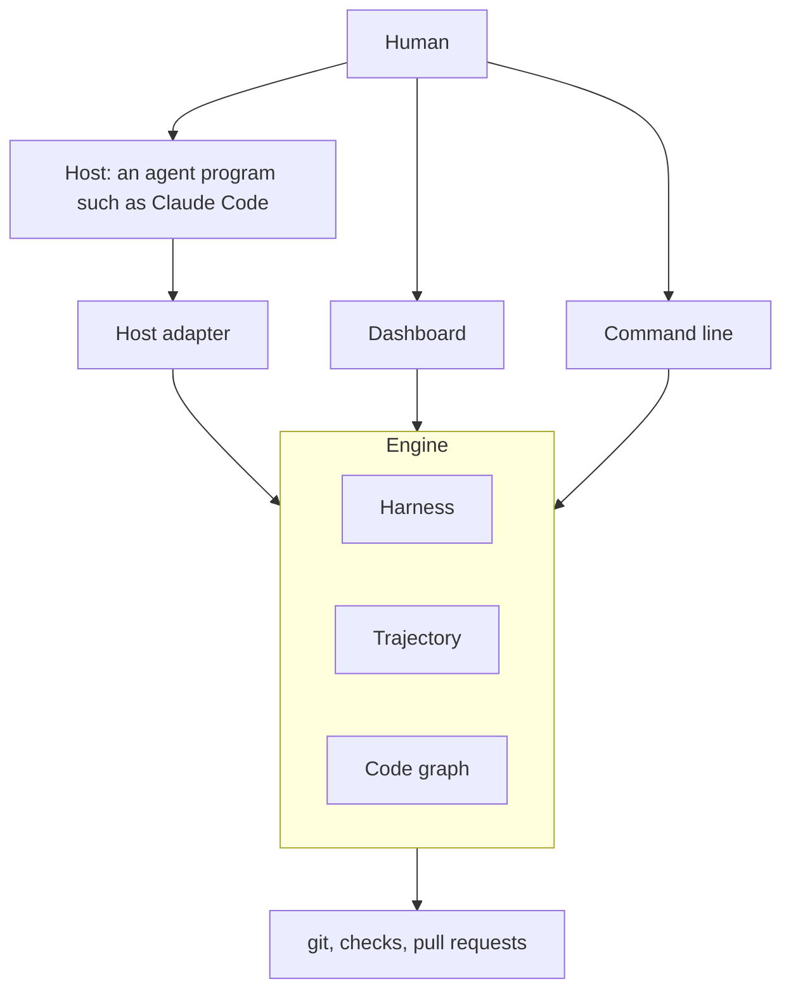

# Architecture

tmb's design of record: how tmb is shaped and why. Read it to understand a part of tmb before you change it, or to check that a change still fits the design.

A rule that is decided but not built carries **Planned**. A rule the Human has not settled carries **Open, for the Human**.

## Two kinds of page

| Kind | Pages | For |
|---|---|---|
| **High-level design** | This page, [PHILOSOPHY.md](PHILOSOPHY.md), [RESPONSIBILITIES.md](RESPONSIBILITIES.md) | What tmb is and who does what. Short and chart-first. The Human reviews these. |
| **Low-level design** | Every other page | The detail under a high-level page: every other case, failures, and how to debug them. For building and debugging tmb. |

- **Two folders.** `docs/architecture/` holds the design in space: the parts, what each owns and how they connect. [`docs/flows/`](../flows/README.md) holds the design in time: the steps tmb takes.
- **The docs are the ground truth, and nothing overrules them silently.** When two pages disagree, or code, a spec or an issue disagrees with a page, the question goes to the Human. No side wins by rank. After the Human's answer both sides are changed to agree. The rule covers every folder of these docs ([docs/README.md](../README.md#when-two-things-disagree)).
- **No schedule here.** Versions, milestones and the state of the work live on the GitHub board and in the record. These pages hold the design only, so they do not go stale when work moves.

## The shape

tmb harnesses the agents a host runs. It is one compiled program per platform, not a plugin of any agent program.

- The **host** runs the agents under the Human's own login. Its main agent is the planner, and every other agent is a subagent the host starts: tmb's worker and reviewer, and any agent the project adds.
- The **engine** holds three parts. The **harness** is the workflow and the gate that enforces it: it briefs the agents and gates the outcome. The **trajectory** records what they do. The **code graph** maps the code.
- The **host adapter** is the only part that knows a host ([HOSTS.md](HOSTS.md)).

## Three layers of knowledge

tmb keeps each fact in exactly one of three layers, at the level of detail that layer holds best:

- **High-level design: these docs.** Components, boundaries, flows, invariants and the reasons behind them. They name no functions, files, tables or tool parameters, so a refactor does not make them stale.
- **Mid-level relationships: the code graph.** What lives where and what depends on what, derived from the code so it cannot drift from it.
- **Low-level logic: the code.** How a step is done, in self-explaining names and tests.

A fact belongs in the lowest layer that can hold it. A rule that a check can enforce goes in code. A relationship that the code graph can derive goes in the code graph. Only the design and its reasons stay here. When a page here starts naming symbols, the detail has drifted into the wrong layer: move it down, don't copy it. Two exceptions: a generated page guarded by a freshness test, such as [ERD.md](ERD.md) and [CONFIG_KEYS.md](CONFIG_KEYS.md); and the install and debugging sections of a detail page, which may name what a user types or sees (commands, settings, environment variables, messages and file locations), never internal functions or tables.

This rule comes from our experience of design and code drifting apart, not from research evidence that it prevents that drift.

**In a user's project** tmb offers the same three layers. The code graph and the code are always there. The top layer depends on where the project keeps its design, so onboarding asks. Planned (trustmybot/tmb#302):

| The project | Onboarding asks | The design is kept |
|---|---|---|
| Has code and design docs | Where the high-level design is | Where it is: a folder in the repo, or a link outside it such as a wiki |
| Has code and no design docs | Where to keep the design | In a folder in the repo, or in the record |
| Is empty | Where to keep the design | In a folder in the repo, or in the record |

A project that wants no docs in its code keeps the design in the record, and the planner reads and writes it there.

## Reading guide

New to tmb? Read in this order:

1. [PHILOSOPHY.md](PHILOSOPHY.md) — why tmb is built the way it is.
2. [RESPONSIBILITIES.md](RESPONSIBILITIES.md) — who does each step.
3. [HOSTS.md](HOSTS.md) — how tmb works with any host through an adapter.
4. [MEMORY.md](MEMORY.md) and [TRAJECTORY.md](TRAJECTORY.md) — what agents remember and what is recorded.

What happens step by step is in [the flows folder](../flows/README.md), with its own reading guide.

| Question | Read |
|---|---|
| Why does tmb do X at all? | [PHILOSOPHY.md](PHILOSOPHY.md) |
| Which agent may do Z? | [RESPONSIBILITIES.md](RESPONSIBILITIES.md) |
| How do several sessions work in parallel? | [RESPONSIBILITIES.md](RESPONSIBILITIES.md#parallel-lanes) |
| How does tmb work with a host such as Claude Code without being built for it? | [HOSTS.md](HOSTS.md) |
| May tmb write to this path? | [HOSTS.md](HOSTS.md#containment) |
| What does an agent see at the start of a turn? | [MEMORY.md](MEMORY.md) |
| What is recorded, and how is work resumed from it? | [TRAJECTORY.md](TRAJECTORY.md) |
| What does the record store? | [ERD.md](ERD.md) |
| How are issues labelled, and how do I find what waits on me? | [ISSUES.md](ISSUES.md) |
| Which project settings exist? | [CONFIG_KEYS.md](CONFIG_KEYS.md) |
| What happens when the Human asks for Y? | [The flows folder](../flows/README.md) |
| What do I type? | [The reference](../reference/README.md) |
| Where does function X live? | Not here: ask the code graph |

## Index

- [PHILOSOPHY.md](PHILOSOPHY.md) — The principles behind the design: how an idea becomes tasks, the dev-vs-user-runtime boundary, one owner per quality check, code over prompts for enforcement, clean removal, hot and cold memory, any host, gating the outcome, and git before a new wheel.
- [RESPONSIBILITIES.md](RESPONSIBILITIES.md) — What each shipped role is for, what it may and may not do, and why the roles are split this way.
- [HOSTS.md](HOSTS.md) — How tmb works with an agent program without being built for one: the engine, the adapter, what each host can and cannot do, containment (what tmb writes and where, and how its gates fail), and several hosts on one record.
- [MEMORY.md](MEMORY.md) — The memory model every agent follows: cold storage in the record, hot session context, and pinned prompts, with the cost of each tier.
- [TRAJECTORY.md](TRAJECTORY.md) — The record: what is kept of sessions, agent runs and checks, and how a hang or a dead run is found from it.
- [ISSUES.md](ISSUES.md) — The groups of issue labels, the rules for each, and how a project makes the scheme its own.
- [ERD.md](ERD.md) — The record's schema as an entity relationship diagram. Generated from the schema.
- [CONFIG_KEYS.md](CONFIG_KEYS.md) — Every project setting tmb reads, with its default and what it changes. Generated from the code.

## Decisions

The decisions about tmb's parts. The first column names the page that holds the detail; "This page" means no other page does. Decisions about the steps are in [the flows folder](../flows/README.md#decisions).

| From | Topic | Decision |
|---|---|---|
| [PHILOSOPHY](PHILOSOPHY.md) | Form | A standalone program. It is not a plugin of any agent. |
| This page | Language | TypeScript, shipped as one compiled file per platform. Nothing else, Node included, has to be installed first. |
| [PHILOSOPHY](PHILOSOPHY.md) | Gate | tmb gates the outcome at task close, review and push. It puts no guard on each edit. |
| [RESPONSIBILITIES](RESPONSIBILITIES.md) | Roles | The host's main agent is the planner. The worker, the reviewer and any agent a project adds are subagents the host starts. The engine briefs, records and gates them. |
| [HOSTS](HOSTS.md) | Hosts | Claude Code, in its command line and its desktop app. No host is hardcoded: each is an adapter. |
| [HOSTS](HOSTS.md) | Login | The Human's subscription to the host. No API key is needed. |
| [HOSTS](HOSTS.md) | Role prompts | Written once, host-neutral. The adapter turns them into each host's format. |
| [HOSTS](HOSTS.md) | Commands | Every function is a `tmb ...` terminal command or an agent tool, the same on every host. |
| [HOSTS](HOSTS.md) | Different models | Each role can use a different model. Agents from different vendors work on one task by connecting their hosts to the same record. |
| [HOSTS](HOSTS.md) | What tmb does not do | Start agents, run models, manage parallel sessions or set up a sandbox. The host does. |
| [TRAJECTORY](TRAJECTORY.md) | Records | Shareable from the first schema: history is kept as events, every record names the role and host that made it, and ids never collide across machines. |
| [MEMORY](MEMORY.md) | Search | Ranked word search plus the code graph. No embedding model. Agent search comes first: a skill teaches the planner to search with several word queries and follow the graph (Planned). Embeddings only if measured misses are real. |
| This page | Network | The engine works with no internet access. Running fully offline with local models needs a host that supports them. |
| This page | Dashboard | A local web page that reads the engine's record. A desktop program with the dashboard built in is Planned (trustmybot/tmb#79). |
| This page | Remote | GitHub only. |
| This page | License | Functional Source License 1.1 with Apache 2.0 as the future license. Free for any use, including inside a company, except a competing commercial product or service. |

## Glossary

The words for tmb's parts. tmb prefers the name a developer already knows. The product name is lowercase: tmb. The first column names the page a word comes from. The words for the steps are in [the flows glossary](../flows/README.md#glossary).

| From | Word | Meaning |
|---|---|---|
| This page | Harness | The workflow and the gate that enforces it, inside the engine. It briefs the agents and gates the outcome. It is not the program that runs the model; that is the host. |
| This page | Engine | tmb without its adapters: the harness, the trajectory and the code graph. |
| [PHILOSOPHY](PHILOSOPHY.md) | Gate | What stops a step that the workflow does not allow. |
| [RESPONSIBILITIES](RESPONSIBILITIES.md) | The Human | The developer tmb works for. |
| [RESPONSIBILITIES](RESPONSIBILITIES.md) | Planner | The role that plans, writes the spec and talks to the Human: the host's main agent. It is addressed as bro in conversation. |
| [RESPONSIBILITIES](RESPONSIBILITIES.md) | Worker | The role that carries out one task, of any kind. |
| [RESPONSIBILITIES](RESPONSIBILITIES.md) | Reviewer | The role that judges a diff and records a verdict. It edits nothing. |
| [RESPONSIBILITIES](RESPONSIBILITIES.md) | Lane | One of several sessions working in a project at once, with the work it took. tmb keeps no lane record. |
| [HOSTS](HOSTS.md) | Host | An agent program, such as Claude Code, that runs the agents. |
| [HOSTS](HOSTS.md) | Host adapter | The one part of tmb that knows a host: its file formats, its events and its limits. |
| [TRAJECTORY](TRAJECTORY.md) | Trajectory | The record of the work. The term is used in agent research for the sequence of an agent's steps. |
| [ISSUES](ISSUES.md) | Issue | One goal of the Human's, with the discussion and decisions that shaped it. |
| [ISSUES](ISSUES.md) | Milestone | A group of issues the Human wants to judge as a whole. |
