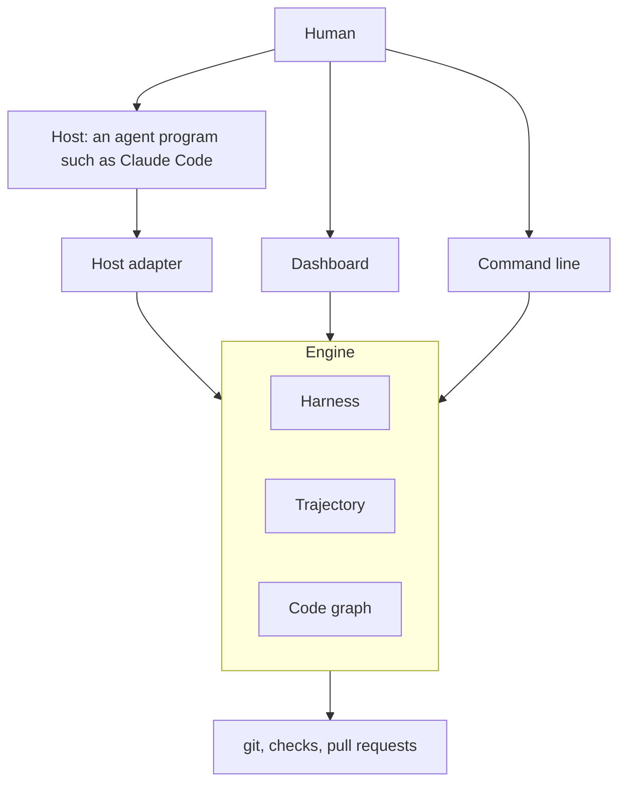

# Architecture

tmb's design of record: how tmb is shaped and why. Read it before you change a part of tmb, or to check that a change still fits the design.

A rule that is decided but not built carries **Planned**. A rule the Human has not settled carries **Open, for the Human**.

## The shape

tmb harnesses the agents a host runs. It is one compiled program per platform, not a plugin of any agent program.

| Part | What it does |
|---|---|
| **Host** | Runs the agents under the Human's own login. Its main agent is the planner. Every other agent is a subagent the host starts: tmb's worker and reviewer, and any agent the project adds. |
| **Host adapter** | The only part that knows a host ([ADAPTERS.md](ADAPTERS.md)). |
| **Engine** | Holds the three parts below. |
| Harness | The workflow and the gate that enforces it. It briefs the agents and gates the outcome. |
| Trajectory | Records what the agents do. |
| Code graph | Maps the code. |

## Three layers of knowledge

tmb keeps each fact in exactly one of three layers: the lowest layer that can hold it.

| Layer | Kept in | Holds |
|---|---|---|
| High-level design | These docs | Components, boundaries, flows, invariants and the reasons behind them. They name no functions, files, tables or tool parameters, so a refactor does not make them stale. |
| Mid-level relationships | The code graph | What lives where and what depends on what, derived from the code so it cannot drift from it. |
| Low-level logic | The code | How a step is done, in self-explaining names and tests. |

- **Example.** A rule that a check can enforce goes in code. A relationship that the code graph can derive goes in the code graph. Only the design and its reasons stay in these docs.
- **Edge case.** A page here starts naming symbols. The detail has drifted into the wrong layer: move it down, do not copy it.
- **Exception 1.** A generated page guarded by a freshness test: the schema tables in [TRAJECTORY_SCHEMA.md](TRAJECTORY_SCHEMA.md) and [CODE_GRAPH_DETAILS.md](CODE_GRAPH_DETAILS.md), and the keys in [CONFIG.md](CONFIG.md#keys).
- **Exception 2.** The install and debugging sections of a detail page may name what a user types or sees: commands, settings, environment variables, messages and file locations. They never name internal functions or tables.
- **Where the rule comes from.** Our experience of design and code drifting apart, not research evidence that it prevents that drift.

**In a user's project** tmb offers the same three layers. The code graph and the code are always there. Where the top layer is kept, onboarding asks: Planned (trustmybot/tmb#302), in [2_ONBOARD.md](../flows/2_ONBOARD.md#steps).

- **Edge case.** A project wants no docs in its code. It keeps the design in the record, and the planner reads and writes it there.

## Two kinds of page

| Kind | Pages | For |
|---|---|---|
| **High-level design** | This page, [PRINCIPLES.md](PRINCIPLES.md), [ROLES.md](ROLES.md) | What tmb is and who does what. Short and chart-first. The Human reviews these. |
| **Low-level design** | Every other page | The detail under a high-level page: every other case, failures, and how to debug them. For building and debugging tmb. |

- **Two folders.** `docs/architecture/` holds the design in space: the parts, what each owns and how they connect. [`docs/flows/`](../flows/README.md) holds the design in time: the steps tmb takes.
- **The docs are the ground truth.** A disagreement goes to the Human ([docs/README.md](../README.md#when-two-things-disagree)).
- **No schedule here.** Versions, milestones and the state of the work live on the GitHub board and in the record.

## Reading guide

New to tmb? Read in this order:

1. [PRINCIPLES.md](PRINCIPLES.md) — why tmb is built the way it is.
2. [ROLES.md](ROLES.md) — what each role is for, what it may do, and how several sessions work in parallel.
3. [ADAPTERS.md](ADAPTERS.md) — how tmb works with a host without being built for it.
4. [ENGINE.md](ENGINE.md) — how the engine is reached, where it judges, and what tmb writes and where.
5. [MEMORY.md](MEMORY.md) — what an agent loads, keeps and writes back, and what each costs.
6. [TRAJECTORY.md](TRAJECTORY.md) — what is recorded, and how work is resumed from it. Its tables are in [TRAJECTORY_SCHEMA.md](TRAJECTORY_SCHEMA.md).
7. [CODE_GRAPH.md](CODE_GRAPH.md) — the map of the code the planner reasons from. Its cases and tables are in [CODE_GRAPH_DETAILS.md](CODE_GRAPH_DETAILS.md).
8. [ISSUES.md](ISSUES.md) — an issue's fields and labels.
9. [CONFIG.md](CONFIG.md) — every setting, where it lives and who may set it.

| Question | Read |
|---|---|
| What happens when the Human asks for Y? | [The flows folder](../flows/README.md), with its own reading guide |
| What do I type? | [The reference](../reference/README.md) |
| Where does function X live? | Not here: ask the code graph |

## Decisions

Each page holds the decisions about its own part. This table holds the ones no other page does. Decisions about the steps are in [the flows folder](../flows/README.md#decisions).

| Topic | Decision |
|---|---|
| Language | TypeScript, shipped as one compiled file per platform. Nothing else, Node included, has to be installed first. |
| Network | The engine works with no internet access. Running fully offline with local models needs a host that supports them. |
| Remote | GitHub only. |
| License | Functional Source License 1.1 with Apache 2.0 as the future license. Free for any use, including inside a company, except a competing commercial product or service. |

## Glossary

The words for tmb's parts. tmb prefers the name a developer already knows. The product name is lowercase: tmb. The first column names the page a word comes from. The words for the steps are in [the flows glossary](../flows/README.md#glossary).

| From | Word | Meaning |
|---|---|---|
| This page | Harness | The workflow and the gate that enforces it, inside the engine. It briefs the agents and gates the outcome. It is not the program that runs the model; that is the host. |
| This page | Engine | tmb without its adapters: the harness, the trajectory and the code graph. |
| [PRINCIPLES](PRINCIPLES.md) | Gate | What stops a step that the workflow does not allow. |
| [ENGINE](ENGINE.md) | Checkpoint | A point where the engine judges an outcome: an agent's start, a task's close, the review, a push. |
| [ROLES](ROLES.md) | The Human | The developer tmb works for. |
| [ROLES](ROLES.md) | Planner | The role that plans, writes the spec and talks to the Human: the host's main agent. It is addressed as bro in conversation. |
| [ROLES](ROLES.md) | Worker | The role that carries out one task, of any kind. |
| [ROLES](ROLES.md) | Reviewer | The role that judges a diff and records a verdict. It edits nothing. |
| [ROLES](ROLES.md) | Lane | One of several sessions working in a project at once, with the work it took. tmb keeps no lane record. |
| [ADAPTERS](ADAPTERS.md) | Host | An agent program, such as Claude Code, that runs the agents. |
| [ADAPTERS](ADAPTERS.md) | Host adapter | The one part of tmb that knows a host: its file formats, its events and its limits. |
| [TRAJECTORY](TRAJECTORY.md) | Trajectory | The record of the work. The term is used in agent research for the sequence of an agent's steps. |
| [CODE_GRAPH](CODE_GRAPH.md) | Code graph | The index of a project's files, its symbols and the links between them. |
| [CODE_GRAPH](CODE_GRAPH.md) | Area | One component of a project, such as login or billing, mapped to its files: the design in space. A named group of files, written by the planner. "tests" is built in. |
| [CODE_GRAPH](CODE_GRAPH.md) | Concept | One flow or rule of the design, mapped to the code that carries it out: the design in time. An ordered list of anchors to functions or files, written by an agent. It may cross areas. |
| [ISSUES](ISSUES.md) | Issue | One goal of the Human's, with the discussion and decisions that shaped it. |
| [ISSUES](ISSUES.md) | Milestone | A group of issues the Human wants to judge as a whole. |
