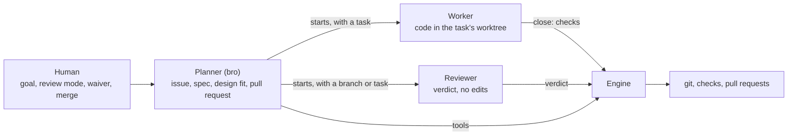
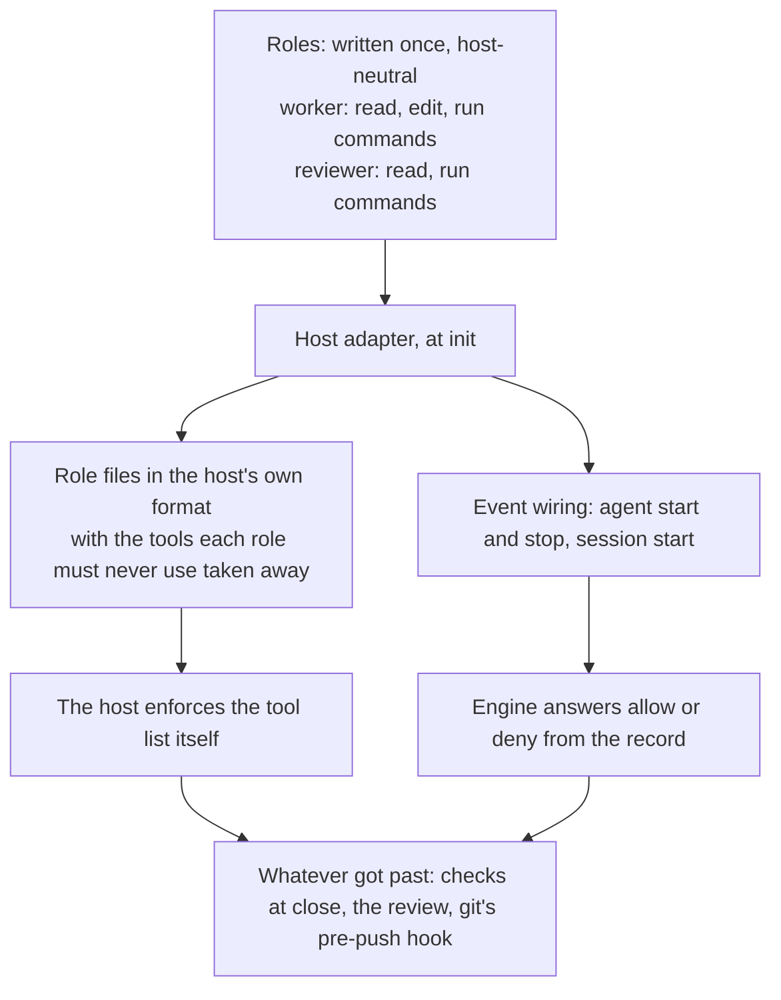
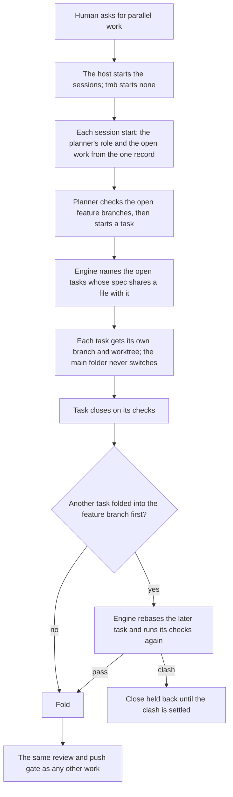

# Agent responsibilities

What each tmb role is for, what it may and may not do, and why the roles are split this way. Each role's prompt sits in its own role file, written once in a host-neutral form. The engine's role checks sit in the code. Ask the code graph for either.

| Role | Who | Owns | Why it exists |
|---|---|---|---|
| Human | The developer | Intent | Sets the goal and the review mode, waives a review, and merges. |
| Planner, addressed as bro | The host's main agent | The spec and design fit | Holds the full picture: the system design and alignment with the Human. It does everything except coding, is the only agent that talks to the Human, and owns the plan, the spec and the design call. |
| Worker | A subagent the host starts | Functionality | Codes. |
| Reviewer | A subagent the host starts, or a second host set up as the reviewer | The diff | An independent third party before the push, with no edit tools. Its verdict, or a Human waiver, is the only thing the push gate accepts. |

## Why three roles

Two things decide the split: what each role can be trusted to do without approving its own work, and which role keeps working when something unexpected happens.

The worker is split from the planner for three reasons:

1. **Token cost.** Coding in the planner would fill its strategic context with diff noise.
2. **No self-homework.** The engine runs the spec's checks on the worker's commit at close. The agent that writes the code does not sign it off.
3. **Subagents are fragile.** A worker runs with a fresh context, and its run can end at any point. The plan, the spec and the pull request stay with the planner, the most resilient layer.

Each layer owns one level of quality, and no layer repeats another's check. [3_TASKS.md](../flows/3_TASKS.md#quality-layers) shows how the layers hand off.

## Which agents a project has

- **Workflow backbone, always available.** Init writes the worker and the reviewer into the project in the host's own format. Removal deletes exactly those files.
- **Edge case.** A role file of the same name is not tmb's. tmb leaves it alone: it replaces only role files it wrote.
- **The host starts them.** tmb starts no agent, runs no model and never reads a login. The work runs as ordinary use of the host by its own user ([HOSTS.md](HOSTS.md)).
- **Identity and context.** A role's file is its identity. The start prompt is the task context. Skills as added capabilities are Planned.
- **Agents the project creates.** Planned: recorded and harnessed like the worker and the reviewer ([Agents a project creates](#agents-a-project-creates)).

## Planner (bro)

The planner's persona is not a role file. The engine gives it to the host's main agent at every session start, with the rules and the open work from the record. In an unattended run the engine puts one instruction first: apply your defaults and name each one.

| The planner | Rule |
|---|---|
| **Plans and routes** | Records the goal as an issue, scopes the work from the code graph, names the feature branch, writes the task spec, and asks the engine to start the task. |
| **Judges, re-checks nothing** | After the review passes it judges only whether the change fits the design, and whether the files changed outside the spec should have been touched. It runs no check again and reviews no diff again. |
| **Asks for the pull request** | Reads the verdict from the record, never from reply text, and asks the engine to push and open the pull request. It never pushes or opens one by hand. |
| **Writes only docs tasks** | A change to docs or prompts that changes no behaviour is a docs task. The planner writes it itself, in that task's worktree ([3_TASKS.md](../flows/3_TASKS.md#32-non-code-task)). |
| **Keeps the code graph's knowledge** | Records the flows and rules that span files, and proposes the project's areas to the Human. Only the planner writes or removes an area. |
| **Talks to the Human** | Only the planner asks the Human questions and reports to them. It raises main-folder changes as a report and never puts a file back itself. |
| **Never takes the Human's steps** | Setting the review mode, waiving a review and removing tmb are the Human's alone. The planner stores the Human's answer and never picks one. |
| **Runs parallel sessions** | With its prompt and tools ([Parallel lanes](#parallel-lanes)). |

- **Edge case.** A docs task's commit touches a file that is not a docs type. Nothing stops the edit on the way. The close refuses the task. The reviewer sees a docs task with the rest.

## Worker

| The worker | Rule |
|---|---|
| **Is started for one open task** | The gate denies a start whose prompt names no open task with a ready worktree. The worker reads its brief first. |
| **Works in the worktree only** | It edits, tests and commits on the task branch, never in the main folder. |
| **Keeps to the spec, and says when it could not** | When the work needs a file outside the spec, it changes the file and names it in its report. The close names every such file for the planner or the reviewer to check. |
| **Closes with the checks** | It runs the brief's checks, commits, and asks the engine to close. A refused close names what failed. The worker fixes it and closes again. |
| **Reports against every success criterion** | With the command or output that shows it, what it did not verify, and what the planner must decide. |
| **Stops and reports instead of guessing** | On a contradictory spec, a missing fact, or three failed attempts at one approach. |
| **Hands back** | Planned: when the work will not fit its turns, it commits a checkpoint so the next run resumes. |

- **Edge case.** The host gives each worker a folder of its own. The engine adopts that folder as the task's worktree when the worker first reads its brief.
- **Edge case.** The gate denies an action. That is a hard stop on that action: the worker reaches that effect no other way.

## Reviewer

| The reviewer | Rule |
|---|---|
| **Agile: once per feature branch** | Tasks close and fold without a verdict of their own, code and docs alike. The reviewer judges the whole branch at its tip before its pull request opens ([3_WORKFLOW.md](../flows/3_WORKFLOW.md)). |
| **Truest: once per task** | On the task's commit, before that task's pull request opens. |
| **Judges what the diff breaks** | A success criterion, a caller or reader of the changed code, a security property, a stated performance budget. Style, naming and design fit are the planner's call, not findings. |
| **Reviews from the record and its own probes** | It reads the branch's and each task's brief, asks the code graph what calls or reads each changed thing, and probes with read-only commands. |
| **Signs off with a recorded verdict** | Pass or fail on the exact commit. Each finding is marked blocking, not blocking, or already there. |
| **Never edits files** | It also never pushes and never opens a pull request. Planned (trustmybot/tmb#303): a verdict is taken only when git shows the tree unchanged since the reviewer's run started. |

- **Edge case.** A verdict needs the reviewer run the host started.
- **Edge case.** A verdict on a tip that has moved is not taken.

## How roles are enforced

The host keeps each role in bounds, through files the adapter writes. tmb has no hook that checks a caller's role on every tool call.

- **A role file takes away only what the role must never use.** The reviewer is given no tool that edits a file. The worker loses nothing. Every other tool, a project's own included, stays.
- **The adapter holds no rules.** It turns the neutral role into the host's format, and a host event into the engine's question. An adapter that grows a rule is a defect.
- **The engine's tools check the role too.** The Human may always call.

| Tool call | Role that may make it |
|---|---|
| Start a feature branch or a task, drop one, ask for a pull request, change a setting | Planner |
| Record a verdict | Reviewer |
| Close a task | Worker or planner |

- **The role is the one the caller gives.** A subagent passes its own role. The main agent defaults to the role its host was set up in: the planner, unless init or onboarding named another.
- **Edge case.** tmb cannot prove which agent called. So a verdict also needs an open reviewer run on that host.
- **The reviewer edits nothing, on any host.** Its role file gives it no tool that edits a file, and tmb watches no file write. The Planned git check (trustmybot/tmb#303, under [Reviewer](#reviewer)) covers a write from its shell, and a host that does not name the agent on a call.
- **A model per role.** The adapter writes a role's model and effort into its role file when one is set. The host runs it.
- **The Human's steps have one fence.** The command line runs one only on a terminal, after a typed yes. An agent's shell has no terminal, so the step is refused there. The fence stops an agent on the plain path. It is not proof ([HOSTS.md](HOSTS.md#ways-into-the-engine)).
- **Edge case.** A host cannot deny an action. The engine's own layers still hold: checks at close and git's pre-push hook.

## Parallel lanes

Flow 3.8 in [FLOWS.md](../flows/FLOWS.md): several sessions working in one project at once. A lane is one such session with the work it took.

tmb keeps no lane record and manages no lanes. The host starts sessions, carries messages between them and lists them. tmb gives every session the same record, and its tools tell the planner what it needs to stay out of another session's way.

### What the planner's prompt and tools give

| tmb gives | Rule |
|---|---|
| **The record as the handoff** | A session resumes from the record and needs nothing from another conversation. The planner records a goal as an issue at once, and each decision on its issue, so every session sees them. |
| **The open work at session start** | Whichever session started it: open issues with their newest decision, open tasks with their issue, feature branch and worktree, truest tasks in review, and pull requests that ended since the last session. |
| **A check of the feature branches first** | The planner's prompt has it add to an open feature branch rather than cut a second one for the same work. Feature names are unique in the record. |
| **Shared files named at task start** | When a file in the new task's spec is also in another open task's spec, the task still starts and the answer names those tasks. It is information, never a refusal. Only tasks in the same repo are compared. |
| **No lock, and no lost fold** | Two tasks may change the same file. A fold is refused when the feature branch moved under it, and the later task is rebased first. So git settles the overlap, and a clash holds back only the later task's close. |
| **A main folder no session switches under another** | The engine cuts and moves branches without checking them out. |
| **A report of the main folder at close** | The close lists what changed there since the task started. With several sessions that can be another session's edit or the Human's own, so tmb puts nothing back and the planner raises the list to the Human. |
| **A health check that finds what stalled** | An open task no agent run is on, a run that never ended, and a worktree the host's files do not wire. The planner's session start names the count in one line. |
| **One gate for all** | The push gate and the review judge commits, not sessions. |

### What is left to the host

- Starting a session, a worker or a reviewer, and running several at once.
- Messages between sessions, and each session's end-of-turn report.
- The list of running sessions.
- Permission prompts shown to the Human.

Two sessions of one host may both be planners. Two hosts may share a project too, each in its own role ([HOSTS.md](HOSTS.md)).

### What tmb leaves out

- **No merge queue, lane priority or merge order of its own.** The Human decides what merges first by merging it first.
- **No file leases and no dependency between sessions.** Two sessions that changed the same file meet as an ordinary rebase or merge conflict.
- **No hub.** No session holds the state of the others.
- **No review mode per lane.** A mode belongs to the project or to a repo ([3_WORKFLOW.md](../flows/3_WORKFLOW.md#where-the-review-mode-is-set)).

### Planned for lanes

- **Session start says which session started each open task.**
- **The planner's prompt guides parallel work.** The planner proposes a split and never starts sessions unasked. It reads each issue's likely files from the code graph and keeps issues that touch the same files in one session. It tells the Human which overlaps it could not remove, and the Human approves the split.

## Agents a project creates

**Planned.** tmb is an agent management tool. An agent the project creates is recorded in the record and harnessed like the worker and the reviewer. A consultant is one kind. How one is created and invoked is in [4_EXTENDING.md](../flows/4_EXTENDING.md).

| For a created agent | Rule |
|---|---|
| **Recorded** | Creating an agent is an entry in the record. |
| **Written per host** | The adapter writes the agent's file in each host's own format. |
| **Runs recorded** | Each of its runs is in the record, like a worker's or a reviewer's. |
| **Tool calls role-checked** | The engine's tools check its role as they check the others. |
| **Same checkpoints** | Its work passes the checks at close, the review and the push gate. |

A consultant-kind agent keeps three rules:

- **Cannot write workflow state.** Its issue, task, status and verdict writes are refused.
- **Writes analyses** as discussion notes.
- **Advises, never decides.** The planner reports its analysis to the Human, and the Human decides.
