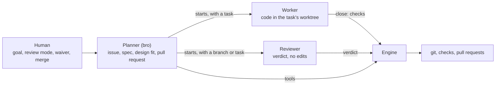
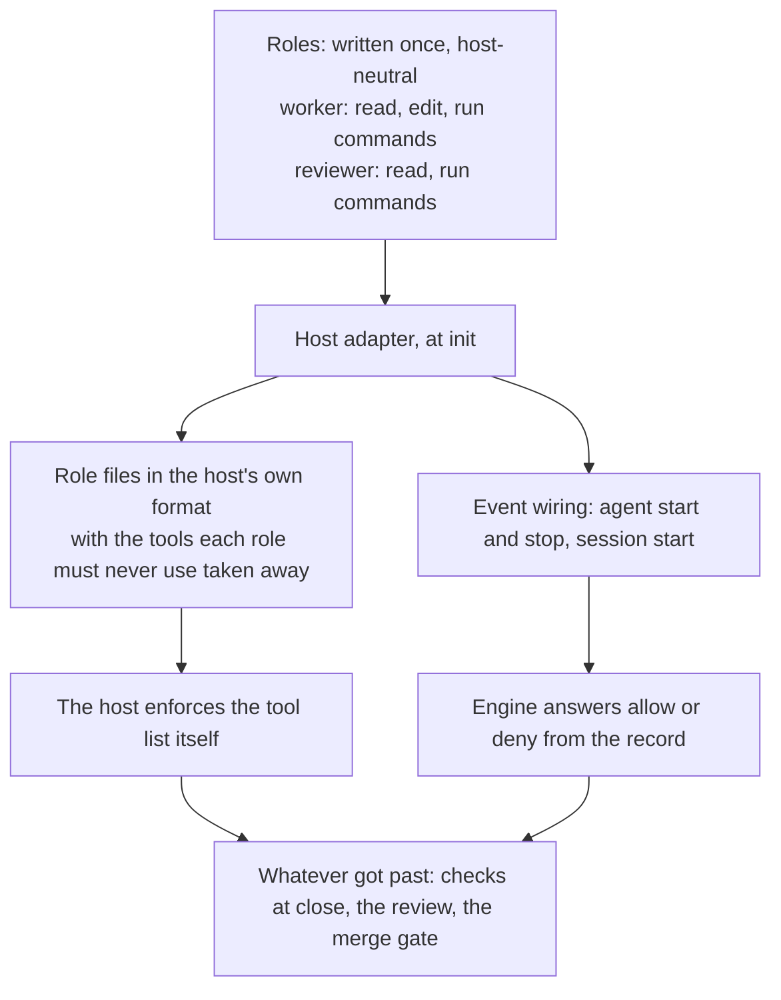

# Agent roles

What each tmb role is for, what it may and may not do, and why the roles are split this way. Each role's prompt sits in its own role file, written once in a host-neutral form. The engine's role checks sit in the code. Ask the code graph for either.

| Role | Who | Owns | Why it exists |
|---|---|---|---|
| Human | The developer | Intent | Sets the goal and the review mode, waives a review, and merges. |
| Planner, addressed as bro | The host's main agent | The spec and design fit | Holds the full picture: the system design and alignment with the Human. It does everything except coding, is the only agent that talks to the Human, and owns the plan, the spec and the design call. |
| Worker | A subagent the host starts | Functionality | Codes. |
| Reviewer | A subagent the host starts | The diff | An independent third party before the pull request, with no edit tools. Its verdict, or a Human waiver, is the only thing the gates accept. |

## Why three roles

**Two things decide the split: what a role can be trusted to do without approving its own work, and which role keeps working when something unexpected happens.**

The worker is split from the planner for three reasons:

- **Example 1: token cost.** Coding in the planner would fill its strategic context with diff noise.
- **Example 2: no self-homework.** The engine runs the spec's checks on the worker's commit at close. The agent that writes the code does not sign it off.
- **Example 3: subagents are fragile.** A worker runs with a fresh context, and its run can end at any point. The plan, the spec and the pull request stay with the planner, the most resilient layer.

Each layer owns one level of quality, and no layer repeats another's check. [3_TASKS.md](../flows/3_TASKS.md#quality-layers) shows how the layers hand off.

## Which agents a project has

**Every tmb project has the worker and the reviewer, and the host starts them.**

- **Example 1.** Init writes the worker and the reviewer into the project in the host's own format.
- **Example 2.** The planner starts a worker. tmb starts no agent, runs no model and never reads a login ([ADAPTERS.md](ADAPTERS.md)).
- **Example 3.** A role's file is its identity. The start prompt is the task context. Skills as added capabilities are Planned (trustmybot/tmb#436).
- **Edge case.** A role file tmb did not write sits in the project. Init replaces and removes only role files it wrote ([ENGINE.md](ENGINE.md#what-tmb-writes-and-where)).

Agents the project creates are Planned (trustmybot/tmb#437) ([Agents a project creates](#agents-a-project-creates)).

## Planner (bro)

**The planner does everything except coding, and it is the only agent that talks to the Human.** Its persona is not a role file: the engine gives it to the host's main agent at every session start, with the rules and the open work from the record.

| The planner | Rule |
|---|---|
| **Plans and routes** | Records the goal as an issue, scopes the work from the code graph, names the feature branch, writes the task spec, and asks the engine to start the task. |
| **Judges, re-checks nothing** | After the review passes it judges only whether the change fits the design, and whether the files changed outside the spec should have been touched. It runs no check again and reviews no diff again. |
| **Asks for the pull request** | Reads the verdict from the record, never from reply text, and asks the engine to push and open the pull request. It never pushes or opens one by hand. |
| **Writes only docs tasks** | A change to docs or prompts that changes no behaviour is a docs task. The planner writes it itself, in that task's worktree. The close refuses one that touches a file that is not a docs type ([3_TASKS.md](../flows/3_TASKS.md#docs-task)). |
| **Keeps the code graph's knowledge** | Records the flows and rules that span files, and proposes the project's areas to the Human. Only the planner writes or removes an area. |
| **Talks to the Human** | Only the planner asks the Human questions and reports to them. It raises main-folder changes as a report and never puts a file back itself. |
| **Never takes the Human's steps** | Setting the review mode, waiving a review and removing tmb are the Human's alone. The planner stores the Human's answer and never picks one. |
| **Runs parallel sessions** | With its prompt and tools ([Parallel lanes](#parallel-lanes)). |

- **Edge case.** A run has no one to answer. The planner applies its defaults ([ENGINE.md](ENGINE.md#unattended-mode)).

## Worker

**The worker codes one open task, in that task's worktree, and closes it with the checks.**

| The worker | Rule |
|---|---|
| **Is started for one open task** | The gate denies a start whose prompt names no open task with a ready worktree. The worker reads its brief first. |
| **Works in the worktree only** | It edits, tests and commits on the task branch, never in the main folder. |
| **Keeps to the spec, and says when it could not** | When the work needs a file outside the spec, it changes the file and names it in its report. The close names every such file for the planner or the reviewer to check. |
| **Closes with the checks** | It runs the brief's checks, commits, and asks the engine to close. A refused close names what failed. The worker fixes it and closes again. |
| **Reports against every success criterion** | With the command or output that shows it, what it did not verify, and what the planner must decide. |
| **Stops and reports instead of guessing** | On a contradictory spec, a missing fact, or three failed attempts at one approach. |
| **Hands back** | Planned (trustmybot/tmb#438): when the work will not fit its turns, it commits a checkpoint so the next run resumes. |

- **Edge case.** The gate denies an action. That is a hard stop on that action: the worker reaches that effect no other way.

## Reviewer

**The reviewer judges a diff it did not write and records a verdict. It never edits a file.**

| The reviewer | Rule |
|---|---|
| **Agile: once per feature branch** | Tasks close and fold without a verdict of their own, code and docs alike. The reviewer judges the whole branch at its tip before its pull request opens ([3_WORKFLOW.md](../flows/3_WORKFLOW.md)). |
| **Truest: once per task** | On the task's commit, before that task's pull request opens. |
| **Judges what the diff breaks** | A success criterion, a caller or reader of the changed code, a security property, a stated performance budget. Style, naming and design fit are the planner's call, not findings. |
| **Reviews from the record and its own probes** | It reads the branch's and each task's brief, asks the code graph what calls or reads each changed thing, and probes with read-only commands. |
| **Signs off with a recorded verdict** | Pass or fail on the exact commit. Each finding is marked blocking, not blocking, or already there. |
| **Never edits files** | It also never pushes and never opens a pull request. Planned (trustmybot/tmb#303): a verdict is taken only when git shows the tree unchanged since the reviewer's run started. |

- **Edge case.** A verdict needs the reviewer run the host started.
- **Edge case.** A verdict on a tip that has moved is not taken.

## How roles are enforced

**The host keeps each role in bounds, through files the adapter writes. The engine's tools check the role on the calls that matter.** tmb has no hook that checks a caller's role on every tool call, and the adapter holds no rules ([ADAPTERS.md](ADAPTERS.md#the-engine-never-names-a-host)).

**A role file takes away only what the role must never use.**

- **Example 1.** The reviewer is given no tool that edits a file.
- **Example 2.** The worker loses nothing. Every other tool, a project's own included, stays.
- **Example 3.** A model per role is written into the role file by the adapter ([ADAPTERS.md](ADAPTERS.md#different-models-on-one-task)).
- **Edge case.** The reviewer writes a file from its shell. tmb watches no file write. The Planned git check (trustmybot/tmb#303, under [Reviewer](#reviewer)) covers it.

**The engine's tools check the role too.** The Human may always call.

| Tool call | Role that may make it |
|---|---|
| Start a feature branch or a task, drop one, ask for a pull request, change a setting | Planner |
| Record a verdict | Reviewer |
| Close a task | Worker or planner |

- **Example 1.** The role is the one the caller gives. A subagent passes its own role. The main agent defaults to the planner.
- **Example 2.** The Human's steps have one fence, at the command line ([ENGINE.md](ENGINE.md#ways-into-the-engine)).
- **Edge case.** tmb cannot prove which agent called. So a verdict also needs an open reviewer run.
- **Edge case.** The host cannot deny an action. A later checkpoint still holds ([ADAPTERS.md](ADAPTERS.md#what-the-host-can-deny)).

## Parallel lanes

**tmb keeps no lane record and manages no lanes. It gives every session the same record, and its tools tell the planner what it needs to stay out of another session's way.**

A lane is one session with the work it took. The host starts sessions, carries messages between them and lists them.

- **Example 1.** Two sessions each start a task. Each task has its own branch and worktree, and both read the same open work at session start.
- **Example 2.** A new task's spec names a file that another open task's spec also names. The task still starts, and the answer names the other task.
- **Edge case.** Two tasks change the same file. There is no lock: git settles it, and a clash holds back only the later task's close.

### What the planner's prompt and tools give

| tmb gives | Rule |
|---|---|
| **The record as the handoff** | A session resumes from the record and needs nothing from another conversation. The planner records a goal as an issue at once, and each decision on its issue, so every session sees them. |
| **The open work at session start** | Whichever session started it: open issues with their newest decision, open tasks with their issue, feature branch and worktree, truest tasks in review, and pull requests that ended since the last session. |
| **A check of the feature branches first** | The planner's prompt has it add to an open feature branch rather than cut a second one for the same work. Feature names are unique in the record. |
| **Shared files named at task start** | When a file in the new task's spec is also in another open task's spec, the task still starts and the answer names those tasks. It is information, never a refusal. Only tasks in the same repo are compared. |
| **No lock, and no lost fold** | Each task has its own branch and worktree, so two tasks may change the same file. A fold is refused when the feature branch moved under it: the engine rebases the later task and runs its checks again first. So git settles the overlap, and a clash holds back only the later task's close. |
| **A main folder no session switches under another** | The engine cuts and moves branches without checking them out. |
| **A report of the main folder at close** | The close lists what changed there since the task started. With several sessions that can be another session's edit or the Human's own, so tmb puts nothing back and the planner raises the list to the Human. |
| **A health check that finds what stalled** | An open code task no agent run is on, a run that never ended, and a worktree the host's files do not wire. The planner's session start names the count in one line. |
| **One gate for all** | The gates and the review judge commits, not sessions. |

### What is left to the host

- Starting a session, a worker or a reviewer, and running several at once.
- Messages between sessions, and each session's end-of-turn report.
- The list of running sessions.
- Permission prompts shown to the Human.

Two sessions may both be planners.

### What tmb leaves out

- **No merge queue, lane priority or merge order of its own.** The Human decides what merges first by merging it first.
- **No file leases and no dependency between sessions.** Two sessions that changed the same file meet as an ordinary rebase or merge conflict.
- **No hub.** No session holds the state of the others.
- **No review mode per lane.** A mode belongs to the project or to a repo ([3_WORKFLOW.md](../flows/3_WORKFLOW.md#where-the-review-mode-is-set)).

### Planned for lanes

- **Session start says which session started each open task** (trustmybot/tmb#63).
- **The planner's prompt guides parallel work** (trustmybot/tmb#443). The planner proposes a split and never starts sessions unasked. It reads each issue's likely files from the code graph and keeps issues that touch the same files in one session. It tells the Human which overlaps it could not remove, and the Human approves the split.

## Agents a project creates

**Planned (trustmybot/tmb#437).** tmb is an agent management tool. An agent the project creates is recorded in the record and harnessed like the worker and the reviewer: its file is written in the host's format, its runs are recorded, its tool calls are role-checked, and its work passes the same checkpoints. How one is created and invoked is in [4_EXTENDING.md](../flows/4_EXTENDING.md#created-agents).

A consultant is one kind of created agent. It keeps three rules:

- **Cannot write workflow state.** Its issue, task, status and verdict writes are refused.
- **Writes analyses** as discussion notes.
- **Advises, never decides.** The planner reports its analysis to the Human, and the Human decides.
