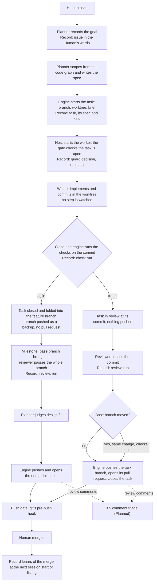
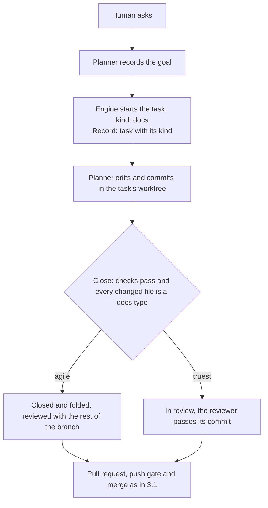
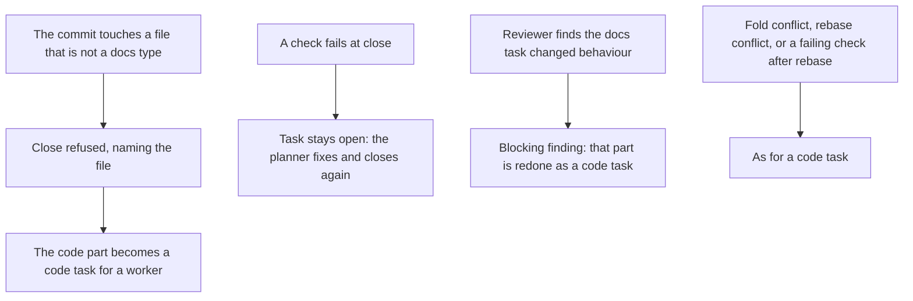
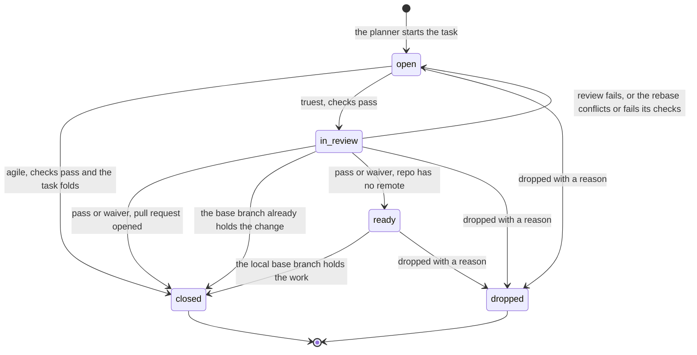
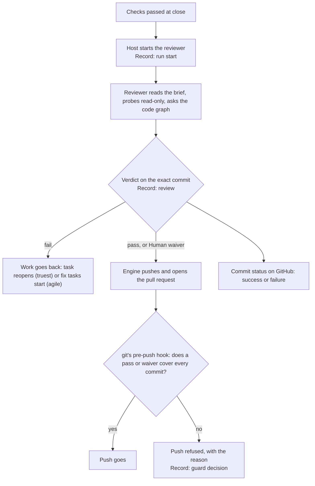
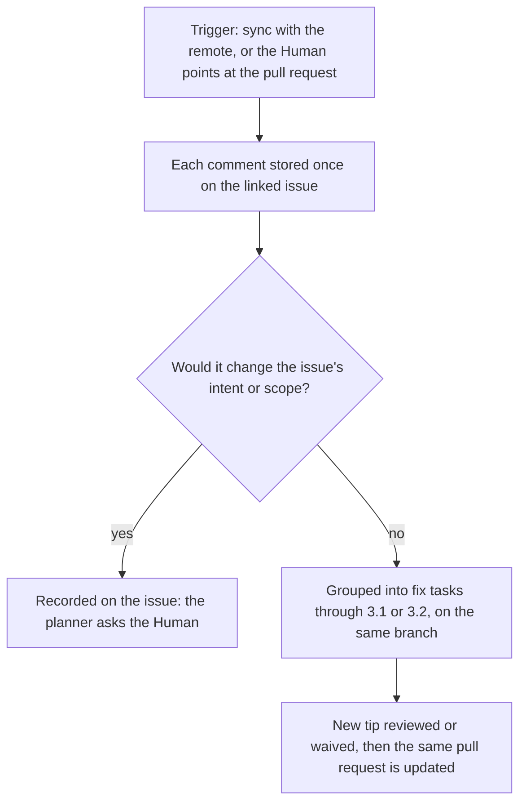
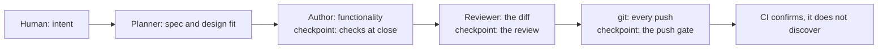

# Agent task handling

Every case of flows 3.1 to 3.5 in [FLOWS.md](FLOWS.md). A task is one change that one agent can finish in one run. It is one of two kinds: a **code task**, which a worker implements, and a **docs task**, a docs or prompts change the planner writes itself. Both kinds end in the same push gate, retry paths and pull request comment triage, and the [quality layers](#quality-layers) rules hold for every step. [GIT.md](GIT.md) covers where the task's work sits at each stage.

**tmb gates the outcome.** It does not watch a task's steps: no guard on each edit, no reading of shell commands, no per-step metering. It checks at three checkpoints, like CI: the checks at close, the review, and the push gate (trustmybot/tmb#98).

Every record a task leaves lives in the record, the cold store [MEMORY.md](MEMORY.md) describes; an agent reads it back from there, never from chat. [TRAJECTORY.md](TRAJECTORY.md) lists what is recorded.

## Units of work

- **Issue.** One goal of the Human's, with the notes and decisions that shaped it.
- **Task.** One change, with a spec: the intent, the files it may touch, the checks that must pass and the success criteria.
- **Milestone.** A group of issues the Human wants to judge as a whole, such as a first usable build.

The [review mode](AGILE.md) decides where a task's review happens. It is set per repo, only by the Human, and a task keeps the mode it was started in.

| Mode | Review | Reaches the base branch as |
|---|---|---|
| **Agile** (recommended; the Human chooses) | Once, on the whole feature branch | One pull request per milestone |
| **Truest** | On every task, before its push | One pull request per task |

## 3.1 Code task

Any change that touches code. The planner plans and judges, a worker implements, the reviewer reviews, and the Human merges. The engine, not an agent, cuts branches and worktrees, runs checks, folds, pushes and opens pull requests. Agents ask for these through tmb's tools, so every step is recorded and no agent is trusted to follow a git procedure.

### Code task succeeds

### Code task fails a step

Each failure returns to its owner. 3.4 lists the paths and marks what is Planned.

```mermaid
flowchart TD
    S0[Worker start names no open task] --> S1["Start denied, with what would be allowed<br/>Record: guard decision"]
    S2[Host fails to make the worker] --> S3["Record: the run ends as stopped"]
    C0[A check fails at close] --> C1["Close refused, naming the check<br/>Record: failing check run"]
    C1 --> W["Task stays open: the worker fixes and closes again"]
    C2[Uncommitted work, or a fold conflict] --> C3["Close refused, naming the files<br/>the step is undone"]
    C3 --> W
    V0[Reviewer fails a truest task] --> V1["Record: review with blocking findings<br/>task open again in the same worktree"]
    V1 --> W
    V2[Reviewer fails a feature branch] --> V3["Planner starts a fix task per blocking finding<br/>the new tip is reviewed again"]
    R0[Truest rebase conflicts, or its checks fail] --> R1["Rebase undone, task open again"]
    R1 --> W
    R2[Rebased change differs] --> R3["Stays in review: a fresh review of the new commit"]
    D0[Wrong approach, or nobody will finish it] --> D1["Planner or Human drops the task with a reason<br/>a new task can name the one it replaces"]
    P0[Push carries a commit no pass or waiver covers] --> P1["git refuses the push<br/>Record: guard decision"]
    X0[A run started and never ended] --> X1["Named at the next session start and by the health check<br/>the planner decides"]
```

| Step | Owner | Method | What it guarantees and hands over |
|---|---|---|---|
| Ask | Human | judgment | intent. When it is vague, the Human and the planner pin it down |
| Record the goal | planner | judgment | an issue titled in the Human's words, saved before any planning, with open questions as a note. In an unattended run a question with a recommended answer counts as answered and is recorded as a decision |
| Spec | planner | judgment | scoped from the code graph, not by reading files: what to change and why, the files, the checks, and success criteria a check can prove. The planner names the task's kind |
| Start the task | engine | deterministic | a ready place to work: the task's branch, cut from the feature branch (agile) or the base branch (truest), its worktree and its brief. Refused until the review mode is set. The engine names the open tasks that share a file, as information |
| Start the worker | host, checked by the gate | deterministic | a worker starts only on an open task whose worktree is ready; the start is recorded as a run. This is a checkpoint, not a watch |
| Implement | worker | judgment | the spec exactly, in the task's worktree. No edit or command is checked on the way |
| Close | engine | deterministic | the task's and the repo's checks pass on the committed work, or the close is refused and names what failed. A task with no checks never closes. The close also reports, without refusing: files changed outside the spec, and anything that changed in the main folder since the task started |
| Fold (agile) | engine | deterministic | the commit is on the feature branch, rebased and checked again if the branch moved, and the branch is pushed as a backup. No push while its pull request is open |
| Review | reviewer | judgment | diff-level quality through 3.3: a verdict recorded for one commit. Agile reviews the whole branch at its tip; truest reviews the task's commit |
| Design fit | planner | judgment | the change fits the design and the spec's intent. The planner checks out-of-spec files by name with git; it re-runs no check and re-reviews no diff |
| Pull request | engine | deterministic | opens only when a pass or a Human waiver covers the tip or commit. A truest task is rebased first when the base branch moved |
| Merge | Human | judgment | the pull request merges. tmb reads the result later and never deletes a branch |

- **A close reports, and refuses only on its checks.** Out-of-spec files are named and the spec stays as written. Main-folder changes go to the Human as a report with the command that puts each file back; tmb puts nothing back, because the change may be the Human's own.
- **Two tasks may change the same file.** There is no lock. git settles it at the fold, and a clash holds back the later task's close.
- **Checks never fail open.** A check that could not run is recorded as not run, with the reason, and the task stays open.
- **Planned at close:** a changelog check, a stale-doc check and a leak check, a probe for each open finding, and a code graph check that no downstream caller breaks.
- **The planner closes the issue.** Planned: it closes itself once all its tasks' commits reach the base branch.

## 3.2 Non-code task

tmb calls it a **docs task**: a change to docs or prompts that changes no behaviour. The planner writes it itself in the task's worktree. It runs 3.1's steps with the planner in the worker's place.

### Non-code task succeeds

### Non-code task fails a step

| Step | Owner | Method | What it guarantees and hands over |
|---|---|---|---|
| Ask, record, spec | Human → planner | judgment | as in 3.1 |
| Name the kind | planner | judgment | the planner judges whether a change is docs. A project declares no list of docs paths: such a list is wrong for the next project and the next file |
| Author | planner | judgment | the planner writes in the task's worktree. No edit is refused on the way |
| Close | engine | deterministic | 3.1's checks, plus a check by file type: only prose, data and image types on a fixed list, and files with no extension such as a licence, may change. A type the list does not name counts as code (trustmybot/tmb#185). tmb does not read the file to guess. The list is in the [reference](../reference/README.md#what-a-docs-task-may-change) |
| Review | reviewer | judgment | seen in the same review as the code tasks. The engine cannot tell whether a config or data change alters behaviour; a docs task that did is a blocking finding |
| Pull request, merge | engine, then Human | as in 3.1 | as in 3.1 |

- **Planned: the doc-review skill.** The author's self-check and the reviewer's matching checklist.

## Task lifecycle

Every task of both kinds moves through one state machine. Each move is added to the record as an event, the current state is derived from the events, and the engine is the only writer.

- **Closed and dropped are final.** Rework on closed agile work is a new fix task on the feature branch. A dropped task's work reaches no branch; a new task can name the dropped task it replaces, so a chain of retries reads as one line.
- **In review keeps its worktree.** Nothing is pushed. Only a reviewer run records the verdict, and only on the task's current commit.
- **Ready is for a repo with no remote** (trustmybot/tmb#183). Nothing is pushed and no pull request opens; the Human merges locally with the command tmb gives. tmb counts the work as merged when the local base branch holds the tip, or when merging it would change nothing, as after a squash by hand. A ready task the Human will not merge is dropped.
- **Dropping keeps what holds work.** The worktree goes unless it holds uncommitted work, and the branch stays while it holds commits (trustmybot/tmb#170).
- **Agile review state is on the branch, not the task.** An agile task closes unreviewed, with its mode recorded. The pass or waiver is recorded for the feature branch's tip ([AGILE.md](AGILE.md)).
- **Review is the default, and only the Human waives it.** A waiver is given per truest task or per feature branch, with a reason, on a terminal with a typed yes. It counts as a pass on the current commit and is kept in the audit trail. The planner never waives.
- **A rebase with the same change keeps its pass.** The checks run again; a change that differs needs a fresh review. An open pull request is never rebased.
- **Auditing is a join.** A task's story is its events in order, joined with its runs, check runs and reviews.

| State | Means |
|---|---|
| open | Work may be done on it. The task's runs say whether an agent is on it. A stuck task stays open until the planner resumes or drops it |
| in_review | A truest task whose checks passed, waiting at its commit. The newest review of the commit says where it stands |
| ready | Covered by a pass or a waiver in a repo with no remote, waiting for the Human's local merge |
| closed | Final. An agile task is folded, with its mode recorded; the review or waiver is on the feature branch. A truest task has its pull request |
| dropped | Final, with a reason. The task that replaces it names it |
| failed | **Planned.** A task whose worker stopped on a broken environment or a contradictory spec ([3.4](#34-retry-and-escalation)) |

- **Planned:** each move names a cause from a fixed list and the record it rests on, and the record refuses a move without it.
- **Planned:** a move the planner takes by hand carries a note saying why, so no bypass is silent.
- **Planned:** closing an issue ends its open tasks.
- **Open, for the Human:** waivers wider than one task or one branch (a listed set, an issue, a session's docs tasks).

## 3.3 Push gate

The reviewer step of both task kinds, and the gate on every push.

| Step | Owner | What it guarantees |
|---|---|---|
| Start | planner → reviewer | the reviewer is named the feature branch or the task. Its start is recorded as a run, which a verdict needs |
| Probe | reviewer | reads the brief, each task's spec and the diff; finds what calls or reads each changed thing through the code graph at the branch's tip or the task's commit; probes with read-only commands |
| Verdict | reviewer | judgment: pass or fail on the exact commit. Each finding blocks, does not block, or was already there. A verdict on a tip that has moved is not taken |
| Pass | planner | reads the verdict from the record, judges design fit and asks for the pull request without being told |
| Fail | planner | sends the work back to its author without asking the Human |

- **The gate is git's own hook.** It does not depend on the host, so it holds for a push typed by hand. The engine reads no shell command to find a push.
- **What it refuses.** In every mode: a push to the base branch that carries a commit no pass or waiver covers. In truest also: a push to any other branch that carries a task's commit without one. A commit of no task, pushed to another branch, goes through, so the Human's own branches are not stopped.
- **No unreviewed commit reaches an open pull request.** While it is open, new folds stay local until the new tip is reviewed or waived; then the same pull request is updated.
- **When the record cannot be read.** No record: the push goes, because tmb stays out of projects it was never set up in. A damaged or empty record, or one from a newer tmb: denied. A repo that is exempt or not registered: allowed, with the reason recorded.
- **Append-only record.** Verdicts are never rewritten; the newest review of a commit decides.
- **A mark on GitHub** (trustmybot/tmb#101). A local hook can be skipped, so each verdict or waiver also sets a commit status on that exact commit. The repo's branch protection can require it; tmb says whether it does and never changes protection settings. A mark that could not be sent is recorded and sent later; it never fails the review. It is a convention, not proof.
- **Another tool's hook** (trustmybot/tmb#184). Where a repo already has a pre-push hook, tmb leaves it alone and says the gate is off there at every session start. With the Human's yes, tmb adds one line first in that hook; removal takes out that line alone.
- **One project per repo.** The hook names its project, so the gate never searches. A project may be one package of a monorepo (trustmybot/tmb#178).
- **Planned:** a gate that was skipped is found by the sync with the remote and recorded as a finding (trustmybot/tmb#70).
- **Planned: freeze** (trustmybot/tmb#64). The Human stops all work in a project with one request: task and agent starts, closes and pull requests are denied until it is lifted. Reads stay allowed.

## 3.4 Retry and escalation

Nothing here waits for a timer: tmb runs only when something calls it.

| Cause | Path |
|---|---|
| A check fails at close | close refused naming the check; the worker fixes and closes again |
| Review fail, truest | the task reopens in its worktree; a worker reworks it and closes again for a new review |
| Review fail, feature branch | the planner starts fix tasks on the branch; the new tip is reviewed again |
| Two review fails in a row | **Planned:** no worker starts on the task until the planner records the root cause |
| Fold or rebase conflict | the step is undone and names the files; the task stays open until settled |
| Base branch moved under a feature branch | the engine merges it in before the review; a conflict changes nothing and is settled in a task |
| Rebased truest commit whose change differs | one new review of the rebased commit |
| A check or a comment fails an open pull request | the planner starts fix tasks on the branch; nothing is pushed until the new tip is reviewed or waived. **Planned:** bringing the comments in (3.5) |
| Pull request closed without a merge | the branch is recorded as closed and named at session start; a new pull request or a rework task reopens it |
| Wrong approach, or nobody will finish | the task is dropped with a reason; a new task names the one it replaces |
| Nobody will merge the feature branch | the branch is dropped with a reason and kept in git |
| A run started and never ended | named at session start and by the health check; the planner decides |
| Worker runs out of turns | **Planned:** it commits a checkpoint and hands back; the next run resumes |
| Broken environment or contradictory spec | the worker stops and reports. **Planned:** the task is marked failed and the planner reopens it |
| Design drift | the planner drops the task and replaces it. **Planned:** the planner amends the spec and reopens |
| Work merged outside the flow | the push gate refuses the uncovered push. **Planned:** its open tasks close, each recorded as a bypass when no review passed |

- **Rework is bounded** (Planned). The number of runs alone never blocks a run; two fails since the last pass do, until the cause is recorded.
- **Nothing waits on the Human** except what only the Human may do: a waiver, the review mode, the merge.

## 3.5 PR comment triage

Planned (trustmybot/tmb#70).

- **Stored once.** A per-pull-request cursor means a re-fetch returns only newer comments.
- **Intent stays the Human's.**
- **Unresolvable pull requests are skipped,** and the gap is recorded.

## Quality layers

The rules behind every step table above. Each step owns one level of quality and hands the next a ready state. The method is deterministic or judgment. No two roles check the same thing: each check has one owner, and no step redoes another step's check.

- **Code enforces; prompts guide.** The three checkpoints are the engine's. An agent can ignore a prompt; it cannot skip a checkpoint.
- **Checkpoints, not steps.** The only things the host is asked before they happen are an agent's start, a file write by the reviewer, and a step only the Human may take. Everything else is judged by what is delivered.
- **Leaks point upstream.** When a later step or CI catches a cheap check, the fix is to move that check into the step that owns it. A leak rate per step as the health metric is Planned.
- **Failures return to their owner.** A failed check goes back to the author, a review finding to the author, a design misfit to the planner's spec.

## Debugging a stuck task

tmb has no watcher, so a stuck task is found at the next session start or by `tmb doctor`. [TRAJECTORY.md](TRAJECTORY.md) covers runs with a start and no end.

| Symptom | Where to look |
|---|---|
| No task will start | The review mode is not set: the Human runs `tmb onboard`. Or the issue is closed |
| The worker will not start | Its start prompt must carry the task's id line from the brief, and the task must be open with its worktree present. In a workspace, start it from inside the task's repo; the deny names the folder |
| The task will not close | The refusal names it: a failing check, uncommitted work, a conflict with the feature branch, no checks set, or, for a docs task, a file that is not a docs type |
| The reviewer's verdict is refused | No reviewer run is open, the commit is not the branch's current tip, or the task is not in review at that commit |
| The pull request will not open | No pass or waiver covers the tip or the commit. The Human waives with `tmb feature waive` or `tmb task waive` |
| The push is denied | It carries a commit no pass or waiver covers, or the record cannot be read. The hook's message names the cause |
| The push gate is off | Another tool owns the pre-push hook: `tmb doctor --fix` or `tmb onboard --add-push-gate` |
| A task is open and nothing works on it | `tmb doctor` lists runs with no end and open tasks with no run. The planner resumes it or drops it |
| A branch stays ready after a local merge | The base branch changed the same lines again; drop it with a reason that says where the work went |
| Every command stops | The record is unreadable or from a newer tmb. `tmb doctor` still runs and names the cause |
