# Trajectories

The record of the work: what was asked, what was decided, what each agent did and how it ended. Any session can resume from it without the conversation that came before, and it answers "why is this still running?" and "why did this stop?" from records, not guesses.

A task's own trajectory is in [3_TASKS.md](../flows/3_TASKS.md#task-lifecycle). This page covers what a task runs inside: sessions, agent runs, gate decisions and check runs.

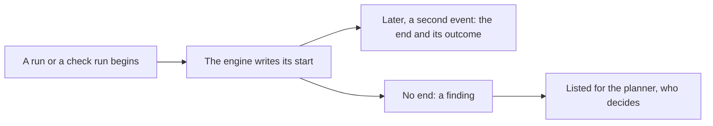

## What the record is for

**The record does three jobs, and every table serves one of them.**

| Job | What it means |
|---|---|
| Keep the trajectory | What was asked, decided, done and judged on this machine, as events |
| Bridge local and remote | It ties the user's local work to the remote's issues, comments and pull requests, as the code graph ties the design to the code |
| Leave room | A new host, role, remote, kind of record or field on the remote is a new value or a new row, never a rewrite |

- **Example 1.** A teammate's comment on the remote and the worker's run that answered it are found from the same issue row.
- **Example 2.** The remote adds a field to its issues. The syncer keeps it in the event's data that day, and a column can be folded from those events later.
- **Edge case.** The project has no remote. The bridge has nothing to tie, and the trajectory is whole without it.

## The record is local first

**The record works with no remote. A remote adds what teammates see, and replaces nothing in the record.**

A person working with agents needs a memory that a remote has no place for: which task an agent took, what it cost, which commit a verdict judged, why the gate said no. The record keeps that on the user's machine, whether or not the project has a remote.

- **Example 1, local.** A project has no remote. Its issues, decisions, tasks, runs and verdicts are all in the record. It needs no account and no network, and a new session resumes from it.
- **Example 2, local with a remote.** Planned (trustmybot/tmb#70). The remote's issues, comments, milestones and pull requests are mirrored into the record. The tasks, runs and verdicts under them stay local.
- **Edge case.** The network is down. Work goes on from the record. The copy of the remote is as old as the last poll, and the record says how old.
- **Edge case.** The remote and the record disagree about a mirrored issue. The remote wins, and the change is written as an event made by tmb.

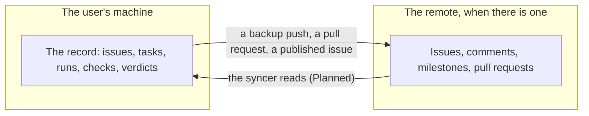

| | Local | Local with a remote |
|---|---|---|
| Issues | Made in the record | Mirrored from the remote, beside the local ones |
| Comments, milestones, pull requests | Notes and decisions, in the record | Mirrored from the remote |
| Tasks, runs, check runs, reviews, guard decisions | In the record | In the record only, never on the remote |
| Which side is the truth | The record | The remote for what it holds, the record for the rest |
| What tmb sends to the remote | Nothing | A branch pushed as a backup, a pull request, a review mark on a commit, and an issue the Human publishes |

- **The syncer only reads.** It never writes to the remote, and it never changes a local issue.
- **A row with no remote id is local.** Publishing an issue gives it one (Planned, trustmybot/tmb#409).
- **Teammates see only what is on the remote.** A note or a decision is local. Planned (trustmybot/tmb#409): the Human may publish one as a comment, as the Human publishes an issue.

### Every kind of repo

**The record keeps what happened, a setting keeps the choice, and the remote's own id ties a row to its item on the remote.** Every row marked Planned is trustmybot/tmb#70 or trustmybot/tmb#411.

- **Example 1.** A teammate asks for changes on the user's pull request. The comment is a discussion on that pull request, so the worker is shown it.
- **Example 2.** A teammate's pull request closes the user's issue. It is a pull request row with an author, no task and no feature branch.
- **Edge case.** An issue is assigned to a teammate. The planner sees the account is not the user's, which is a setting, and leaves the issue alone.
- **Edge case.** The repo is renamed or moved on the remote. Each item keeps its remote id, so each row is kept and only its address changes.

| The project is | What the record does | |
|---|---|---|
| A repo with no remote | Everything is local. The backup push is recorded as not run | |
| A repo with the user's own remote, worked on alone | Mirrors the remote's issues, comments, milestones and pull requests | Planned |
| A repo shared with teammates | The same, and each mirrored row names the account that wrote it. Work assigned to someone else is left alone | Planned |
| A fork | Two remotes. Issues come from the upstream, the branch is pushed to the fork, and the pull request names both. Which remote is the upstream is a setting | Planned |
| A repo that takes pull requests from other people's forks | Each is a pull request row whose branch is in another remote, with its author and no task | Planned |
| A repo whose issues are kept in another repository | Which repository the issues come from is a setting. The issue names its own repository | Planned |
| A repo with several remotes, such as a mirror | One remote is the one issues come from, by the same setting. The others only take pushes | Planned |
| A multi-repo workspace | One record. Each row names its repo, and each repo is mirrored from its own remote | Planned: the mirror |
| A remote tmb cannot read: not GitHub, or no sign-in | Works as local. Pushes still go, and the record says the remote is not read | Planned |
| A second clone of the same repo on one machine | A second project with its own record. A task's worktree is not a clone: it shares its project's record | |
| The same repo on a second machine | The record is per machine and out of git. Mirrored issues come back with the first full pass. Local issues, tasks and runs stay on the first machine | Planned: the mirror |

- **Edge case.** The user copies the record file to the second machine. It works there: ids never collide across machines.
- **Edge case.** A repo gains a remote later. Its local issues stay local until the Human publishes each one.
- **Edge case.** A repo loses its remote, or the user loses access. The mirrored rows are kept and marked gone from the remote; nothing is deleted.

## 1. Outcomes are recorded at checkpoints

tmb records outcomes at checkpoints. It does not record each tool call or each step of an agent.

- **Example 1.** A worker closes its task. The check run at close is recorded, with each command and its result.
- **Example 2.** The gate denies a worker's start. The deny is recorded with its reason.
- **Not recorded:** file writes and shell commands. tmb reads neither.

| Record | Holds |
|---|---|
| Issue | A goal, its state and its milestone. **Planned** (trustmybot/tmb#402): its priority, type, labels and links to other issues |
| Discussion | Notes and decisions on an issue. The newest decision is the one in force; one that conflicts with an earlier decision is confirmed by the Human first |
| Feature branch | A branch tasks fold into, its base, its state and its repo |
| Task | A spec, its kind, its state, its branch, its commit and its repo |
| Run | One worker or reviewer on one task or one review: start, end, how it ended, its cost |
| Check run | The checks run on a commit, each command and its result: start and end |
| Review | A reviewer's verdict on a commit or a feature branch, its findings, and the run that wrote it |
| Guard decision | Each allow and deny the gate gave at a checkpoint, and why |
| Waiver, review mark, setting change | Each Human waiver, each mark sent to the remote and each change to a setting is its own record, as are a feedback report and an import |
| Doc | **Planned** (trustmybot/tmb#302). One design document: where it lives, in a repo or outside it such as a wiki, what it is for, and its repo |
| Session | **Planned** (trustmybot/tmb#63, trustmybot/tmb#254). One host session, with its start, its end and its own cost |
| Pull request | **Planned** (trustmybot/tmb#405). One pull request, what it carries and its state on the remote |
| Milestone | **Planned** (trustmybot/tmb#70). One milestone, open or closed, matched to the remote's |

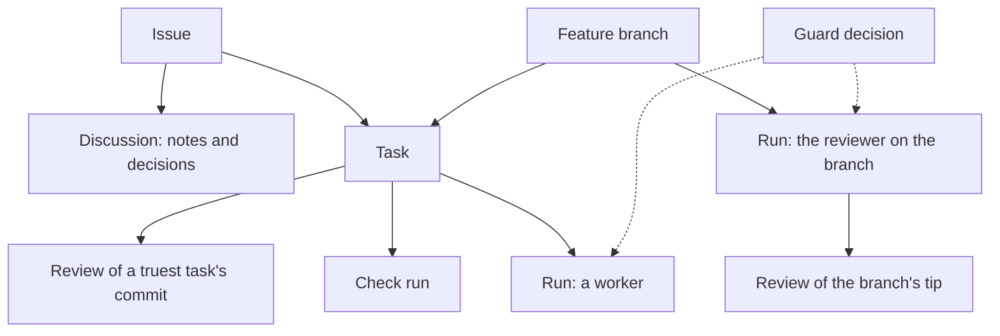

### Which work gets a record

**Work worth keeping is an issue with its tasks. Ad hoc work in the chat leaves no record.** A task always belongs to one issue; there is no task without one.

- **Example 1, synced.** A teammate assigns the user an issue on the remote. The syncer brings it into the record, the planner cuts tasks under it, and its state and comments follow the remote.
- **Example 2, local only.** The user tries an exploratory fix. The planner opens an issue in the record only, and cuts tasks under it. Nothing reaches the remote.
- **Example 3, no record.** The user asks the planner for a throwaway review page and updates to it. That is conversation: no issue, no task, no run.
- **Edge case.** The exploratory fix proves worth sharing. The Human says publish, and the issue is created on the remote and tied to it. From then on it is synced.
- **Edge case.** The planner is unsure whether a request is worth a record. It asks the Human; it never opens an issue to cover a chat.
- **Edge case.** Ad hoc work still costs tokens. The session's own cost counts them (Planned, trustmybot/tmb#254); no task does.

| Work | In the record | On the remote |
|---|---|---|
| A remote issue | Issue and tasks | Synced. Planned (trustmybot/tmb#70) |
| A local issue | Issue and tasks | Nothing, until the Human publishes it. Planned (trustmybot/tmb#409) |
| Ad hoc work in the chat | Nothing | Nothing |

- **The syncer never publishes.** An issue made in the record stays local until the Human's word.
- **Tasks, runs and reviews are never on the remote.** Only the issue, its comments, its milestone and its pull request are.

## 2. A start and an end are two events

A run and a check run each write their start before any work. The end is a second event, and it carries the outcome.

- **Example.** A check run starts at close and writes its start. When the checks end, a second event adds the result. The start is never edited into an end: the record only adds events, and the current state is derived from them.
- **Edge case.** A start without an end is a finding: the work is still running, or it stopped without saying so.

## 3. Every record names what it belongs to and who made it

Each record points at its parent, so the work forms a tree. Each record also names its maker: the Human, or the role and host that acted. tmb itself is the maker of a write no person or agent made, such as an upgrade. Planned: the session that acted (trustmybot/tmb#63).

| Record | Names |
|---|---|
| Run | Its task, or its feature branch for a branch review |
| Review | The run that wrote it |
| Check run | Its task and its commit |

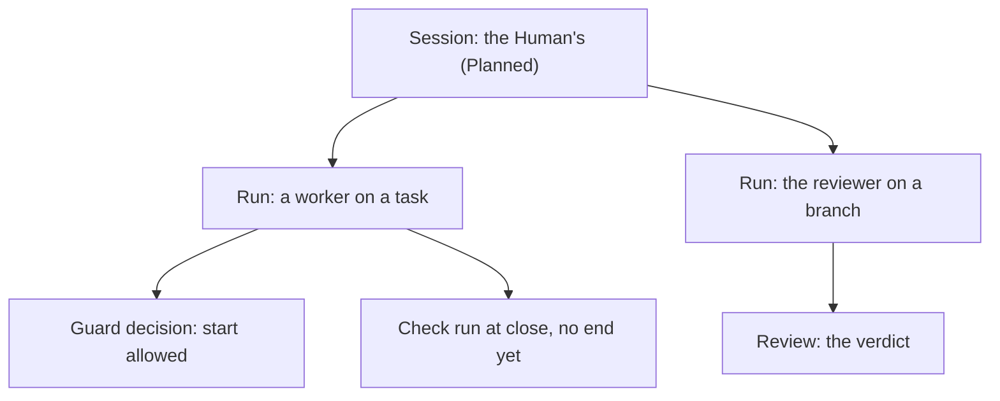

The chart is one moment of a real tree. To find what is stuck, follow the records with no end downward: the lowest one is where the work stopped. The tree starts at the run. Planned: the session level and the link from a run to its session.

- **Example 1.** A push tmb makes for an agent is that agent's.
- **Example 2.** A push typed by hand is the Human's.
- **Edge case.** Every command-line call is the Human's. That is why a step only the Human may take needs a terminal and a typed yes ([ENGINE.md](ENGINE.md#ways-into-the-engine)).

## 4. The engine is the only writer

Agents, the command line and the dashboard change the record only through the engine, so every rule is enforced in one place.

| Rule | In practice |
|---|---|
| Reads return small pieces | A brief, a section or a ranked snippet, never a dump |
| Ids never collide across machines | A record can be copied to another machine without renumbering |
| Writes stay cheap | The database takes one writer at a time, so a record at a checkpoint is one small insert |

## 5. A run is one start of a worker or the reviewer

A run ends as finished or stopped.

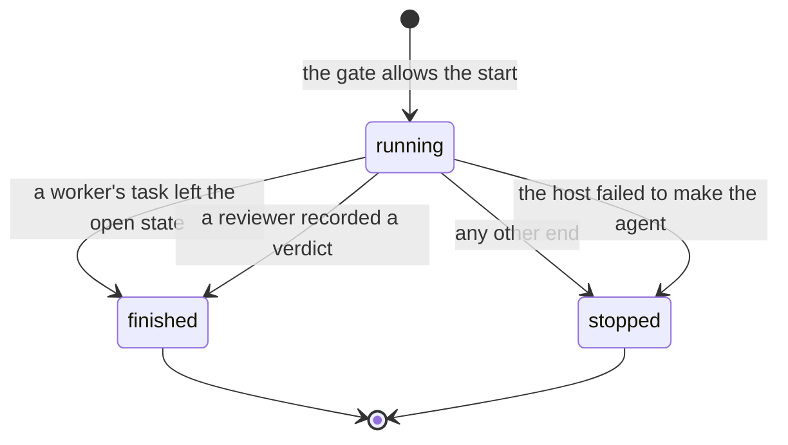

- **Example.** A reviewer gives no verdict. Its run is stopped.
- **Edge case.** The gate allows a start and the host then fails to make the agent. No agent ran, so no stop would come to end the run. The run is stopped.
- **A denied start opens no run.** It is recorded as a guard decision with its reason, so "why did the worker never start?" has a record.
- **The planner's own turns are not a run.** They belong to the session record, which is Planned.
- **A reviewer that is a host's main agent** has no subagent start. Its run opens at that host's session start and ends with its verdict.

**Cost is tokens, per model:** input, output, cache read and cache write, given by the host's adapter.

- **Edge case.** A run whose usage cannot be read has no cost, and that is not an error.
- **tmb records no price.** Prices change, and a subscription has none per run.

**Planned** (trustmybot/tmb#256): a stopped run names its cause from a fixed list (failed, out of turns, killed, escalated, stuck, never started), and a resumed run names the run it resumes.

## 6. A check run is one execution of a task's checks on one commit

Verification is recorded as check runs. The checks run at close, and again after a fold or a rebase moved the commit.

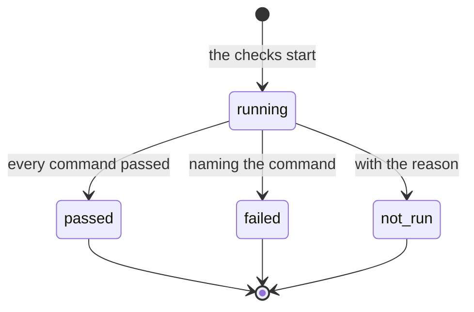

- **Edge case.** A check run killed with its session keeps its start and has no end, so it shows as a finding.

## 7. A guard decision is one answer of the gate

In tmb a hook runs only at a checkpoint: a session start, an agent's start or stop, and git's pre-push hook. Every answer is recorded, allow and deny, with the event and the reason.

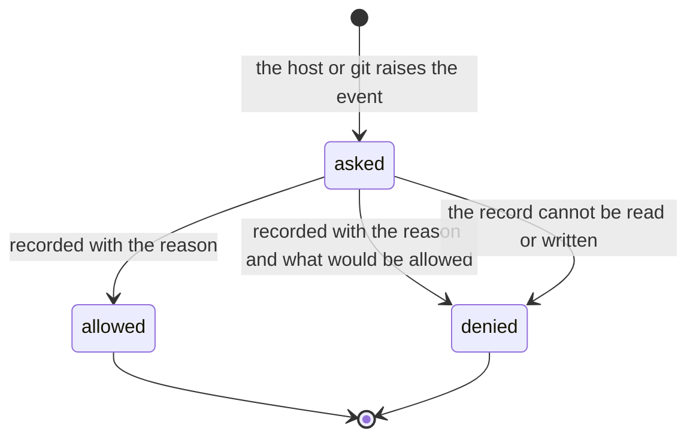

- **Edge case.** A gate never fails open on a broken record. It denies when it cannot read or write the record, and allows only where tmb was never set up.
- **Not events:** a task's start and close. The engine checks them when asked, and a refusal goes to the caller without a guard decision.
- **A decision is written once, when it is made.** Planned: a start written before the hook's work, so a hook that hangs or crashes leaves a record.

## 8. A session holds the runs

Planned (trustmybot/tmb#63, trustmybot/tmb#254). A record names the role and host, not the session. The session record is what tells the work of two sessions on one project apart.

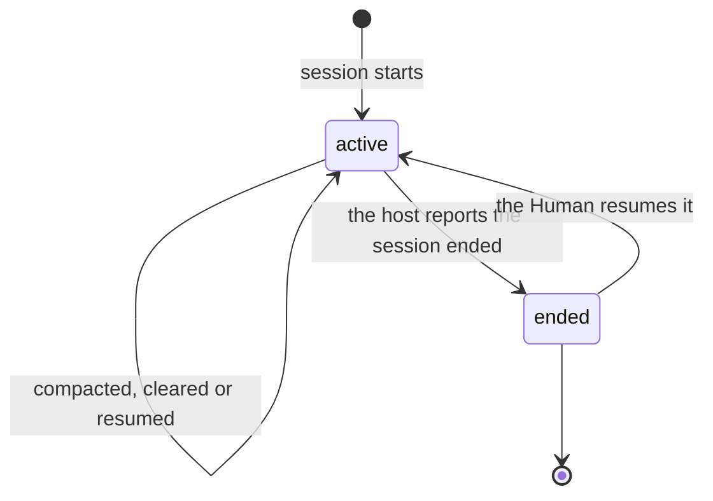

- **One stable id** across a compaction, a clear and a resume.
- **A session with a start and no end is a finding,** like a run.
- **A session's own tokens** are recorded with the same four counts as a run's, apart from its runs' counts, so a total counts nothing twice.
- **tmb starts no session and assigns no work between sessions.** [ROLES.md](ROLES.md#parallel-lanes) covers parallel sessions.

## 9. Nothing is skipped silently

A step that did not run is recorded as not run, with the reason.

- **Examples.** A check that could not run, a backup push that was skipped, a commit status that could not be sent, a push allowed in an exempt repo.
- **Edge case.** The host does not name the role of an agent it starts. The start is allowed and recorded as a finding.

## 10. Stuck work is listed, never ended

tmb has no watcher and no timer: it runs only when something calls it.

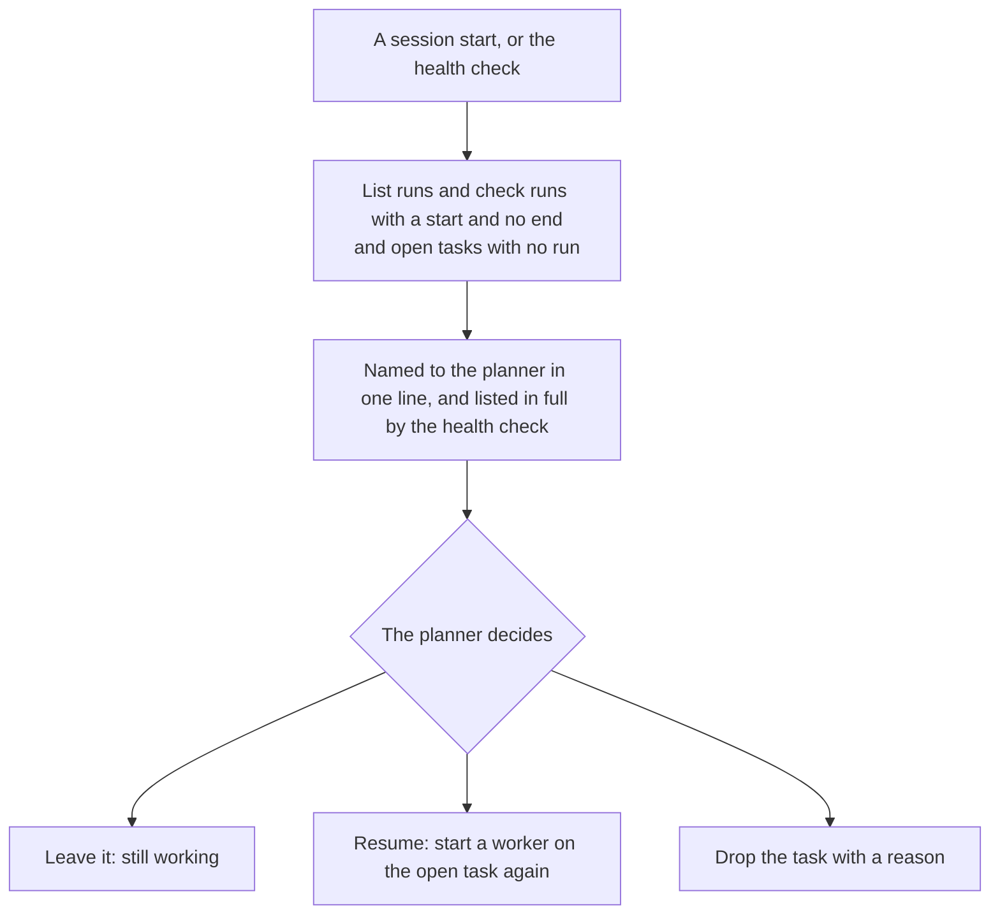

- **Last activity needs no heartbeat.** It is the newest record under the run.
- **Nothing is ended for the agent.** tmb lists what has no end and deletes nothing.

## 11. One database file per project

The file sits inside the project's folder and is left out of git. The engine creates it at init and is the only program that migrates it.

- **Example 1.** A multi-repo workspace shares one file, in the workspace folder ([3_GIT.md](../flows/3_GIT.md#multi-repo-workspaces)).
- **Example 2.** Each feature branch and task names its repo. One with none belongs to the project folder itself.

| State | Gate | Other commands |
|---|---|---|
| No database | Allows: tmb stays out of projects it was never set up in | Offer `tmb init` |
| Readable | Decides normally | Run normally |
| Unreadable, empty, or made by a newer tmb | Denies, naming the cause, and for a newer one the version that wrote it | None runs. `tmb doctor` still runs and reads the record read-only |

- **The nearest record wins.** A tmb call looks in its folder, then in each folder above it. A session that moved into a subfolder still finds its project. With none found, the starting folder is the project.
  - **Edge case.** A `.tmb` folder with no database in it is passed over.
  - **Edge case.** A second record above or below the project is listed by the health check, never merged.
- **A denied gate still lets the agent look.** Reading files and running shell commands go on, because tmb watches neither, so the agent can see what is wrong and tell the Human.
- **Nothing downgrades a record.** For one made by a newer tmb, the Human runs the newer program there or updates this one.
- **The code graph is separate.** It can be rebuilt from git at any time and lives in its own file, one per repo. Indexing is not recorded in the trajectory ([CODE_GRAPH.md](CODE_GRAPH.md)).
- **Plugin projects.** A one-way migration carries a plugin project's records into a new tmb database and leaves the plugin's database untouched. A kind of record tmb does not have is left behind, not folded into another kind.

## 12. Debugging with it

| Question | Where the answer is |
|---|---|
| What is stuck? | `tmb doctor`: runs and check runs with a start and no end, and open tasks with no run |
| Why did the worker never start? | The guard decision for its start: the deny names the reason and what would be allowed |
| Did the worker finish? | Its run's outcome: finished or stopped |
| Why did the close fail? | The task's newest check run: each command and its result |
| Why did the gate let this push through? | The guard decision: covered by a pass or waiver, or an exempt repo. With no record in the project nothing is recorded, and the hook says so in one line |
| Who waived this review? | The waiver, with its reason and its commit |
| What did this task cost? | The cost on its runs, in tokens per model |
| Why three re-runs of this task? | The task's events in order, with its runs and reviews ([3_TASKS.md](../flows/3_TASKS.md#task-lifecycle)) |
| Why does this session never end? | Planned, with the session record |

## Schema

The record is one SQLite file, `.tmb/trajectory.db`, in the workspace folder and left out of git. Its schema is `src/engine/store/schema.ts`, at `SCHEMA_VERSION = 12` (`PRAGMA user_version`). The code graph has its own file and schema ([CODE_GRAPH.md](CODE_GRAPH.md#schema)); no foreign key crosses between the two.

**This section is the one schema the record is built to.** A table or column marked Planned, with its issue, is not built yet; one marked "goes" is built and will be removed. Everything unmarked is built. A schema change updates this section in the same pull request. Planned: a generator with a freshness test that fails when it drifts.

The record is tmb's cold memory ([`MEMORY.md`](MEMORY.md)): the only source of truth for workflow state. Its tables fall into four groups:

- **Events** — `events`, the one append-only table. Every write to the record is one event; nothing else is the source of truth.
- **Projections** — each row is the current state of one record, folded from its events. They can be emptied and rebuilt from `events`. Built: `issues`, `discussions`, `features`, `tasks`, `runs`, `check_runs`, `reviews`, `guard_decisions`, `waivers`, `review_marks`, `setting_changes`, `freezes`, `feedback_reports`, `imports`. Planned: `sessions`, `pull_requests`, `milestones`, `issue_links`, `docs`.
- **Search** — `search`, one full-text index.
- **Not folded from events** — `meta`, the record's own facts, and `sync_state` (Planned), where each poll of the remote stopped.

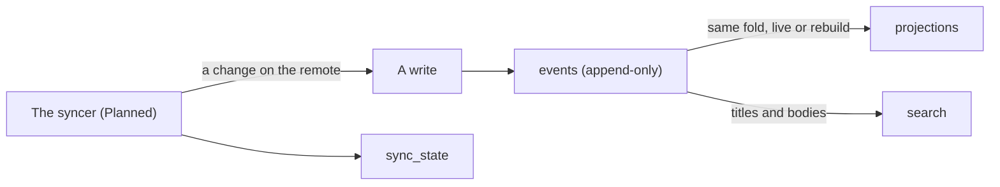

### Design requirements

Every table, and every change to one, meets these requirements.

- **Trajectory.** The record exists to keep the trajectory of work. Every table either records a step in it (a fact) or describes something that takes part in it (a dimension). Anything else does not belong in it: a setting's value is in the config, and a choice is never a column.
- **Consistency.** A projection table is plural and its record kind is the singular: `tasks` → `task`, `check_runs` → `check_run`. Every projection row carries its id, `created_by` (the JSON actor of its first event) and `created_at` (that event's time). Ids are ULIDs, never autoincrement.
- **Room to grow.** A new session, host, vendor, role, remote or record kind is new rows, never a reshaped table. The schema checks shape only: valid JSON, a text that is not blank, which columns are set together. Every list of values is checked by the engine ([ENUMS.md](../contributing/ENUMS.md)), so no list of values is a CHECK.
- **Nothing lost for want of a column.** A fact with no column stays in its event's data. A column added later is folded from the events already kept, so the schema can start small.
- **Fits the remote, names no vendor.** A mirrored row keeps the remote's own id, state and words as text. No column or table is named after a vendor, and which remote a row came from is on the row.
- **Local first.** No table needs a remote. Every column that describes the remote is nullable, and a row with no `remote_id` is local.

### Diagram

A solid line is built and a dashed line is Planned. Every foreign key refuses the delete of a row that another row points at (`ON DELETE NO ACTION`), and the record opens with `foreign_keys = ON`.

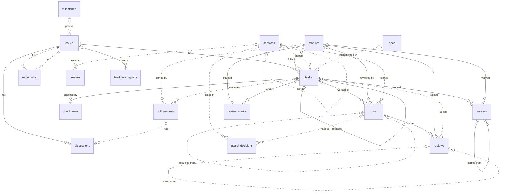

### Tables

In each table an empty last cell means built.

#### `events`

| Column | Type | Null | Holds and constraints | Planned |
|---|---|---|---|---|
| `id` | TEXT | PK | A ULID |  |
| `record_kind` | TEXT | NOT NULL | One of `issue`, `discussion`, `task`, `run`, `check_run`, `review`, `guard_decision`, `feature`, `waiver`, `review_mark`, `setting_change`, `freeze`, `feedback_report`, `import`, checked by the engine | Gains one kind per planned projection. Old `audit` events stay and the fold skips them |
| `record_id` | TEXT | NOT NULL |  |  |
| `type` | TEXT | NOT NULL | `created` or `updated` |  |
| `data` | TEXT | NOT NULL | CHECK `json_valid(data)` |  |
| `actor_kind` | TEXT | NOT NULL | `human`, `agent`, or `tmb` for a write no person or agent made |  |
| `actor_role` | TEXT | nullable | `planner`, `worker` or `reviewer`, checked by the engine, so a role a project creates is a new value |  |
| `actor_host` | TEXT | nullable |  |  |
| `actor_source` | TEXT | nullable | Which part of tmb wrote it: `syncer` or `upgrade`. Set only for a `tmb` actor |  |
| `actor_session` | TEXT | nullable | The session that acted. NULL for the Human at a terminal and for tmb | trustmybot/tmb#63 |
| `actor_remote` | TEXT | nullable | On an event the syncer wrote, the remote account that made the change | trustmybot/tmb#70 |
| `at` | TEXT | NOT NULL |  |  |

Table constraint: a `human` actor has no role and no host; an `agent` actor has both; a `tmb` actor has no role and no host, and has a source. A NULL host on an agent, or a NULL source on tmb, is refused.

- **Example.** An upgrade moves a fact to a new record. It writes the event as `tmb`, source `upgrade`.
- **Example, Planned.** A pull request is merged in the browser. The syncer writes one `updated` event: actor `tmb`, source `syncer`, `actor_remote` the account that merged it.
- **Edge case.** A write with an unknown record kind or role is still refused, by the engine.
- **Edge case.** A tool call or a hook names itself as tmb. The engine refuses it: only the engine's own code writes as tmb. A push hook that names tmb is taken as the Human's.

#### `issues`

| Column | Type | Null | Holds and constraints | Planned |
|---|---|---|---|---|
| `id` | TEXT | PK |  |  |
| `title` | TEXT | NOT NULL | CHECK `length(trim(title)) > 0` |  |
| `body` | TEXT | NOT NULL | Default `''` |  |
| `state` | TEXT | NOT NULL | Default `'open'`. `open` or `closed` |  |
| `state_reason` | TEXT | nullable | Why it closed, in the remote's words, such as completed, not planned or duplicate | trustmybot/tmb#70 |
| `milestone` | TEXT | nullable | The milestone's name | Goes, for `milestone_id` (trustmybot/tmb#70) |
| `milestone_id` | TEXT | nullable | FK → `milestones.id` | trustmybot/tmb#70 |
| `priority` | TEXT | nullable | `urgent`, `high`, `medium` or `low`. A remote's value outside the list is kept as it is and ordered last | trustmybot/tmb#402 |
| `type` | TEXT | nullable | The kind of work, such as bug or feature | trustmybot/tmb#402 |
| `labels` | TEXT | NOT NULL | A JSON list of free labels. Default `'[]'` | trustmybot/tmb#402 |
| `assignees` | TEXT | NOT NULL | A JSON list of remote accounts. Default `'[]'` | trustmybot/tmb#409 |
| `repo` | TEXT | nullable | The repo it belongs to, named as `tasks.repo` names its own | trustmybot/tmb#402 |
| `remote_url` | TEXT | nullable | Its address on the remote. UNIQUE | trustmybot/tmb#402 |
| `remote`, `remote_id`, `remote_updated_at`, `remote_gone_at` | TEXT | nullable | [The remote columns](#the-remote-columns). All NULL for a local issue | trustmybot/tmb#70 |
| `created_by` | TEXT | NOT NULL |  |  |
| `created_at` | TEXT | NOT NULL |  |  |
| `updated_at` | TEXT | NOT NULL |  |  |

- **Example.** The Human publishes a local issue. Its `remote_id` and `remote_url` are filled, and from then on the syncer follows it.
- **Edge case.** The repo's issues are kept in another repository. `remote_url` names that one and `repo` still names the code's.

#### `issue_links`

Planned (trustmybot/tmb#402). One row per link between two issues. Record kind `issue_link`.

| Column | Type | Null | Holds and constraints |
|---|---|---|---|
| `id` | TEXT | PK |  |
| `issue_id` | TEXT | NOT NULL | FK → `issues.id`. The issue the link is on |
| `kind` | TEXT | NOT NULL | `parent`, `blocked_by` or `duplicate_of` |
| `target_id` | TEXT | NOT NULL | FK → `issues.id`. UNIQUE with `issue_id` and `kind` |
| `removed_at` | TEXT | nullable | A removed link keeps its row |
| `created_by`, `created_at` | TEXT | NOT NULL |  |

- **Example.** Issue B is blocked by issue A. While A is open, the planner is shown B as blocked.
- **Edge case.** An issue links to itself, or two issues block each other. The engine refuses the write.

#### `milestones`

Planned (trustmybot/tmb#70). One row per milestone. Record kind `milestone`.

| Column | Type | Null | Holds and constraints |
|---|---|---|---|
| `id` | TEXT | PK |  |
| `title` | TEXT | NOT NULL | UNIQUE with `repo` |
| `description` | TEXT | NOT NULL | Default `''` |
| `state` | TEXT | NOT NULL | `open` or `closed` |
| `repo` | TEXT | nullable | Named as `tasks.repo` names its own |
| `remote`, `remote_id`, `remote_updated_at`, `remote_gone_at` | TEXT | nullable | [The remote columns](#the-remote-columns) |
| `created_by`, `created_at`, `updated_at` | TEXT | NOT NULL |  |

- **No due date.** The record holds no schedule.
- **Edge case.** An upgrade finds issues that name a milestone by text. It makes one row per name and repo and points each issue at it.

#### `discussions`

| Column | Type | Null | Holds and constraints | Planned |
|---|---|---|---|---|
| `id` | TEXT | PK |  |  |
| `issue_id` | TEXT | NOT NULL | FK → `issues.id` | Becomes nullable: exactly one of `issue_id` and `pull_request_id` is set (trustmybot/tmb#411) |
| `pull_request_id` | TEXT | nullable | FK → `pull_requests.id` | trustmybot/tmb#411 |
| `kind` | TEXT | NOT NULL | `note` or `decision` | Gains `comment`, for one mirrored from the remote (trustmybot/tmb#70) |
| `body` | TEXT | NOT NULL | CHECK `length(trim(body)) > 0`. A note and a decision never change | A comment's body follows the remote's (trustmybot/tmb#70) |
| `remote_author` | TEXT | nullable | The remote account that wrote a comment | trustmybot/tmb#70 |
| `remote`, `remote_id`, `remote_updated_at`, `remote_gone_at` | TEXT | nullable | [The remote columns](#the-remote-columns). All NULL for a note and a decision that was not published | trustmybot/tmb#70 |
| `created_by` | TEXT | NOT NULL |  |  |
| `created_at` | TEXT | NOT NULL |  |  |
| `updated_at` | TEXT | nullable | When a comment last changed | trustmybot/tmb#70 |

- **Example.** A comment is edited on the remote. The row's body follows it, and each version stays in `events`.
- **Edge case.** A decision is local even on a mirrored issue. The syncer never sends it, and never changes it.

#### `pull_requests`

Planned (trustmybot/tmb#405, trustmybot/tmb#411). One row per pull request. Record kind `pull_request`.

| Column | Type | Null | Holds and constraints |
|---|---|---|---|
| `id` | TEXT | PK |  |
| `url` | TEXT | NOT NULL | UNIQUE |
| `repo` | TEXT | nullable | Named as `tasks.repo` names its own |
| `feature_id` | TEXT | nullable | FK → `features.id` |
| `task_id` | TEXT | nullable | FK → `tasks.id`. At most one of `feature_id` and `task_id` is set; a teammate's pull request has neither |
| `author` | TEXT | nullable | The remote account that opened it. NULL when tmb opened it |
| `closes` | TEXT | NOT NULL | A JSON list of the issues it closes. Default `'[]'` |
| `base_remote`, `head_remote` | TEXT | nullable | The remote repository it merges into, and the one its branch is in. They differ for a fork |
| `state` | TEXT | NOT NULL | `open`, `merged` or `closed` |
| `draft` | INTEGER | NOT NULL | 1 while it is a draft. Default 0 |
| `head_commit` | TEXT | nullable | The commit at its tip when last seen |
| `review_decision`, `checks` | TEXT | nullable | The remote's review decision and the result of its checks, when last seen |
| `remote`, `remote_id`, `remote_updated_at`, `remote_gone_at` | TEXT | nullable | [The remote columns](#the-remote-columns) |
| `created_by`, `created_at`, `updated_at` | TEXT | NOT NULL |  |

- **Example.** tmb opens a pull request: a row made by the planner. The Human merges it in the browser: an update made by tmb, from the syncer.
- **Edge case.** A contributor opens a pull request from their fork. The row has their account as `author`, their fork as `head_remote`, and no task.

#### `features`

| Column | Type | Null | Holds and constraints | Planned |
|---|---|---|---|---|
| `id` | TEXT | PK |  |  |
| `name` | TEXT | NOT NULL | UNIQUE; CHECK `length(trim(name)) > 0` |  |
| `base_branch` | TEXT | NOT NULL |  |  |
| `base_commit` | TEXT | NOT NULL | The commit the branch was cut from. It never changes |  |
| `base_merged_commit` | TEXT | nullable | The base branch's commit last brought into the branch |  |
| `state` | TEXT | NOT NULL | Default `'open'` |  |
| `repo` | TEXT | nullable | NULL is the project folder itself |  |
| `drop_reason` | TEXT | nullable |  |  |
| `pr_url` | TEXT | nullable |  | Goes, for a `pull_requests` row (trustmybot/tmb#405) |
| `created_by` | TEXT | NOT NULL |  |  |
| `created_at` | TEXT | NOT NULL |  |  |
| `updated_at` | TEXT | NOT NULL |  |  |

#### `tasks`

| Column | Type | Null | Holds and constraints | Planned |
|---|---|---|---|---|
| `id` | TEXT | PK |  |  |
| `issue_id` | TEXT | NOT NULL | FK → `issues.id`. No task lives without an issue |  |
| `feature_id` | TEXT | nullable | FK → `features.id` |  |
| `replaces` | TEXT | nullable | FK → `tasks.id`. The dropped task it replaces |  |
| `session_id` | TEXT | nullable | FK → `sessions.id`. The session that started it | trustmybot/tmb#63 |
| `doc_id` | TEXT | nullable | FK → `docs.id`. The design it implements | trustmybot/tmb#302 |
| `title` | TEXT | NOT NULL | CHECK `length(trim(title)) > 0` |  |
| `spec` | TEXT | NOT NULL | Default `''` |  |
| `state` | TEXT | NOT NULL |  |  |
| `kind` | TEXT | nullable |  |  |
| `review_mode` | TEXT | nullable |  |  |
| `repo` | TEXT | nullable | NULL is the project folder itself |  |
| `branch` | TEXT | nullable |  |  |
| `worktree` | TEXT | nullable |  |  |
| `base_commit` | TEXT | nullable |  |  |
| `commit_sha` | TEXT | nullable |  |  |
| `main_snapshot` | TEXT | nullable |  |  |
| `push_result` | TEXT | nullable |  |  |
| `push_detail` | TEXT | nullable |  |  |
| `drop_reason` | TEXT | nullable |  |  |
| `pr_url` | TEXT | nullable |  | Goes, for a `pull_requests` row (trustmybot/tmb#405) |
| `created_by` | TEXT | NOT NULL |  |  |
| `created_at` | TEXT | NOT NULL |  |  |
| `updated_at` | TEXT | NOT NULL |  |  |

#### `sessions`

Planned (trustmybot/tmb#63, trustmybot/tmb#254). One row per host session. Record kind `session`.

| Column | Type | Null | Holds and constraints |
|---|---|---|---|
| `id` | TEXT | PK | A ULID, stable across a compaction, a clear and a resume |
| `host` | TEXT | NOT NULL | The host's id |
| `host_session_id` | TEXT | NOT NULL | The host's own id for the session, an opaque text. UNIQUE with `host` |
| `role` | TEXT | NOT NULL | The role the host's main agent took |
| `parent_id` | TEXT | nullable | FK → `sessions.id`. The session that started this one |
| `started_at` | TEXT | NOT NULL |  |
| `ended_at` | TEXT | nullable | NULL while active. A resume clears it |
| `cost` | TEXT | nullable | Tokens per model, the session's own, without its runs' |
| `tmb_version` | TEXT | NOT NULL | The tmb program that served it |
| `created_by`, `created_at`, `updated_at` | TEXT | NOT NULL |  |

- **Example.** One session plans and a second session reviews. That is two rows with two roles, in one record.
- **Edge case.** A planner starts another planner. The second row names the first in `parent_id`.
- **No lanes table.** A lane is a session; what it holds is the tasks and runs that name it.

#### `runs`

| Column | Type | Null | Holds and constraints | Planned |
|---|---|---|---|---|
| `id` | TEXT | PK |  |  |
| `task_id` | TEXT | nullable | FK → `tasks.id` |  |
| `feature_id` | TEXT | nullable | FK → `features.id`, for a branch review |  |
| `session_id` | TEXT | nullable | FK → `sessions.id`. The session that started the run. NULL only on a run older than the session record | trustmybot/tmb#63 |
| `resumed_from` | TEXT | nullable | FK → `runs.id` | trustmybot/tmb#256 |
| `role` | TEXT | NOT NULL | `planner`, `worker` or `reviewer`, checked by the engine |  |
| `host` | TEXT | nullable | The host that ran the agent. It can differ from the host of the session that started it | trustmybot/tmb#256 |
| `model`, `runner` | TEXT | nullable | The model that ran, and the name of the configured agent that ran it. Which agent serves which role is a setting; which one ran is a fact of the run | trustmybot/tmb#411 |
| `effort` | TEXT | nullable | The effort it was given | trustmybot/tmb#256 |
| `started_at` | TEXT | NOT NULL |  |  |
| `ended_at` | TEXT | nullable |  |  |
| `outcome` | TEXT | nullable | `finished` or `stopped` |  |
| `stop_cause` | TEXT | nullable | Set only on a stopped run: `failed`, `out_of_turns`, `killed`, `escalated`, `stuck` or `not_started` | trustmybot/tmb#256 |
| `stop_detail` | TEXT | nullable | The cause in words | trustmybot/tmb#256 |
| `cost` | TEXT | nullable | Tokens per model. CHECK `cost IS NULL OR json_valid(cost)` |  |
| `usage_source` | TEXT | nullable | Where the token count came from, "not measured" included | trustmybot/tmb#256 |
| `tool_calls` | INTEGER | nullable | Its number of tool calls | trustmybot/tmb#256 |
| `tools` | TEXT | nullable | JSON: per tool, the calls and result sizes | trustmybot/tmb#256 |
| `tmb_version` | TEXT | nullable | The tmb program that served it | trustmybot/tmb#406 |
| `created_by` | TEXT | NOT NULL |  |  |
| `created_at` | TEXT | NOT NULL |  |  |

- **Example.** The planner's session is on one vendor's host and the worker runs on a local model. The run's `host`, `model` and `runner` say so; the session's row does not change.

#### `check_runs`

| Column | Type | Null | Holds and constraints | Planned |
|---|---|---|---|---|
| `id` | TEXT | PK |  |  |
| `task_id` | TEXT | NOT NULL | FK → `tasks.id` |  |
| `commit_sha` | TEXT | NOT NULL |  |  |
| `commands` | TEXT | NOT NULL | Each command and its result. Default `'[]'`; CHECK `json_valid(commands)` |  |
| `started_at` | TEXT | NOT NULL |  |  |
| `ended_at` | TEXT | nullable |  |  |
| `result` | TEXT | nullable |  |  |
| `created_by` | TEXT | NOT NULL |  |  |
| `created_at` | TEXT | NOT NULL |  |  |

#### `reviews`

| Column | Type | Null | Holds and constraints | Planned |
|---|---|---|---|---|
| `id` | TEXT | PK |  |  |
| `run_id` | TEXT | nullable | FK → `runs.id`. The run that wrote it |  |
| `feature_id` | TEXT | nullable | FK → `features.id` | Exactly one of `feature_id` and `task_id` is set (trustmybot/tmb#406) |
| `task_id` | TEXT | nullable | FK → `tasks.id`, for a review of one task | trustmybot/tmb#406 |
| `carried_from` | TEXT | nullable | FK → `reviews.id`. The review a rebase carried over |  |
| `commit_sha` | TEXT | nullable | The commit it judged | Becomes NOT NULL (trustmybot/tmb#406) |
| `verdict` | TEXT | NOT NULL |  |  |
| `findings` | TEXT | NOT NULL | Default `'[]'`; CHECK `json_valid(findings)` |  |
| `target_kind` | TEXT | NOT NULL | `commit` or `branch` | Goes (trustmybot/tmb#406) |
| `target` | TEXT | NOT NULL | A name or a SHA, as text | Goes (trustmybot/tmb#406) |
| `created_by` | TEXT | NOT NULL |  |  |
| `created_at` | TEXT | NOT NULL |  |  |

- **Edge case.** A rebase leaves a task's patch unchanged. The pass is carried as a new row for the rebased commit, with the same verdict and findings, naming the newest review of the old commit.

#### `guard_decisions`

| Column | Type | Null | Holds and constraints | Planned |
|---|---|---|---|---|
| `id` | TEXT | PK |  |  |
| `event` | TEXT | NOT NULL |  |  |
| `decision` | TEXT | NOT NULL | `allow` or `deny` |  |
| `reason` | TEXT | NOT NULL |  |  |
| `session_id` | TEXT | nullable | FK → `sessions.id` | trustmybot/tmb#406 |
| `run_id` | TEXT | nullable | FK → `runs.id` | trustmybot/tmb#406 |
| `created_by` | TEXT | NOT NULL |  |  |
| `created_at` | TEXT | NOT NULL |  |  |

- **Example.** "Why did this worker never start?" is one lookup: the guard decisions of its session.
- **Edge case.** A push typed by hand has no session and no run. Its guard decision names neither.

#### The six tables for single kinds of entry

**Each kind of entry is its own record, with its own columns.** There is no catch-all table.

- **Example 1.** The Human waives a branch's review. The gate finds one `waivers` row for that branch and commit; it parses no text.
- **Example 2.** A setting changes. One `setting_changes` row says who changed it, from what and to what.
- **Edge case.** A record made before these tables kept every such entry in one catch-all table. The upgrade writes each old entry again as an event of its new kind, made by tmb. The old events are never rewritten, and no entry is lost.
- **Edge case.** An old entry on how a review mode was chosen has no setting change beside it. It becomes its own row for the key `review_mode`, with no values.
- **Edge case.** tmb moved to a new program. That alone changes no value: its row repeats the tie in force, and the wiring refresh that follows writes the new tie.
- **Edge case.** An old review mark names a commit that no review and no waiver covers, so its parent cannot be found. It gets no row; its old event stays in `events`.
- **Edge case.** An old entry holds a detail that has no column, such as a feedback report's title. The new event's data keeps it; the row takes only its columns.
- **Edge case.** The config file is not built yet (trustmybot/tmb#305). Until it is, the newest `setting_changes` row for a key is the value in force.

| An entry for | Is |
|---|---|
| A Human waiver, of a task or a feature branch | A `waivers` row |
| A review mark sent to the remote, and a mark sent late | A `review_marks` row |
| A review carried over a rebase | A `reviews` row with `carried_from`, or a `waivers` row with `carried_from` when a waiver covered the old commit |
| A setting change | A `setting_changes` row for its key |
| How a review mode was chosen | The `how` of that review mode's `setting_changes` row |
| Which tmb program the project is tied to, tmb moved, and tmb's wiring redone after an update | A `setting_changes` row with the key `program`. Each holds the whole tie, so the newest row is the tie in force |
| A base branch brought into a feature branch | An `updated` event on the feature branch, which sets `base_merged_commit` |
| A freeze of every session's work, and its lifting | A `freezes` row. The table is built; freezing is Planned (trustmybot/tmb#64) |
| A feedback report filed or its form opened | A `feedback_reports` row |
| A migration from the plugin | An `imports` row |

Each of the six tables also has `id` (PK), `created_by` and `created_at`. Each is a projection, and its record kind is its name in the singular.

| Table | Column | Type | Null | Holds and constraints |
|---|---|---|---|---|
| `waivers` | `task_id` | TEXT | nullable | FK → `tasks.id` |
| | `feature_id` | TEXT | nullable | FK → `features.id`. Exactly one of the two is set |
| | `commit_sha` | TEXT | NOT NULL | The commit the waiver covers |
| | `reason` | TEXT | NOT NULL | Only the Human writes a waiver |
| | `carried_from` | TEXT | nullable | FK → `waivers.id`. The Human's waiver that a rebase carried to this commit, with its reason |
| `review_marks` | `task_id` | TEXT | nullable | FK → `tasks.id`, for a mark on one task's commit |
| | `feature_id` | TEXT | nullable | FK → `features.id`. Exactly one of the two is set |
| | `commit_sha` | TEXT | NOT NULL |  |
| | `kind` | TEXT | NOT NULL | `pass`, `fail` or `waiver` |
| | `state` | TEXT | NOT NULL | What the remote is told: `success` or `failure` |
| | `sent_at` | TEXT | nullable | NULL until the remote has it |
| `setting_changes` | `key` | TEXT | NOT NULL |  |
| | `repo` | TEXT | nullable | For one repo's own setting |
| | `old_value`, `new_value` | TEXT | nullable | JSON |
| | `how` | TEXT | nullable | The way the Human chose a review mode: `init`, `onboard` or `planner`. NULL for every other key |
| `freezes` | `reason` | TEXT | NOT NULL | Only the Human's request writes a freeze |
| | `session_id` | TEXT | nullable | FK → `sessions.id`. The session it was asked in |
| | `lifted_by` | TEXT | nullable | The JSON actor that lifted it |
| | `lifted_at` | TEXT | nullable | NULL while frozen |
| `feedback_reports` | `route` | TEXT | NOT NULL | How it was sent |
| | `url` | TEXT | nullable | Where it landed |
| | `issue_id` | TEXT | nullable | FK → `issues.id` |
| `imports` | `source` | TEXT | NOT NULL | What was imported from, such as the plugin |
| | `repo` | TEXT | nullable |  |
| | `detail` | TEXT | NOT NULL | JSON: what was carried and what was left behind |

#### `docs`

Planned (trustmybot/tmb#302). One row per design document, so the planner finds the design whether it lives in the repo, outside it such as on a wiki, or in the record itself. Record kind `doc`.

| Column | Type | Null | Holds and constraints |
|---|---|---|---|
| `id` | TEXT | PK |  |
| `repo` | TEXT | nullable | The repo the document describes; NULL is the project folder itself |
| `location` | TEXT | NOT NULL | A path inside the repo, a link outside it, or a name for a document kept in the record. UNIQUE with `repo`; CHECK `length(trim(location)) > 0` |
| `body` | TEXT | nullable | The document's text, only for a document kept in the record |
| `title` | TEXT | NOT NULL | CHECK `length(trim(title)) > 0` |
| `purpose` | TEXT | NOT NULL | What the document is for and when to read it. CHECK `length(trim(purpose)) > 0` |
| `state` | TEXT | NOT NULL | `current` or `retired`. Default `'current'`. A retired row is kept |
| `created_by`, `created_at`, `updated_at` | TEXT | NOT NULL |  |

- **A document lives in one place.** One in the repo or outside it stays there, and the row says where that is and what it is for. One kept in the record has its text in `body`, for a project that keeps no docs in its code.
- **The planner records and updates it;** the Human may. An updated event may change `location`, `body`, `title`, `purpose` and `state`.
- **A task's spec names a row** as the design it implements ([`3_TASKS.md`](../flows/3_TASKS.md)).

#### `sync_state`

Planned (trustmybot/tmb#70). One row per remote repository and list. It is not folded from events: a poll that finds nothing writes no event. A lost row costs one full pass.

| Column | Type | Null | Holds and constraints |
|---|---|---|---|
| `remote` | TEXT | NOT NULL | The remote repository. PK with `list`. A fork has two remotes, so two sets of rows |
| `list` | TEXT | NOT NULL | Issues, comments, pull requests or milestones |
| `tag` | TEXT | nullable | The tag the remote gave last time, sent back to ask "has anything changed?" |
| `since` | TEXT | nullable | The time the next "what changed?" asks from |
| `synced_at`, `full_pass_at` | TEXT | nullable | When the last poll and the last full pass ended, so a reader knows how old the copy is |
| `wait_until` | TEXT | nullable | Set when the remote asks for a wait. No poll runs before it |
| `claimed_by`, `claim_until` | TEXT | nullable | The short claim one syncer holds, which runs out by itself |
| `last_error` | TEXT | nullable | Why the last poll failed. NULL after a good one |

- **Edge case.** The remote cannot be read at all. `last_error` says why, and the project works as local.

#### `meta`

| Column | Type | Null | Holds and constraints |
|---|---|---|---|
| `key` | TEXT | PK |  |
| `value` | TEXT | NOT NULL | CHECK `json_valid(value)` |

### The remote columns

Planned (trustmybot/tmb#70). **Every record the remote also holds carries the remote's own id.** The four mirrored tables are `issues`, `discussions`, `pull_requests` and `milestones`.

| Column | Holds |
|---|---|
| `remote` | The remote repository the row is mirrored from, named as `sync_state` names it. For a fork it is the upstream |
| `remote_id` | The remote's own id for the item, which a rename does not change. UNIQUE with `remote`. NULL for a local row, which the syncer leaves alone |
| `remote_updated_at` | The remote's time of last change, so an unchanged item is skipped |
| `remote_gone_at` | When the syncer found it deleted or out of reach. NULL while it is there |

- **Example 1.** An issue is closed in the browser. The syncer finds its row by `remote_id` and writes one `updated` event, made by tmb, naming the account that closed it.
- **Example 2.** Nothing changed since the last poll. The syncer sends back the tag it kept in `sync_state`, the remote answers "not modified", and no event is written.
- **Edge case.** An issue is transferred to another repo. Where the remote keeps its id, the row is kept and its `remote` and address updated. Where it does not, the old row is marked gone and the new one links to it as a duplicate.
- **Edge case.** An issue is deleted on the remote. The full pass sets `remote_gone_at`; the row and its history stay.

### What the record takes from a GitHub issue

| On GitHub | In the record | Why |
|---|---|---|
| Priority, a built-in field | `issues.priority`, the same four values | The planner orders work by it. On the remote it is the field, not a label (trustmybot/tmb#403) |
| Type | `issues.type` | One fact per issue, so a column. On the remote it is GitHub's issue type, not a `type/` label (trustmybot/tmb#403) |
| Labels | `issues.labels` | Free words a project chooses. The project's list of them is a setting, not in the record ([ISSUES.md](ISSUES.md#the-list-is-a-setting)) |
| Milestone | A `milestones` row, named by `issues.milestone_id` | The syncer mirrors its state, and a misspelt name cannot make a second one |
| Relationships: parent, blocked by, duplicate | `issue_links` | The order of work depends on them |
| Assignees | `issues.assignees` | On a shared repo the planner does not take work assigned to someone else |
| Projects | Left out | A board is a view, and the dashboard is tmb's |
| Status, effort, start and target dates | Left out | State comes from tasks, effort belongs to a run, and the record holds no schedule |
| "Relates to" | Left out | It changes no order of work |

### Proposed and left out

Each is a table the plugin had or a split that was weighed.

| Not added | Why |
|---|---|
| A table per review finding | A finding has no state of its own; the next review judges the next commit |
| A table for handoffs between sessions | The record is the handoff |
| A table of people | An account on the remote stays text on the row it acts on. Which account is the user's is a setting ([CONFIG.md](CONFIG.md)) |
| A table of remotes | A remote is text on the rows that name it. Which one issues come from is a setting |
| A table for agents a project creates | Creating one is an event, and its file is the host's ([ROLES.md](ROLES.md#agents-a-project-creates)) |
| A lanes table | A lane is a session |

### Search

One FTS5 virtual table.

| Index | Indexed columns | Unindexed columns | Tokenizer |
|---|---|---|---|
| `search` | `title`, `body` | `record_kind`, `record_id`, `issue_id` | `porter unicode61 remove_diacritics 2` |

It covers issues and discussions. Planned: a task's title and spec (trustmybot/tmb#406), a doc's title, purpose and body (trustmybot/tmb#302), and a mirrored comment like any discussion (trustmybot/tmb#70). There are no embedding tables: search is ranked word search plus the code graph.

### Indexes

| Index | Table | Columns | Unique |
|---|---|---|---|
| `idx_events_record` | `events` | `record_id, id` | no |
| `idx_issues_state` | `issues` | `state, id` | no |
| `idx_discussions_issue` | `discussions` | `issue_id, kind, id` | no |
| `idx_features_state` | `features` | `state, id` | no |
| `idx_tasks_feature` | `tasks` | `feature_id, id` | no |
| `idx_tasks_state` | `tasks` | `state, id` | no |
| `idx_tasks_issue` | `tasks` | `issue_id, id` | no |
| `idx_runs_feature` | `runs` | `feature_id, id` | no |
| `idx_runs_open` | `runs` | `role, ended_at, id` | no |
| `idx_runs_task` | `runs` | `task_id, id` | no |
| `idx_check_runs_task` | `check_runs` | `task_id, id` | no |
| `idx_reviews_feature` | `reviews` | `feature_id, id` | no |

Planned, with each table above: one index per new foreign key column, in the same shape (the column, then `id`), and the unique indexes its table names.

### Triggers

| Trigger | Table | Does |
|---|---|---|
| `events_no_update` | `events` | Refuses every UPDATE: events are append-only |
| `events_no_delete` | `events` | Refuses every DELETE: events are append-only |

### How the groups connect

- Every task belongs to one issue. A task may also belong to a feature branch, and may name the dropped task it replaces.
- A discussion belongs to one issue. Planned: or to one pull request.
- A run links to what it worked on: a task, or a feature branch for a branch review. A review names the commit it judged, the run that wrote it, and its feature branch. Planned: or its task.
- A feature branch and a task record the repo they were cut in; NULL is the project folder itself.
- Settings are not a table of values: each change to a setting is a `setting_changes` row, and the newest row that sets a value is the value in force ([`CONFIG.md`](CONFIG.md)). Planned (trustmybot/tmb#305): the values move to a config file, and the record keeps only the trail.
- A few references are soft: `reviews.target`, `tasks.branch`, every commit column and every remote account hold a name or a SHA with no declared foreign key.

### Rules the data keeps

- **Events are append-only.** Two triggers refuse any UPDATE or DELETE on `events`.
- **Current state is a fold.** The live write path and the rebuild apply the same function to each event, so a rebuilt projection matches the live one.
- **Two event types.** An event is `created` or `updated`. Each record kind lists the columns a created event fills and the columns an updated event may change; `discussions`, `reviews`, `guard_decisions`, `waivers`, `setting_changes`, `feedback_reports` and `imports` rows never change. Planned: a mirrored comment is the one discussion that may.
- **Every write has an actor.** The Human, or an agent named by its role and host. A human actor carries no role or host; an agent actor carries both. Or tmb, named by its source.
- **The remote is the truth for what it holds.** Planned (trustmybot/tmb#70). A mirrored row changes only by an event the syncer wrote, or by a write tmb first made on the remote at the Human's word.
- **Verdicts are append-only.** A new review adds a row. A review names the exact commit it judged, so a later commit is never taken as reviewed.
- **Checks are recorded, not re-run.** Each run of a task's checks is a `check_runs` row with each command it ran and the commit it ran at.
- **Cost is metered, not stored as totals.** A run's `cost` holds the tokens it used per model, filled when the run ends.
- **Nothing is dropped silently.** A dropped task or feature branch keeps its row and its `drop_reason`.
- **Roles are enforced by the engine, not the schema.** Each operation checks which role may call it ([`ROLES.md`](ROLES.md)).

### Schema migration policy

The record's schema is a list of steps, one per version; step *i* takes a database from version *i* to *i + 1*, so a new database and an upgraded one end with the same tables. On open, every missing step runs in one transaction, so the file is never left between versions, and the shape is signed in `meta` with the version and program that wrote it. A record a newer tmb reshaped is refused, never downgraded, and the refusal names the program that wrote it.

- **Example.** A step removes a column. It moves the column's values to their new place in the same step, so no fact is lost.
- **Edge case.** A step changes a projection only. The projection is rebuilt from `events`, which the step never rewrites.

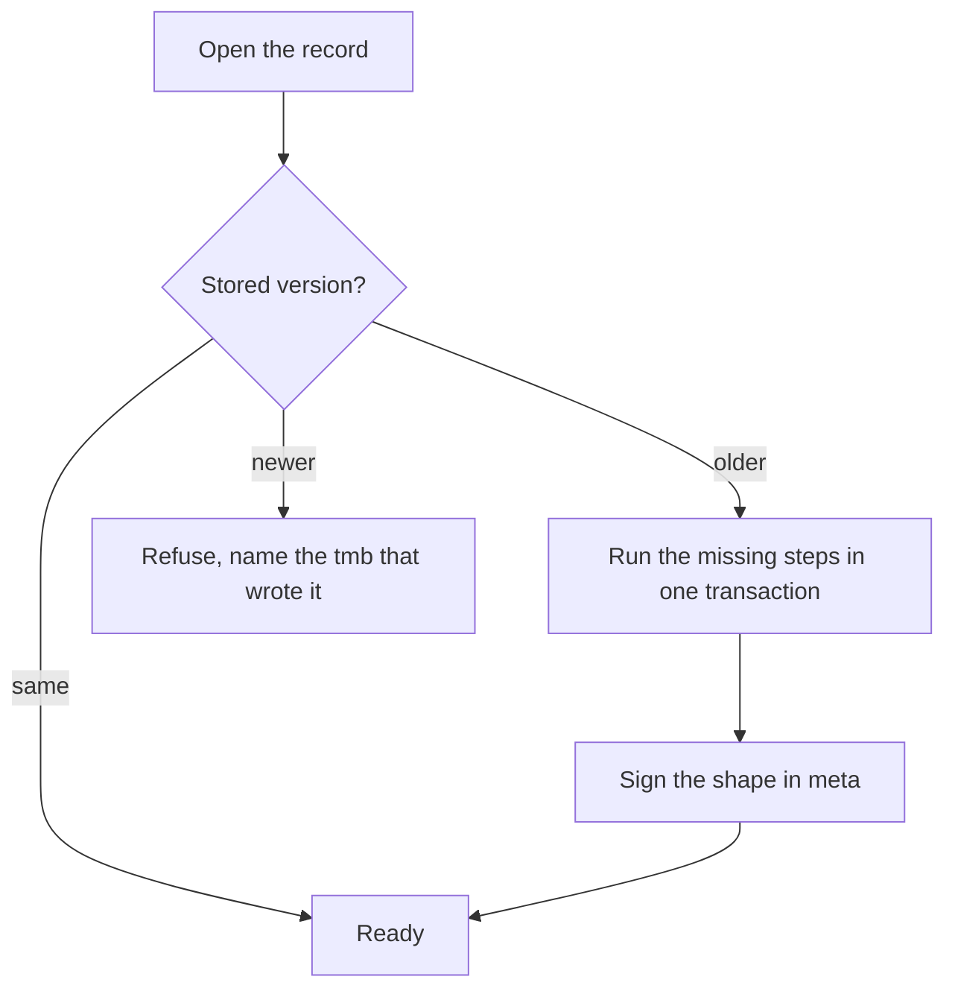
