# Trajectories

The record of the work: what was asked, what was decided, what each agent did and how it ended. Any session can resume from it without the conversation that came before, and it answers "why is this still running?" and "why did this stop?" from records, not guesses.

A task's own trajectory is in [3_TASKS.md](../flows/3_TASKS.md#task-lifecycle). This page covers what a task runs inside: sessions, agent runs, gate decisions and check runs.

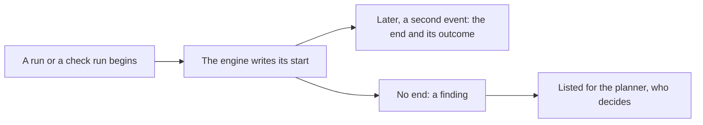

## 1. Outcomes are recorded at checkpoints

tmb records outcomes at checkpoints. It does not record each tool call or each step of an agent.

- **Example 1.** A worker closes its task. The check run at close is recorded, with each command and its result.
- **Example 2.** The gate denies a worker's start. The deny is recorded with its reason.
- **Not recorded:** file writes and shell commands. tmb reads neither.

| Record | Holds |
|---|---|
| Issue | A goal, its state and its milestone |
| Discussion | Notes and decisions on an issue. The newest decision is the one in force; one that conflicts with an earlier decision is confirmed by the Human first |
| Feature branch | A branch tasks fold into, its base, its state and its repo |
| Task | A spec, its kind, its state, its branch, its commit and its repo |
| Run | One worker or reviewer on one task or one review: start, end, how it ended, its cost |
| Check run | The checks run on a commit, each command and its result: start and end |
| Review | A reviewer's verdict on a commit or a feature branch, its findings, and the run that wrote it |
| Guard decision | Each allow and deny the gate gave at a checkpoint, and why |
| Audit entry | Every change to configuration and every Human waiver |
| Doc | **Planned** (trustmybot/tmb#302). One design document: where it lives, in a repo or outside it such as a wiki, what it is for, and its repo |
| Session | **Planned** (trustmybot/tmb#63, trustmybot/tmb#254). One host session, with its start, its end and its own cost |

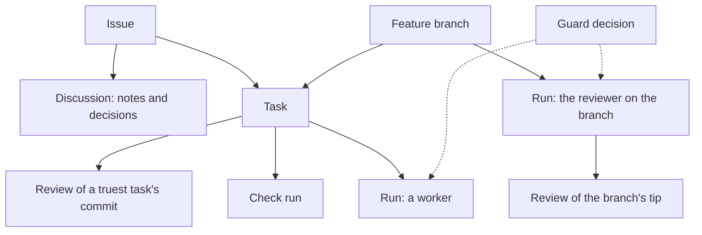

## 2. A start and an end are two events

A run and a check run each write their start before any work. The end is a second event, and it carries the outcome.

- **Example.** A check run starts at close and writes its start. When the checks end, a second event adds the result. The start is never edited into an end: the record only adds events, and the current state is derived from them.
- **Edge case.** A start without an end is a finding: the work is still running, or it stopped without saying so.

## 3. Every record names what it belongs to and who made it

Each record points at its parent, so the work forms a tree. Each record also names its maker: the Human, or the role and host that acted.

| Record | Names |
|---|---|
| Run | Its task, or its feature branch for a branch review |
| Review | The run that wrote it |
| Check run | Its task and its commit |

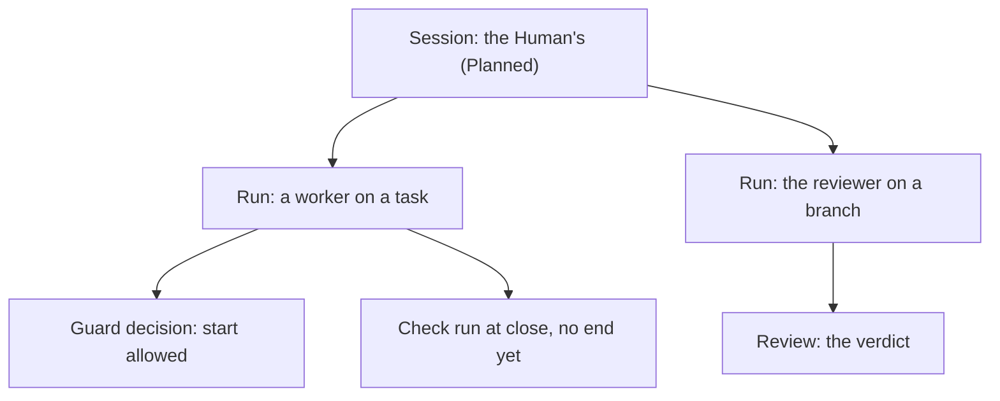

The chart is one moment of a real tree. To find what is stuck, follow the records with no end downward: the lowest one is where the work stopped. The tree starts at the run. Planned: the session level and the link from a run to its session.

- **Example 1.** A push tmb makes for an agent is that agent's.
- **Example 2.** A push typed by hand is the Human's (trustmybot/tmb#134).
- **Edge case.** Every command-line call is the Human's. That is why a step only the Human may take needs a terminal and a typed yes ([HOSTS.md](HOSTS.md)).

## 4. The engine is the only writer

Agents, the command line and the dashboard change the record only through the engine, so every rule is enforced in one place.

| Rule | In practice |
|---|---|
| Reads return small pieces | A brief, a section or a ranked snippet, never a dump |
| Ids never collide across machines | A record can be copied to another machine without renumbering |
| Writes stay cheap | The database takes one writer at a time, so a record at a checkpoint is one small insert |

## 5. A run is one start of a worker or the reviewer

A run ends as finished or stopped (trustmybot/tmb#133).

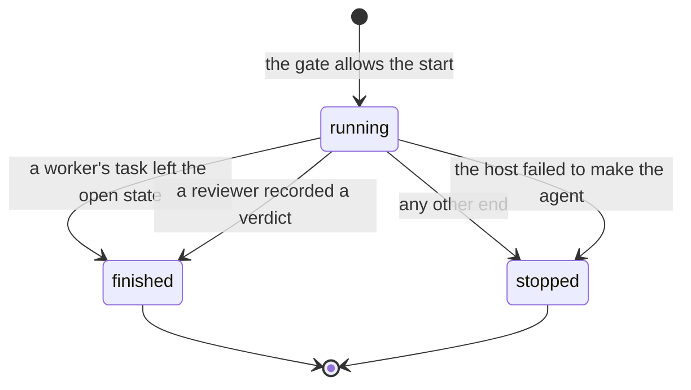

- **Example.** A reviewer gives no verdict. Its run is stopped.
- **Edge case.** The gate allows a start and the host then fails to make the agent. No agent ran, so no stop would come to end the run. The run is stopped (trustmybot/tmb#285).
- **A denied start opens no run.** It is recorded as a guard decision with its reason, so "why did the worker never start?" has a record.
- **The planner's own turns are not a run.** They belong to the session record, which is Planned.
- **A reviewer that is a host's main agent** has no subagent start. Its run opens at that host's session start and ends with its verdict.

**Cost is tokens, per model:** input, output, cache read and cache write, given by the host's adapter.

- **Edge case.** A run whose usage cannot be read has no cost, and that is not an error.
- **tmb records no price.** Prices change, and a subscription has none per run.

**Planned:** a fixed list of causes on a stopped run (failed, out of turns, killed), and a resumed run that names the run it resumes.

## 6. A check run is one execution of a task's checks on one commit

Verification is recorded as check runs. The checks run at close, and again after a fold or a rebase moved the commit.

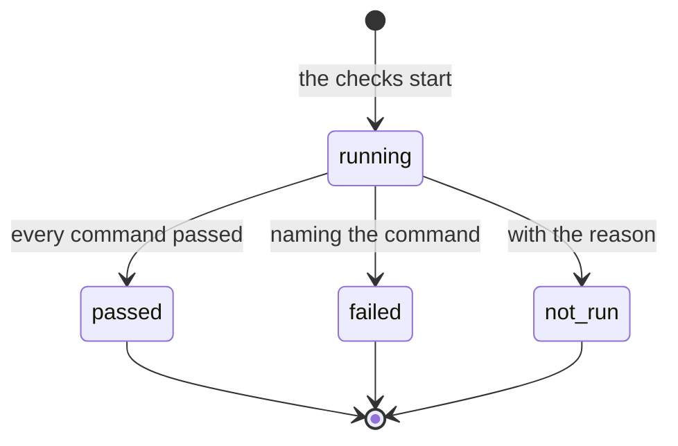

- **Edge case.** A check run killed with its session keeps its start and has no end, so it shows as a finding.

## 7. A guard decision is one answer of the gate

In tmb a hook runs only at a checkpoint: a session start, an agent's start or stop, and git's pre-push hook. Every answer is recorded, allow and deny, with the event and the reason.

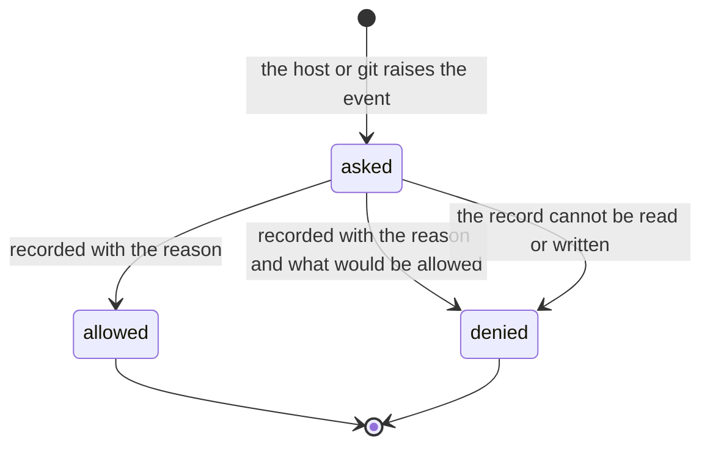

- **Edge case.** A gate never fails open on a broken record. It denies when it cannot read or write the record, and allows only where tmb was never set up.
- **Not events:** a task's start and close. The engine checks them when asked, and a refusal goes to the caller without a guard decision.
- **A decision is written once, when it is made.** Planned: a start written before the hook's work, so a hook that hangs or crashes leaves a record.

## 8. A session holds the runs

Planned (trustmybot/tmb#63, trustmybot/tmb#254). A record names the role and host, not the session. The session record is what tells the work of two sessions on one project apart.

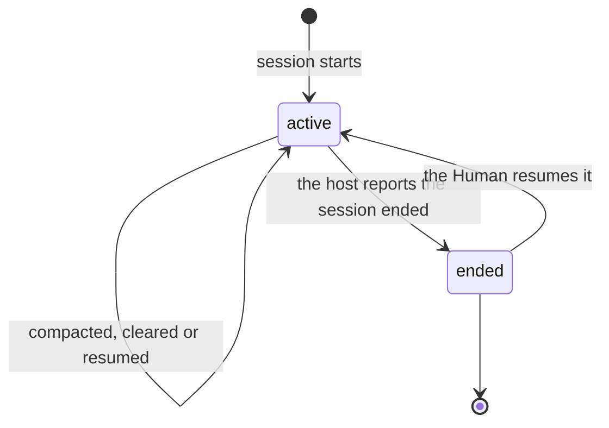

- **One stable id** across a compaction, a clear and a resume.
- **A session with a start and no end is a finding,** like a run.
- **A session's own tokens** are recorded with the same four counts as a run's, apart from its runs' counts, so a total counts nothing twice.
- **tmb starts no session and assigns no work between sessions.** [RESPONSIBILITIES.md](RESPONSIBILITIES.md#parallel-lanes) covers parallel sessions.

## 9. Nothing is skipped silently

A step that did not run is recorded as not run, with the reason.

- **Examples.** A check that could not run, a backup push that was skipped, a commit status that could not be sent, a push allowed in an exempt repo.
- **Edge case.** The host does not name the role of an agent it starts. The start is allowed and recorded as a finding.

## 10. Stuck work is listed, never ended

tmb has no watcher and no timer: it runs only when something calls it (trustmybot/tmb#160).

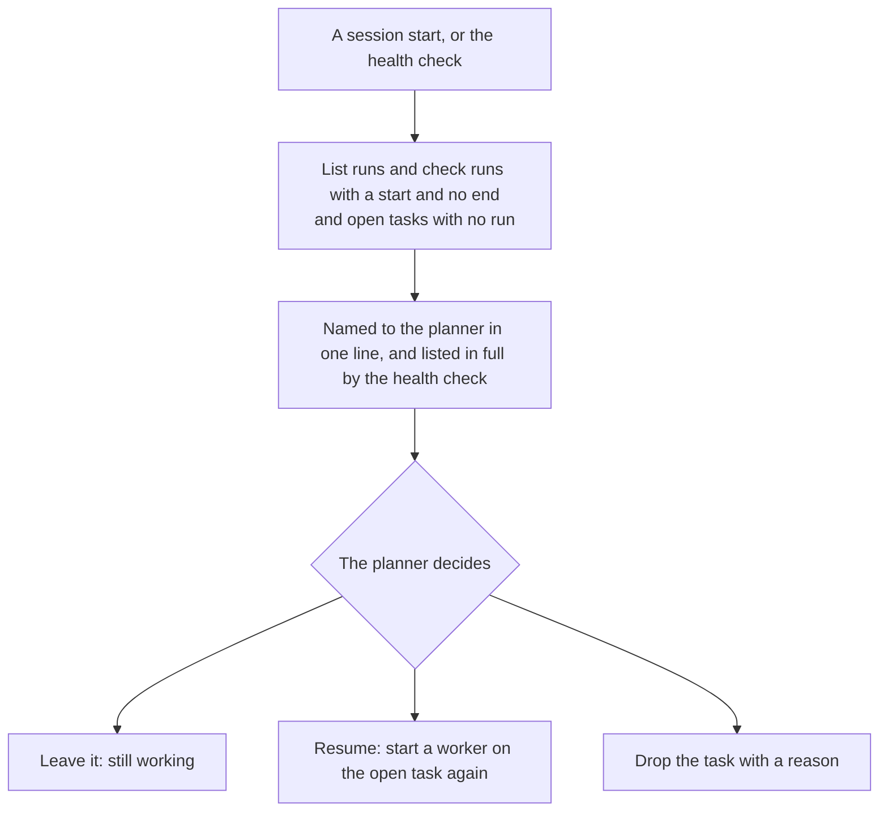

- **Last activity needs no heartbeat.** It is the newest record under the run.
- **Nothing is ended for the agent.** tmb lists what has no end and deletes nothing.

## 11. One database file per project

The file sits inside the project's folder and is left out of git. The engine creates it at init and is the only program that migrates it.

- **Example 1.** A multi-repo workspace shares one file, in the workspace folder ([3_GIT.md](../flows/3_GIT.md#multi-repo-workspaces)).
- **Example 2.** Each feature branch and task names its repo. One with none belongs to the project folder itself.

| State | Gate | Other commands |
|---|---|---|
| No database | Allows: tmb stays out of projects it was never set up in | Offer `tmb init` |
| Readable | Decides normally | Run normally |
| Unreadable, empty, or made by a newer tmb | Denies, naming the cause, and for a newer one the version that wrote it | None runs. `tmb doctor` still runs and reads the record read-only |

- **The code graph is separate.** It can be rebuilt from git at any time and lives in its own file, one per repo. Indexing is not recorded in the trajectory ([CODE_GRAPH.md](CODE_GRAPH.md)).
- **Plugin projects.** A one-way migration carries a plugin project's records into a new tmb database and leaves the plugin's database untouched. A kind of record tmb does not have is left behind, not folded into another kind.

## 12. Debugging with it

| Question | Where the answer is |
|---|---|
| What is stuck? | `tmb doctor`: runs and check runs with a start and no end, and open tasks with no run |
| Why did the worker never start? | The guard decision for its start: the deny names the reason and what would be allowed |
| Did the worker finish? | Its run's outcome: finished or stopped |
| Why did the close fail? | The task's newest check run: each command and its result |
| Why did the gate let this push through? | The guard decision: covered by a pass or waiver, or an exempt repo. With no record in the project nothing is recorded, and the hook says so in one line |
| Who waived this review? | The audit trail |
| What did this task cost? | The cost on its runs, in tokens per model |
| Why three re-runs of this task? | The task's events in order, with its runs and reviews ([3_TASKS.md](../flows/3_TASKS.md#task-lifecycle)) |
| Why does this session never end? | Planned, with the session record |

## Schema

The record is one SQLite file, `.tmb/trajectory.db`, in the workspace folder and left out of git. Its schema is `src/engine/store/schema.ts`, at `SCHEMA_VERSION = 11` (`PRAGMA user_version`). The code graph has its own file and schema ([CODE_GRAPH.md](CODE_GRAPH.md#schema)); no foreign key crosses between the two.

**This section lists every table and column of the record.** A schema change updates it in the same pull request. Planned: a generator with a freshness test that fails when it drifts.

The record is tmb's cold memory ([`MEMORY.md`](MEMORY.md)): the only source of truth for workflow state. Its tables fall into four groups:

- **Events** — `events`, the one append-only table. Every write to the record is one event; nothing else is the source of truth.
- **Projections** — `issues`, `discussions`, `features`, `tasks`, `runs`, `check_runs`, `reviews`, `guard_decisions`, `audit`. Each row is the current state of one record, folded from its events. They can be emptied and rebuilt from `events`.
- **Search** — `search`, one full-text index over issues and discussions.
- **Meta** — `meta`, the record's own facts: which tmb wrote its shape.

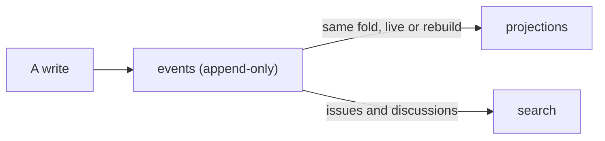

### Design requirements

Every table, and every change to one, meets these two requirements.

- **Trajectory.** The record exists to keep the trajectory of work. Every table either records a step in it (a fact) or describes something that takes part in it (a dimension). Anything else does not belong in it.
- **Consistency.** Naming is consistent. A projection table is plural and its record kind is the singular: `tasks` → `task`, `check_runs` → `check_run`. Every projection row carries its id, `created_by` (the JSON actor of its first event) and `created_at` (that event's time). Ids are ULIDs, never autoincrement.

### Diagram

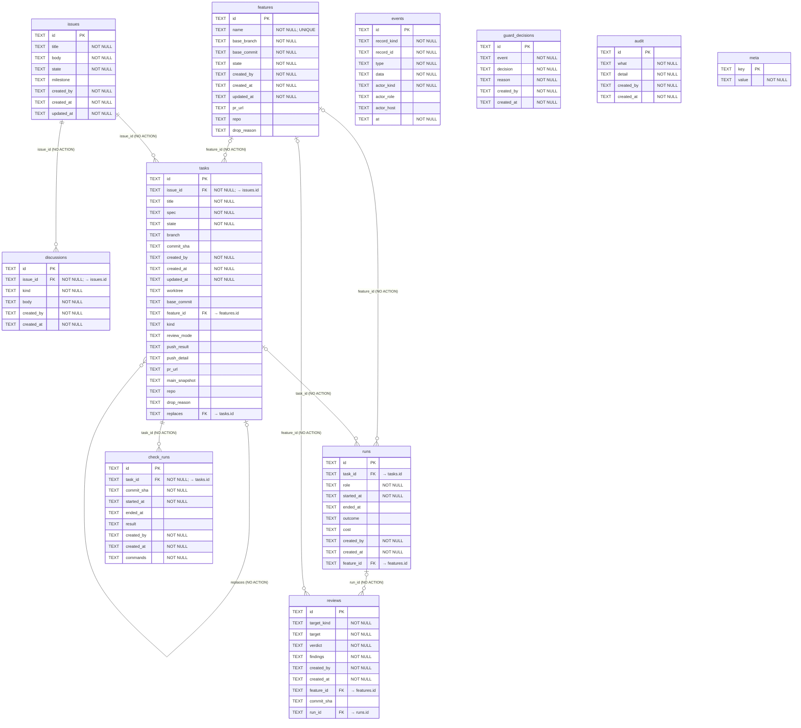

### Tables

#### `events`

| Column | Type | Null | Default | Constraints |
|---|---|---|---|---|
| `id` | TEXT | nullable |  | PK |
| `record_kind` | TEXT | NOT NULL |  | CHECK `record_kind IN ('issue','discussion','task','run','check_run','review','guard_decision','audit','feature')` |
| `record_id` | TEXT | NOT NULL |  |  |
| `type` | TEXT | NOT NULL |  |  |
| `data` | TEXT | NOT NULL |  | CHECK `json_valid(data)` |
| `actor_kind` | TEXT | NOT NULL |  | CHECK `actor_kind IN ('human','agent')` |
| `actor_role` | TEXT | nullable |  | CHECK `actor_role IN ('planner','worker','reviewer')` |
| `actor_host` | TEXT | nullable |  |  |
| `at` | TEXT | NOT NULL |  |  |

Table constraints:

- CHECK `(actor_kind = 'human' AND actor_role IS NULL AND actor_host IS NULL) OR (actor_kind = 'agent' AND actor_role IS NOT NULL AND length(trim(actor_host)) > 0)`

#### `issues`

| Column | Type | Null | Default | Constraints |
|---|---|---|---|---|
| `id` | TEXT | nullable |  | PK |
| `title` | TEXT | NOT NULL |  | CHECK `length(trim(title)) > 0` |
| `body` | TEXT | NOT NULL | `''` |  |
| `state` | TEXT | NOT NULL | `'open'` | CHECK `state IN ('open','closed')` |
| `milestone` | TEXT | nullable |  |  |
| `created_by` | TEXT | NOT NULL |  |  |
| `created_at` | TEXT | NOT NULL |  |  |
| `updated_at` | TEXT | NOT NULL |  |  |

#### `discussions`

| Column | Type | Null | Default | Constraints |
|---|---|---|---|---|
| `id` | TEXT | nullable |  | PK |
| `issue_id` | TEXT | NOT NULL |  | FK → `issues.id` ON DELETE NO ACTION |
| `kind` | TEXT | NOT NULL |  | CHECK `kind IN ('note','decision')` |
| `body` | TEXT | NOT NULL |  | CHECK `length(trim(body)) > 0` |
| `created_by` | TEXT | NOT NULL |  |  |
| `created_at` | TEXT | NOT NULL |  |  |

#### `features`

| Column | Type | Null | Default | Constraints |
|---|---|---|---|---|
| `id` | TEXT | nullable |  | PK |
| `name` | TEXT | NOT NULL |  | UNIQUE; CHECK `length(trim(name)) > 0` |
| `base_branch` | TEXT | NOT NULL |  |  |
| `base_commit` | TEXT | NOT NULL |  |  |
| `state` | TEXT | NOT NULL | `'open'` |  |
| `created_by` | TEXT | NOT NULL |  |  |
| `created_at` | TEXT | NOT NULL |  |  |
| `updated_at` | TEXT | NOT NULL |  |  |
| `pr_url` | TEXT | nullable |  |  |
| `repo` | TEXT | nullable |  |  |
| `drop_reason` | TEXT | nullable |  |  |

#### `tasks`

| Column | Type | Null | Default | Constraints |
|---|---|---|---|---|
| `id` | TEXT | nullable |  | PK |
| `issue_id` | TEXT | NOT NULL |  | FK → `issues.id` ON DELETE NO ACTION |
| `title` | TEXT | NOT NULL |  | CHECK `length(trim(title)) > 0` |
| `spec` | TEXT | NOT NULL | `''` |  |
| `state` | TEXT | NOT NULL |  |  |
| `branch` | TEXT | nullable |  |  |
| `commit_sha` | TEXT | nullable |  |  |
| `created_by` | TEXT | NOT NULL |  |  |
| `created_at` | TEXT | NOT NULL |  |  |
| `updated_at` | TEXT | NOT NULL |  |  |
| `worktree` | TEXT | nullable |  |  |
| `base_commit` | TEXT | nullable |  |  |
| `feature_id` | TEXT | nullable |  | FK → `features.id` ON DELETE NO ACTION |
| `kind` | TEXT | nullable |  |  |
| `review_mode` | TEXT | nullable |  |  |
| `push_result` | TEXT | nullable |  |  |
| `push_detail` | TEXT | nullable |  |  |
| `pr_url` | TEXT | nullable |  |  |
| `main_snapshot` | TEXT | nullable |  |  |
| `repo` | TEXT | nullable |  |  |
| `drop_reason` | TEXT | nullable |  |  |
| `replaces` | TEXT | nullable |  | FK → `tasks.id` ON DELETE NO ACTION |

#### `runs`

| Column | Type | Null | Default | Constraints |
|---|---|---|---|---|
| `id` | TEXT | nullable |  | PK |
| `task_id` | TEXT | nullable |  | FK → `tasks.id` ON DELETE NO ACTION |
| `role` | TEXT | NOT NULL |  | CHECK `role IN ('planner','worker','reviewer')` |
| `started_at` | TEXT | NOT NULL |  |  |
| `ended_at` | TEXT | nullable |  |  |
| `outcome` | TEXT | nullable |  |  |
| `cost` | TEXT | nullable |  | CHECK `cost IS NULL OR json_valid(cost)` |
| `created_by` | TEXT | NOT NULL |  |  |
| `created_at` | TEXT | NOT NULL |  |  |
| `feature_id` | TEXT | nullable |  | FK → `features.id` ON DELETE NO ACTION |

#### `check_runs`

| Column | Type | Null | Default | Constraints |
|---|---|---|---|---|
| `id` | TEXT | nullable |  | PK |
| `task_id` | TEXT | NOT NULL |  | FK → `tasks.id` ON DELETE NO ACTION |
| `commit_sha` | TEXT | NOT NULL |  |  |
| `started_at` | TEXT | NOT NULL |  |  |
| `ended_at` | TEXT | nullable |  |  |
| `result` | TEXT | nullable |  |  |
| `created_by` | TEXT | NOT NULL |  |  |
| `created_at` | TEXT | NOT NULL |  |  |
| `commands` | TEXT | NOT NULL | `'[]'` | CHECK `json_valid(commands)` |

#### `reviews`

| Column | Type | Null | Default | Constraints |
|---|---|---|---|---|
| `id` | TEXT | nullable |  | PK |
| `target_kind` | TEXT | NOT NULL |  | CHECK `target_kind IN ('commit','branch')` |
| `target` | TEXT | NOT NULL |  |  |
| `verdict` | TEXT | NOT NULL |  |  |
| `findings` | TEXT | NOT NULL | `'[]'` | CHECK `json_valid(findings)` |
| `created_by` | TEXT | NOT NULL |  |  |
| `created_at` | TEXT | NOT NULL |  |  |
| `feature_id` | TEXT | nullable |  | FK → `features.id` ON DELETE NO ACTION |
| `commit_sha` | TEXT | nullable |  |  |
| `run_id` | TEXT | nullable |  | FK → `runs.id` ON DELETE NO ACTION |

#### `guard_decisions`

| Column | Type | Null | Default | Constraints |
|---|---|---|---|---|
| `id` | TEXT | nullable |  | PK |
| `event` | TEXT | NOT NULL |  |  |
| `decision` | TEXT | NOT NULL |  | CHECK `decision IN ('allow','deny')` |
| `reason` | TEXT | NOT NULL |  |  |
| `created_by` | TEXT | NOT NULL |  |  |
| `created_at` | TEXT | NOT NULL |  |  |

#### `audit`

| Column | Type | Null | Default | Constraints |
|---|---|---|---|---|
| `id` | TEXT | nullable |  | PK |
| `what` | TEXT | NOT NULL |  | CHECK `length(trim(what)) > 0` |
| `detail` | TEXT | NOT NULL | `''` |  |
| `created_by` | TEXT | NOT NULL |  |  |
| `created_at` | TEXT | NOT NULL |  |  |

#### `meta`

| Column | Type | Null | Default | Constraints |
|---|---|---|---|---|
| `key` | TEXT | nullable |  | PK |
| `value` | TEXT | NOT NULL |  | CHECK `json_valid(value)` |

### Planned: `docs`

Planned (trustmybot/tmb#302). One row per design document, so the planner finds the design whether it lives in the repo, outside it such as on a wiki, or in the record itself. A projection like the others: record kind `doc`, folded from its events.

| Column | Type | Null | Default | Constraints |
|---|---|---|---|---|
| `id` | TEXT | nullable |  | PK |
| `repo` | TEXT | nullable |  | The repo the document describes, named as `features.repo` and `tasks.repo` name theirs; NULL is the project folder itself |
| `location` | TEXT | NOT NULL |  | A path inside the repo, a link outside it, or a name for a document kept in the record. UNIQUE with `repo`; CHECK `length(trim(location)) > 0` |
| `body` | TEXT | nullable |  | The document's text, only for a document kept in the record; NULL when it lives at `location` |
| `title` | TEXT | NOT NULL |  | CHECK `length(trim(title)) > 0` |
| `purpose` | TEXT | NOT NULL |  | What the document is for and when to read it. CHECK `length(trim(purpose)) > 0` |
| `state` | TEXT | NOT NULL | `'current'` | `current` or `retired`. A retired row is kept |
| `created_by` | TEXT | NOT NULL |  |  |
| `created_at` | TEXT | NOT NULL |  |  |
| `updated_at` | TEXT | NOT NULL |  |  |

- **A document lives in one place.** One in the repo or outside it stays there, and the row says where that is and what it is for. One kept in the record has its text in `body`, for a project that keeps no docs in its code.
- **The planner records and updates it;** the Human may. An updated event may change `location`, `body`, `title`, `purpose` and `state`.
- **A task's spec names a row** as the design it implements ([`3_TASKS.md`](../flows/3_TASKS.md)).

### Foreign keys

| Column | References | On delete |
|---|---|---|
| `discussions.issue_id` | `issues.id` | NO ACTION |
| `tasks.replaces` | `tasks.id` | NO ACTION |
| `tasks.feature_id` | `features.id` | NO ACTION |
| `tasks.issue_id` | `issues.id` | NO ACTION |
| `runs.feature_id` | `features.id` | NO ACTION |
| `runs.task_id` | `tasks.id` | NO ACTION |
| `check_runs.task_id` | `tasks.id` | NO ACTION |
| `reviews.run_id` | `runs.id` | NO ACTION |
| `reviews.feature_id` | `features.id` | NO ACTION |

The record opens with `foreign_keys = ON`.

### Search indexes

All are FTS5 virtual tables.

| Index | File | Indexed columns | Unindexed columns | Tokenizer |
|---|---|---|---|---|
| `search` | record | `title`, `body` | `record_kind`, `record_id`, `issue_id` | `porter unicode61 remove_diacritics 2` |

There are no embedding tables: search is ranked word search plus the code graph.

### Indexes

| Index | Table | Columns | Unique |
|---|---|---|---|
| `idx_events_record` | `events` | `record_id, id` | no |
| `idx_issues_state` | `issues` | `state, id` | no |
| `idx_discussions_issue` | `discussions` | `issue_id, kind, id` | no |
| `idx_features_state` | `features` | `state, id` | no |
| `idx_tasks_feature` | `tasks` | `feature_id, id` | no |
| `idx_tasks_state` | `tasks` | `state, id` | no |
| `idx_tasks_issue` | `tasks` | `issue_id, id` | no |
| `idx_runs_feature` | `runs` | `feature_id, id` | no |
| `idx_runs_open` | `runs` | `role, ended_at, id` | no |
| `idx_runs_task` | `runs` | `task_id, id` | no |
| `idx_check_runs_task` | `check_runs` | `task_id, id` | no |
| `idx_reviews_feature` | `reviews` | `feature_id, id` | no |

### Triggers

| Trigger | Table | Does |
|---|---|---|
| `events_no_update` | `events` | Refuses every UPDATE: events are append-only |
| `events_no_delete` | `events` | Refuses every DELETE: events are append-only |

### How the groups connect

- Every discussion and task belongs to one issue. A task may also belong to a feature branch, and may name the dropped task it replaces.
- A run links to what it worked on: a task, or a feature branch for a branch review. A review names the feature branch and commit it judged, and the run that wrote it.
- A feature branch and a task record the repo they were cut in; NULL is the project folder itself.
- Settings are not a table: each change to a setting is an `audit` row, and the newest row is the value in force ([`CONFIG.md`](CONFIG.md)).
- A few references are soft: `reviews.target`, `tasks.branch` and every commit column hold a name or a SHA with no declared foreign key.

### Rules the data keeps

- **Events are append-only.** Two triggers refuse any UPDATE or DELETE on `events`.
- **Current state is a fold.** The live write path and the rebuild apply the same function to each event, so a rebuilt projection matches the live one.
- **Two event types.** An event is `created` or `updated`. Each record kind lists the columns a created event fills and the columns an updated event may change; `discussions`, `reviews`, `guard_decisions` and `audit` rows never change.
- **Every write has an actor.** The Human, or an agent named by its role and host. A human actor carries no role or host; an agent actor carries both.
- **Verdicts are append-only.** A new review adds a row. A review names the exact commit it judged, so a later commit is never taken as reviewed.
- **Checks are recorded, not re-run.** Each run of a task's checks is a `check_runs` row with each command it ran and the commit it ran at.
- **Cost is metered, not stored as totals.** A run's `cost` holds the tokens it used per model, filled when the run ends.
- **Nothing is dropped silently.** A dropped task or feature branch keeps its row and its `drop_reason`.
- **Roles are enforced by the engine, not the schema.** Each operation checks which role may call it ([`RESPONSIBILITIES.md`](RESPONSIBILITIES.md)).

### Schema migration policy

The record's schema is a list of steps, one per version; step *i* takes a database from version *i* to *i + 1*, so a new database and an upgraded one end with the same tables. On open, every missing step runs in one transaction, so the file is never left between versions, and the shape is signed in `meta` with the version and program that wrote it. A record a newer tmb reshaped is refused, never downgraded, and the refusal names the program that wrote it.

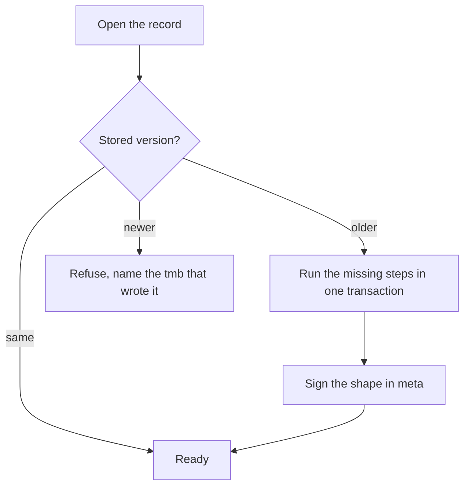
