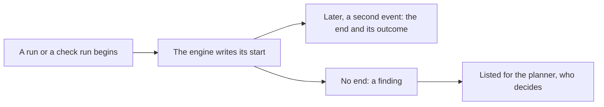
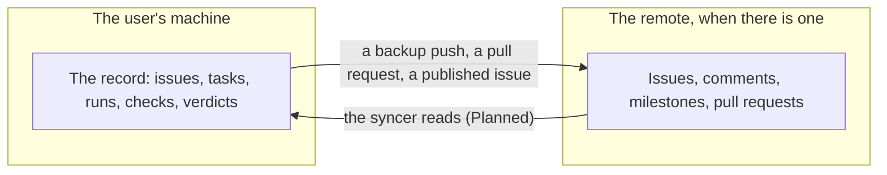
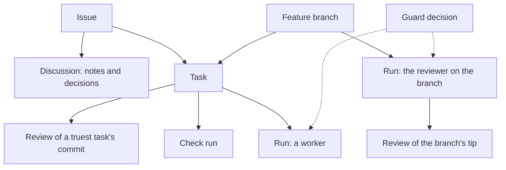
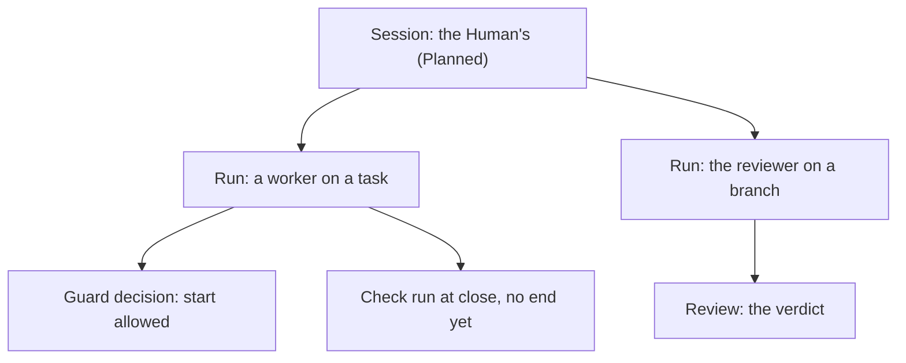
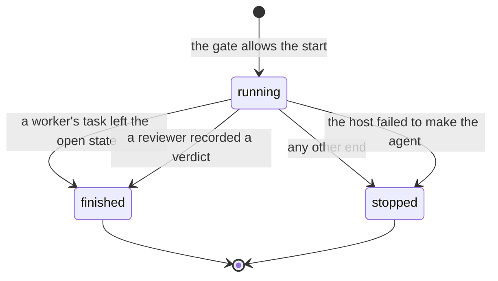
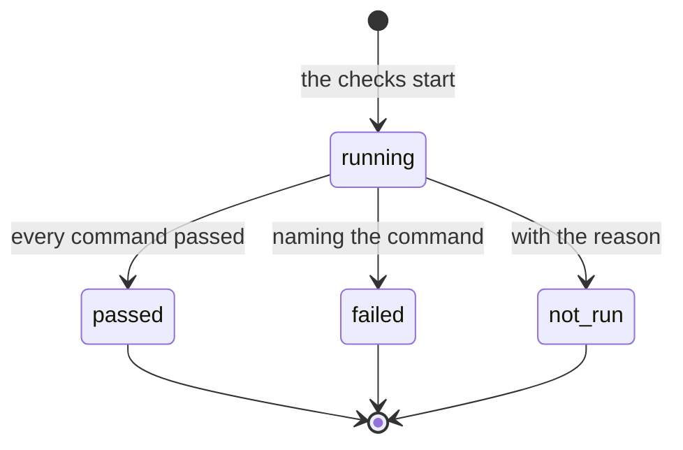
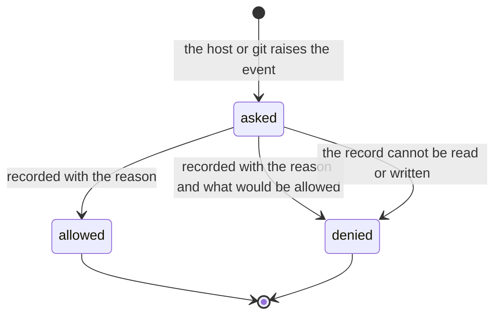
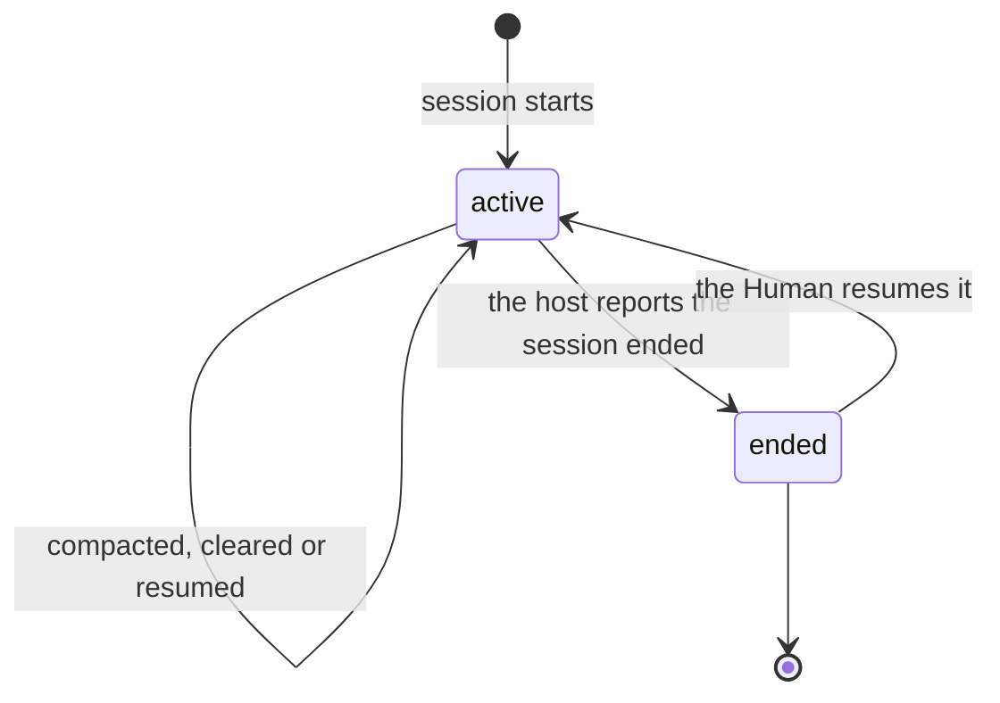
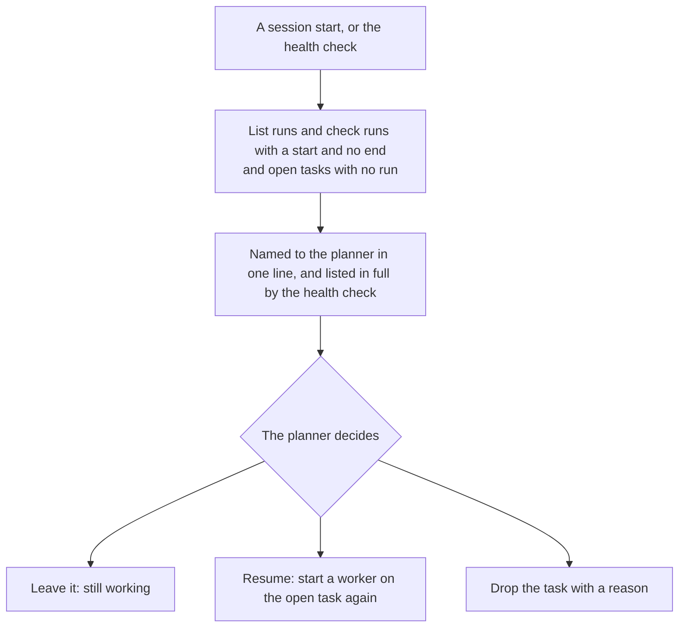

# Trajectories

The record of the work: what was asked, what was decided, what each agent did and how it ended. Any session can resume from it without the conversation that came before, and it answers "why is this still running?" and "why did this stop?" from records, not guesses.

A task's own trajectory is in [3_TASKS.md](../flows/3_TASKS.md#task-lifecycle). This page covers what a task runs inside: sessions, agent runs, gate decisions and check runs.

## What the record is for

**The record does three jobs, and every table serves one of them.**

| Job | What it means |
|---|---|
| Keep the trajectory | What was asked, decided, done and judged on this machine, as events |
| Bridge local and remote | It ties the user's local work to the remote's issues, comments and pull requests, as the code graph ties the design to the code |
| Leave room | A new host, role, remote, kind of record or field on the remote is a new value or a new row, never a rewrite |

- **Example 1.** A teammate's comment on the remote and the worker's run that answered it are found from the same issue row.
- **Example 2.** The remote adds a field to its issues. The syncer keeps it in the event's data that day, and a column can be folded from those events later.
- **Edge case.** The project has no remote. The bridge has nothing to tie, and the trajectory is whole without it.

## The record is local first

**The record works with no remote. A remote adds what teammates see, and replaces nothing in the record.**

A person working with agents needs a memory that a remote has no place for: which task an agent took, what it cost, which commit a verdict judged, why the gate said no. The record keeps that on the user's machine, whether or not the project has a remote.

- **Example 1, local.** A project has no remote. Its issues, decisions, tasks, runs and verdicts are all in the record. It needs no account and no network, and a new session resumes from it.
- **Example 2, local with a remote.** Planned (trustmybot/tmb#70). The remote's issues, comments, milestones and pull requests are mirrored into the record. The tasks, runs and verdicts under them stay local.
- **Edge case.** The network is down. Work goes on from the record. The copy of the remote is as old as the last poll, and the record says how old.
- **Edge case.** The remote and the record disagree about a mirrored issue. The remote wins, and the change is written as an event made by tmb.

| | Local | Local with a remote |
|---|---|---|
| Issues | Made in the record | Mirrored from the remote, beside the local ones |
| Comments, milestones, pull requests | Notes and decisions, in the record | Mirrored from the remote |
| Tasks, runs, check runs, reviews, guard decisions | In the record | In the record only, never on the remote |
| Which side is the truth | The record | The remote for what it holds, the record for the rest |
| What tmb sends to the remote | Nothing | A branch pushed as a backup, a pull request, a review mark on a commit, and an issue the Human publishes |

- **The syncer only reads.** It never writes to the remote, and it never changes a local issue.
- **A row with no remote id is local.** Publishing an issue gives it one (Planned, trustmybot/tmb#409).
- **Teammates see only what is on the remote.** A note or a decision is local. Planned (trustmybot/tmb#409): the Human may publish one as a comment, as the Human publishes an issue.

### Every kind of repo

**The record keeps what happened, a setting keeps the choice, and the remote's own id ties a row to its item on the remote.** Every row marked Planned is trustmybot/tmb#70 or trustmybot/tmb#411.

- **Example 1.** A teammate asks for changes on the user's pull request. The comment is a discussion on that pull request, so the worker is shown it.
- **Example 2.** A teammate's pull request closes the user's issue. It is a pull request row with an author, no task and no feature branch.
- **Edge case.** An issue is assigned to a teammate. The planner sees the account is not the user's, which is a setting, and leaves the issue alone.
- **Edge case.** The repo is renamed or moved on the remote. Each item keeps its remote id, so each row is kept and only its address changes.

| The project is | What the record does | |
|---|---|---|
| A repo with no remote | Everything is local. The backup push is recorded as not run | |
| A repo with the user's own remote, worked on alone | Mirrors the remote's issues, comments, milestones and pull requests | Planned |
| A repo shared with teammates | The same, and each mirrored row names the account that wrote it. Work assigned to someone else is left alone | Planned |
| A fork | Two remotes. Issues come from the upstream, the branch is pushed to the fork, and the pull request names both. Which remote is the upstream is a setting | Planned |
| A repo that takes pull requests from other people's forks | Each is a pull request row whose branch is in another remote, with its author and no task | Planned |
| A repo whose issues are kept in another repository | Which repository the issues come from is a setting. The issue names its own repository | Planned |
| A repo with several remotes, such as a mirror | One remote is the one issues come from, by the same setting. The others only take pushes | Planned |
| A multi-repo workspace | One record. Each row names its repo, and each repo is mirrored from its own remote | Planned: the mirror |
| A remote tmb cannot read: not GitHub, or no sign-in | Works as local. Pushes still go, and the record says the remote is not read | Planned |
| A second clone of the same repo on one machine | A second project with its own record. A task's worktree is not a clone: it shares its project's record | |
| The same repo on a second machine | The record is per machine and out of git. Mirrored issues come back with the first full pass. Local issues, tasks and runs stay on the first machine | Planned: the mirror |

- **Edge case.** A repo gains a remote later. Its local issues stay local until the Human publishes each one.
- **Edge case.** A repo loses its remote, or the user loses access. The mirrored rows are kept and marked gone from the remote; nothing is deleted.

## 1. Outcomes are recorded at checkpoints

tmb records outcomes at checkpoints. It does not record each tool call or each step of an agent.

- **Example 1.** A worker closes its task. The check run at close is recorded, with each command and its result.
- **Example 2.** The gate denies a worker's start. The deny is recorded with its reason.
- **Not recorded:** file writes and shell commands. tmb reads neither.

| Record | Holds |
|---|---|
| Issue | A goal, its state and its milestone. **Planned** (trustmybot/tmb#402): its priority, type, labels and links to other issues |
| Discussion | Notes and decisions on an issue. The newest decision is the one in force; one that conflicts with an earlier decision is confirmed by the Human first |
| Feature branch | A branch tasks fold into, its base, its state and its repo |
| Task | A spec, its kind, its state, its branch, its commit and its repo |
| Run | One worker or reviewer on one task or one review: start, end, how it ended, its cost |
| Check run | The checks run on a commit, each command and its result: start and end |
| Review | A reviewer's verdict on a commit or a feature branch, its findings, and the run that wrote it |
| Guard decision | Each allow and deny the gate gave at a checkpoint, and why |
| Waiver, review mark, setting change | Each Human waiver, each mark sent to the remote and each change to a setting is its own record, as are a feedback report and an import |
| Doc | **Planned** (trustmybot/tmb#302). One design document: where it lives, in a repo or outside it such as a wiki, what it is for, and its repo |
| Session | **Planned** (trustmybot/tmb#63, trustmybot/tmb#254). One host session, with its start, its end and its own cost |
| Pull request | **Planned** (trustmybot/tmb#405). One pull request, what it carries and its state on the remote |
| Milestone | **Planned** (trustmybot/tmb#70). One milestone, open or closed, matched to the remote's |

### Which work gets a record

**Work worth keeping is an issue with its tasks. Ad hoc work in the chat leaves no record.** A task always belongs to one issue; there is no task without one.

- **Example 1, synced.** A teammate assigns the user an issue on the remote. The syncer brings it into the record, the planner cuts tasks under it, and its state and comments follow the remote.
- **Example 2, local only.** The user tries an exploratory fix. The planner opens an issue in the record only, and cuts tasks under it. Nothing reaches the remote.
- **Example 3, no record.** The user asks the planner for a throwaway review page and updates to it. That is conversation: no issue, no task, no run.
- **Edge case.** The exploratory fix proves worth sharing. The Human says publish, and the issue is created on the remote and tied to it. From then on it is synced.
- **Edge case.** The planner is unsure whether a request is worth a record. It asks the Human; it never opens an issue to cover a chat.
- **Edge case.** Ad hoc work still costs tokens. The session's own cost counts them (Planned, trustmybot/tmb#254); no task does.

| Work | In the record | On the remote |
|---|---|---|
| A remote issue | Issue and tasks | Synced. Planned (trustmybot/tmb#70) |
| A local issue | Issue and tasks | Nothing, until the Human publishes it. Planned (trustmybot/tmb#409) |
| Ad hoc work in the chat | Nothing | Nothing |

## 2. A start and an end are two events

A run and a check run each write their start before any work. The end is a second event, and it carries the outcome.

- **Example.** A check run starts at close and writes its start. When the checks end, a second event adds the result. The start is never edited into an end: the record only adds events, and the current state is derived from them.
- **Edge case.** A start without an end is a finding: the work is still running, or it stopped without saying so.

## 3. Every record names what it belongs to and who made it

Each record points at its parent, so the work forms a tree. Each record also names its maker: the Human, or the role and host that acted. tmb itself is the maker of a write no person or agent made, such as an upgrade. Planned: the session that acted (trustmybot/tmb#63).

| Record | Names |
|---|---|
| Run | Its task, or its feature branch for a branch review |
| Review | The run that wrote it |
| Check run | Its task and its commit |

To find what is stuck, follow the records with no end downward: the lowest one is where the work stopped. The tree starts at the run. Planned: the session level and the link from a run to its session.

- **Example.** A push tmb makes for an agent is that agent's. A push typed by hand is the Human's.
- **Edge case.** Every command-line call is the Human's ([ENGINE.md](ENGINE.md#ways-into-the-engine)).

## 4. The engine is the only writer

Agents, the command line and the dashboard change the record only through the engine, so every rule is enforced in one place.

- **Ids never collide across machines.** A record can be copied to another machine without renumbering.
- **Writes stay cheap.** The database takes one writer at a time, so a record at a checkpoint is one small insert.
- **Reads return small pieces** ([MEMORY.md](MEMORY.md#3-load-a-page-through-an-index)).

## 5. A run is one start of a worker or the reviewer

A run opens when the gate allows the start, and ends as finished or stopped.

| A run ends as | When |
|---|---|
| Finished | A worker's task left the open state, or a reviewer recorded a verdict |
| Stopped | Any other end, or the host failed to make the agent |

- **Example.** A reviewer gives no verdict. Its run is stopped.
- **Edge case.** The gate allows a start and the host then fails to make the agent. No agent ran, so no stop would come to end the run. The run is stopped.
- **A denied start opens no run.** It is recorded as a guard decision with its reason, so "why did the worker never start?" has a record.
- **The planner's own turns are not a run.** They belong to the session record, which is Planned.
- **A reviewer that is a host's main agent** is in [ADAPTERS.md](ADAPTERS.md).

**Cost is tokens, per model:** input, output, cache read and cache write, given by the host's adapter.

- **Edge case.** A run whose usage cannot be read has no cost, and that is not an error.
- **tmb records no price.** Prices change, and a subscription has none per run.

**Planned** (trustmybot/tmb#256): a stopped run names its cause from a fixed list (failed, out of turns, killed, escalated, stuck, never started), and a resumed run names the run it resumes.

## 6. A check run is one execution of a task's checks on one commit

Verification is recorded as check runs. The checks run at close, and again after a fold or a rebase moved the commit.

- **It ends one of three ways.** Passed: every command passed. Failed, naming the command. Not run, with the reason.
- **Edge case.** A check run killed with its session keeps its start and has no end, so it shows as a finding.

## 7. A guard decision is one answer of the gate

Every answer the gate gives at a checkpoint is recorded, allow and deny, with the event and the reason. The checkpoints, and how a gate fails, are in [ENGINE.md](ENGINE.md#gates-fail-closed).

- **Example.** An allow is recorded with the reason. A deny is recorded with the reason and what would be allowed.
- **Edge case.** A task's start and close are not events: a refusal there writes no guard decision.
- **A decision is written once, when it is made.** Planned: a start written before the hook's work, so a hook that hangs or crashes leaves a record.

## 8. A session holds the runs

Planned (trustmybot/tmb#63, trustmybot/tmb#254). A record names the role and host, not the session. The session record is what tells the work of two sessions on one project apart.

- **One stable id** across a compaction, a clear and a resume. The session stays active through each.
- **A session ends** when the host reports it ended. The Human's resume makes it active again.
- **A session with a start and no end is a finding,** like a run.
- **A session's own tokens** are recorded with the same four counts as a run's, apart from its runs' counts, so a total counts nothing twice.
- **tmb starts no session and assigns no work between sessions.** [ROLES.md](ROLES.md#parallel-lanes) covers parallel sessions.

## 9. Nothing is skipped silently

A step that did not run is recorded as not run, with the reason.

- **Examples.** A check that could not run, a backup push that was skipped, a commit status that could not be sent, a push allowed in an exempt repo.
- **Edge case.** The host does not name the role of an agent it starts. The start is allowed and recorded as a finding.

## 10. Stuck work is listed, never ended

tmb has no watcher and no timer: it runs only when something calls it.

- **What is listed.** At a session start, and by the health check: runs and check runs with a start and no end, and open tasks with no run. The planner is told in one line, and the health check lists them in full ([1_INSTALL.md](../flows/1_INSTALL.md)).
- **The planner decides.** Leave it, because it is still working. Resume it: start a worker on the open task again. Or drop the task with a reason ([3_TASKS.md](../flows/3_TASKS.md#debugging-a-stuck-task)).
- **Last activity needs no heartbeat.** It is the newest record under the run.
- **Nothing is ended for the agent.** tmb lists what has no end and deletes nothing.

## 11. One database file per project

The file sits inside the project's folder and is left out of git. The engine creates it at init and is the only program that migrates it.

- **Example 1.** A multi-repo workspace shares one file, in the workspace folder ([3_GIT.md](../flows/3_GIT.md#multi-repo-workspaces)).
- **Example 2.** Each feature branch and task names its repo. One with none belongs to the project folder itself.

| State | Gate | Other commands |
|---|---|---|
| No database | Allows: tmb stays out of projects it was never set up in | Offer `tmb init` |
| Readable | Decides normally | Run normally |
| Unreadable, empty, or made by a newer tmb | Denies, naming the cause, and for a newer one the version that wrote it | None runs. `tmb doctor` still runs and reads the record read-only |

- **The nearest record wins.** A tmb call looks in its folder, then in each folder above it. A session that moved into a subfolder still finds its project. With none found, the starting folder is the project.
  - **Edge case.** A `.tmb` folder with no database in it is passed over.
  - **Edge case.** A second record above or below the project is listed by the health check, never merged.
- **A denied gate still lets the agent look.** Reading files and running shell commands go on, because tmb watches neither, so the agent can see what is wrong and tell the Human.
- **Nothing downgrades a record.** For one made by a newer tmb, the Human runs the newer program there or updates this one.
- **The code graph is separate.** It can be rebuilt from git at any time and lives in its own file, one per repo. Indexing is not recorded in the trajectory ([CODE_GRAPH.md](CODE_GRAPH.md)).
- **Plugin projects.** A one-way migration carries a plugin project's records into a new tmb database and leaves the plugin's database untouched. A kind of record tmb does not have is left behind, not folded into another kind.

## 12. Debugging with it

| Question | Where the answer is |
|---|---|
| What is stuck? | `tmb doctor`: runs and check runs with a start and no end, and open tasks with no run |
| Why did the worker never start? | The guard decision for its start: the deny names the reason and what would be allowed |
| Did the worker finish? | Its run's outcome: finished or stopped |
| Why did the close fail? | The task's newest check run: each command and its result |
| Why did the gate let this push through? | The guard decision: covered by a pass or waiver, or an exempt repo. With no record in the project nothing is recorded, and the hook says so in one line |
| Who waived this review? | The waiver, with its reason and its commit |
| What did this task cost? | The cost on its runs, in tokens per model |
| Why three re-runs of this task? | The task's events in order, with its runs and reviews ([3_TASKS.md](../flows/3_TASKS.md#task-lifecycle)) |
| Why does this session never end? | Planned, with the session record |

## Schema

The record is one SQLite file, an append-only table of events with the current state of each record folded from it. Every table, column, index and trigger, the remote columns and the migration policy are in [TRAJECTORY_SCHEMA.md](TRAJECTORY_SCHEMA.md).
