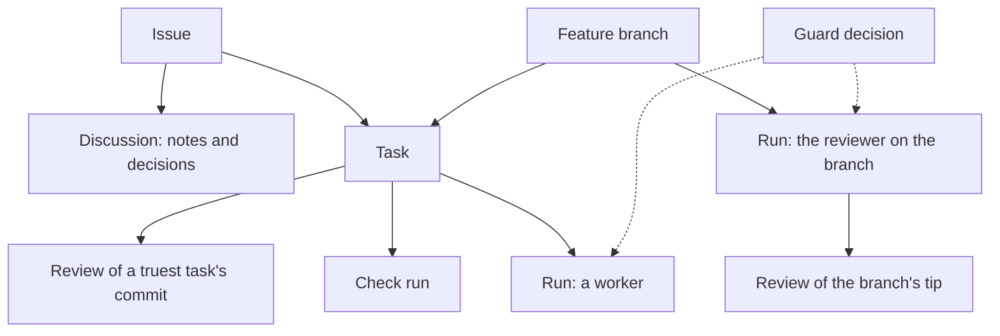
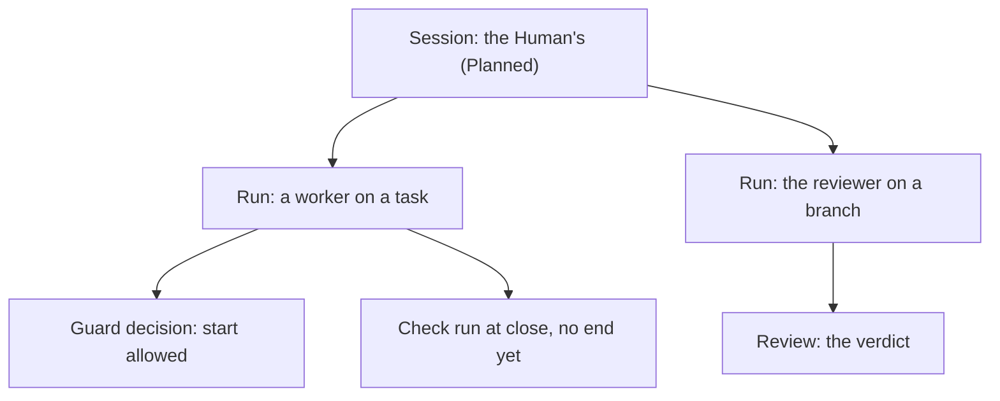
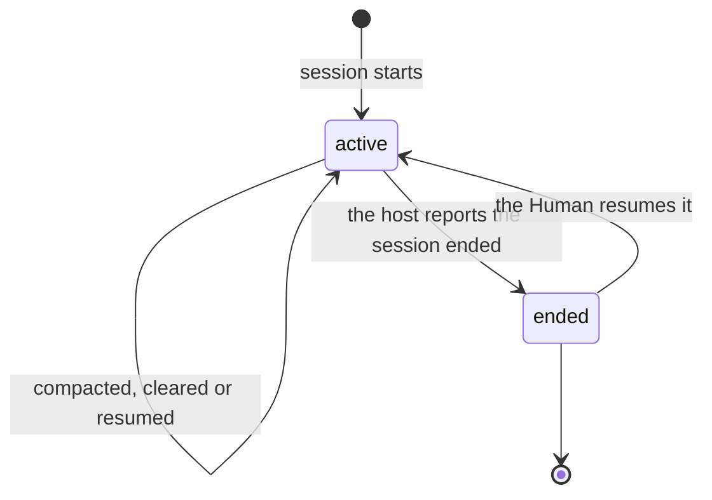
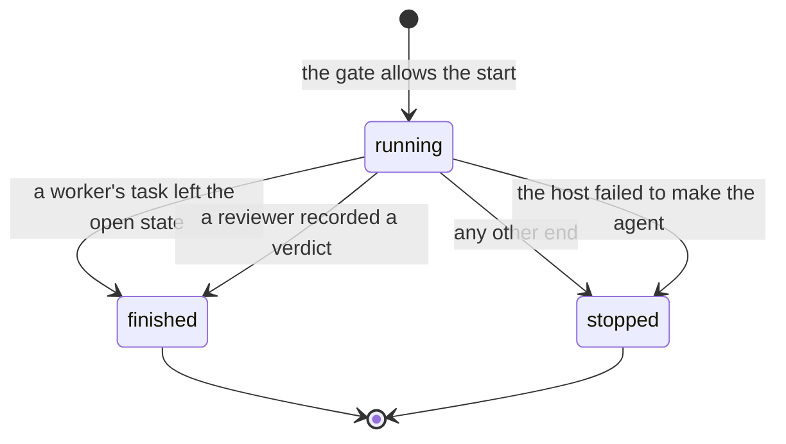
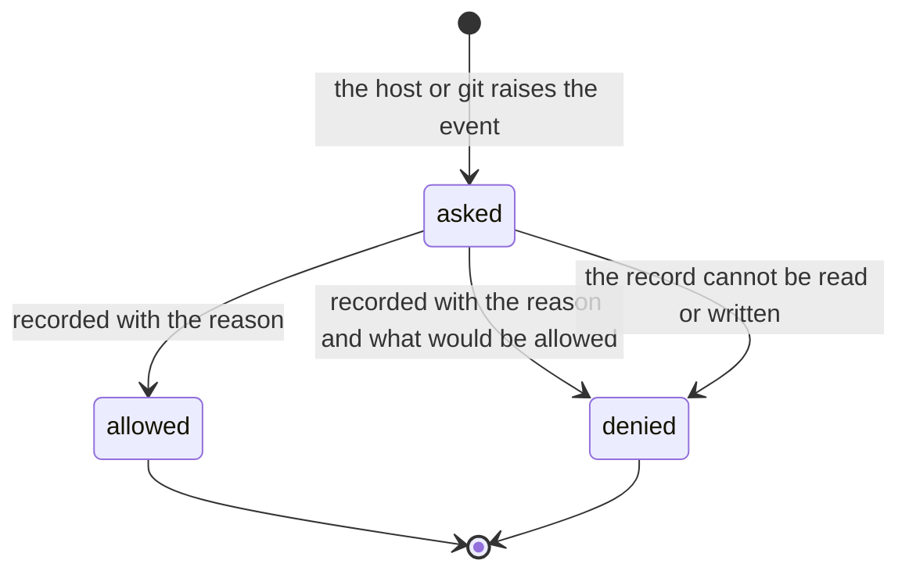
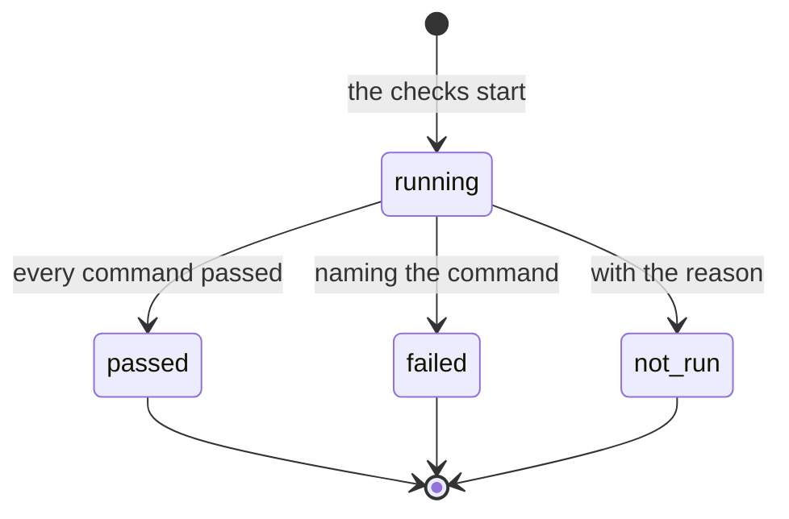
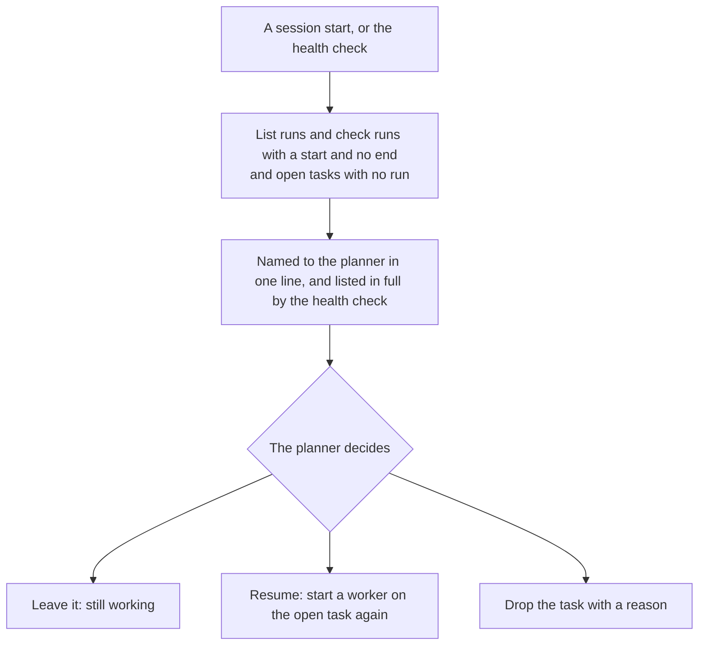

# Trajectories

The record of the work: what was asked, what was decided, what each agent did and how it ended. Any session can resume from it without the conversation that came before. This page covers what the record holds and how it answers "why is this still running?" and "why did this stop?" from records, not guesses. A task's own trajectory is in [3_TASKS.md](../flows/3_TASKS.md#task-lifecycle); this page covers the things a task runs inside: sessions, agent runs, gate decisions and check runs.

tmb records outcomes at checkpoints. It does not record each tool call or each step of an agent.

## What is recorded

| Record | Holds |
|---|---|
| Issue | A goal, its state and its milestone |
| Discussion | Notes and decisions on an issue. The newest decision is the one in force |
| Feature branch | A branch tasks fold into, its base, its state and its repo |
| Task | A spec, its kind, its state, its branch, its commit and its repo |
| Run | One worker or reviewer on one task or one review: start, end, how it ended, its cost |
| Check run | The checks run on a commit, each command and its result: start and end |
| Review | A reviewer's verdict on a commit or a feature branch, its findings, and the run that wrote it |
| Guard decision | Each allow and deny the gate gave at a checkpoint, and why |
| Audit entry | Every change to configuration and every Human waiver |
| Doc | **Planned** (trustmybot/tmb#302). One design document: where it lives, in a repo or outside it such as a wiki, what it is for, and its repo |
| Session | **Planned** (trustmybot/tmb#63, trustmybot/tmb#254). One host session, with its start, its end and its own cost |

## The rule

- **Start is a fact.** A run and a check run each write their start before any work.
- **End is a second event.** It carries the outcome. A start is never edited into an end: the record only adds events, and the current state is derived from them.
- **A start without an end is a finding.** It is still running, or it stopped without saying so.
- **Each names what it belongs to.** A run names its task, or its feature branch for a branch review. A review names the run that wrote it. A check run names its task and commit.
- **Every record names who made it.** The Human, or the role and host that acted. A push tmb makes for an agent is that agent's; a push typed by hand is the Human's (trustmybot/tmb#134). Every command-line call is the Human's, which is why a step only the Human may take needs a terminal and a typed yes ([HOSTS.md](HOSTS.md)).
- **The engine is the only writer.** Agents, the command line and the dashboard change the record only through the engine, so every rule is enforced in one place.
- **Reads return small pieces.** A brief, a section or a ranked snippet, never a dump.
- **Ids never collide across machines.** A record can be copied to another machine without renumbering.
- **Writes stay cheap.** The database takes one writer at a time, so a record at a checkpoint is one small insert.

The chart is one moment of a real tree. To find what is stuck, follow the records with no end downward: the lowest one is where the work stopped. The tree starts at the run. Planned: the session level and the link from a run to its session.

## Sessions

Planned (trustmybot/tmb#63, trustmybot/tmb#254). A record names the role and host, not the session; the session record is what tells the work of two sessions on one project apart.

- **One stable id** across a compaction, a clear and a resume.
- **A session with a start and no end is a finding,** like a run.
- **A session's own tokens** are recorded with the same four counts as a run's, apart from its runs' counts, so a total counts nothing twice.
- **tmb starts no session and assigns no work between sessions.** [RESPONSIBILITIES.md](RESPONSIBILITIES.md#parallel-lanes) covers parallel sessions.

## Agent runs

One run is one start of a worker or the reviewer. The planner's own turns are not a run; they belong to the session record, which is Planned.

- **Finished or stopped** (trustmybot/tmb#133). A reviewer that gave no verdict is stopped. So is a start the gate allowed and the host then failed to make: no agent ran, so no stop would come to end its run (trustmybot/tmb#285).
- **A denied start is recorded too,** as a guard decision with its reason, so "why did the worker never start?" has a record. It opens no run.
- **A reviewer that is a host's main agent** has no subagent start. Its run opens at that host's session start and ends with its verdict.
- **Cost is tokens, per model:** input, output, cache read and cache write, given by the host's adapter. A run whose usage cannot be read has no cost, and that is not an error.
- **tmb records no price.** Prices change, and a subscription has none per run.
- **Planned:** a fixed list of causes on a stopped run (failed, out of turns, killed), and a resumed run that names the run it resumes.

## Hook runs

In tmb a hook runs only at a checkpoint: a session start, an agent's start or stop, and git's pre-push hook. Each answer is one guard decision.

- **Every decision is recorded,** allow and deny, with the event and the reason.
- **A gate never fails open on a broken record.** It denies when it cannot read or write the record, and allows only where tmb was never set up.
- **Not recorded:** file writes and shell commands. tmb reads neither.
- **Not events:** a task's start and close. The engine checks them when asked, and a refusal goes to the caller without a guard decision.
- **A decision is written once, when it is made.** Planned: a start written before the hook's work, so a hook that hangs or crashes leaves a record.

## Verification runs

Recorded as check runs. One run is one execution of a task's checks on one commit: at close, and again after a fold or a rebase moved the commit.

A check run killed with its session keeps its start and has no end, so it shows as a finding.

## Finding and ending what is stuck

tmb has no watcher and no timer: it runs only when something calls it (trustmybot/tmb#160).

- **Last activity needs no heartbeat.** It is the newest record under the run.
- **Nothing is ended for the agent.** tmb lists what has no end and deletes nothing.

## Nothing is skipped silently

A step that did not run is recorded as not run, with the reason: a check that could not run, a backup push that was skipped, a commit status that could not be sent, a push allowed in an exempt repo. An agent start whose role the host did not name is allowed and recorded as a finding.

## Where it lives

One database file per project, inside the project's folder and left out of git. A workspace of several repos shares one, in the workspace folder ([3_GIT.md](../flows/3_GIT.md#multi-repo-workspaces)). Each feature branch and task names its repo; one with none belongs to the project folder itself. The engine creates the file at init and is the only program that migrates it.

| State | Gate | Other commands |
|---|---|---|
| No database | Allows: tmb stays out of projects it was never set up in | Offer `tmb init` |
| Readable | Decides normally | Run normally |
| Unreadable, empty, or made by a newer tmb | Denies, naming the cause, and for a newer one the version that wrote it | None runs. `tmb doctor` still runs and reads the record read-only |

- **The code graph is separate.** It can be rebuilt from git at any time and lives in its own file, one per repo. Indexing is not recorded in the trajectory ([2_CODE_GRAPH.md](../flows/2_CODE_GRAPH.md)).
- **Plugin projects.** A one-way migration carries a plugin project's records into a new tmb database and leaves the plugin's database untouched. A kind of record tmb does not have is left behind, not folded into another kind.

## Debugging with it

| Question | Where the answer is |
|---|---|
| What is stuck? | `tmb doctor`: runs and check runs with a start and no end, and open tasks with no run |
| Why did the worker never start? | The guard decision for its start: the deny names the reason and what would be allowed |
| Did the worker finish? | Its run's outcome: finished or stopped |
| Why did the close fail? | The task's newest check run: each command and its result |
| Why did the gate let this push through? | The guard decision: covered by a pass or waiver, or an exempt repo. With no record in the project nothing is recorded, and the hook says so in one line |
| Who waived this review? | The audit trail |
| What did this task cost? | The cost on its runs, in tokens per model |
| Why three re-runs of this task? | The task's events in order, with its runs and reviews ([3_TASKS.md](../flows/3_TASKS.md#task-lifecycle)) |
| Why does this session never end? | Planned, with the session record |
