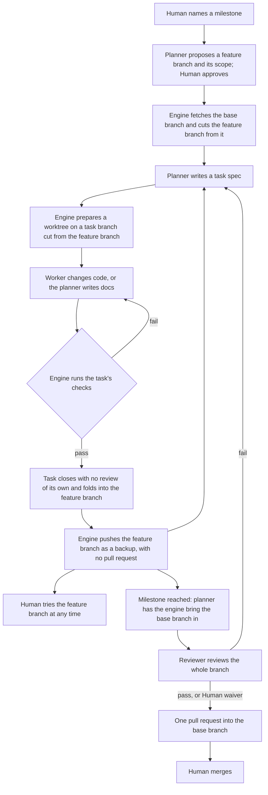
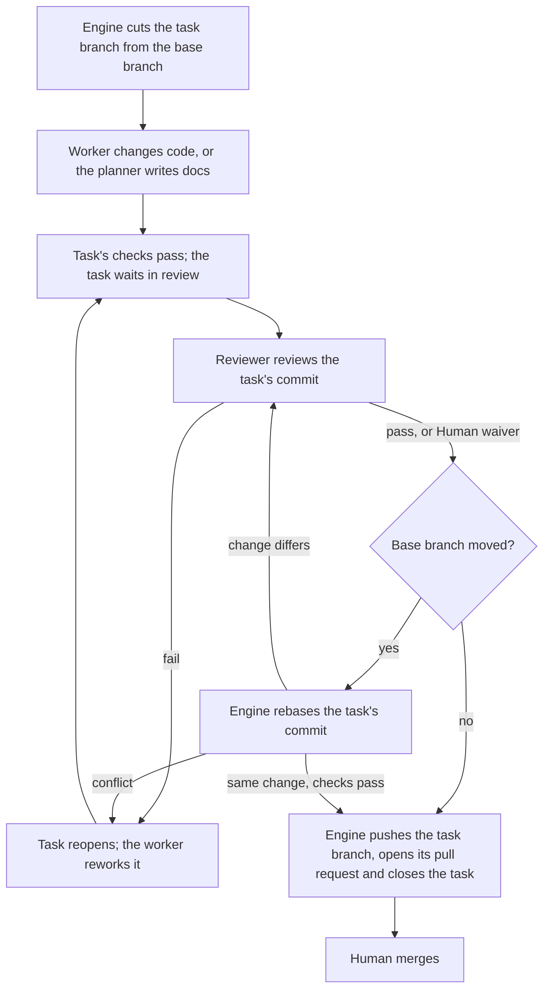

# Workflow

The path a piece of work takes from the Human's request to a merge, and who does each step.

## Roles

| Role | Who | Does |
|---|---|---|
| Human | The developer | Sets the goal, tries the result, merges. |
| Planner | The host agent, under the name bro | Talks to the Human, records the goal, splits it into tasks, writes each task's spec, judges the result. Writes docs tasks itself. |
| Worker | A subagent the host starts | Carries out one code task in its own worktree and reports against the spec. |
| Reviewer | A subagent the host starts | Judges a finished change without having written it. It is given no tool that edits a file, and the guard denies its writes; what that holds back differs by host ([The gate](#the-gate)). |

How the host starts workers and the reviewer is in [HOSTS.md](HOSTS.md).

## Units of work

- **Issue.** One goal of the Human's, with the discussion and decisions that shaped it.
- **Task.** One change that one agent can finish in one run. It carries a spec: the intent, the files it may touch, the checks that must pass and the success criteria.
- **Milestone.** A group of issues the Human wants to judge as a whole, such as a first usable build.

## Two kinds of task

| Kind | Who writes it | When |
|---|---|---|
| Code task | A worker | The change touches code. |
| Docs task | The planner | The change is to docs or prompts and changes no behaviour. |

- **The planner judges which kind a task is.** A project declares no list of paths that count as docs: such a list is wrong for the next project and for the next file. The planner names the kind when it starts the task, and the record keeps it.
- **The engine checks the call by file type.** A docs task may change only the prose, data and image types on a fixed list, and files such as `LICENSE` that carry no extension; the list is in the [reference](../reference/README.md#what-a-docs-task-may-change). A docs task whose commit touches any other file is refused at its close, and the refusal names the file. A type the list does not name counts as code, so `.vue`, `.svelte`, `.html` and `.sql` are refused (trustmybot/tmb#185). tmb does not read the file to guess.
- **The rest stays the planner's call.** The table marks config and data files as data, and cannot tell whether a change to one alters behaviour.
- **A docs task is checked like any other.** Its checks run at close, and the reviewer sees it in the same review as the code tasks.
- **A wrong call the engine cannot see is caught in review.** A docs task that changed behaviour is a finding, and that part is redone as a code task.

## Review modes

The review mode decides who reviews a change and when. Only the Human sets it: the planner stores the Human's answer, and never picks one. Not yet enforced on the command line, where an agent with a shell can set it (trustmybot/tmb#179).

| Mode | Review | Reaches the base branch as | For |
|---|---|---|---|
| **Agile** (recommended) | Once, on the whole feature branch | One pull request per milestone | Building a feature in many small tasks and judging it as a whole. |
| **Truest** | On every task, before its push | One pull request per task | A repo where nothing may reach the base branch unreviewed. |

Agile is built first, at level 4. Truest is built last, at level 10 (see [the build order](README.md#build-order)).

- **A default for the project.** The Human sets it at onboarding. It is the mode of any work that names none.
- **Or a mode for one line of work.** The Human can give one line of work the other mode, and the default stays for the rest. Planned. Proposed, for the Human's review: what counts as one line of work.

## Agile mode

- A task closes only when its checks pass on its commit. That holds in every mode.
- The feature branch's pull request opens only after the reviewer passes the branch, or after a Human waiver that is recorded.
- The Human can try the feature branch in a separate worktree while tasks continue.
- **The feature branch starts from the remote's base branch** (trustmybot/tmb#169). The engine fetches it first. It uses the local base branch instead when that holds a commit the remote lacks, when there is no remote, or when the remote is out of reach.
- **The base branch is brought in before the review.** On the planner's request the engine merges the base branch into the feature branch, with a merge commit and never a rebase, and pushes the branch as a backup, except while its pull request is open. A conflict changes nothing and names the files: the planner settles it in a task, or raises it to the Human. The feature branch's brief says whether it holds the base branch. Nothing refuses a review of a branch that does not; the brief is how the planner and the reviewer know. Proposed, for the Human's review.
- **A feature branch ends as merged or closed** (trustmybot/tmb#131). Once its pull request is open, tmb reads that pull request's state through the Human's own GitHub CLI: merged makes the branch merged, closed without a merge makes it closed. tmb reads it when the planner's session starts, when the features are listed, and for the dashboard at most once a minute per branch. A read that fails changes nothing, so with no network the branch stays as it was. tmb never deletes the branch.
- The planner's session start names each pull request that ended since the last session.
- **A feature branch whose pull request is open takes fix tasks** (trustmybot/tmb#168). The planner names the branch when starting the task. A task that names no feature branch still goes only to an open one.
- **No unreviewed commit reaches an open pull request.** While the pull request is open, a fold or a merge of the base branch is not pushed, and the answer says so. This holds for a task that was already open when the pull request opened (trustmybot/tmb#181). Until the review, the new commits are only in the local feature branch. Once the reviewer passes the new tip, or the Human waives the review, the planner's pull request step pushes the tip to the same pull request and opens no second one. Proposed, for the Human's review.
- **A closed feature branch can be taken up again** (trustmybot/tmb#152). A new pull request can be opened from it under the same rule: a pass or a Human waiver at its tip, and a tip the earlier one covers needs no new review. Starting a task that names the branch opens it again for rework. When a pull request is already open from the branch, as when the Human reopened it on GitHub, tmb records that one and opens none. The record keeps the earlier pull request's link.
- **Merged is final.** A merged feature branch takes no task and no pull request.

## Truest mode

- **No feature branch.** A truest task is cut from the base branch and belongs to no feature branch.
- **In review.** After its checks pass, a task waits at its commit and keeps its worktree. Nothing is pushed. Only a reviewer run records the verdict, and only on that commit.
- **The pull request is tmb's own step.** After a pass the planner asks the engine for it without being told by the Human.
- **A waiver is the Human's.** It is given per task, with a reason, and counts as a pass on the task's current commit.
- **Rebase before the first push only.** When the base branch moved since the task was cut, the engine rebases the reviewed commit. A conflict reopens the task. A change that differs after the rebase needs a fresh review. An open pull request is never rebased, because that would rewrite what was pushed.
- **The same change keeps its pass.** When the rebased commit makes the same change, the checks run again and the earlier pass carries over. Proposed, for the Human's review: the alternative is a fresh review after every rebase.
- **The push gate covers every task.** A push to the base branch is refused when it carries a commit no pass or waiver covers, as in agile. So is a push to any other branch that carries a task's commit without one. A commit that belongs to no task, pushed to another branch, goes through. Proposed, for the Human's review: the alternative refuses every uncovered commit on every branch, which also stops the Human's own branches.
- **A task keeps the review mode it was started in.** A change of mode applies to tasks started after it.

## The gate

Code enforces the workflow; prompts only guide. Three layers, each owned by the engine:

1. **Checks at close.** A task cannot close until the engine has run its checks on the commit and recorded a pass.
2. **Guards in the host.** The host adapter asks the engine before a subagent starts, and before a file write; the engine denies the write when the host names the agent as the reviewer. The engine answers allow or deny from the record ([HOSTS.md](HOSTS.md)). The engine reads no shell command: a push is judged by layer 3, whoever typed it.
3. **Git's own pre-push hook.** A push is refused unless the record holds what the review mode requires for those commits. This layer does not depend on the host, so it also holds for a push typed by hand.

A gate denies when it cannot read the record, and allows in a project tmb has never been set up in. A record file that is there but empty is a damaged record, so the gate denies (trustmybot/tmb#185).

**The hook names its project.** init writes the project's folder into the hook, relative to the repo's top, `tmb pre-push --project <path>`, so the gate never searches for it. A project may be one package of a monorepo, below its repo's top, where git runs the hook (trustmybot/tmb#178). When the named folder holds no record, the push goes and the hook says so in one line. One repo holds one tmb project for now: init refuses a second project in a repo whose hook already names another, and says why. In such a project a task's checks run in the project's folder inside the worktree, and the files its commit touched are compared with its spec as paths from the project's folder.

**A hook that is another tool's.** A repo may already have a pre-push hook that is not tmb's, as husky and lefthook write. init leaves it alone, and the push gate is off there (trustmybot/tmb#184). init, every session start and `tmb doctor` say so and name the repo, until the gate is on or the repo is exempt. With the Human's yes, tmb adds its one line to the end of that hook: `tmb onboard` asks on a terminal, `tmb onboard --add-push-gate` is the yes with no terminal (`--yes` does not give it), and `tmb doctor --fix` offers it. The line is safe to commit: it calls the program by name, names the project from the repo's top, does nothing where the program is not installed, and lets the hook's other lines run unless the gate refuses. `tmb remove` takes out that line alone. A tool that rewrites its hook file on every install drops the line; the session start then says the gate is off again.

**A mark on GitHub.** (trustmybot/tmb#101) git's hook on a developer's machine can be skipped, so the gate also has a place on the server. When tmb records a verdict or a Human waiver, it sets a commit status named tmb/review on that exact commit. A pass sets it to success. A waiver sets it to success too, and its text says the Human waived the review. A fail sets it to failure. The mark belongs to one commit: a new commit has none until it is reviewed. GitHub keeps a mark only on a commit it has, so a commit GitHub does not have yet is marked once tmb pushes it. A mark that could not be sent is recorded as not sent, and tmb sends it at the next review, waiver or pull request. It never fails the review. The repo's own branch protection can require the mark before a merge. `tmb onboard` and tmb's pull request step say whether the base branch requires it, and how to turn the rule on. tmb never changes the protection settings: they are the Human's. The mark is a convention among people who can write to the repo, not proof. GitHub offers the rule on a private repo only on its paid plans. The mark is sent with the Human's own GitHub command line, and only when origin is a GitHub repo.

**Checkpoints, not steps.** tmb checks what is delivered, like CI, and does not watch every step (trustmybot/tmb#98). Decided by the Human on 2026-11-19.

- **The reviewer writes nothing, by role.** Each role's definition takes away only the tools it must never use: the reviewer is given no tool that edits a file, and the worker loses nothing. The host enforces that list itself, and the guard also denies every file write the host names as the reviewer's, whatever tool asked (trustmybot/tmb#185). What holds differs by host:
  - **Claude Code** names the subagent on each tool call, so the reviewer's edit tools are taken away and a write that reaches the guard is denied. The reviewer keeps its shell to run the checks and read git, and tmb reads no shell command, so a file written from the shell is not denied. A push from it is still judged by git's pre-push hook.
  - **Codex** names no agent on a tool call, so a reviewer subagent's write is judged under its host's role and goes through. A Codex set up as the reviewer is the reviewer on every call, and its writes are denied, including a patch run through the shell. Its pre-push hook still judges every push.
- **A worker starts inside its worktree.** On Claude Code. On Codex the worker uses the worktree the engine cut. The host gives each worker a folder of its own to start in, and keeps its edits out of the main folder. When the worker first reads its brief, the engine makes that folder the task's worktree, on the task's branch. It does so only when the folder is clean and belongs to no other task; otherwise the task keeps the worktree the engine cut.
- **Two tasks may change the same file.** There is no lock. git settles it when the work is merged, and a clash holds back the later task's close until it is resolved.
- **A close reports, and refuses only on its checks.** A file the task changed outside its spec is named at close, and the spec stays as written. The planner or the reviewer checks with git which files those are; it is a check of names, not a second review of content. The main folder is compared with how it was when the task started, and anything that changed there since is listed with the command that puts it back. The planner raises that list to the Human as a report, the way a git host shows a merge conflict, and the Human settles it. tmb puts nothing back by itself, because the list can hold the Human's own edits made meanwhile.
- **The engine reads no shell command.**
- Planned: a gate that was skipped is found by the sync with the remote and recorded as a finding (trustmybot/tmb#70).

**Freeze.** Planned (trustmybot/tmb#64). The Human can stop all work in a project with one request to any session, and start it again the same way. A freeze is an entry in the record with its reason, so it holds for every session. While it holds, the gate denies what moves work forward: starting a task, starting a worker or the reviewer, a file write by an agent, closing a task and opening a pull request. Reads stay allowed, the planner is told at session start, and a push typed by hand is not affected.

## What the engine does itself

The engine, not an agent, creates branches and worktrees, runs checks, folds a task into its feature branch, pushes and opens pull requests. Agents ask for these through the engine's tools, so every step is recorded and no agent needs to be trusted to follow a git procedure.

## One record, one or several repos

(trustmybot/tmb#163) tmb supports a project of one repo and a workspace of several under one model: a project is a set of repos sharing one record, and every step finds the repo it works in by the same rules. A project folder that is a git work tree, or inside one, is a project of one repo: the folder itself, named `.`, whose policy is the `base_branch` and `checks` settings. It works as before, even when it holds nested repos. A project folder that is not a git work tree is a workspace, such as a product's engine, its plugin and its Homebrew tap side by side. tmb runs from the workspace folder, and its repos share one record there.

**No repo yet.** When `tmb init` runs in a folder that is in no git work tree, holds no repo below it and whose record registers none, it runs `git init` there and says so: the project is then one repo. When it finds any repo below, it never runs `git init`; it wires the repos it found.

**Which folders.** `tmb init` records every top-level folder of a workspace, git or not. A folder whose `.git` is a folder is a repo; tmb looks for repos up to two folders down. It does not look inside a repo it found, a dot-folder or `node_modules`. A `.git` file marks a linked worktree or a submodule, never a repo, so a task worktree is not taken for one and is not recorded. A top-level folder that is no repo and holds none, such as a folder of test material, is recorded as a folder that is not a repo. A repo or folder is named by its path from the workspace, with forward slashes, such as `tmb` or `tools/tap`. The record keeps the set, so no later step scans or guesses. Running init again adds what appeared and drops what is gone, with a line for each.

**Managed and left alone.** Only the managed repos get the workflow: hooks, features and tasks, the code graph and the push gate. A folder that is not a repo, and an exempt repo, are listed in the record and left untouched.

**Policy per repo.** The `repos` setting gives each repo its own policy: its base branch, its checks, or `exempt` for a repo tmb does no work in, such as fixtures that never ship. A folder that is not a repo is recorded as `{"git": false}` and takes no policy. init takes each base branch from that repo's own git: origin's default branch, else its current branch, else `main`, and prints where each came from. A policy set before is kept. Each repo pushes to its own origin and opens pull requests on its own GitHub repo. Only the host, the host roles and the review mode are the workspace's. The project-wide base branch and checks are not read in a workspace.

**The repo comes from the work, never from the folder a session runs in.** A feature or task records its repo. `feature_start` and `task_start` take `repo`; with one repo tmb works in it may be left out, and with several a call that names none is refused with the list. An agile task works in its feature branch's repo, and a `repo` that differs is refused. A truest task names its repo. Every later step on a feature or task runs in that repo: cutting from its base branch, the task worktree, the checks, the fold, the backup push, the main-folder snapshot and the pull request. Task worktrees stay under the workspace's `.tmb/worktrees/`, so a worker finds the shared record. Feature names are unique in the whole record. tmb's issues live in the record and name no repo.

**The gate in each repo.** init writes git's pre-push hook into every repo that is not exempt, and `tmb remove` deletes each. The hook runs in the repo being pushed and names the workspace's folder: the gate reads the record there and finds the repo from git's top level, and judges the push against that repo's base branch. A push from a task worktree is judged as one from the repo it was cut from. A repo the record does not register, or registers as exempt, is not judged: the push is allowed, and the recorded reason says why.

**A code graph per repo.** Each repo has its own graph, `.tmb/graphs/<repo>.db`, built from its own base branch, with paths relative to that repo. The graph tools take `repo` as `feature_start` does. init and `tmb index` index each repo tmb works in, one line each; a repo that cannot be indexed yet says why, and the others go on.

## When a task does not close

What tmb does today when work goes wrong, and what is planned. The plugin had a rule for each case; tmb keeps the ones a checkpoint can hold (trustmybot/tmb#165).

| Case | Today | Planned |
|---|---|---|
| A check fails at close | The close is refused and names the check. The task stays open, and the worker fixes it and closes again. | |
| The reviewer fails a truest task | The task reopens in its worktree. A worker reworks it, and it closes again for a new review. | v1.x: after two fails in a row, no worker starts on the task until the planner has recorded the cause. |
| The reviewer fails a feature branch | The planner starts fix tasks on the branch, and the new tip is reviewed again. | |
| A check fails, or a reviewer comments, on an open pull request | The planner starts fix tasks on the branch (trustmybot/tmb#168). Nothing is pushed until the new tip is reviewed or waived, and then it updates the same pull request. | v1.x: the syncer brings the comments in, and the planner sorts them into tasks (trustmybot/tmb#70). |
| The pull request is closed without a merge | The feature branch is recorded as closed, and the planner's session start says so and names what can be done (trustmybot/tmb#131). The planner opens a new pull request from it, or starts a rework task on it, which opens it again (trustmybot/tmb#152). | |
| A fold or a rebase conflicts | The step is undone and names the files. The task stays open until the worker has settled it. | |
| The base branch moved under a feature branch | The planner has the engine bring the base branch in before the review (trustmybot/tmb#169). A conflict changes nothing and names the files, and is settled in a task. | |
| The approach is wrong, or nobody will finish the task | The planner or the Human drops the task with a reason (trustmybot/tmb#170). It works on an open task and on a truest task in review. The task is recorded as dropped, never as closed, and nothing of it reaches the feature branch. Its worktree goes as a closed task's does, unless it holds work nobody committed. Its branch is kept while it holds commits, and the answer names it and how to delete it. A new task can name the dropped task it replaces. | |
| A run started and never ended | `tmb doctor` lists it, and the planner's session start names it in one line (trustmybot/tmb#160). The planner decides. | |

- **Nothing here waits for a timer.** tmb runs only when something calls it, so a stuck task is found at the next session start or by `tmb doctor` (trustmybot/tmb#160), not by a watcher.
- **A project with no remote** (trustmybot/tmb#183), decided by the Human on 2026-11-20: nothing is pushed and no pull request is opened. A close skips the backup push and says so. After the reviewer passes the feature branch, or the Human waives the review, the pull request step records the branch `ready` and gives the Human the command to merge it locally. A truest task is first rebased onto the local base branch, as before a push, then recorded `ready`: its worktree goes and its branch stays. Once the local base branch holds the tip, tmb records the feature branch merged, or the task closed. It looks when the planner's session starts, when the features or tasks are listed, and for the dashboard. A ready feature branch takes fix tasks: the first one opens it again, and its new tip needs a new pass or waiver before the pull request step makes it ready again. A ready truest task the Human will not merge as it is, such as one squashed by hand, which tmb cannot see, is dropped with a reason.
- **Found on 2026-11-20, not yet fixed.** A task that was open when the pull request opened can still fold into the branch, unreviewed (trustmybot/tmb#181).
