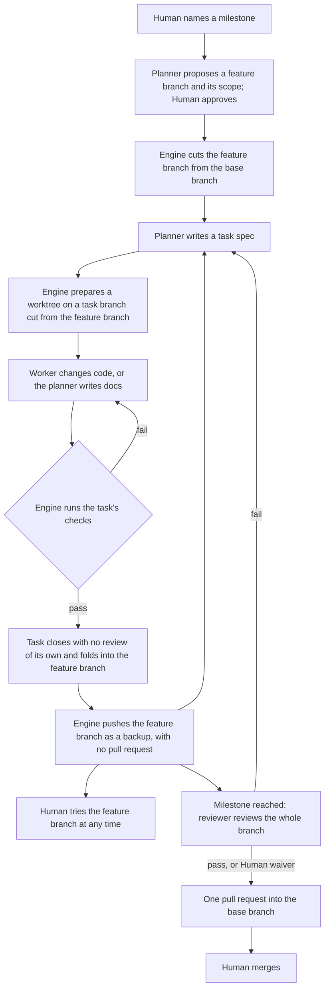
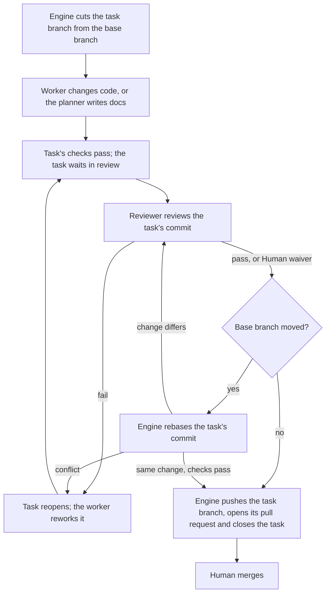

# Workflow

The path a piece of work takes from the Human's request to a merge, and who does each step.

## Roles

| Role | Who | Does |
|---|---|---|
| Human | The developer | Sets the goal, tries the result, merges. |
| Planner | The host agent, under the name bro | Talks to the Human, records the goal, splits it into tasks, writes each task's spec, judges the result. Writes docs tasks itself. |
| Worker | A subagent the host starts | Carries out one code task in its own worktree and reports against the spec. |
| Reviewer | A subagent the host starts | Judges a finished change without having written it. It cannot edit files. |

How the host starts workers and the reviewer is in [HOSTS.md](HOSTS.md).

## Units of work

- **Issue.** One goal of the Human's, with the discussion and decisions that shaped it.
- **Task.** One change that one agent can finish in one run. It carries a spec: the intent, the files it may touch, the checks that must pass and the success criteria.
- **Milestone.** A group of issues the Human wants to judge as a whole, such as a first usable build.

## Two kinds of task

| Kind | Who writes it | When |
|---|---|---|
| Code task | A worker | The change touches code. |
| Docs task | The planner | The change is to docs or prompts and changes no behaviour. |

- **The planner judges which kind a task is.** A project declares no list of paths that count as docs: such a list is wrong for the next project and for the next file. The planner names the kind when it starts the task, and the record keeps it.
- **The engine checks the call by file type.** A docs task whose commit touches a file written in a programming language is refused at its close, and the refusal names the file. The engine tells a programming language from prose, markup and data with the language table of GitHub's Linguist, which it ships with. The table is maintained for every project, so tmb keeps no list of its own. Where the table gives one extension to several languages, the file is refused only when every one of them is a programming language; tmb does not read the file to guess.
- **The rest stays the planner's call.** The table marks config and data files as data, and cannot tell whether a change to one alters behaviour.
- **A docs task is checked like any other.** Its checks run at close, and the reviewer sees it in the same review as the code tasks.
- **A wrong call the engine cannot see is caught in review.** A docs task that changed behaviour is a finding, and that part is redone as a code task.

## Review modes

The review mode decides who reviews a change and when. Only the Human sets it.

| Mode | Review | Reaches the base branch as | For |
|---|---|---|---|
| **Agile** (default) | Once, on the whole feature branch | One pull request per milestone | Building a feature in many small tasks and judging it as a whole. |
| **Truest** | On every task, before its push | One pull request per task | A repo where nothing may reach the base branch unreviewed. |

Agile is built first, at level 4. Truest is built last, at level 10 (see [the build order](README.md#build-order)).

- **A default for the project.** The Human sets it at onboarding. It is the mode of any work that names none.
- **Or a mode for one line of work.** The Human can give one line of work the other mode, and the default stays for the rest. Planned. Proposed, for the Human's review: what counts as one line of work.

## Agile mode

- A task closes only when its checks pass on its commit. That holds in every mode.
- The feature branch's pull request opens only after the reviewer passes the branch, or after a Human waiver that is recorded.
- The Human can try the feature branch in a separate worktree while tasks continue.

## Truest mode

- **No feature branch.** A truest task is cut from the base branch and belongs to no feature branch.
- **In review.** After its checks pass, a task waits at its commit and keeps its worktree. Nothing is pushed. Only a reviewer run records the verdict, and only on that commit.
- **The pull request is tmb's own step.** After a pass the planner asks the engine for it without being told by the Human.
- **A waiver is the Human's.** It is given per task, with a reason, and counts as a pass on the task's current commit.
- **Rebase before the first push only.** When the base branch moved since the task was cut, the engine rebases the reviewed commit. A conflict reopens the task. A change that differs after the rebase needs a fresh review. An open pull request is never rebased, because that would rewrite what was pushed.
- **The same change keeps its pass.** When the rebased commit makes the same change, the checks run again and the earlier pass carries over. Proposed, for the Human's review: the alternative is a fresh review after every rebase.
- **The push gate covers every task.** A push to the base branch is refused when it carries a commit no pass or waiver covers, as in agile. So is a push to any other branch that carries a task's commit without one. A commit that belongs to no task, pushed to another branch, goes through. Proposed, for the Human's review: the alternative refuses every uncovered commit on every branch, which also stops the Human's own branches.
- **A task keeps the review mode it was started in.** A change of mode applies to tasks started after it.

## The gate

Code enforces the workflow; prompts only guide. Three layers, each owned by the engine:

1. **Checks at close.** A task cannot close until the engine has run its checks on the commit and recorded a pass.
2. **Guards in the host.** The host adapter asks the engine before a subagent starts, and before a file write by a host that was set up as the reviewer. The engine answers allow or deny from the record ([HOSTS.md](HOSTS.md)). The engine reads no shell command: a push is judged by layer 3, whoever typed it.
3. **Git's own pre-push hook.** A push is refused unless the record holds what the review mode requires for those commits. This layer does not depend on the host, so it also holds for a push typed by hand.

A gate denies when it cannot read the record, and allows in a project tmb has never been set up in.

**A mark on GitHub.** (trustmybot/tmb#101) git's hook on a developer's machine can be skipped, so the gate also has a place on the server. When tmb records a verdict or a Human waiver, it sets a commit status named tmb/review on that exact commit. A pass sets it to success. A waiver sets it to success too, and its text says the Human waived the review. A fail sets it to failure. The mark belongs to one commit: a new commit has none until it is reviewed. GitHub keeps a mark only on a commit it has, so a commit GitHub does not have yet is marked once tmb pushes it. A mark that could not be sent is recorded as not sent, and tmb sends it at the next review, waiver or pull request. It never fails the review. The repo's own branch protection can require the mark before a merge. `tmb onboard` and tmb's pull request step say whether the base branch requires it, and how to turn the rule on. tmb never changes the protection settings: they are the Human's. The mark is a convention among people who can write to the repo, not proof. GitHub offers the rule on a private repo only on its paid plans. The mark is sent with the Human's own GitHub command line, and only when origin is a GitHub repo.

**Checkpoints, not steps.** tmb checks what is delivered, like CI, and does not watch every step (trustmybot/tmb#98). Decided by the Human on 2026-11-19.

- **Roles are kept in bounds by the host.** Each role's definition takes away only the tools it must never use: the reviewer cannot edit, and the worker loses nothing. The host enforces that list itself.
- **A worker starts inside its worktree.** The host gives each worker a folder of its own to start in, and keeps its edits out of the main folder. When the worker first reads its brief, the engine makes that folder the task's worktree, on the task's branch. It does so only when the folder is clean and belongs to no other task; otherwise the task keeps the worktree the engine cut.
- **Two tasks may change the same file.** There is no lock. git settles it when the work is merged, and a clash holds back the later task's close until it is resolved.
- **A close reports, and refuses only on its checks.** A file the task changed outside its spec is named at close, and the spec stays as written. The planner or the reviewer checks with git which files those are; it is a check of names, not a second review of content. The main folder is compared with how it was when the task started, and anything that changed there since is listed with the command that puts it back. The planner raises that list to the Human as a report, the way a git host shows a merge conflict, and the Human settles it. tmb puts nothing back by itself, because the list can hold the Human's own edits made meanwhile.
- **The engine reads no shell command.**
- Planned: a gate that was skipped is found by the sync with the remote and recorded as a finding (trustmybot/tmb#70).

**Freeze.** Planned (trustmybot/tmb#64). The Human can stop all work in a project with one request to any session, and start it again the same way. A freeze is an entry in the record with its reason, so it holds for every session. While it holds, the gate denies what moves work forward: starting a task, starting a worker or the reviewer, a file write by an agent, closing a task and opening a pull request. Reads stay allowed, the planner is told at session start, and a push typed by hand is not affected.

## What the engine does itself

The engine, not an agent, creates branches and worktrees, runs checks, folds a task into its feature branch, pushes and opens pull requests. Agents ask for these through the engine's tools, so every step is recorded and no agent needs to be trusted to follow a git procedure.

## Carried over from the plugin

The plugin's design for retry and escalation, pull request comment triage and multi-repo workspaces is carried over unchanged in intent. Each gets its section here when its level starts.
