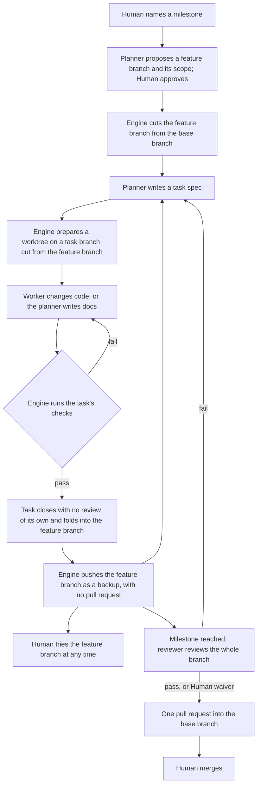
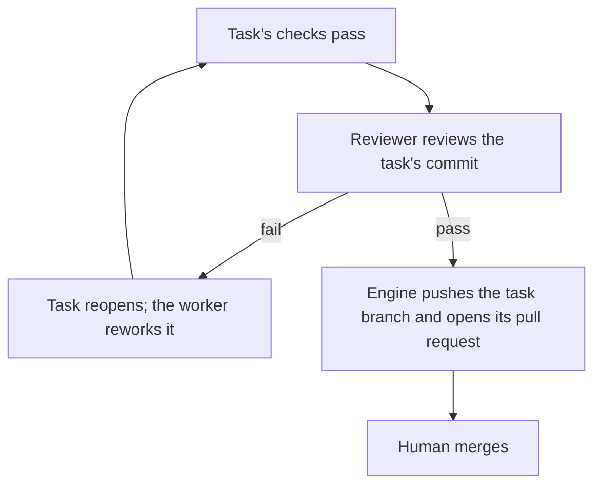

# Workflow

The path a piece of work takes from the Human's request to a merge, and who does each step.

## Roles

| Role | Who | Does |
|---|---|---|
| Human | The developer | Sets the goal, tries the result, merges. |
| Planner | The host agent, under the name bro | Talks to the Human, records the goal, splits it into tasks, writes each task's spec, judges the result. Writes docs tasks itself. |
| Worker | A subagent the host starts | Carries out one code task in its own worktree and reports against the spec. |
| Reviewer | A subagent the host starts | Judges a finished change without having written it. It cannot edit files. |

How the host starts workers and the reviewer is in [HOSTS.md](HOSTS.md).

## Units of work

- **Issue.** One goal of the Human's, with the discussion and decisions that shaped it.
- **Task.** One change that one agent can finish in one run. It carries a spec: the intent, the files it may touch, the checks that must pass and the success criteria.
- **Milestone.** A group of issues the Human wants to judge as a whole, such as a first usable build.

## Two kinds of task

| Kind | Who writes it | When |
|---|---|---|
| Code task | A worker | The change touches code. |
| Docs task | The planner | The change is to docs or prompts and changes no behaviour. |

- **The planner judges which kind a task is.** A project declares no list of paths that count as docs: such a list is wrong for the next project and for the next file. The planner names the kind when it starts the task, and the record keeps it.
- **The engine checks the call by file type.** Planned. A docs task whose commit touches a file written in a programming language is refused at its close, and the refusal names the file. The engine tells a programming language from prose, markup and data with the language table of GitHub's Linguist, which it ships with. The table is maintained for every project, so tmb keeps no list of its own. Where the table gives one extension to several languages, the file is refused only when every one of them is a programming language; tmb does not read the file to guess. Proposed, for the Human's review.
- **The rest stays the planner's call.** The table marks config and data files as data, and cannot tell whether a change to one alters behaviour.
- **A docs task is checked like any other.** Its checks run at close, and the reviewer sees it in the same review as the code tasks.
- **A wrong call the engine cannot see is caught in review.** A docs task that changed behaviour is a finding, and that part is redone as a code task.

## Review modes

The review mode decides who reviews a change and when. Only the Human sets it.

| Mode | Review | Reaches the base branch as | For |
|---|---|---|---|
| **Agile** (default) | Once, on the whole feature branch | One pull request per milestone | Building a feature in many small tasks and judging it as a whole. |
| **Truest** | On every task, before its push | One pull request per task | A repo where nothing may reach the base branch unreviewed. |

Agile is built first, at level 4. Truest is built last, at level 10 (see [the build order](README.md#build-order)).

## Agile mode

- A task closes only when its checks pass on its commit. That holds in every mode.
- The feature branch's pull request opens only after the reviewer passes the branch, or after a Human waiver that is recorded.
- The Human can try the feature branch in a separate worktree while tasks continue.

## Truest mode

Planned, last in the build order.

## The gate

Code enforces the workflow; prompts only guide. Three layers, each owned by the engine:

1. **Checks at close.** A task cannot close until the engine has run its checks on the commit and recorded a pass.
2. **Guards in the host.** The host adapter asks the engine before an agent writes a file, starts a subagent or runs a git command that moves a branch. The engine answers allow or deny from the record ([HOSTS.md](HOSTS.md)).
3. **Git's own pre-push hook.** A push is refused unless the record holds what the review mode requires for those commits. This layer does not depend on the host, so it also holds for a push typed by hand.

A gate denies when it cannot read the record, and allows in a project tmb has never been set up in.

## What the engine does itself

The engine, not an agent, creates branches and worktrees, runs checks, folds a task into its feature branch, pushes and opens pull requests. Agents ask for these through the engine's tools, so every step is recorded and no agent needs to be trusted to follow a git procedure.

## Carried over from the plugin

The plugin's design for retry and escalation, rebasing a reviewed task, pull request comment triage and multi-repo workspaces is carried over unchanged in intent. Each gets its section here when its level starts.
