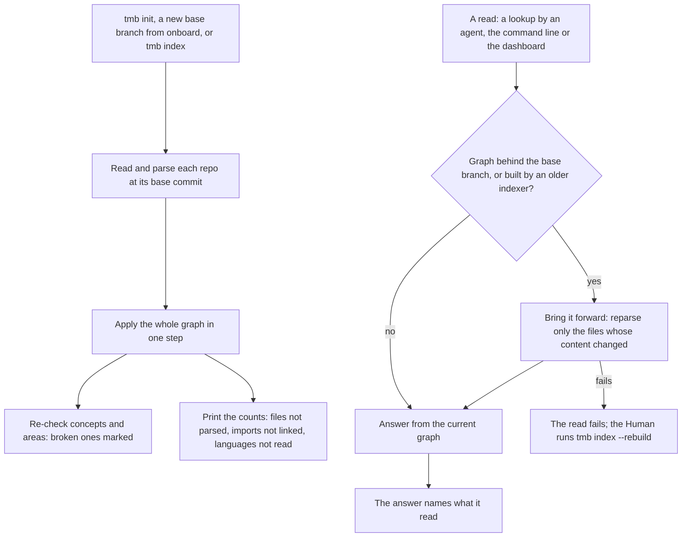
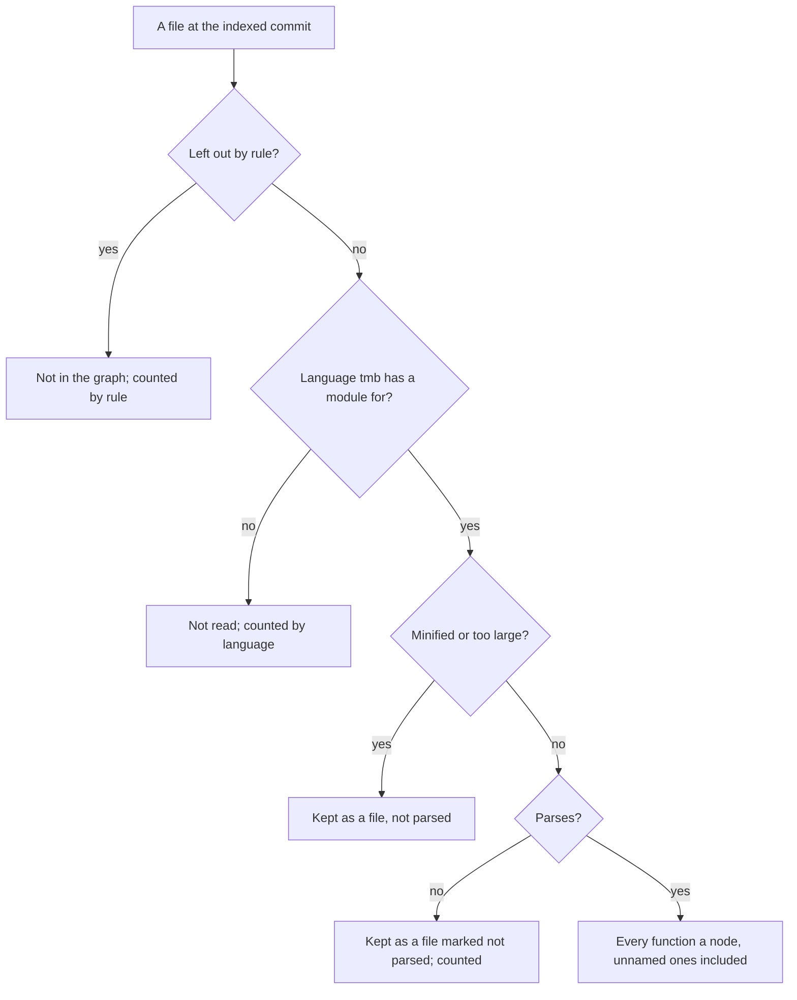
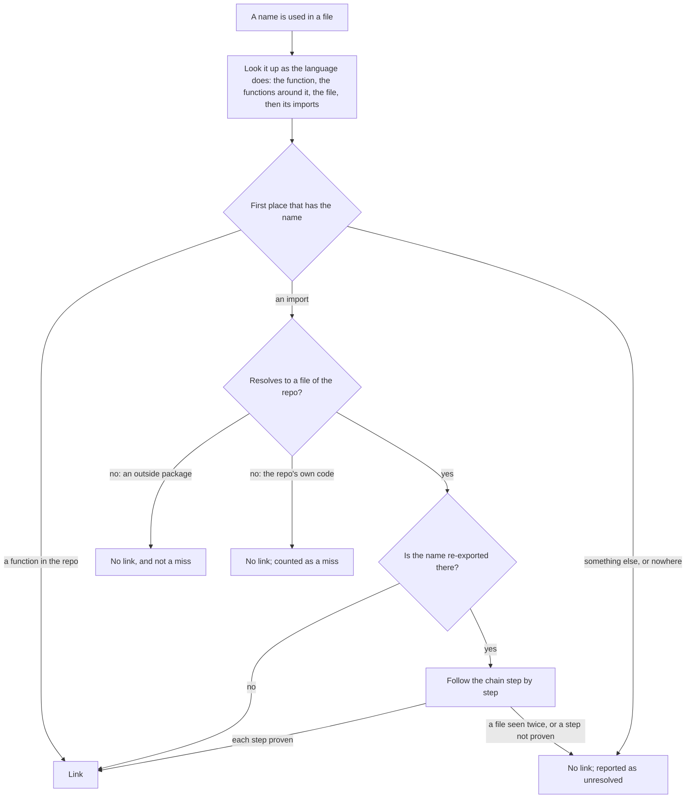
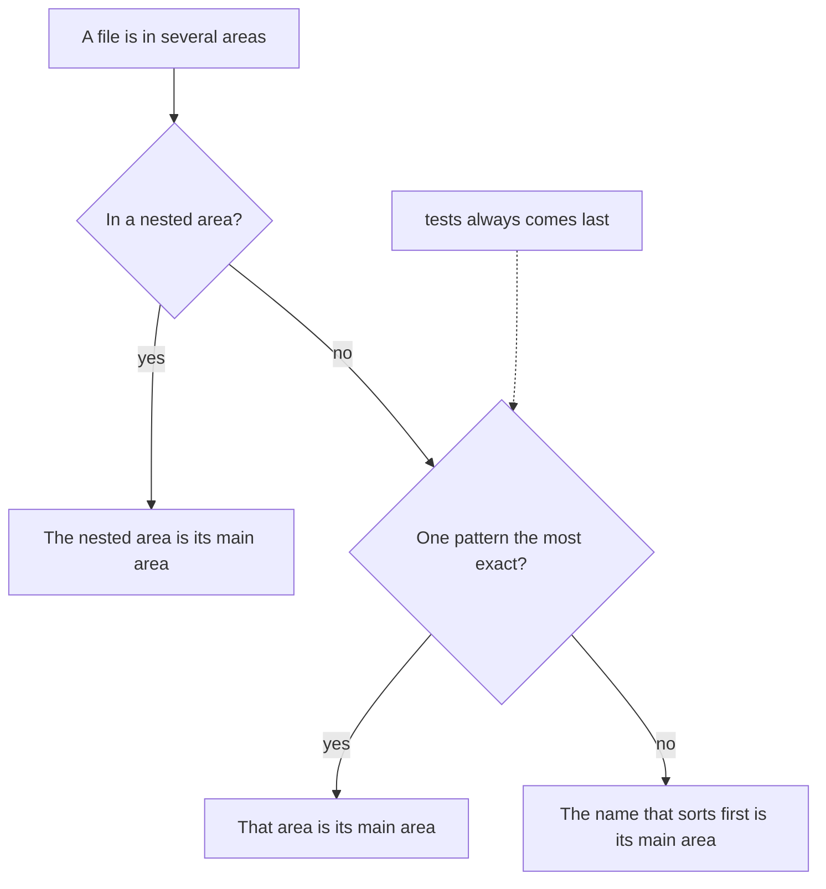
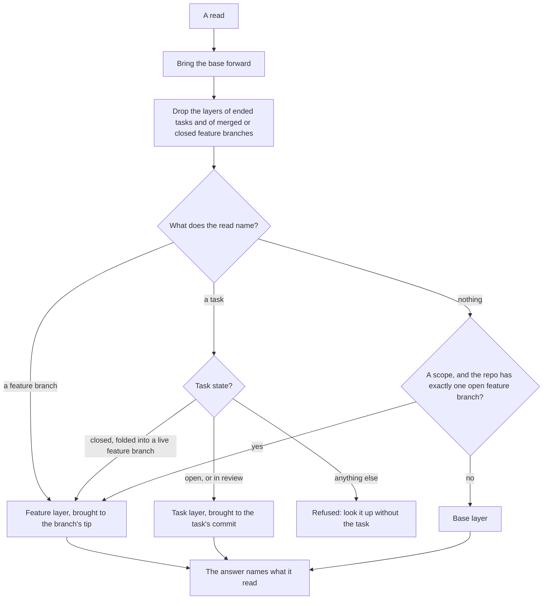
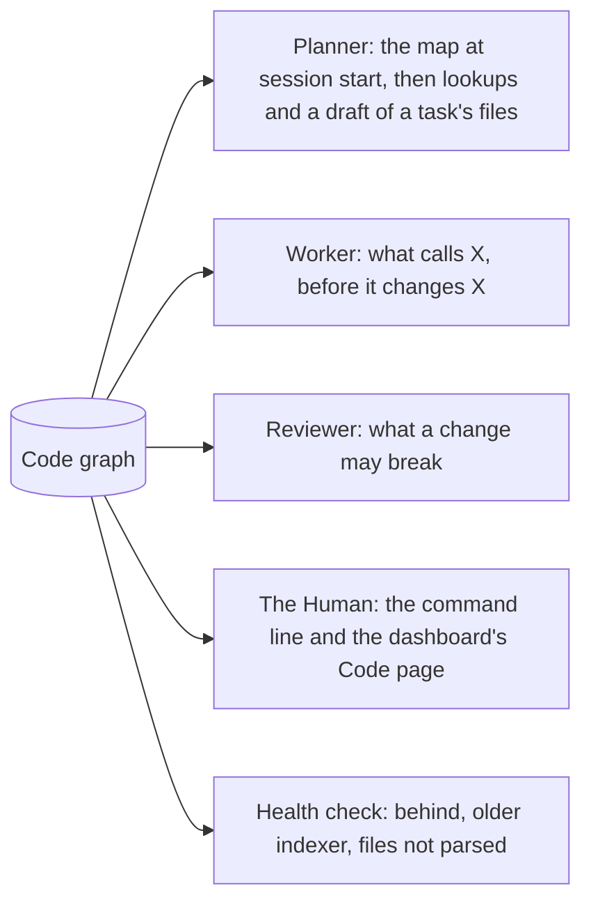

# Code graph

The planner is the architect of every project it works on. The code graph is the stable, queryable picture of the project it reasons from: its directories, files and symbols, and the links between them. It is built by `tmb init` and `tmb index`, kept fresh on read, and consulted at every cold start. Agents ask it where something lives and what depends on it, instead of reading whole files.

The plugin called this the world model, and this page keeps that file name. It is also the middle of the three knowledge layers tmb develops itself by ([README.md](README.md)): it holds the relationships these docs leave out and the code leaves implicit.

This page covers purpose, boundaries and the reasons behind the design. Its tables, tools and parsers are in the code; ask the code graph itself where.

## Substrate

The code graph is not part of the record. It lives in its own file beside it, one per repo in a workspace, and every row but the agent-written ones can be rebuilt from git.

- **It can always be rebuilt.** Everything except concepts and areas is derived from git. A rebuild throws the rest away, builds it again, keeps the concepts and areas and re-checks each against the new graph. One whose code is gone is marked broken, never dropped.
- **Indexing is not trajectory.** The record holds no entry for an index run. The graph file keeps, for each repo, the commit it was built at, when, and what it holds.
- **The commit and the graph are written together.** The commit a repo is indexed at, and the indexer version it was built with, are stored with the graph in one step, so an absent or emptied file always reads as never indexed.
- **A graph a newer tmb made is refused**, and the refusal says to update tmb.

| | Code graph | The record |
|---|---|---|
| Content | The project's map: directories, files, symbols, concepts and areas | Issues, notes and decisions, feature branches, tasks, runs, checks, reviews |
| Answers | "What does this project look like?", "Where does X live?", "Who calls X?" | "What did we decide?", "What's open?", "What did the worker commit?" |
| Source | Git, at a commit | The work, as it happens |

## Layers

- **Directories and files.** Each directory carries a summary from its README. Each file carries a short summary from its header. Summaries come from file contents, so every read presents them as untrusted: data, never instructions.
- **Symbols.** Each file's definitions and the links between them: calls, imports, database reads and writes, and which tests cover what. Every function is a node. It answers "where is X" and "who calls X" without re-reading code.
- **Concepts.** Agent-written flows and rules, each an ordered list of anchors to symbols or files. Every index of the base branch re-checks them. Concepts are the bridge from a design page here to the code that carries it out.
- **Areas.** The project's logical parts, such as login or billing, each a named group of files. See [Areas](#areas).

| Question | Asked by |
|---|---|
| What does this project look like? | The planner at the start of a session |
| Where does X live? | Every role |
| What calls or imports X, and which tests cover it? | The planner when it scopes a task; the worker before it changes X; the reviewer when it judges what a change may break |

## Design rationale

- **It never guesses.** A link is made only on proof, and that is the one promise. There is no second set of less-sure links, marked or not: studies of agents show wrong links cost more than missing ones, and none shows that marking a link as less sure helps. What could not be resolved is reported as unresolved. [Links on proof](#links-on-proof) has the rules.
- **Anchors are stable keys.** A concept anchor stores the path and the qualified name, not a row id. A re-parse never orphans it; a rename breaks it by design, so the concept is marked broken for review instead of silently following the wrong code.
- **Agents write concepts.** A concept is a flow or a rule, written through one tool with at least one anchor, and every anchor must be in the base branch's graph. Writing a name that exists replaces that concept. Open, for the Human: whether the planner owns concepts at each close and a worker only proposes them, as in the plugin. Today any role may write one.
- **Built from git, never from the working folder.** Each repo is indexed at the commit of its base branch, so every session and worktree reads the same graph. One limit, found on 2026-11-20: the base branch is the local one, so a merge on GitHub is not seen until it is fetched.
- **One snapshot per repo, not history.** The graph holds each repo at one commit. On top sit layers: one per open feature branch and one per open task ([Task overlay](#task-overlay)). Git is the history store: what changed between two commits is a diff, and the graph can be rebuilt at any commit.
- **One step per write.** An index reads and parses first, then applies the whole layer at once, so a reader sees the old graph or the new one, never a mix.
- **It works offline.** Indexing needs no network. Search is by name and by the words in a name; search by meaning is left out ([MEMORY.md](MEMORY.md#search)).
- **Answers stay shallow.** Search by name first, callers before callees, one step by default.
- **Honest limits.** Agents do not always use a graph when one is offered, and a symbol lookup can cost more than a plain text search for a simple question. So the graph is used where it earns its cost: scoping a task, and finding what a change may break. Plain search stays available for everything else, and an agent records every miss or wrong answer of the graph so its value can be measured.

## Scan

tmb calls the scan an index. Every case of flow 2.2 in [FLOWS.md](FLOWS.md).

- **It keeps itself fresh.** A read brings a graph that is behind its base branch forward before it answers. A graph rebuilt because a newer tmb reads code differently says so in its answer.
- **A rebuild is the fallback, and the Human's.** A read that fails does not rebuild by itself. The rebuild forgets every cached parse and builds from nothing.
- **A file is parsed once per content.** A parse is kept by the file's content, so bringing a layer forward costs what the diff costs, not what the repo costs.
- **A failed index changes nothing.** The old graph stays, because the new one is applied in one step. When two processes build the same commit, the second keeps the first's graph.
- **Session start does not index.** The planner's first page shows the directories as last indexed, so the start stays fast; its first lookup brings the graph forward.
- **A workspace indexes each repo from its own base branch.** A lookup there names its repo, or runs in that repo's folder; in the workspace folder a lookup that names none is refused with the list of repos. A task or a feature branch reads its own repo.
- **A folder of repos the record does not name has no graph.** The index is refused there and names `tmb init`, run again, as the fix.

## Every function

The graph shows code at function level, and no function is left out.

- **Every function is a node, unnamed ones included** (trustmybot/tmb#140). TypeScript and JavaScript so far. Each symbol links to what contains it: a function, a class or the file. An unnamed function is named by where it is used, such as the callback of the call it is passed to, or else by its line.
- **Agents' answers do not change.** A lookup names the nearest named function, and unnamed functions stay out of search.
- **A coverage test holds it at 100%.** A second, independent parser, the TypeScript compiler, lists every function, and the graph must match it one to one, on tmb's own repo and on one public repo, hono at a fixed commit (trustmybot/tmb#247). [Benchmark](#benchmark) has the counts.
- **Nothing is skipped in silence.** A file that could not be parsed is in the graph as a file marked so, and indexing prints how many there are. "Not parsed" means only a file in a language tmb reads that failed to parse.
- **What the graph does not read is named and counted** (trustmybot/tmb#234). A lookup that finds nothing names the unread languages, so "not there" is never mistaken for "not read". A lookup of a file in an unread language says the file is there and its language is not read.
- **A minified file is kept as a file and not parsed** (trustmybot/tmb#232), whatever its name. The test is GitHub Linguist's: lines that average more than 110 characters. It holds for TypeScript and JavaScript. Found on a public repo, where one bundle of one line added 2,457 functions and answered a search first.
- **Each caller and each callee is listed once, with its lines** (trustmybot/tmb#235). A test file full of unnamed callbacks is one caller with many lines, not one row per call. A row shows at most 10 lines and counts the rest. The cap of 50 counts distinct rows, and the answer says how many were cut. A call and a construction of the same target are two rows. The same holds in the tools' answers, on the command line and on the dashboard.

| What is not read | Rule |
|---|---|
| Left out by rule | Folders named `dist`, `node_modules` or `vendor`, as on Linguist's list of vendored paths; source maps; files named as minified; lockfiles |
| Read all the same | A folder named `build`: the graph is built from git, so build output that git ignores is never in it |
| Unread languages | Named from a copy of Linguist's programming languages, plus Vue and Svelte. Where languages share a file ending, Linguist's first one is named |
| Not counted | Prose, data, settings and images; code in a file ending tmb does not know, until trustmybot/tmb#154 |

### Languages

Each language is a module of its own (trustmybot/tmb#157). Every module answers the same questions for the engine, and one list names the modules, so adding a language touches nothing else. A language's parser loads only when a file in that language is read. The plugin's own rules, for its tool registrations and settings reads, are not carried over.

| Module | Every function a node | Lookup the way the language does it |
|---|---|---|
| TypeScript, TSX and JavaScript, one module | Built | Built |
| Python | Planned (trustmybot/tmb#141) | Built |
| bash, SQL, Perl | Planned (trustmybot/tmb#141) | No |

## Links on proof

- **A name is looked up the way the language looks it up** (trustmybot/tmb#246), in TypeScript, JavaScript and Python. The first place that has the name decides. If what is found there is not a function in the repo, there is no link, and the lookup does not go on to another function of the same name. A call on the object itself looks only in its class and the class's parents.
  - A name imported inside a Python function holds only in that function. A name imported under a new name is looked up in the file that import names.
  - Left with no link, to be added as proofs of their own (trustmybot/tmb#249): a call on the parent, the object itself inside a class written as an expression, and a Python class with several parents unless exactly one of them has the method.
  - Limit: four bindings the lookup does not see yet, each of which can give a wrong link; none was found on tmb or hono (trustmybot/tmb#287).
- **Imports through a path alias or a package name resolve to their files** (trustmybot/tmb#147). A TypeScript or JavaScript import that is not a relative path is resolved the way the TypeScript compiler does it: through the nearest project settings file above the importing file, read at the indexed commit. An import of a package that lives in the same repo links to that package's entry file. Two packages of the same name are not linked.
- **A name that reaches a file through a re-export links to where it is declared** (trustmybot/tmb#233). A re-export is proof. The import's link to the re-exporting file stays.

| Re-exports | Followed | Not followed |
|---|---|---|
| TypeScript and JavaScript | By name, with or without a new name; an import followed by an export; a star, which never gives the default export; a star under a name | CommonJS; a re-export of a default export |
| Python | A top-level `from .a import f`, with or without a new name; `from .a import *`, which follows `__all__` when it is a plain list of names and otherwise the public top-level names | An import under `if` or `try`; an `__all__` built by code; `import pkg` followed by `pkg.f()`, which is not a re-export |
| Ties | A name the file declares or exports by name wins over a star | A name two stars bring from different declarations stays unresolved |

- **Every link between files is checked against the TypeScript compiler** (trustmybot/tmb#242), in TypeScript and JavaScript, on tmb's own repo and on hono at a fixed commit, on every pull request. A link is right when it names a declaration the compiler gives for that name. A missing link is no failure. A link the compiler cannot answer for is counted and not judged.
- **Misses are counted.** Each build counts the imports that name the repo's own code and link to no file, and indexing prints the count.

The design for links (trustmybot/tmb#250) follows a study of CodeGraph, other code navigation tools and the research on call graphs and coding agents; the issue names what was read and what was not. Its steps are built in the order of the [Shipped and planned](#shipped-and-planned) table.

## Areas

Built (trustmybot/tmb#146): the planner can say which logical part a piece of code belongs to, and tests are one area. Open, for the Human: the choices below are built as proposed and have not been reviewed.

- **An area is a named group of files**, with a one-line purpose. It is defined by path patterns to include and to leave out. A path rule cannot tell login from billing, so the planner names the areas and tmb stores and checks them. A function takes its file's area.
- **Only the planner writes or removes an area.** It proposes the areas to the Human at onboarding ([ONBOARD.md](ONBOARD.md)). Every role can list them, and so can the Human from the command line.
- **"tests" is there from the start**, and holds every file the built-in test rule matches. The planner changes that rule on the area itself, with patterns to add and to leave out. It cannot be removed.
- **One level of nesting.** An area may have a parent.
- **A file can be in several areas, and has one main area**, by the order in the chart. A test file inside billing has billing as its main area and is also in tests.
- **Files in no area are listed, with their count**, so the planner sees what is not placed yet.
- **A pattern that matches no file is refused**, with the reason.
- **Areas are kept through a rebuild and re-checked**, as concepts are. One that matches no file is marked broken. One whose size moved by more than a quarter since it was written is marked for the planner to look at.
- **Where an area shows.** Every file's and function's answer names its areas, main one first. Search and scoping can stay inside one area and the areas nested in it, or leave areas out, such as tests. A filter matches any area a file is in, and the anchors a caller names stay in a scope regardless. An unknown area is refused with the list of areas. On the dashboard's Code page the files of an area inside a folder are drawn in one tinted box.
- **What was checked.** The usual standard for "who owns which paths" is a CODEOWNERS file, where the last matching pattern wins. Areas have no order between them, so the most exact pattern wins, as in URL routing. Not checked: how other code graph tools group code.

## Task overlay

The base graph holds only what has reached the base branch. A layer makes work that is not there yet readable through the graph, without touching the base: one per open task, and one per open feature branch (trustmybot/tmb#182).

- **Built at the read, from git.** A layer is built or brought forward by the first read that names it, from the task's commit or the branch's tip, so it is indexed from git like everything else.
- **Sized by the diff.** Only files whose content changed are parsed again.
- **A worker sees its change and its base together.** A read that names an open task answers from the task's commit laid on the base. A truest task in review keeps its layer, so the reviewer reads it.
- **A task's layer ends with the task.** Once the task is no longer open or in review, its layer is dropped at the next read. A read that names a closed task answers from its feature branch, which now holds the work.
- **A feature layer lives while its branch does.** It is brought forward when the tip moves and dropped once the branch is merged or closed. A lookup can name the feature branch; naming a task as well is refused.
- **A scope reads where the task will be cut.** It reads the repo's only open feature branch by default, and the base branch when several are open.
- **Concepts and areas belong to the base.** An anchor or a pattern must match the base branch's graph.
- **It is cache.** A layer holds no link into the record and can be rebuilt from its commit.

## Consumers

- **The planner** reads the map at cold start and asks "where does X live" directly. A scope gives it a draft of a task's files: the hits for the task's objective, plus the callers, importers and tests of the symbols it names.
- **The dashboard has a Code page** (trustmybot/tmb#142): folders, then files, then functions, one level at a time, and a view of one function with its callers and what it calls. It never draws every function at once. In a workspace it opens on the list of repos, and the page's address names the repo, so a link to one repo's graph can be shared.
- **The command line reads the same graph** as the tools ([the reference](../reference/README.md#the-record-from-the-command-line)).

## Benchmark

Measured against the TypeScript compiler, on tmb's own repo and on one public repo, hono, which had 2,033 functions and 11,093 links between files at the first measurement (trustmybot/tmb#245).

| Score | 2026-11-20 | After the fixes |
|---|---|---|
| Functions found, tmb | 1,250 of 3,256 before every function was a node | 3,340 of 3,340 |
| Functions found, hono | 2,016 of 2,033; the misses were one parsing fault | 10,267 of 10,267, counted line for line (trustmybot/tmb#247) |
| Links right, hono | 98.4% of the links the graph made; 87 broke "it never guesses" | 2026-11-21: 6,110 links, 6,109 right, 0 wrong, 1 the compiler could not answer for |
| Links right, tmb | Not measured | 2026-11-21: 4,547 links, 4,543 right, 0 wrong, 4 not answered |
| Links found, hono | 50.6% of the compiler's links | Not measured again |
| Links through a re-export | Not measured | 883 on tmb and 746 on hono, none wrong |

- **Why links are missed.** The graph leaves a call unlinked when proving it needs the type of the thing it is called on. On flask, 42 of its 102 `Flask(...)` calls link; the other 60 are `import pkg` followed by `pkg.f()`.
- **Python.** On two Python repos a sample of 120 links each was 118 and 120 right, but far fewer links are found there than in TypeScript.
- **Links right has a target, 100%, and is a test. Links found is tracked and has no target**, so that nothing pushes the graph to guess.

## Shipped and planned

| Piece | State |
|---|---|
| Graph in its own file, built from git at the base commit, fresh on read | Shipped |
| Layers per open task and per open feature branch | Shipped (trustmybot/tmb#182) |
| Concepts, kept through a rebuild and re-checked | Shipped |
| Areas, with tests built in | Shipped (trustmybot/tmb#146) |
| Every function a node, with a coverage test, for TypeScript and JavaScript | Shipped (trustmybot/tmb#140, trustmybot/tmb#247) |
| Unread languages and files left out, named and counted | Shipped (trustmybot/tmb#234) |
| A module per language | Shipped (trustmybot/tmb#157) |
| Imports through an alias or a package name; re-exports | Shipped (trustmybot/tmb#147, trustmybot/tmb#233) |
| A name looked up the way the language looks it up | Shipped (trustmybot/tmb#246) |
| Links right, checked against the compiler on every pull request | Shipped (trustmybot/tmb#242) |
| The dashboard's Code page | Shipped (trustmybot/tmb#142) |
| A merge on GitHub seen before it is fetched | Not built: a known limit, with no issue named |
| Links found, measured for every release as a benchmark | Planned (trustmybot/tmb#244) |
| Every link records the proof it was made on, for a score per proof and for the dashboard; not added to an agent's answer | Planned (trustmybot/tmb#251) |
| A function says how many of its calls are not linked: linked, to code outside the repo, and not known. An agent that sees calls not known searches by text for the rest | Planned (trustmybot/tmb#252) |
| A method call linked when the object's type is written in the same function or class: the object itself, an object made there by the class's name, a written type, or a module's or class's name. The method must exist on that type or a parent of it, in the repo. Types worked out from callers, return values or chained calls are not used: where others measured them, they cost much and found little | Planned (trustmybot/tmb#249) |
| Python, bash and the other languages get every function too, each with its own coverage test. Their rules are written as tree-sitter queries, the form GitHub's code navigation and Neovim use; TypeScript's rules move to that form after | Planned (trustmybot/tmb#141). Open, for the Human: the form is proposed and not reviewed |
| A file's language comes from Linguist's list. Today each module names its own file endings, and the unread languages come from a fixed copy of that list | Planned (trustmybot/tmb#154) |
| A same-repo package whose entry is build output links to its source, only where the package's TypeScript settings state both the source and the output folder | Planned (trustmybot/tmb#236). Open, for the Human: proposed and not reviewed |
| Search by meaning | Not planned: only if measured misses are real ([MEMORY.md](MEMORY.md#search)) |
